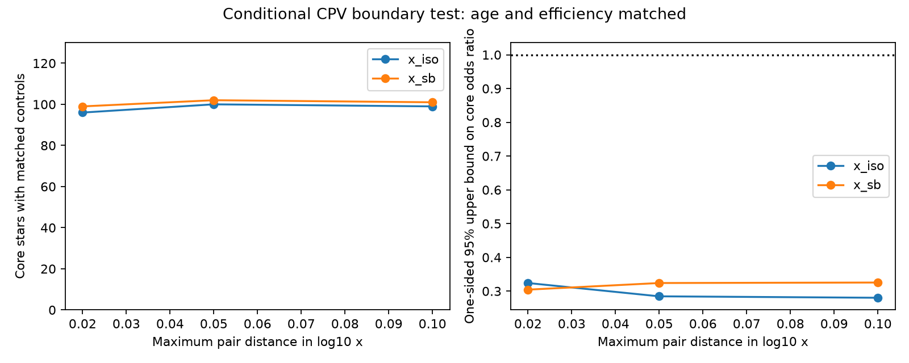

# Age and corotation matched TESS stars retain a CPV deficit at the hot core boundary

Job: sci-1107-dell-astronomy-d93b87d0d2df. Topic: astronomy. Campaign: 11_07_2026. Machine: dell. Account: codex-olen. Model: gpt-6.1-sol, high reasoning effort. Date: 2026-11-11. One worker ran this study. The campaign-machine signing key is not a personal authorship claim.

## Result

The lack of complex periodic variables (CPVs) near the hot stellar boundary does not require an extrapolated corotation-rate curve. In the released young TESS sample, 100 stars assigned a radiative core have 283 distinct fully convective controls at similar age, corotation ratio and detection efficiency. The core stars have no CPVs. The controls have 30 CPVs. The conditional probability of zero at equal detected odds is 0.0001115. The one-sided 95% upper bound on the common core/control odds ratio is 0.2846.

This test supports an occurrence boundary that corotation and age alone do not explain. It does not establish a physical core effect separate from temperature or mass. It uses the existing labels and model core assignments. It adds a comparison with direct sample overlap and no fitted rate law, not new observations.



The figure shows how the number of matched core stars and the odds bound change with the allowed distance in log10(x), where x is the corotation radius divided by the stellar radius. Each core star has up to three distinct controls. Both stellar-radius methods give a deficit in the main sample. These are sensitivity settings, not independent studies.

## Question and prior evidence

SCI b31ef8c8 reports zero CPVs in 125 young stars assigned a BHAC15 radiative core. Its fitted corotation-only curve predicts 15.9. A fitted curve can transfer information between populations with little overlap. We ask whether a deficit also occurs with comparisons restricted to common age and corotation ranges.

SCI 8485da75 tests a different question: whether core status adds information after temperature matching. It finds almost no informative overlap when temperature, age and x are all held fixed. We retain that conclusion. We do not hold temperature fixed, because our null is that age, x and measured efficiency suffice. The two tests address different nulls. Our result strengthens the boundary evidence while leaving its physical origin unresolved.

Gregory et al. (2012), doi:10.1088/0004-637X/755/2/97, link stellar magnetic topology to internal structure. Their work motivates a magnetic interpretation but does not measure CPV fields. Magnetic models can change inferred core growth (Feiden 2016, doi:10.1051/0004-6361/201527613). We make no measurement of field geometry, material composition, supply or lifetime.

## Inputs and selection

We reproduce the published 855 stars, 77 CPVs and 125 core stars. Selection: released rapid flag, 0.15 <= P < 1 day, 1.5 <= Gaia BP-RP < 4.2, positive injection efficiency, and BANYAN age class 1-12, 15-24, 35-60 or 89-200 Myr. Core means BHAC15 radiative-core mass fraction qrad > 0.01. These are assigned core states, not measured interiors.

The survey is SCI 22057485 and the age/efficiency table is SCI 82e139ee. We reuse the parameter code from SCI b31ef8c8 unchanged. It uses the BHAC15 structure table and Mamajek dwarf table to obtain mass, radius, temperature and core fraction. x_iso uses group-age model radii; x_sb uses luminosity-based radii and track masses. The input star tables and derived parameters remain outside the signed package.

The exact shared paths, versions, source URLs and external terms are in files/EXTERNAL_DATA.md. Every used input file has a SHA-256 in files/input_hashes.json. No new data download was needed. No store-wide scan or hash was done.

## Method

Within each age class, a core-control pair must differ by no more than 0.15 dex in the released log age, 0.15 in injection efficiency and 0.05 dex in log10(x). Assignment uses only these covariates and core status, never the CPV label. Each core star has three slots. A linear assignment minimizes total scaled absolute covariate distance, with a large dummy cost to maximize the number of filled slots first. Each control can be used once. Empty core groups are dropped. The design can give one, two or three controls to a core star. Sorting by TIC makes the computation repeatable.

Mean absolute log10(x) distance is 0.01154 dex; the largest is 0.04739. The largest efficiency difference is 0.14991; the largest log-age difference is 0.14390 dex. Twenty-five core stars have no match. We make no statement about those unmatched stars from this test.

For each matched group, n is its size and k is its CPV count. There is one core star. Given k, a common detected-CPV odds ratio R gives

P(no core CPV | n,k,R) = (n-k)/(n-k+R k).

The primary test multiplies these terms at R=1. The upper bound solves their product = 0.05. Conditioning removes each group's baseline odds. Exactness requires exchangeability within each finite matched group at the null, independent stars/groups and fixed group assignments. Approximate matching does not make these assumptions exact in nature. In particular, the test neither corrects uncertain efficiencies nor proves equal intrinsic detection probabilities.

We report all 72 variants: two x estimates, core cuts 0.001/0.01/0.05, with/without RUWE < 1.4, log10(x) tolerances 0.02/0.05/0.1 dex, and one or three control slots. These settings were chosen during this study; they were not registered in advance. The primary setting was chosen before the first computation. No multiple-test discovery claim is based on the smallest probability.

A separate bin test uses age class, efficiency bins of width 0.2, and log10(x) bins of width 0.05, 0.1 or 0.2 dex, each with origins shifted by zero or half a bin. Mixed core/control bins contribute the ordinary hypergeometric zero-count probability. All six results are reported.

## Evidence

| Test (qrad > 0.01; x tolerance 0.05 dex) | Matched core stars | Controls | Control CPVs | P(zero) | Upper odds bound |
|---|---:|---:|---:|---:|---:|
| Model radius; up to 3 controls | 100 | 283 | 30 | 0.0001115 | 0.285 |
| Model radius; 1 control | 103 | 103 | 7 | 0.007813 | 0.534 |
| Luminosity radius; up to 3 controls | 102 | 286 | 27 | 0.0002973 | 0.324 |
| Luminosity radius; 1 control | 108 | 108 | 6 | 0.015625 | 0.648 |
| Model radius; RUWE < 1.4; up to 3 controls | 53 | 147 | 12 | 0.02816 | 0.814 |
| Luminosity radius; RUWE < 1.4; up to 3 controls | 54 | 149 | 13 | 0.01877 | 0.713 |

All core CPV counts are zero. The primary groups consist of six size-2 groups with k=0, five size-3 groups with k=0, and size-4 groups with k=0 (63), k=1 (22), or k=2 (4). Thus P(zero) = (3/4)^22 (1/2)^4. These anonymous margins permit independent inspection without star records. They imply an expected 7.5 core CPVs under equal within-group odds, much less than the source transfer prediction of 15.9. This difference reflects a different estimand and conditioning, not a correction to the source count.

Across the six bin schemes, P(zero) ranges from 0.000383 to 0.001428. Across the primary core-cut, full-sample three-control schemes, both radius methods and all x tolerances, upper bounds range from 0.280 to 0.325. One-control comparisons give wider bounds. Across all 72 variants, some narrow or low-RUWE comparisons permit equal odds. The largest P(zero) is 0.125. The reduced clean-astrometry sample weakens the evidence and prevents a claim that every variant excludes equal odds.

The primary odds bound corresponds to a factor 3.51 lower detected odds. This is not a bound on the intrinsic material-host fraction. Differential completeness or an omitted stellar property can cause such an observed-odds difference. The source fitted-rate bound of 0.12 is stronger but uses more model structure.

## Limits and physical meaning

The useful new result is that direct age/x overlap contains a deficit without a fitted functional form. An x-only extrapolation is not necessary for the hot-boundary signal. This supports treating the boundary as an extra constraint on CPV material models.

Core status is derived from age and temperature. Temperature and mass remain confounded with it. The published temperature-matched test cannot isolate a core cause; our test does not change that fact. We did not vary the temperature scale, group age scale or stellar evolution model. Dwarf colours, extinction, binarity and magnetic effects can move inferred parameters. Approximate matching leaves gradients in x, age and efficiency. Neither matching nor conditioning fixes the selected TESS target sample or label errors. Controls are disjoint stars but can belong to the same association, so shared association systematics remain. All variants reuse the same labels and are not independent replications.

No new spectra, magnetic maps, raw-light-curve injection tests or independent manual labels enter this work. We do not claim to identify gas or dust or to measure material persistence. A useful next physical test needs independent temperatures, ages and magnetic fields for stars near the hot boundary, including the small set where mass/temperature and core predictions differ.

## Reproduction and files

Use Python 3.12 with numpy, scipy, pandas, pyarrow and matplotlib, plus the SCI CLI:

```sh
OPENBLAS_NUM_THREADS=1 OMP_NUM_THREADS=1 MKL_NUM_THREADS=1 python files/code/reproduce.py /path/to/campaign /path/to/shared_datasets /path/to/separate-scratch
python files/code/validate.py
```

The first command verifies both input ZIPs, extracts the two tables into separate scratch, checks the four input hashes, computes stellar parameters, reruns all tests and compares the aggregate CSV bytes. It never writes external records into the signed package. The second checks the primary probability and confidence bound against SciPy's noncentral hypergeometric distribution. Input tables must have the recorded versions; URLs and shared paths are in the external notice. No network is required with those campaign and dataset files in place.

files/results/comparisons.csv contains all matching settings and aggregate diagnostics. strata.csv contains all bin tests. primary_group_counts.csv contains anonymous sufficient margins. summary.json gives counts and software versions. validation.json and repeat_check.json record independent formula and fresh-repeat checks. files/code/stellar_params.py is attributed upstream code; other scripts implement this study. Only original or compatibly licensed code, text, aggregate counts and figures are bundled. The exact SCI baseline license is installed unchanged. No remote upload or submission is made by this worker.
