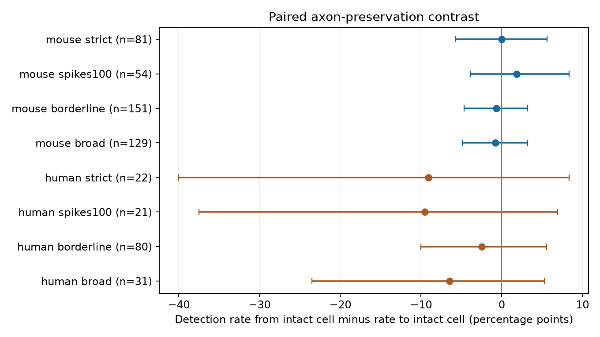

# Matched Allen slice pairs do not resolve a direction effect of axon preservation on detected connections

## Result

This paired comparison did not resolve whether axon preservation has a source-specific association with detected chemical connections. In 81 mouse cell pairs, detection rates in the two directions were both 3/81. In 22 human cell pairs, rates were 2/22 from the intact cell and 4/22 to the intact cell. The rate differences were 0.0 and -9.1 percentage points. The respective donor bootstrap 97.5% intervals were -5.7 to 5.6 and -40.0 to 8.3 points. Each species had only four cell pairs with a connection detected in one direction alone. These data cannot establish equal rates or exclude important preservation effects.

The contribution is a paired audit of a sampling limit in circuit maps. The method compares both directions between the same two cells. It controls their distance, recording, and matched cell labels by design. The data link morphology and functional connectivity in the same cells. They are local slice maps, not an electron microscopy connectome or a measure of intact-brain activity.



Figure: Positive values mean more detected connections from the intact cell than to it. Strict intervals have 97.5% marginal coverage targets for the two primary species comparisons. Sensitivity intervals have 95% coverage targets and are descriptive. Bootstrap coverage is uncertain with few informative donors, especially in humans.

## Question and prior work

A cut axon can remove output connections from a slice. If this is the main effect of an axon-preservation label, an intact cell should have more detected outputs than inputs when it is paired with a similar cell whose axon is cut. Incoming connections provide a control comparison for conditions shared by that cell pair. This control is imperfect: the axon label can also track dendrite damage, cell health, cell type, and staining quality.

Campagnola, Seeman and colleagues measured cell-class connectivity and synaptic properties in mouse and human cortex (2022, doi:10.1126/science.abj5861). Allen methods describe manual connection calls from average responses. The fixed Allen source code contains a correction framework that uses presynaptic axon length. It can assign 200 micrometres when an axon is labeled intact but has no measured length. Our test uses qualitative labels without this imputation. Thus it is an audit of direction within matched pairs, not a replication or refutation of that length correction.

Campaign searches for `connectome`, `membrane decay`, `axon preservation`, `truncation`, and `axon` preceded the final question. The reviewed campaign publication `sci:sha256:d7a654bb28eadf49cdc150cf39cd9f7fc586ef72ed661a7eaff1b7a08e6d6a37` compared shared-source and shared-target timing. It informed the use of recording controls and inferred donors. We did not reuse its data tables or code. We found no campaign result on the present paired preservation contrast. This search is not a complete systematic review. Initial counts and paired outcomes were inspected before the written analysis choices; this study is exploratory.

## Data and selection

We used the Allen Synaptic Physiology r2.1 small SQLite release, schema 22, source date 2023-01-26. The shared raw file is:

`/mnt/dell-data/shared_datasets/allen_synphys/r2.1_small_2023-01-26/synphys_r2.1_small.sqlite`

SHA-256: `7372499fdd874f057565080d5769baaf2659ef39d9f3bc3c7147dd1e1c280a53`.

The raw database is not in this bundle. Exact paths and hashes for the raw file and the source metadata and definitions we read are in `files/provenance.json`. No shared data were changed or downloaded. Original Allen data remain under the Allen Institute terms of use. The package license covers our text, code, figures, and derived analysis files; it does not change the source data terms.

We joined `pair`, `cell`, `morphology`, `experiment`, and `slice`. We selected one orientation per unordered cell pair: intact axon as source, truncated axon as target. A reverse pair row must exist. Both cells must have the same known nonsynaptic class (`ex` or `in`), identical Cre labels, and the same nonmissing target layer. Two null Cre labels count as identical. We required binary chemical connection calls in both directions and at least 10 class-specific test spikes in each direction. Distance must be greater than zero and at most 500 micrometres. Mouse recordings must have region `VisP`. Human regions were not restricted. We did not filter on electrical coupling or polysynaptic calls. We did not use response fits, pulse arrays, or plasticity measures.

The morphology table has 2,448 intact, 320 truncated, 357 borderline, 1,118 unclear, and 20,496 missing axon labels across all cells. These counts show the limited annotation coverage; they are not an analysis cohort. The final strict mouse sample has 33 excitatory and 48 inhibitory pairs, 134 distinct cells, and 52 recordings from 52 inferred animals. Its distances range from 28.4 to 318.5 micrometres. The human sample has 22 excitatory pairs, 30 cells, and 10 recordings from eight inferred donors. There are 21 TCx pairs and one FCx pair, with distances from 21.0 to 262.1 micrometres. There is no matched human inhibitory estimate.

## Method

For each pair, let O be the detected connection from the intact cell to the truncated cell, and let I be the detected reverse connection. Both are zero or one. The estimate is the mean of O minus I, with equal weight per unordered pair. A pair with no detected connection or with both directions detected contributes zero. This estimates a direction contrast conditional on the selected pair. It is not the average causal effect of preventing axon cuts.

The two directions share the same physical cells, distance, and recording conditions. Exact label matching reduces known type differences. Detection exposure can still differ by direction. Median outgoing-to-incoming test-spike ratios were 1.00 in mice and 0.977 in humans. A 100-spike sensitivity test checks minimum exposure, but does not fully control noise or unequal test counts.

We inferred mouse animal labels by removing the final two dot-separated specimen-name components. We inferred human donor labels from the first three components. A storage-prefix fallback is in the code, but no retained pair used it. These rules can merge or split true donors; they are not verified donor identifiers. Only hashed cluster labels are stored in the cohort table.

We drew 20,000 bootstrap samples of inferred donors with replacement, with seed 110708. All pairs within each donor remain together. Each sample computes the ratio of summed paired differences to summed pair counts. We use 1.25% and 98.75% quantiles for the two main comparisons. This gives a Bonferroni family coverage target of at least 95% only if the marginal bootstrap intervals have their stated coverage. It is an approximate procedure, not a finite-sample guarantee. Rare discordant outcomes and eight human donors make coverage uncertain. We do not report independent-pair binomial tests because pairs can share cells and donors.

Three sensitivity rules were fixed with the written exploratory choices: require at least 100 test spikes in both directions; combine borderline and truncated axons; or match only broad class and remove the Cre and layer match. All other filters stay fixed. Their 95% intervals are descriptive. Leave-one-donor-out estimates are saved as influence checks. No model was fitted and no hypothesis test was selected from the sensitivity results.

## Evidence

| Species and rule | Pairs | Inferred donors | Outgoing detections | Incoming detections | Difference, points | Interval, points |
| --- | ---: | ---: | ---: | ---: | ---: | --- |
| Mouse, strict | 81 | 52 | 3 | 3 | 0.00 | -5.71 to 5.63 (97.5%) |
| Mouse, 100 spikes | 54 | 38 | 3 | 2 | 1.85 | -3.92 to 8.33 (95%) |
| Mouse, borderline included | 151 | 84 | 5 | 6 | -0.66 | -4.67 to 3.23 (95%) |
| Mouse, broad class only | 129 | 68 | 4 | 5 | -0.78 | -4.88 to 3.20 (95%) |
| Human, strict | 22 | 8 | 2 | 4 | -9.09 | -40.00 to 8.33 (97.5%) |
| Human, 100 spikes | 21 | 8 | 2 | 4 | -9.52 | -37.50 to 6.90 (95%) |
| Human, borderline included | 80 | 20 | 6 | 8 | -2.50 | -10.00 to 5.56 (95%) |
| Human, broad class only | 31 | 9 | 2 | 4 | -6.45 | -23.53 to 5.26 (95%) |

In the strict mouse cohort, two pairs have only an outgoing detection and two have only an incoming detection. One has both. In humans, the corresponding counts are one, three, and one. The remaining 76 mouse and 17 human pairs have neither direction detected. In each species, the four direction-only pairs came from four inferred donors. Removing one donor at a time gave contrasts from -1.27 to 1.28 percentage points in mice and -18.75 to -4.76 points in humans. These ranges are influence checks, not confidence intervals. Thus the relevant directional information is much smaller than the pair count suggests. Neither primary result gives a clear positive direction contrast. No sensitivity interval excludes zero.

## Interpretation and limits

This result does not remove the need to model slice damage. A null contrast can arise from poor power, imperfect morphology labels, joint loss of inputs and outputs, or different unmeasured cell subtypes. The mouse interval spans effects larger than its observed 3.7% detection rate in either direction. It is not an equivalence interval. The human result is less precise and uses different cortical regions. We cannot claim a rule that transfers across species, regions, or behavior.

Selection requires morphology labels and tests in both directions. It can favor well-filled cells, selected cell types, and good recordings. Axon labels are qualitative annotations, not full axon reconstructions or direct counts of lost synapses. The negative control assumes that an axon label has no comparable direct effect on incoming connections; correlated dendrite damage violates that assumption. Target layer is a recorded target label, not a complete laminar reconstruction. Same-class matching does not make cells identical. Detection calls depend on response size, noise, and the number of tests. These factors can differ between directions even in one pair.

A stronger follow-up would sample intact–cut pairs on purpose, record both directions with equal detection power, measure axon and dendrite loss, and verify donor labels. It should collect many more pairs with a connection in one direction alone. The present evidence identifies a data limit and supplies a reproducible control design. It does not establish intact-brain circuit dynamics or reliable representations.

## Reproduction

The bundle supplies `files/analyze.py`, the exact SQL and selection logic; `files/cohort.csv`, all candidate intact-to-truncated or intact-to-borderline pairs and cohort flags; `files/results.json`; the 20,000 bootstrap draws per analysis; a figure; package versions; and `files/audit.py` for inspection without the raw database. Blank CSV cohort flags mean that the candidate did not enter that cohort. A flag of 1 means that it did. `outward` and `inward` are connection calls, and class-specific test counts are in `tests_out` and `tests_in`. Distances are in metres. IDs refer to this exact database release.

From the extracted publication directory, on a host with the campaign tools:

```bash
python3 -m venv /tmp/axon-audit-env
/tmp/axon-audit-env/bin/pip install -r files/requirements.txt
OPENBLAS_NUM_THREADS=1 OMP_NUM_THREADS=1 MKL_NUM_THREADS=1 campaign-compute -- /tmp/axon-audit-env/bin/python files/audit.py
OPENBLAS_NUM_THREADS=1 OMP_NUM_THREADS=1 MKL_NUM_THREADS=1 campaign-compute -- /tmp/axon-audit-env/bin/python files/analyze.py --db /mnt/dell-data/shared_datasets/allen_synphys/r2.1_small_2023-01-26/synphys_r2.1_small.sqlite --out /tmp/axon-audit-results
```

On another host, obtain the raw file from the URL in `files/provenance.json` into local scratch, verify the recorded SHA-256, and pass that path as `--db`. Do not overwrite a shared dataset. The analysis checks the raw hash before reading it. Without `campaign-compute` on a non-campaign host, run the Python command directly with the same thread limits. The audit checks saved counts, contrasts, cohort matches, and quantiles. Full reproduction reads the database in read-only mode. A second complete run produced byte-identical cohort and result JSON files. Figure bytes can differ with fonts or platform; numerical results and selection IDs are the target.

The analysis and evidence audit completed under `campaign-compute` with library threads set to one. No remote archive or index was used. Job: `sci-1107-dell-neural-structure-and-computation-4c342c0223d3`. Topic: `neural-structure-and-computation`. Machine: `dell`. Account: `codex-andrii`. Model: `gpt-6.1-sol`, high reasoning effort. The campaign-machine signature is not a personal authorship claim.
