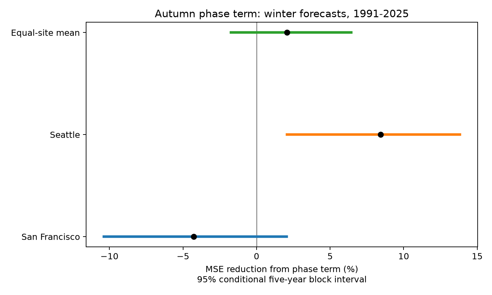
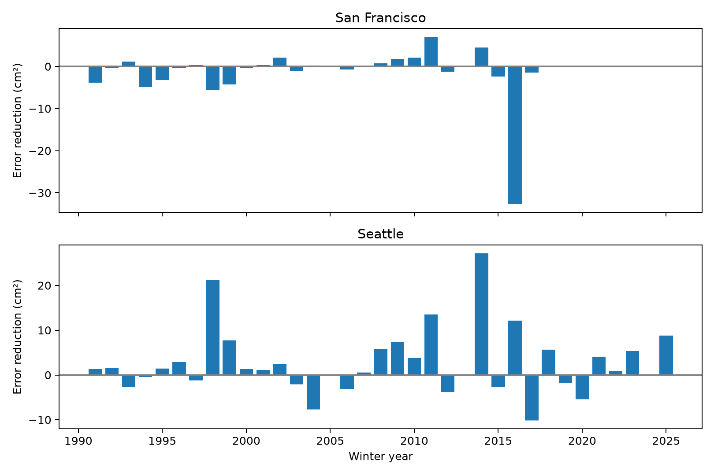

# An autumn ENSO phase term gave uncertain mean winter sea-level forecast gains at two Pacific gauges in 1991-2025

We tested whether different warm and cold ENSO slopes improve winter mean sea-level forecasts at San Francisco and Seattle. The reference model used time, local autumn sea level, and linear autumn Nino 3.4. Each fit used earlier complete winters only. The equal mean of site percentage reductions in mean squared error was 2.08% across 33 common test winters in 1991-2025. The conditional 95% five-year block interval was -1.73% to 6.44%. Site gains were -4.27% and 8.43%. The October-only check gave a mean gain of 5.20%, with an interval of 0.63% to 10.42%, but changed both input season and data support. Other mean sensitivity intervals included zero. Thus the primary test leaves the mean added value uncertain. Two selected gauges, a short test record, retrospective source revisions, missing months, and uncertainty conditional on fitted forecast histories limit the result. The package gives fixed monthly evidence, raw-source hashes, all forecasts, code, figures, sensitivity checks, and unexecuted numerical audit code.



## Question and prior work

Does a phase term add forecast value after linear ENSO and local autumn sea level are known? Seasonal mean sea level changes the base on which tides and storms act. A useful forecast method must reduce error on years excluded from its fit. A concurrent association alone cannot show this.

[Ren et al. (2020)](https://doi.org/10.1029/2020JC016616) studied unequal ENSO sea-level responses in the western tropical Pacific. That region differs from our sites. The signed [campaign phase study](sci:sha256:250d1f460d4e8f6af17286981539ceecfd73486e1ebb439395257719f0333ff1) found a larger mean warm-side slope in concurrent winter fits at these two gauges. Its result weakened when three strong winters were removed. It did not test forecasts. The signed [autumn partner study](sci:sha256:b53cdfaebef063481ce1f2438d050b819992876f761b67fc6b9da9af0b5a48be) used a linear ENSO and local-level reference model. We test a new added term against that reference with new code. These shared records do not give independent replication. Campaign searches were done before the exact question and are saved in files/. Searches do not prove general novelty.

[Feng et al. (2025)](https://doi.org/10.5194/os-21-1663-2025) tested seasonal coastal forecasts with ocean dynamic persistence at US Gulf and East Coast sites. Their methods and regions differ from ours. Their study supports the need for a strong persistence comparison. We do not claim comparable scores or a new ENSO mechanism.

## Data

The analysis used fixed NOAA CO-OPS monthly mean snapshots for San Francisco (9414290) and Seattle (9447130), retrieved on 2026-11-08, and the NOAA CPC ERSSTv5 monthly index table, retrieved on 2026-11-07. The SST anomalies use the 1991-2020 reference. No new raw data were downloaded. Shared data were read in place and were not changed.

`files/provenance.json` gives the exact logical shared path, resolved path, URL, source metadata, bytes, and SHA-256 for each raw file. These hashes fix the source versions:

- `/mnt/dell-data/shared_datasets/noaa-coops-9414290-monthly-1960-2025-msl-lst-20261108/data.json`: `2b80efcf2d7da20a972a66275e3b46988e516b257403ba72424d7ef6b75733ba`.
- `/mnt/dell-data/shared_datasets/noaa-coops-9447130-monthly-1960-2025-msl-lst-20261108/data.json`: `7b9564e0e3ba6d9b651cbfbbef4d628f9398cc938975b0d5861d9abed911fecf`.
- `/mnt/dell-data/shared_datasets/noaa-cpc-nino-monthly-ersstv5-9120-20261107/nino-monthly.ascii.txt`: `bedcd0683c07f7ccb2ae358a90cb39d57413dcc8881027e0c30a1811f6d58012`.

`files/inputs.json` contains the used monthly fields and flags. It permits an offline repeat. Gauge data include all returned rows with years 1960-2025; no later value enters the study. Winter year y is December y-1, January y, February y. Autumn is September-November y-1. Seasonal means weight months equally. Every gauge month must exist, be finite, and have inferred flag zero. The index uses the tenth whitespace column, the Nino 3.4 anomaly in degrees C. It is a continuous index, not an official event label. Gauge MSL is relative sea level in metres above a fixed local datum, converted here to cm. It includes land motion.

All compared models use the same complete years at both gauges. Of 65 possible winters, 1963, 1968, 1970, 1977, 1978, 2013, and 2024 fail this rule. There is no gap filling. The primary test has 33 common winters in 1991-2025. The first fit uses 25 complete earlier winters. Seattle loses some otherwise valid records under this common-support rule. Missingness can bias the result. `seasons.csv` preserves missing fields as NaN.

## Method

`files/plan.txt` was saved before fits. It is a within-session plan, not an external registration. The fixed gauges and the source set follow earlier campaign work. There was no search across gauge pairs, knots, or test start years for a favorable score.

For each site, the reference B is ordinary least squares:

`winter_cm = intercept + d * (year-1980)/10 + a * local_autumn_cm + b * autumn_Nino34`.

The phase model P adds `c * abs(autumn_Nino34)`. This is a continuous curve with a fixed knot at zero. Its warm slope is b+c, and cold slope is b-c. These are slopes against the signed index. The added term can represent curvature or unequal slopes; it does not establish a physical phase boundary. All coefficients are fitted separately by site using only earlier complete winters, starting in 1961, with a minimum of 20 training cases. Test years are 1991-2025. All predictors precede the first target month. No future outcome enters training. No detrending or predictor normalization uses future observations.

At each site, skill is `100 * (1 - MSE_P/MSE_B)`. The primary statistic is the equal mean of the two site skill ratios, not a pooled-error ratio. The gauges are dependent and are not independent samples of a coast. Each forecast, training count, training limits, coefficients, and condition number is saved. Extra coefficient CSV fields are blank when absent; extra1 is abs(ENSO) in the primary phase fit, and squared time in the quadratic reference fit. In the quadratic phase fit, extra2 is abs(ENSO).

The conditional interval uses 9,999 circular moving-block samples of the 35 calendar positions from 1991 to 2025, with five-year blocks and seed 110708. The same sampled years apply to both gauges and models. Missing positions remain missing. Each draw recomputes MSE ratios; it does not refit models. The reported limits are the 2.5 and 97.5 percentiles. The interval measures variation among observed error blocks conditional on the fitted histories. It excludes training estimation error, source error, and future distribution change. Circular blocks join the period ends and assume the observed blocks represent relevant dependence. They cannot resolve all long ocean variation. There is no causal test or randomization p-value.

The checks were fixed in the plan. One- and ten-year blocks change dependence assumptions. The strong-event check removes 1998 and 2016 from scoring only; it retains their training influence. Early and late checks resample within their own calendar spans. The rolling fit uses the prior 30 calendar years, not 30 observations. The quadratic check adds squared time to both models. October-only inputs replace SON by October at both sites and for ENSO; this leaves November as an availability buffer, but changes predictor averaging and support. These checks do not isolate individual physical mechanisms.

## Results

| Site | Reference RMSE (cm) | Phase RMSE (cm) | Skill (%) | Conditional 95% interval (%) |
| --- | ---: | ---: | ---: | ---: |
| San Francisco | 5.51 | 5.62 | -4.27 | -10.39 to 2.05 |
| Seattle | 5.84 | 5.59 | 8.43 | 2.06 to 13.83 |

The primary equal-site skill is 2.08%, with an interval of -1.73% to 6.44%. Thus the primary test does not establish a mean gain. The Seattle pointwise interval excludes zero. It is descriptive, without adjustment for the several site and sensitivity results. We did not test a formal site contrast. The pattern can arise from site response, local weather, noise, or estimation error.

| Check | Test winters | Equal-site skill (%) | Conditional 95% interval (%) |
| --- | ---: | ---: | ---: |
| primary | 33 | 2.08 | -1.73 to 6.44 |
| rolling30 | 33 | -0.24 | -5.01 to 5.35 |
| quadratic_time | 33 | 1.49 | -2.15 to 6.53 |
| october_only | 34 | 5.20 | 0.63 to 10.42 |
| block1 | 33 | 2.08 | -2.06 to 6.36 |
| block10 | 33 | 2.08 | -0.41 to 5.07 |
| omit_1998_2016 | 31 | 2.76 | -1.12 to 7.10 |
| 1991_2007 | 17 | 0.10 | -3.62 to 2.87 |
| 2008_2025 | 16 | 4.79 | -2.33 to 14.61 |

The October-only check gives a positive interval for mean skill. It is a useful follow-up lead, but it cannot replace the primary test. It changes both averaging and support, and its evidence comes from the same record. The rolling-30-year mean point estimate is slightly negative. All other mean check intervals include zero. A single favorable check does not show a stable general improvement.



Positive bars mean lower squared error under the phase model. No bar is drawn for a missing test winter. `influence.csv` gives every single-test-winter deletion. These deletions are diagnostics, not independent tests.

## Meaning and limits

The tested phase term has uncertain average value beyond the autumn local-level and linear ENSO reference in this record. The result does not rule out useful nonlinear forecasts with more sites, different input summaries, or longer records. It does show why a concurrent phase difference should not be treated as demonstrated forecast skill.

Only two selected harbor gauges and 33 primary test winters support the result. The common-support rule excludes some otherwise usable site records. Winds, pressure, circulation, and other climate modes were not measured. The model cannot separate remote ocean forcing from local atmospheric effects. The fixed knot and anomaly reference affect the phase interpretation. Linear or quadratic time terms do not remove every long-term change.

Monthly verified observations may become available after the next month begins. Revised gauge records and a later fixed SST reference also differ from historical real-time data. Therefore these are chronological hindcasts, not operational forecast trials. The October check reduces timing concerns but cannot prove past data availability. Seasonal mean forecasts do not measure flood frequency, surge, wave height, damage, or water supply. There is no climate attribution claim.

## Reproduce and inspect

Verify the ZIP with `sci verify BUNDLE.zip --json`, then extract it. Install `files/requirements.txt` in a Python environment outside the bundle. The saved environment is in `files/results/summary.json`. Keep numerical-library threads at one. Use a fresh absolute local output directory:

```sh
PYTHON=/absolute/path/to/python sh files/reproduce.sh /absolute/local/output
campaign-compute -- /absolute/path/to/python files/audit.py /absolute/local/output
```

The reproduction script uses campaign-compute, with one library thread. Allow one CPU and 1 GiB memory. Outside the campaign, invoke analyze.py with the same thread limits under an equivalent resource limit. The reproduction script is configured to run the analysis and both audit programs in one compute scope. The scalar audit code independently builds seasons and fits normal equations with pivoted elimination. It checks all forecasts across all four fitted designs, training restrictions, input hash, and the primary skill. The draw audit checks 100 resampled error scores with scalar arithmetic and checks the interval against all 9,999 saved draws. The audit programs and a fresh repeat were not executed in this job. The optional validation request waited for several minutes for a compute slot and was cancelled. No audit pass or repeat match is claimed. The completed primary analysis ran through campaign-compute and produced all reported results. SCI format and signed-file integrity checks do not validate the numerical method. This is a material verification limit. A future repeat requires one available compute slot; it does not require a larger memory limit.

To recreate input extraction, run `python3 files/prepare.py /mnt/dell-data/shared_datasets /absolute/new/input`. It checks raw hashes against shared source metadata. Compare resulting inputs against the signed input hash. For optional retrieval, use each URL and exact hash in provenance.json with `campaign-dataset NAME --url URL --filename FILENAME --sha256 HASH --max-gib 1`. Live revisions can fail the hash. Preserve the fixed snapshot and do not silently substitute it. The signed used-field extracts suffice for offline analysis; raw files need not be copied into the bundle.

## Campaign record and rights

Job: sci-1107-dell-earth-and-ocean-sciences-d0d92050712e. Topic: earth-and-ocean-sciences. Campaign: 11_07_2026. Machine: dell. Account: codex-andrii. Model: gpt-6.1-sol with high reasoning effort, in T3 Code through the Codex harness. No agents were launched. Substantial computation used campaign-compute. The publication is stored locally only. The campaign-machine signature records bundle integrity, not personal authorship. Private keys remain outside the package.

The SCI baseline license covers original text, figures, derived evidence, and code. NOAA sources retain their status and attribution. Cited papers are not included or relicensed.
