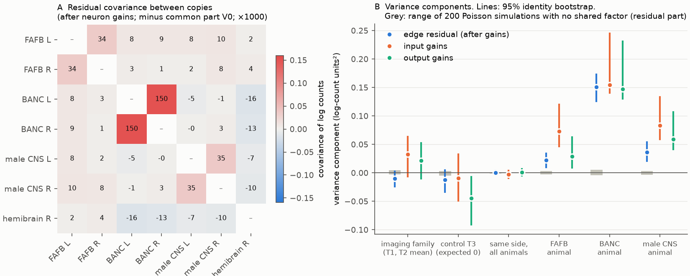
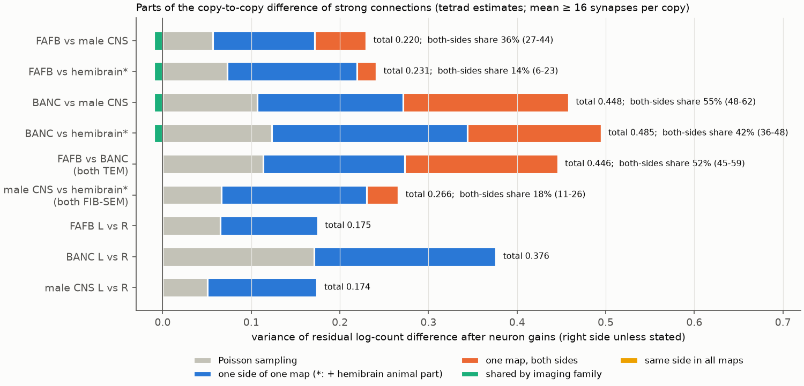
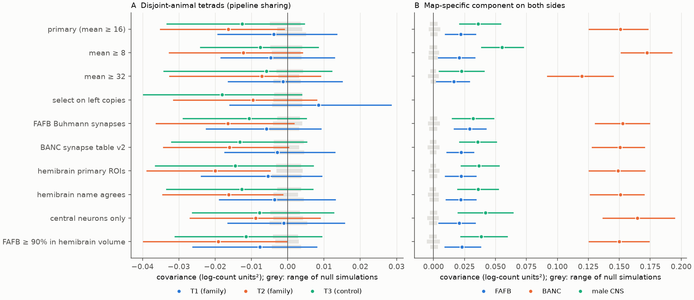

# In four adult fly connectomes, synapse-count differences of strong connections after neuron gains are specific to each map; no detectable part is shared by the two TEM maps or the two FIB-SEM maps

## Summary

Prior SCI studies found that the synapse counts of the same fly connection vary more between two adult connectomes than Poisson sampling permits. Neuron input and output gains removed about half of the excess (sci:sha256:fc45a3bb…). The remaining differences between two animals repeat on the left and right sides of the brain (sci:sha256:1d90e6cc…, sci:sha256:02d2476f…). Those studies used three animals and could not separate biology from shared reconstruction effects.

We added a fourth animal, the hemibrain. The four maps come from two imaging and reconstruction families. FAFB (FlyWire) and BANC use serial-section transmission electron microscopy (TEM). The male CNS and the hemibrain use focused-ion-beam scanning electron microscopy (FIB-SEM) and FlyEM reconstruction. With four animals, two differences can come from four *different* animals, for example (FAFB − hemibrain) and (BANC − male CNS). The covariance of two such differences over connections (a "tetrad") has no Poisson-noise term and no term from any single map. It is not zero only if some deviations are shared by animals from the same family. We used tetrads to split the count differences of 5,951 strong connections (mean of 16 or more synapses per copy; 1,039 cell types with one neuron per side) into parts. We did this after we removed one input and one output gain for each neuron in each copy.

Main results (residual log counts after neuron gains; 95% intervals from 300 identity-bootstrap draws):

1. **No detectable part is shared by an imaging family.** The mean of the two family tetrads was −0.010 (−0.024 to 0.003) log-count units². This is −6% (−15% to +2%) of the FAFB versus male CNS excess over Poisson, and −3% (−7% to +1%) of the BANC versus male CNS excess. The control tetrad, which a family factor does not affect, was −0.013 (−0.033 to 0.005). All analysis variants gave family tetrads near zero (Figure 3).
2. **Each map has its own component that repeats on both sides.** The variance of this component was 0.022 (0.010 to 0.034) in FAFB, 0.036 (0.021 to 0.054) in the male CNS, and 0.151 (0.126 to 0.173) in BANC. BANC thus has 4 to 7 times the value of the other two maps. This component is spread over most cell types: when we removed all connections of the 5% of cell types that contribute most, a per-connection diagnostic of it kept 64% (FAFB), 57% (male CNS) and 76% (BANC) of its value.
3. **No left-right asymmetry is shared by all animals.** The same-side tetrad was 0.0001 (−0.004 to 0.004).
4. **The rest is specific to one side of one map.** It is the only part of the left versus right difference in each map (FAFB 0.110, male CNS 0.124, BANC 0.205 over Poisson). Between FAFB and the male CNS it is 71% (60% to 84%) of the excess, and the two-sided map parts are 36% (27% to 44%).
5. **A change of synapse detector does not remove the two-sided map component.** In FAFB, the left (Princeton table) to right (Buhmann table) covariance was 0.456 against 0.443 with the Princeton table on both sides. In BANC, synapse tables v2 and v3 gave 0.564 against 0.559.
6. **Neuron gains may have a small family part.** Family tetrads of the input and output gains were positive in all 18 variant estimates (0.016 to 0.099) but their intervals excluded zero in only 4 (for example input gains at mean ≥ 32: 0.099, 0.025 to 0.176). The two-sided map parts of the gains were larger (input gains in the primary sample: 0.073 FAFB, 0.154 BANC, 0.083 male CNS).

**Interpretation.** Within the tested scope, the shared bilateral component that the prior studies found is not a property of an imaging or reconstruction family. It is specific to one map. It can be individual biology of that animal, or a reconstruction effect of that one volume (for example its proofreading, segmentation quality or cell typing) that acts on both sides in the same way. The very large BANC value supports a map-specific technical or sample cause more than normal individual variation, but the data cannot prove this. The large one-side part shows that, after neuron gains, most of the edge-level difference between two animals is the same size as the difference between the two sides of one animal.

**Main limitations.** There are four animals and one male. One factor groups imaging, segmentation and synapse-detection families, so we cannot separate those three. The hemibrain contributes only a right side and has truncated neurons. The tetrads detect shared deviations only if they are additive in log counts. Copy-specific scale differences can give small tetrads of either sign (we see one small negative tetrad). The analysis covers cell types with one neuron per side, ipsilateral connections and strong connections only.

**Figure 1.** (A) Covariance between the residual log counts of two copies after neuron gains, minus the common part V0 that all copies share (×1000). Poisson noise affects only the diagonal, which is not shown. Only the two sides of one map have large values; BANC left-right is the largest. (B) Tetrad estimates of the variance parts, for the edge residual (blue), for input gains (orange) and for output gains (aqua). Lines: 95% identity-bootstrap intervals. Grey boxes: range of 200 Poisson simulations with no shared factor (edge residual only; the simulations keep the observed gains, so they are not a null for the gain parts).

**Figure 2.** Parts of the variance of the residual log-count difference between two copies (right side unless stated). Grey: Poisson sampling. Orange: the two-sided component of each map in the pair. Aqua: shared by the imaging family (shown when the pair crosses families; near zero). Blue: the rest, specific to one side of one map (for pairs with the hemibrain it also contains the hemibrain map part, which a single side cannot identify). The text gives the share of the excess from the two-sided map parts.

## Question and prior work

How much of the variation of a synapse count between two connectomes is biology, and how much comes from the method that made each map? Schlegel et al. (2024, doi:10.1038/s41586-024-07686-5) compared FlyWire and the hemibrain and found consistent cell-type connectivity, but with one TEM and one FIB-SEM map they could not separate animal and method. In this campaign, fc45a3bb (sci:sha256:fc45a3bbacfe312efc4feb894ffe1069894afd046e9d4dab9f1dba9dcc0e9f69) measured the dispersion of homologous counts. f072f243 (sci:sha256:f072f2432d85d67865fec00cbd6bf070ea2b51d400a8bbb3a77520aede786bdb) split the excess into a constant and a multiplicative part and stated that "between-animal comparisons confound animal and reconstruction pipeline". 1d90e6cc (sci:sha256:1d90e6cc44dfa10a3d57a80748a0218d6e45d79ea8d0e2be280d0ec595134a88) and 02d2476f (sci:sha256:02d2476ffc23af0a6dac950f0d9d5f865632c5bf2fc7c3cab05b6972ce672049) found that the between-animal differences after neuron gains repeat on the two sides, and stated that biology and shared reconstruction effects were not separated. 04069535 (sci:sha256:04069535fb6a14ddd86ee3f27057228fe375cc7feff8dbb4edc41ffed76fccc9) found in the optic lobe that the FAFB excess is shared by two synapse tables of the same reconstruction. The contact study 719853bc (sci:sha256:719853bc11d5780abf11622d387cd86a6ec41b6f743463d05b29fc6acd60028e) and the activity study a188ce3a (sci:sha256:a188ce3adfdf31b7a1045bed3583b1931ea1ec53cfa03f9ab20a14ce90cfb80f) limit the interpretation: geometry can set counts, and wiring variation need not change activity.

A campaign search (`sci search` for hemibrain, FlyEM/FlyWire cross-dataset, pipeline, reconstruction error, four connectomes and bilateral asymmetry) found no study that used four animals from two method families to test shared method effects. This search is not a proof of priority.

Questions:

- Are the deviations of one map shared with the other map of the same imaging family (TEM: FAFB, BANC; FIB-SEM: male CNS, hemibrain)?
- How large is the part that repeats on both sides of one map, and is it the same in all maps?
- Is any left-right asymmetry the same in all animals?

## Data

All inputs are public releases. We used the shared campaign copies in place and checked each SHA-256 against its recorded provenance (`files/PROVENANCE.md`; all matched). `files/NOTICE-external-data.md` gives the URLs, versions, hashes and terms.

| Map | Animal | Method family | Counts used | Identity key |
| --- | --- | --- | --- | --- |
| FAFB / FlyWire v783 | female brain | TEM | Codex Princeton synapse table, no threshold (Buhmann table as a check) | Codex consolidated primary type |
| BANC v888 | female brain and nerve cord | TEM | simple edge list, synapse table v3 (v2 as a check); proofread neurons | `fafb_alignment_cell_type` |
| male CNS v1.0 | male CNS | FIB-SEM (FlyEM) | connectome weights, synapse confidence ≥ 0.5 | `flywireType` |
| hemibrain v1.2 | female central brain, mostly right side | FIB-SEM (FlyEM) | traced total connections (primary-ROI counts as a check) | hemibrain type mapped 1:1 to a FlyWire type through the FlyWire `hemibrain_type` annotation |

**Identities.** A cell type enters if it has exactly one neuron on each side in FAFB, BANC and the male CNS, and exactly one traced neuron with instance `_R` in the hemibrain. This gave 1,093 types (934 central, 104 descending, 53 visual projection or centrifugal, 2 other by FAFB super class).

**Copies.** For each ordered type pair i → j (i ≠ j) and each side, the count between the two neurons on that side is one copy. There are seven copies: FAFB L and R, BANC L and R, male CNS L and R, hemibrain R. Only ipsilateral connections enter. A missing connection between two present neurons is a zero.

**Primary sample.** Every copy (and the two check tables of FAFB and BANC) has a count of 1 or more, and the seven copies sum to at least 7 × 16. This gave 5,951 connections among 1,039 types. BANC counts are lower (mean 0.45 times FAFB), so BANC has more Poisson noise; this affects only the diagonal terms.

## Method

**Residual after neuron gains.** For each copy c we set y_ce = log(x_ce + 0.5). We fitted y_c = intercept + output gain of the presynaptic type + input gain of the postsynaptic type by least squares on the selected connections, separately for each copy, and kept the residual u_c. For two copies c and d, S_cd = Σ_e u_ce u_de / Σ_e (1 − h_e), where h_e is the leverage of connection e. The degrees-of-freedom divisor keeps an edge-independent component on one scale when bootstrap weights change the fit.

**Why off-diagonal entries are free of sampling noise.** Given the latent rates, the Poisson noise of two different copies is independent. The projection is the same linear map for each copy. Thus E[S_cd] for c ≠ d contains no sampling-noise term. Any effect that belongs to one copy only (its own noise, its own scale, its own errors) also stays on the diagonal.

**Tetrads.** For four different copies a, b, c, d, T(a−b | c−d) = S_ac − S_ad − S_bc + S_bd. Under an additive model of shared factors (a common edge value, an imaging-family factor, a female factor, a side factor, and a factor for each map that is the same on both of its sides), the tetrads give:

- family: T1 = T((FAFB−hemibrain) | (BANC−male CNS)) and T2 = T((FAFB−male CNS) | (BANC−hemibrain)) each equal the sum of the TEM and FIB-SEM family variances. The female factor cancels. We report their mean.
- control: T3 = T((FAFB−BANC) | (male CNS−hemibrain)) is zero under this model.
- same side in all animals: T((a_L−a_R) | (b_L−b_R)) = 2 × side variance, for the three map pairs.
- two-sided map component: the bilateral repeat B_ab = T((a_L−b_L) | (a_R−b_R)) is the sum of the map parts of a and b, plus the family part if a and b come from different families. Then the FAFB part is (B_FM + B_FB − B_BM)/2, and similarly for BANC and the male CNS; the family parts cancel.

**Decomposition of a difference.** For copies c1 and c2, the variance of u_c1 − u_c2 minus the Poisson variance is the excess. The Poisson variance uses the exact variance of log(x + 0.5) for a zero-truncated Poisson count with a mean from an additive model (connection mean plus the gains of each copy), with the residual leverage. We subtract the family part (cross-family pairs), the map parts and the side part, and call the remainder the one-side part.

**Uncertainty.** 300 bootstrap draws gave each cell type an independent exponential weight; a connection has the product of its two type weights. Each draw refits the gains. Intervals are 2.5% and 97.5% quantiles. They describe resampling of cell types within these four animals. They are not intervals over a population of animals.

**Null simulation.** We fitted the additive model (connection mean plus copy gains) to all connections with a seven-copy sum of at least 3.5 × 16. We drew independent Poisson counts from it 200 times, applied the same selection and repeated all steps. This model has no shared factor beyond the common connection value. All tetrad estimates of the edge residual stayed within ±0.006 in these simulations. The simulations keep the observed gains, so they are not a null for gain-level tetrads.

**Gain tetrads.** The same tetrads applied to the centred input gains and output gains of each copy (weighted by type bootstrap weights) test whether gain differences are shared. Gain estimates also take up a small part of edge-level variance, so the gain parts are less clean than the residual parts.

**Concentration check** (`code/diag.py`). For each map, the product of its left and right deviations from the other maps was summed per cell type. We report the share from the top 1%, 5% and 10% of types and the value after removal of all connections of the top 5%.

**Additive-model fit.** We also fitted the 21 off-diagonal entries with an additive model with separate TEM and FIB-SEM family terms. Its family coefficients changed sign between count thresholds (for example TEM +0.021 at mean ≥ 32 and −0.036 at mean ≥ 8). Rows of the covariance matrix showed that the copies have slightly different scales relative to the common connection value. Such scale differences enter the separate coefficients but cancel to first order in tetrads. We therefore use tetrads as the primary estimates and give the model coefficients only in `files/results/all_statistics.csv`.

## Results

### Primary sample

**Table 1.** Tetrad estimates (edge residual after neuron gains; log-count units²).

| Quantity | Estimate | 95% bootstrap interval | Range in 200 null simulations |
| --- | --- | --- | --- |
| family (mean of T1, T2) | −0.010 | −0.024 to 0.003 | −0.003 to 0.005 |
| T1 (FAFB−hemibrain)(BANC−male CNS) | −0.004 | −0.019 to 0.013 | −0.003 to 0.005 |
| T2 (FAFB−male CNS)(BANC−hemibrain) | −0.016 | −0.035 to −0.001 | −0.003 to 0.004 |
| T3 control (FAFB−BANC)(male CNS−hemibrain) | −0.013 | −0.033 to 0.005 | −0.005 to 0.004 |
| same side, all animals | 0.0001 | −0.004 to 0.004 | −0.001 to 0.001 |
| FAFB, both sides | 0.022 | 0.010 to 0.034 | −0.003 to 0.003 |
| BANC, both sides | 0.151 | 0.126 to 0.173 | −0.004 to 0.006 |
| male CNS, both sides | 0.036 | 0.021 to 0.054 | −0.003 to 0.003 |

For scale: the common part V0 shared by all copies was 0.41, and the total residual variance of one copy was 0.52 to 0.53 (FAFB, male CNS, hemibrain) and 0.74 (BANC). Poisson noise was 0.025 to 0.041 per copy (0.082 in BANC).

**Table 2.** Shares of the excess over Poisson of the difference between two copies (right side). Family share is shown only for pairs from different families.

| Pair | Excess over Poisson | Family | Two-sided map parts | One side of one map |
| --- | --- | --- | --- | --- |
| FAFB vs male CNS | 0.163 (0.140 to 0.190) | −6% (−15 to 2) | 36% (27 to 44) | 71% (60 to 84) |
| FAFB vs hemibrain | 0.158 (0.133 to 0.178) | −6% (−16 to 2) | 14% (6 to 23) † | 92% (81 to 104) |
| BANC vs male CNS | 0.342 (0.305 to 0.378) | −3% (−7 to 1) | 55% (48 to 62) | 48% (41 to 56) |
| BANC vs hemibrain | 0.362 (0.311 to 0.396) | −3% (−7 to 1) | 42% (36 to 49) † | 61% (54 to 67) |
| FAFB vs BANC (both TEM) | 0.333 (0.293 to 0.369) | – | 52% (45 to 59) | 48% (41 to 55) |
| male CNS vs hemibrain (both FIB-SEM) | 0.200 (0.169 to 0.225) | – | 18% (11 to 26) † | 82% (74 to 89) |
| FAFB L vs R | 0.110 (0.093 to 0.130) | – | – | 100% |
| BANC L vs R | 0.205 (0.172 to 0.230) | – | – | 100% |
| male CNS L vs R | 0.124 (0.105 to 0.149) | – | – | 100% |

† The hemibrain has one side, so its own map part is inside the one-side column.

Shares can exceed 100% or fall below 0% because the family estimate can be negative. If the family variance were at the upper end of its interval (0.003), it would be 2% of the FAFB versus male CNS excess.

The two pairs from one family were not more similar than pairs from different families. FAFB versus BANC (both TEM) had an excess of 0.333, against 0.163 for FAFB versus male CNS. Male CNS versus hemibrain (both FIB-SEM) had 0.200, against 0.158 for FAFB versus hemibrain. A pair is far apart when it includes BANC, whatever the family.

### Detector swaps

In FAFB the Princeton and Buhmann tables detect synapses on the same segmentation. Opposite-side covariances do not share any synapse. They were 0.443 (Princeton L, Princeton R), 0.456 (Princeton L, Buhmann R), 0.451 (Buhmann L, Princeton R) and 0.468 (Buhmann L, Buhmann R). Thus the two-sided FAFB structure is the same with either detector. The same-side Princeton-minus-Buhmann variance was 0.028, less than the 0.073 that independent Poisson noise of two tables would give, because the tables share most synapses. This value is an upper limit for detector-specific variance in one FAFB copy pair. It is about a quarter of the FAFB left-right excess (0.110). In BANC, tables v2 and v3 gave the same opposite-side covariances (0.559 to 0.564). These two BANC tables share most detections, so this is a weak check.

### Concentration

(From `files/results/diag_thr16.json`.) The two-sided component is not carried by a few cell types. 74% (FAFB), 84% (BANC) and 75% (male CNS) of the 1,039 types had a positive summed contribution. The top 5% of types gave 32%, 28% and 39% of the sum. Removal of all connections of these types kept 0.023 of 0.036 (FAFB), 0.086 of 0.113 (BANC) and 0.025 of 0.044 (male CNS) of the per-connection mean product (this statistic also contains terms from the other maps, so its values differ from Table 1). In BANC the value was 0.122 for connections between two central-brain neurons and 0.086 for the others.

### Robustness

**Figure 3.** (A) Family tetrads T1 and T2 and the control tetrad T3 in ten analysis variants. (B) The two-sided component of each map. Lines: 95% identity-bootstrap intervals (150 draws for the variants, 300 for the primary sample). Grey: range of the null simulations.

**Table 3.** Tetrad estimates by variant (edge residual; 95% intervals). `files/results/robustness.csv` has all values.

| Variant | Connections | Family (T1, T2 mean) | FAFB both sides | BANC both sides | male CNS both sides |
| --- | --- | --- | --- | --- | --- |
| primary (mean ≥ 16 per copy) | 5,951 | −0.010 (−0.024 to 0.003) | 0.022 (0.010 to 0.034) | 0.151 (0.126 to 0.173) | 0.036 (0.021 to 0.054) |
| mean ≥ 8 | 8,929 | −0.008 (−0.025 to 0.006) | 0.021 (0.004 to 0.033) | 0.172 (0.151 to 0.192) | 0.055 (0.039 to 0.072) |
| mean ≥ 32 | 3,177 | −0.004 (−0.020 to 0.010) | 0.017 (0.002 to 0.029) | 0.120 (0.092 to 0.145) | 0.023 (0.004 to 0.041) |
| selection on the three left copies only; right copies may be zero | 6,327 | T1 0.009 (−0.016 to 0.028), T2 −0.010 (−0.031 to 0.008) | – | – | – |
| FAFB Buhmann synapse table | 5,618 | −0.011 (−0.026 to 0.003) | 0.029 (0.017 to 0.042) | 0.153 (0.131 to 0.174) | 0.032 (0.015 to 0.048) |
| BANC synapse table v2 | 5,859 | −0.009 (−0.023 to 0.004) | 0.022 (0.011 to 0.032) | 0.150 (0.128 to 0.170) | 0.036 (0.021 to 0.051) |
| hemibrain counts in primary ROIs of the covered neuropils | 5,868 | −0.013 (−0.029 to 0.000) | 0.022 (0.010 to 0.034) | 0.149 (0.126 to 0.170) | 0.037 (0.022 to 0.053) |
| hemibrain name agrees in FlyWire and male CNS annotations | 5,942 | −0.010 (−0.023 to 0.003) | 0.022 (0.010 to 0.034) | 0.151 (0.127 to 0.170) | 0.036 (0.020 to 0.052) |
| central-brain neurons only | 4,530 | −0.005 (−0.019 to 0.009) | 0.021 (0.004 to 0.034) | 0.165 (0.137 to 0.194) | 0.042 (0.020 to 0.064) |
| FAFB connection ≥ 90% inside the hemibrain-covered neuropils | 4,810 | −0.013 (−0.029 to 0.001) | 0.023 (0.009 to 0.038) | 0.150 (0.126 to 0.174) | 0.038 (0.022 to 0.059) |

The selection-on-left variant removes any selection effect on the right copies, because the right copies do not enter the selection. Its family tetrads were also near zero. The ordering BANC ≫ male CNS ≥ FAFB of the two-sided component held in every variant.

### Neuron gains

The gain parts were less clear. For the primary sample, the family tetrads of input gains were T1 0.037 and T2 0.028 with the control T3 −0.009; for output gains they were 0.044, −0.001 and −0.045, which does not fit one family factor. At mean ≥ 32 both gain types fitted the family pattern: input gains T1 0.095 (0.015 to 0.200), T2 0.103 (0.018 to 0.183), T3 0.008; output gains 0.082, 0.079 and −0.004. The two-sided map parts of input gains at that threshold were 0.17 (FAFB), 0.16 (BANC) and 0.13 (male CNS). Over 9 variants, the mean of T1 and T2 was positive for all 18 gain estimates (0.016 to 0.099) and its interval excluded zero in 4. Thus a part of the neuron-level scale differences, which the prior study removed with gains, may be shared by maps of one imaging family. At mean ≥ 32 this part (about 0.10) was smaller than the two-sided map parts of the gains (0.13 to 0.17). It needs a test with more animals.

## Interpretation

1. **Shared reconstruction effects of a method family are not the source of the bilateral component.** If TEM imaging, FlyWire-style segmentation or the TEM synapse detectors biased particular connections, FAFB and BANC would share those biases, and T1 and T2 would be positive. They were near zero in every variant, and the upper 95% limit of their mean was at most 0.010 in any variant (at most 10% of the FAFB versus male CNS excess in that variant). The same holds for FlyEM FIB-SEM reconstruction (male CNS and hemibrain). This removes one class of technical explanations of the prior bilateral results (1d90e6cc, 02d2476f). A female factor shared by FAFB, BANC and the hemibrain cancels in all three tetrads, so these data do not test it.
2. **The bilateral component belongs to one map.** Its size differs between maps by a factor of up to 7. It does not depend on the synapse detector within a map. It is spread over most cell types. Possible causes are the individual development of each animal, the condition of each sample (age, fixation, staining), and reconstruction choices that are specific to one volume and act on both sides (for example proofreading effort per cell type, cell-type matching, or segmentation quality in one batch). With one map per animal, these causes cannot be separated. The BANC value (0.15, a log-ratio SD of about 0.39) is much larger than the FAFB and male CNS values (SD about 0.15 to 0.19). Normal individual variation of the same size in only one of three animals is less probable than a sample-specific or map-specific cause, but this is an inference, not a measurement.
3. **Most of the edge-level difference between two maps is specific to one side.** For FAFB and the male CNS, 71% of the excess is of this kind. Its size is set by the left-right difference within each map. Thus the precision of a single connection count in a single map, rather than a difference between animals, limits how far one connectome describes another for a given connection, after neuron-level scale is removed.
4. **Consequence for generalization.** A single map predicts the strong connections of another map, after neuron gains, with a residual log-ratio variance of about 0.16 (FAFB versus male CNS) to 0.36 (pairs with BANC), plus Poisson noise. The between-map part that is not side-specific can be large in one map (BANC). Thus the quality and individuality of each map must be measured, for example with its left-right repeat, before one map is used as the reference for another.

## Limitations

- Four animals, one of them male. One family factor groups imaging, segmentation and synapse-detection methods; we cannot test them one by one.
- The hemibrain has only one side and many truncated neurons. Truncation enters its gains and its one-side part. The hemibrain primary-ROI check and the FAFB check restricted to the hemibrain volume test this.
- The tetrad estimates assume additive shared factors on log counts after gain removal. Differences in scale between copies relative to the common connection value add second-order terms of either sign. A small negative T2 is not explained by any non-negative shared factor and may come from such scale terms or from the hemibrain mapping.
- Cell-type matching between maps uses names from different annotation efforts. A matching error that is the same on both sides of one map enters the two-sided map part. The concentration check shows that this part is not carried by a few types, but broad small matching effects remain possible.
- Only types with one neuron per side, ipsilateral connections and strong connections (mean ≥ 8 to 32) are covered. Weak connections and repeated types are not tested.
- Bootstrap intervals resample cell types in these four animals and do not cover other animals.
- Synapse counts are a structural measure; no functional claim follows.

## Reproduction

`files/REPRODUCE.md` gives the steps. In short: `bash files/code/fetch_data.sh <scratch>/datasets` (or use the shared campaign store), then `bash files/code/reproduce.sh <datasets> <scratch> <results>`. Record-level tables go only to `<scratch>`. The run takes about 1.5 hours on 6 processes. All random draws use fixed seeds.

## Provenance

Job `sci-1107-dell-neural-structure-and-computation-f76038b91844`, topic `neural-structure-and-computation`, campaign 11_07_2026, machine `dell`, account `claude-olen`. Model: Claude Opus 5.5 (`claude-opus-5-5`), working as an automated research agent in T3 Code. Analysis date 2026-11-10. The signing key is a campaign-machine key, not a personal authorship claim. No external data are bundled; see `files/NOTICE-external-data.md`.

## References

- Dorkenwald S. et al. (2024) Neuronal wiring diagram of an adult brain. Nature 634:124. doi:10.1038/s41586-024-07558-y
- Schlegel P. et al. (2024) Whole-brain annotation and multi-connectome cell typing of Drosophila. Nature 634:139. doi:10.1038/s41586-024-07686-5
- Buhmann J. et al. (2021) Automatic detection of synaptic partners in a whole-brain Drosophila electron microscopy data set. Nat Methods 18:771. doi:10.1038/s41592-021-01183-7
- Scheffer L.K. et al. (2020) A connectome and analysis of the adult Drosophila central brain. eLife 9:e57443. doi:10.7554/eLife.57443
- Berg S. et al. (2025) Male CNS connectome v1.0 (FlyEM). bioRxiv doi:10.1101/2025.10.09.680999
- Bates A.S. et al. (2026) BANC brain and nerve cord connectome. Nature. doi:10.1038/s41586-026-10735-w; data release doi:10.7910/DVN/7WTH1N
- SCI campaign publications cited above by their sci:sha256 identifiers.
