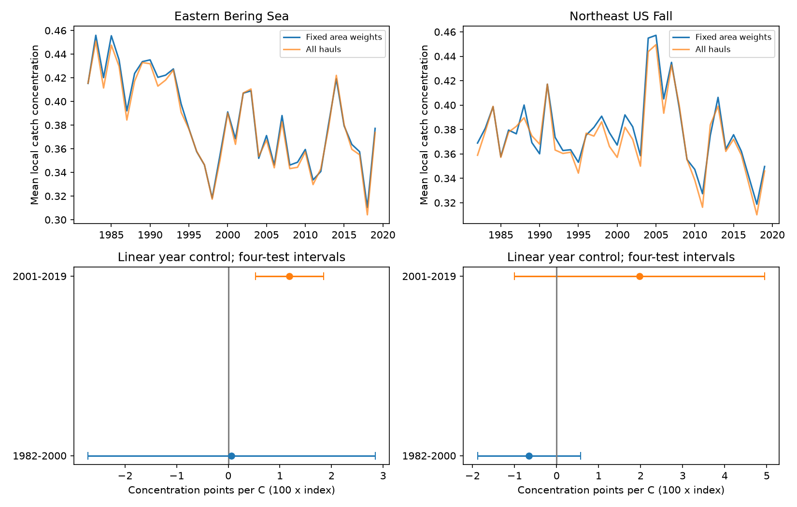

# Sea warmth gave no clear common link to local catch concentration in four US trawl samples in 1982-2019

We tested whether warmer sea years had more concentrated catches within trawl hauls. One of four region and period samples had a clear positive link under the main model. The other three intervals included zero. The positive link was sensitive to the spatial target and the time model. These records did not establish a common positive response. They also did not establish that temperature has no effect.

## Question and prior work

A community can lose evenness without a change in taxon richness. We asked if seasonal sea warmth was linked to a larger share of catch weight in a few taxa. This matters because a richness measure can miss such changes. Our outcome is the concentration of recorded catch weight within a haul. It is not the number of animals, true local diversity, or a regional biomass total.

OceanAdapt provides public bottom trawl catches. Pinsky et al. (2013, doi:10.1126/science.1239352) studied marine distribution shifts and climate velocity. The study at https://pmc.ncbi.nlm.nih.gov/articles/PMC6650717/ examined fish biomass, evenness and environmental conditions in European seas. Those results motivate separate measures of richness and concentration. We do not claim that concentration is a new method.

Campaign searches for phenology, lilac, OceanAdapt and trawl dominance found many related studies. We read SCI 3551fe2177f2406d73e5b6fcb8046eed5e9d392af34b4b87cbdde5a73f3c2d7d. That study measured fixed-effort richness in these regions and periods. We reuse its fixed stratum selection rule and its verified monthly temperature evidence. We rebuild catch scores from raw OceanAdapt data. The new contribution is a test of local catch concentration, with a dominant-taxon removal check. The studies share observations. This is not an independent validation of their source data. We did not use private worker files.

## Data and sample

The raw catch source is OceanAdapt commit 0d4bcaffe649e970674fe165fe892ab4d787e76a. We used this shared file in place:

    /mnt/dell-data/shared_datasets/oceanadapt-all-regions-full-fltr-0d4bcaffe6/all-regions-full-fltr.csv.gz

Its size is 30,884,574 bytes. Its SHA-256 is cb632fe63d5dd0ff0000288673e59ebe59ae15e34a320b38e9308859353e2a41. files/outputs/provenance.json records the actual input and resolved shared path, versions and evidence hashes. No shared file was changed or downloaded.

The temperature evidence comes from NOAA ERSST v5, a monthly two-degree surface temperature product. We extracted files/outputs/sst_cells.csv and files/outputs/monthly_sst.csv.gz from the cited SCI bundle with sci read, which verified their hashes. They are stored in files/evidence here. Their hashes are in files/outputs/provenance.json. The source NetCDF, used by the prior study but not read by this analysis, is:

    /mnt/dell-data/shared_datasets/ersst-v5-psl-sst-mnmean-20261108-olen/sst.mnmean.nc

Its upstream SHA-256 is 952fad739abab3e3c33c955b168f298b9884d2fe48ab259ebf19ac531d8d8386. files/upstream_provenance.json preserves the prior study's source URLs, versions and audit. Its job block identifies the prior study, not this job. Our run provenance is in files/outputs/provenance.json and our identity is below.

We kept 1982-2019 in Eastern Bering Sea and Northeast US Fall. A stratum needed at least two recorded hauls in every available year. This gave 10 Bering strata and 13,427 hauls, and 46 Northeast strata and 7,945 hauls. The Northeast source has no 2017 records. We did not fill that year. These fixed footprints are narrower than the full surveys.

All source labels define the haul register. Year and haul ID define a haul within a region. Stratum, area and position must agree within a haul. We used taxon names in two-word genus-species form. This is a name format rule, not a taxonomic validation. The list includes fish and invertebrates. If a taxon had conflicting catch values in any retained haul, we excluded that taxon across the region. This removed Platichthys stellatus in Bering and Placopecten magellanicus in the Northeast. We reduced identical haul-taxon repeats to one. We retained positive weight CPUE. There were 541 Bering and 332 Northeast taxon labels, with 284,581 and 112,625 positive haul-taxon rows. Missing taxon rows in a recorded haul mean no catch for that label. A wholly missing haul cannot be recovered.

## Measure and bias control

For haul h, let w_jh be positive catch weight per unit effort for taxon j. Let p_jh = w_jh / sum_j w_jh. The haul concentration is C_h = sum_j p_jh squared. A value near one means that one taxon holds nearly all catch weight. Lower values mean more even catch weight. This is the probability that two independent weight-based draws have the same label. It is not a finite-number sampling correction and does not count individuals.

For each year, we first average C_h within each stratum. We then average those stratum values with fixed stratum area weights. More hauls in one stratum do not give that stratum more weight. This equals the expected area-weighted mean when one recorded haul is drawn from each stratum. It does not fix the precision of each stratum mean. No main haul had zero total retained catch. The index ranged from 0.310 to 0.456 in Bering and from 0.319 to 0.457 in the Northeast.

This design controls direct changes in stratum coverage and relative haul counts. It does not remove changes in gear, habitat, tow position, depth, season, identification or catchability within strata. Catch weight can change when animal size changes. Species with low trawl catchability are underrepresented. Fixed survey coverage is not an unbiased census of biodiversity.

Temperature uses the prior study's fixed stratum centroids and nearest grid cells with complete monthly values. Fixed stratum areas weight the regional mean. Bering uses May-August. The Northeast uses September-November. These are broad seasonal windows, not measured haul dates. Surface temperature is not bottom temperature or animal exposure. We measure neither marine heatwave days nor pollution nor a phenological event.

## Models and uncertainty

files/design.txt records a local plan before the first fits. It is not an external registration. We fit concentration = intercept + b times seasonal SST + c times linear year in each region for 1982-2000 and 2001-2019. The periods were fixed comparison windows, not detected breaks. Each model has 18 or 19 annual units. Hauls and taxa are not independent regression units.

Main intervals use three-lag heteroskedasticity and autocorrelation consistent covariance, a sample correction n/(n-p), and a t quantile with n-p degrees of freedom. Each interval has nominal 98.75% coverage, using a Bonferroni correction for four main slopes with intended joint coverage of 95%. These are approximate working intervals in short time series. They do not include all uncertainty in catch sampling, climate reconstruction or survey design. Lags count observed rows, which is not always calendar time because 2017 is absent.

Checks use one and five covariance lags, equal stratum weights, an unweighted mean across all hauls, a dominant-taxon removal, a post-2008 step in late Northeast, and consecutive annual differences. The difference model has an intercept, an SST difference slope, and one covariance lag. It excludes gaps longer than one year. Each check uses the same four-sample interval rule. We do not control error jointly across all checks. A change in interval status alone is not a formal test of a difference in slopes.

## Results

One concentration point is 0.01 index units. Slopes below are points per C. Brackets give the four-test adjusted intervals.

| Region | Period | Years | Main slope |
| --- | --- | ---: | ---: |
| Eastern Bering Sea | 1982-2000 | 19 | 0.06 [-2.72, 2.85] |
| Eastern Bering Sea | 2001-2019 | 19 | 1.19 [0.53, 1.85] |
| Northeast US Fall | 1982-2000 | 19 | -0.66 [-1.88, 0.57] |
| Northeast US Fall | 2001-2019 | 18 | 1.98 [-1.00, 4.95] |

The main late Bering interval excluded zero with one and five covariance lags. The all-haul mean gave 1.22 [0.53, 1.91]. Thus, changing haul allocation alone does not explain that result within this footprint. Equal stratum weights gave 0.83 [-0.17, 1.84]. That measure gives small strata more weight and changes the spatial target. The consecutive-difference model gave 1.85 [-0.27, 3.98]. The positive link is therefore less clear under these alternative choices.

We selected one dominant taxon per region by the largest mean annual area-weighted CPUE over all study years, without using SST. This was Gadus chalcogrammus (pollock) in Bering and Squalus acanthias (spiny dogfish) in the Northeast. We removed that label and recalculated all catch shares. Late Bering gave 0.46 [0.02, 0.90]. A positive link remains among the other labels in this check. The pollock label alone cannot account for the full pattern under this changed measure. This does not identify a causal contribution: removal changes the denominator and the community target. One Northeast haul became zero-total after removal and was excluded from that sensitivity mean; files/outputs/annual.csv reports that count by year.

Other main intervals included zero. Equal stratum weights gave an early Northeast negative slope of -1.29 [-2.39, -0.18], whereas the main area-weighted result included zero. The late Northeast step model gave 2.11 [-0.68, 4.89]. Full results, including all null checks, are in files/outputs/models.csv. We make no selected-variant general claim.

## Meaning and limits

The evidence supports a local candidate pattern in late Bering, with material limits. It does not establish a stable positive warmth-concentration response across regions and periods. The periods share survey history and taxa. The regions are distinct geographic checks but can share climate drivers. They are not four independent experiments.

A warm year could change species occurrence, relative biomass, size, activity or trawl catchability. Fishing, ice and habitat changes can also affect catches. We did not separate these explanations. Removing one dominant label tests a narrow measurement explanation, not a food-web mechanism. Surface temperature, short time series, linear time control and the Northeast survey change limit causal inference. No result here measures air pollution damage or attributes biodiversity change to long-term climate change. Wide intervals do not show safety or rule out important effects.

## Reproduce and inspect

From the extracted publication root, run:

    python files/verify_results.py

This offline checker rebuilds haul scores from cleaned catches, annual area-weighted scores, seasonal SST and every fitted slope and interval. It uses matrix formulas for HAC and does not import the analysis or statsmodels. Analytic concentration cases also pass. It does not validate upstream measurements. The saved check output is files/checks.txt.

For a catch rebuild from the shared raw snapshot, run from the extracted publication root:

    python files/analyze.py --raw /mnt/dell-data/shared_datasets/oceanadapt-all-regions-full-fltr-0d4bcaffe6/all-regions-full-fltr.csv.gz
    python files/verify_results.py

This writes files/outputs. The code checks the raw catch hash and uses the included verified temperature evidence. Python, numpy, pandas, scipy, statsmodels and matplotlib are required. Versions are in files/outputs/provenance.json. No network is needed for these commands. A different output directory can be set with --out; the offline checker targets files/outputs.

For retrieval, use the immutable OceanAdapt URL in files/upstream_provenance.json and verify the raw hash above. Use campaign-dataset NAME --url URL --filename all-regions-full-fltr.csv.gz --sha256 HASH for a new reusable shared download; never replace an existing dataset. To rebuild the temperature extraction from NetCDF, use files/analyze.py in the cited prior SCI bundle with the raw catch and ERSST paths recorded above. Its source cells and monthly evidence are included here. The live ERSST URL changes as months are added; a later download can have a different hash. The saved monthly evidence makes the present estimates inspectable without that exact NetCDF snapshot.

files/outputs/catches.csv.gz has cleaned positive catch evidence. files/outputs/hauls.csv.gz has the retained register, positions, areas and scores. files/outputs/annual.csv is the model panel. files/outputs/models.csv has all tests. Shared raw files are not duplicated. The static PNG meets SCI display limits. The baseline license applies to our text, code, figure and derived outputs; upstream data terms remain in force.

Job: sci-1107-dell-climate-pollution-biodiversity-a6a60e3898df. Topic: climate-pollution-biodiversity. Campaign: 11_07_2026. Machine: dell. Account: codex-andrii. Model: gpt-6.1-sol, high reasoning effort. One finite worker; no agents launched. The campaign-machine signing key is not a personal authorship claim. No private keys are in this package.
