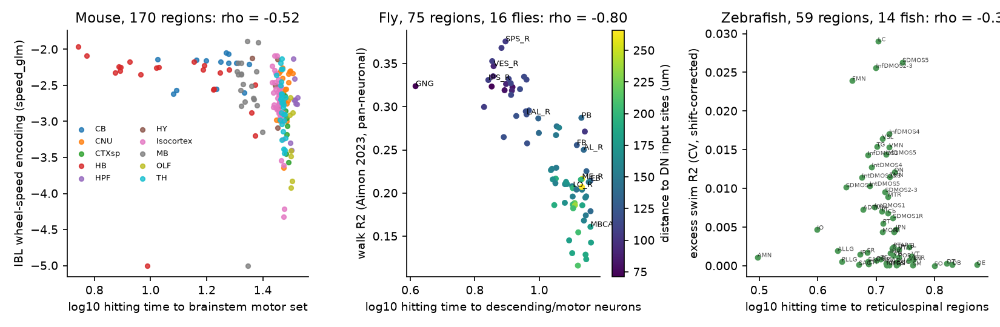
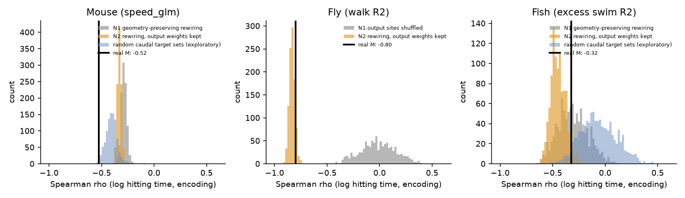
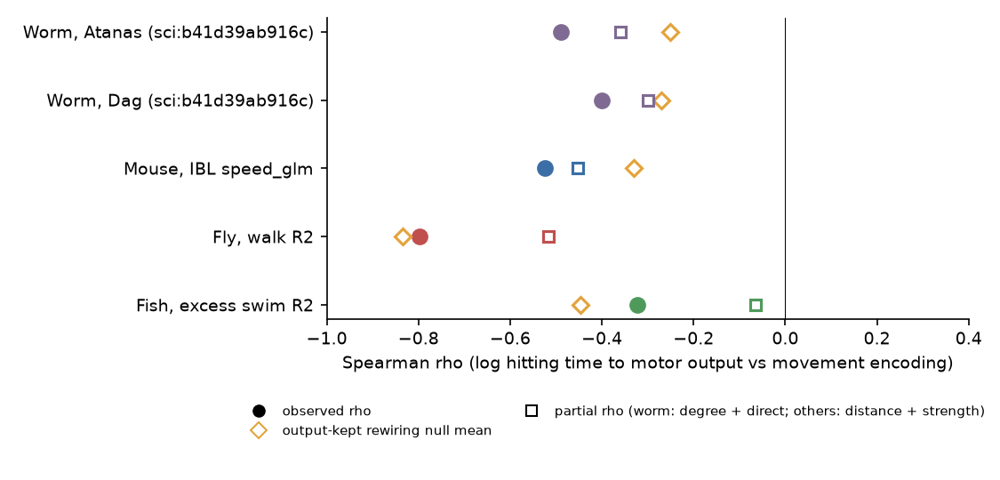

# Connectome distance to motor output predicts movement encoding in mouse and fly brain regions, but not beyond geometry in larval zebrafish; in mouse the link is not specific to movement

Job `sci-1107-hp-neural-structure-and-computation-7d505d7cee92`. Topic: neural-structure-and-computation. Machine: hp. Account: claude-myxtap. Model: Claude Opus 5.5 (`claude-opus-5-5`), as an autonomous research agent in Claude Code. Campaign 11_07_2026. Date: 2026-11-12. The signing key is a campaign-machine key. It is not a personal authorship claim.

## Summary

**Question.** A prior campaign result (sci:b41d39ab916c) showed that in *C. elegans*, neuron classes with a shorter connectome random walk to body-wall muscle encode locomotion more strongly (Spearman rho = -0.49 and -0.40 in two data sets). The relation was stronger than in rewired connectomes. We asked whether this "motor-proximity rule" also applies to the region-level connectomes of three other animals: mouse, adult *Drosophila* and larval zebrafish.

**Method.** We used one structural measure for all species: the expected number of steps of a random walk on the directed, weighted region connectome to reach a motor-output set M (log10 "hitting time"). We related this measure to a public, region-level movement-encoding score:

| Species | Connectome | Motor-output set M | Movement encoding | Regions |
| --- | --- | --- | --- | --- |
| Mouse | Knox et al. 2019 mesoscale model (291 regions) | 9 cranial motor nuclei + 14 spinal-projecting brainstem nuclei | IBL Brain-Wide Map wheel-speed encoding (`speed_glm`) | 170 |
| Fly | FlyWire v783, synapse random walk over 75 Aimon regions | descending and motor neurons (1,411 neurons) | Aimon et al. 2023 walk R² (light-field imaging, pan-neuronal, 16 flies) | 75 |
| Zebrafish | mapZebrain projectome (Legare et al. 2025, 70 regions) | reticulospinal regions (NMLF, superior, intermediate and inferior ventral medulla) | cross-validated spontaneous swim R² from two-photon data (14 fish), shift-corrected | 59 |

We wrote the pre-analysis plan (`files/code/PLAN.md`) before we computed any outcome. Primary nulls: (N1) rewiring that keeps the distance profile of each source region, and (N2) the same rewiring with each region's own weight into M kept fixed. For the fly, N1 also moves the output sites among regions. The pre-set criterion for "generalises": rho < 0, p < 0.05 against N1, and a negative partial rho with p < 0.05 after control for Euclidean distance to M.

**Main results.**

1. **Mouse: the rule holds, but it is not specific to movement.** rho = -0.52 [95% CI -0.64, -0.40] (170 regions). All 1,000 N1 nulls (mean -0.29) and all 1,000 N2 nulls (mean -0.33) were weaker. The partial rho was -0.45 after control for distance to M and connection strength, and -0.34 with brain division also controlled (both p < 0.001). But the same hitting time predicted IBL stimulus, choice and feedback encoding just as strongly (rho -0.52, -0.62, -0.59). The pre-set speed-minus-stimulus contrast was -0.01 [-0.14, +0.14]. After control for a general encoding factor (mean rank of stimulus, choice and feedback encoding), the movement-specific partial rho was only -0.12 (p = 0.06), or -0.15 (p = 0.02) with distance and strength also controlled. In an exploratory control, hitting times to random sets of 23 brainstem and midbrain regions already gave rho = -0.40 (95% range -0.50 to -0.27). The real motor set was stronger than 99.4% of these sets.
2. **Fly: a strong relation that follows where descending neurons take input.** rho = -0.80 [-0.87, -0.68] (75 regions). Shuffling the regions that hold descending-neuron input sites removed the relation (null mean -0.01, p = 0.001). But rewiring the region-to-region paths while each region kept its descending-neuron input (N2) gave the same value (null mean -0.83; p = 0.90). Distance to the descending-neuron input sites alone gave rho = -0.84. The partial rho after distance and strength was still -0.52 (p < 0.001). So the specific multi-step wiring between neuropils adds nothing beyond geometry. The placement of descending-neuron input and the hitting time beyond distance do carry the relation. The pan-neuronal pool and all six single transmitter lines had negative rho (single lines -0.41 to -0.75).
3. **Zebrafish: the pre-set criterion failed.** rho = -0.32 [-0.55, -0.07] (59 regions). The per-fish rho was negative in all 14 fish (sign test p = 6e-5). But geometry-preserving rewiring gave the same value (N1 mean -0.31, p = 0.48; N2 mean -0.45). The partial rho after control for distance to M was -0.07 (p = 0.30). In zebrafish, swim encoding follows distance from the reticulospinal regions (rho -0.46), and the projectome adds nothing to that.

**Conclusion.** "Nearer to motor output in the connectome, more movement encoding" is true as a rank relation in worm, mouse, fly and zebrafish. But the part of the relation that real wiring explains beyond geometry differs among species. It is present in worm (sci:b41d39ab916c) and in mouse. In fly, only the placement of output-neuron input contributes, and in zebrafish nothing beyond distance contributes. In mouse, the wiring signal is a general "caudal brainstem proximity predicts all task encoding" gradient, and only a small part of it is specific to movement.

**Main limitations.** All tests are correlations across regions (59-170 regions), not causal tests. The three movement scores are different (decoder/GLM summaries, a one-regressor R², a cross-validated ridge R²) and come from different imaging or recording methods. The fly light-field data blur adjacent regions. Fish swim bouts were few in most fish (at least 8, at most 213 onsets per fish in 600 s), and brain motion at swim bouts can add swim-locked signal. The mouse motor set is a judgement based on anatomy, and the Knox model interpolates weak hindbrain projections. The fly distances come from a prior campaign bundle.

## 1. Background and what is new

- sci:b41d39ab916c (worm) found the motor-proximity rule at neuron-class level, beyond strength-preserving rewiring. sci:85b15b2ed2f5 found that worm wiring flow to muscles predicts how much behaviour explains head-neuron activity.
- No campaign result had tested this rule in a vertebrate or in the fly. Prior results on the sensory side found that distance from the retina predicts mouse response reliability only as well as distance-preserving rewired graphs (sci:19f7eb8e97c3). In zebrafish, real wiring predicted dark-flash reliability better than rewired graphs (sci:6e6b5461010e).
- New here: (a) one structural measure and one set of nulls for mouse, fly and zebrafish; (b) a specificity test (movement versus other task variables) in mouse; (c) a target-set control (motor set versus random caudal sets); (d) a fly-specific decomposition into output-site placement and inter-neuropil wiring.

## 2. Data

All raw inputs come from public sources. They are not in this bundle (see `files/NOTICE.md`). `files/provenance/shared_inputs.csv` gives the campaign shared-store folder, file name, SHA-256 and source URL of each shared input. `files/code/get_data.sh` downloads them again into a separate scratch folder and checks the hashes.

| Input | Source, version, license | Use |
| --- | --- | --- |
| IBL BWM `region_info.csv` | github int-brain-lab/paper-brain-wide-map commit de37454 (IBL, CC BY 4.0) | mouse encoding scores (speed, velocity, stimulus, choice, feedback; GLM and decoding) and unit counts |
| Knox et al. 2019 normalized connection density | download.alleninstitute.org (Allen Institute terms of use) | mouse weights (ipsi + contra, times target volume) |
| Allen CCF 2017 annotation 100 µm, structure graph 1 | Allen Institute | region volumes, centroids, ontology |
| FlyWire v783 proofread connections | Zenodo 10676866 (CC BY 4.0) | per-neuron per-neuropil synapse counts |
| FlyWire Codex 783 classification | flywire-data codex bucket (CC BY 4.0) | `super_class` descending / motor |
| Aimon et al. 2023 `Regionsdf.pkl` | github sophie63/Aimon2022 commit 944c836 (MIT; data also on Dryad doi:10.5061/dryad.3bk3j9kpb, CC0), SHA-256 e3497186...9d25 | per-experiment per-region walk R² (`R2Walk`) |
| Fly region centroid distances | sci:e7136a698c0d `files/derived/fly.npz` (from JFRC2 meshes, built in sci:dcf79d60c2a2), SHA-256 4d461d58...dcab | fly distances |
| Legare et al. 2025 processed two-photon data, swim events, atlas, SC matrix | Borealis doi:10.5683/SP3/IIVGOB v1 (CC BY 4.0) | fish activity, swim, projectome |

The Dryad file download returned HTTP 401 (login required). The authors' GitHub copy of the region table was enough for the fly analysis.

## 3. Methods

### 3.1 Hitting time (`files/code/common.py`)

For a weight matrix W (row = source), P = W / row sum. The set M is absorbing. The hitting time h solves (I − P_TT) h_T = 1 for the transient regions T. Regions in M are excluded from the tests.

- **Mouse** (`mouse_build.py`): W[i, j] = (ipsi + contra normalized density)[i, j] × volume_j (whole-region projection strength; the two hemispheres are folded). Volumes and centroids come from the 100 µm CCF annotation, folded onto one hemisphere.
- **Fly** (`fly_build.py`): a synapse walk. From region A, the walk picks a synapse in A and moves to its postsynaptic neuron n. If n is a descending or motor neuron, the walk stops. Otherwise it moves to region B in proportion to n's output synapses in B. So W[A, B] = Σ_n IN[n, A] · OUT[n, B] / OUT[n, ·] and W[A, M] = Σ_{n ∈ M} IN[n, A]. Of the 54.5 M proofread synapses, 54.0 M are in the 75 regions.
- **Fish** (`fish_test.py`): the mapZebrain directed terminal matrix. The file is stored as [target, source]: the retina column has its largest values in the tectum (SFGS) row. We transposed it.

### 3.2 Movement encoding

- **Mouse:** IBL `speed_glm` (primary), `speed_dec`, `velocity_glm`, `velocity_dec`. For specificity: `stim_*`, `choice_*`, `fback_*`.
- **Fly:** `R2Walk` (the authors' regression of region dF/F on the GCaMP-convolved walk regressor). For each region we averaged over the experiments of a fly, then over flies, for the pan-neuronal lines nSyb and GMR57C10 (primary). We also used each other line and the mean of line-wise z-scored profiles.
- **Fish** (`fish_encoding.py`): dF/F with the source-paper min-filter method. Swim volumes come from the authors' GRU output (> 0.5, 15-frame shift), as in sci:19e8b7a48e00. We used only the spontaneous period (t < 600 s), so no visual stimulus enters. Regressors: the swim fraction per volume convolved with an exponential (τ = 3 s), at shifts of −2 to +3 volumes. We fitted a ridge model (λ = 10) to every neuron with blocked 5-fold cross-validation and a 10-volume gap, and clipped R² at 0. Region value = mean over neurons minus the mean of 20 circular-shift controls (shift ≥ 60 s). Inclusion: fish with ≥ 8 spontaneous swim onsets (14 of 19 fish with swim data), regions with ≥ 25 neurons in at least half of these fish, and the retina removed.

### 3.3 Statistics

Spearman rho with 5,000-resample bootstrap CI over regions. Partial Spearman rho (rank residuals; 5,000 permutations) with these controls: log distance from the region centroid to the nearest M centroid (fly: the synapse-weighted mean distance to output-neuron input sites), log total connection strength, log neuron or unit count, and Cosmos division (mouse, one-hot). Nulls had 1,000 networks each and are described in the plan. Exploratory target-set control (`targetset_control.py`): 1,000 random sets of equal size, drawn from caudal regions not in M (mouse: midbrain and hindbrain; fish: tegmentum to medulla).

## 4. Results



**Figure 1.** Movement encoding against log10 hitting time to the motor-output set. Mouse regions are coloured by brain division. Fly regions are coloured by distance to the input sites of descending neurons.

### 4.1 Primary tests

| Species (outcome) | n | rho [95% CI] | N1 mean, p | N2 mean, p | partial: distance to M | partial: distance + strength | rho of distance to M alone |
| --- | --- | --- | --- | --- | --- | --- | --- |
| Mouse (speed_glm) | 170 | −0.52 [−0.64, −0.40] | −0.29, 0.001 | −0.33, 0.001 | −0.45 (p < 0.001) | −0.45 (p < 0.001) | −0.29 |
| Fly (pan-neuronal walk R²) | 75 | −0.80 [−0.87, −0.68] | −0.01, 0.001 | −0.83, 0.90 | −0.61 (p < 0.001) | −0.52 (p < 0.001) | −0.84 |
| Zebrafish (excess swim R²) | 59 | −0.32 [−0.55, −0.07] | −0.31, 0.48 | −0.45, 0.95 | −0.07 (p = 0.30) | −0.07 (p = 0.31) | −0.46 |
| Worm, Atanas / Dag (sci:b41d39ab916c) | 58 / 54 | −0.49 / −0.40 | all-contact rewiring −0.01 / +0.01 | muscle synapses kept −0.25 / −0.27 (p 0.000 / 0.038) | – | degree + direct: −0.36 / −0.30 | – |

Pre-set criterion: mouse passes, fly passes (but fails N2), zebrafish fails.



**Figure 2.** Real rho (black line) against N1 (grey), N2 (orange) and random caudal target sets (blue, exploratory). In mouse the real value is outside all nulls. In fly, N2 rewiring with the descending-neuron input kept gives the same value. In zebrafish, all null families overlap the real value.

### 4.2 Robustness

- **Mouse motor sets.** Cranial-only: rho −0.58. Spinal-projecting-only: rho −0.54. Both are outside all N1/N2 nulls (p = 0.001). The partial rho with distance, strength and division controlled was −0.33 and −0.35.
- **Mouse outcomes.** speed_dec −0.35, velocity_glm −0.50 and velocity_dec −0.50 were all outside the nulls. For speed_dec the division-controlled partial rho was −0.12 (p = 0.07).
- **Fly.** With descending neurons only as M, rho = −0.80 (the same). The all-lines z-score profile gave −0.73. The single lines gave Cha −0.67, Vglut −0.75, TDC −0.63, TH −0.48, Trh −0.45 and Gad −0.41. For every line N2 ≈ the real value. With CoefWalk instead of R²: −0.75.
- **Fish.** Raw R² and the fraction of neurons with R² > 0.05 gave the same result (rho −0.32). With cranial motor nuclei added to M: rho −0.60, but N1 −0.53 (p = 0.25), N2 −0.60 (p = 0.55) and partial after distance −0.21. Random 4-region caudal target sets gave a mean of −0.06 (95% range −0.37 to +0.28); the real set was at the 5.1st percentile.

### 4.3 Mouse specificity


**Figure 3.** In mouse, the hitting time to motor output predicts every IBL task variable. Bars: rho, N2 null mean, and the partial rho controlled for distance, strength and division.

| IBL score | rho | N2 mean | partial (distance + strength + division) |
| --- | --- | --- | --- |
| speed_glm | −0.52 | −0.33 | −0.34 |
| stim_glm | −0.52 | −0.37 | −0.35 |
| choice_glm | −0.62 | −0.54 | −0.34 |
| fback_glm | −0.59 | −0.44 | −0.39 |
| speed_dec | −0.35 | −0.19 | −0.12 |
| stim_dec | −0.29 | −0.27 | −0.04 |
| choice_dec | −0.36 | −0.10 | −0.18 |
| fback_dec | −0.47 | −0.27 | −0.22 |

The pre-set contrast rho(speed_glm) − rho(stim_glm) = −0.01 [−0.14, 0.14]. For decoding: −0.06 [−0.23, 0.09]. The hitting time correlates with a general encoding factor at rho = −0.66. Controlled for that factor, the speed partial rho is −0.12 (one-sided p = 0.06; with distance and strength −0.15, p = 0.02). In the exploratory target-set control, random caudal sets explained most of the speed relation (mean −0.40). A fixed set of sensory brainstem nuclei gave −0.38.

### 4.4 Cross-species summary



**Figure 4.** Observed rho (filled), output-kept rewiring null mean (orange diamond) and partial rho (open square) for worm (from sci:b41d39ab916c), mouse, fly and zebrafish.

## 5. Interpretation

1. The rank relation exists in all four animals. A reader who looks only at rho would conclude that the rule generalises.
2. The nulls show that the cause differs. In zebrafish the relation is spatial: regions near the hindbrain reticulospinal zone encode swimming more, whatever the projectome says. In the fly, the placement of descending-neuron input sites in each neuropil and the distance to those sites explain the relation. The specific path structure among neuropils adds nothing (N2). In mouse, real paths add beyond geometry. But the same paths predict sensory, choice and feedback encoding, and random caudal targets give most of the effect. The most likely reading for mouse is a brain-wide gradient: regions with short connectome paths to the caudal brainstem have stronger task-related modulation of all kinds. Movement-related activity that IBL GLMs and decoders cannot fully separate from the task variables is one candidate cause.
3. A test of structure–function generality must therefore use geometry-preserving and output-preserving nulls and a specificity contrast. Raw cross-region correlations are not enough.

## 6. Limitations and open questions

- Correlations across regions, not causal tests. Region counts are modest (fish 59, fly 75).
- Different outcome definitions per species. The IBL `speed_glm`/`_dec` are summary scores from the BWM paper, and we did not recompute them. The fly `R2Walk` is an in-sample one-regressor R² from the authors. The fish score is our cross-validated R².
- Fly light-field imaging has low spatial resolution, and walk-related signal is brain-wide. Adjacent-region blur can make encoding spatially smooth, which favours distance.
- Fish: few swim bouts in most fish, and brain motion at bouts can add swim-locked fluorescence. The mapZebrain atlas pixel units are used for distances. Spinal cord is not in the projectome, so M is a proxy.
- Mouse: M is a judgement based on anatomy. Knox model weights in the hindbrain are interpolated. The Knox model has no spinal cord.
- Not done: neuron-level tests in vertebrates (for example MICrONS has no motor output), a fly test with single-neuron imaging, recomputation of IBL encoding with movement regressors removed, and a test with a second mouse connectome (for example single-neuron projectomes).

## 7. Reproduction

```
# 1. inputs into a separate scratch folder (never this bundle)
bash files/code/get_data.sh /path/datasets /path/scratch
# 2. run (about 1.5 h on 2 CPUs; the fish encoding takes most of it)
SCI_DATASETS=/path/datasets SCRATCH=/path/scratch CAMPAIGN=/path/with/e7136a698c0d.zip bash files/code/run_all.sh
```

Python 3.12 with numpy, scipy, pandas, pyarrow, h5py and matplotlib. Outputs: `files/results/*.json` (all tests, nulls summarised, partials), `files/results/*_region_table.csv` (per-region hitting time, controls and outcomes), `files/results/fish_per_fish_rho.csv`, and `files/figures/`. On the campaign machine the shared store is `./datasets` (paths in `files/provenance/shared_inputs.csv`).

## 8. Citations

Prior campaign work: sci:b41d39ab916c (worm rule tested here), sci:85b15b2ed2f5, sci:dcf79d60c2a2 and sci:e7136a698c0d (fly region list and distances), sci:19e8b7a48e00 (fish swim conventions), sci:cc71e4a4660c (IBL region table use), sci:19f7eb8e97c3 and sci:6e6b5461010e (sensory-side analogues). External: Knox et al. 2019 (doi:10.1162/netn_a_00066); IBL et al. Brain-Wide Map (doi:10.1101/2023.07.04.547681); Dorkenwald et al. 2024 (doi:10.1038/s41586-024-07558-y); Schlegel et al. 2024 (doi:10.1038/s41586-024-07686-5); Aimon et al. 2023 (doi:10.7554/eLife.85202); Legare et al. 2025 data (doi:10.5683/SP3/IIVGOB).
