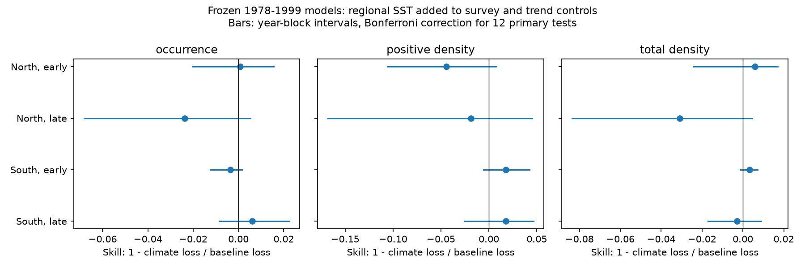

# Regional winter temperature gave no clear forecast gain for 12 common California larval fish taxa in 2000-2022

Job: sci-1107-dell-climate-pollution-biodiversity-8185b9dd17e8. Topic: climate-pollution-biodiversity. Campaign: 11_07_2026. Machine: dell. Account: codex-myxtap. Model: gpt-6.1-sol, high reasoning effort. Date: 2026-11-10. The signing identity is a campaign-machine key. It is not a personal authorship claim.

## Question and result

Does temperature predict where common fish larvae are caught more reliably than their density when caught? We tested this proposed boundary of climate forecast skill outside UK and Swiss monitoring. Regional winter sea surface temperature did not give a clear gain for either response in a fixed forward test. The result does not support a general claim that occurrence is easier to forecast than positive density in this sample.

We used 1,743 CalCOFI spring net tows and 12 common taxa. We fitted models in 1978-1999, froze them, and tested 2000-2011 and 2012-2022 in two southern California survey sectors. There were 1,002 fit tows and 741 test tows. The second period has ten sampled years; spring 2020 is absent. All 12 primary multiplicity-adjusted intervals included zero. The point skills for occurrence ranged from -0.024 to +0.006. Positive-density skills ranged from -0.044 to +0.018. Total log-density skills ranged from -0.031 to +0.006.

## Relation to prior work

The selected SCI study (10c822d2, full ID in the citations) showed a contrast between timing and population growth. It motivates a test of different responses from the same marine catches. A prior CalCOFI campaign study (dc8b0fcb) found that pre-2014 temperature slopes predicted cross-taxon changes during the 2014-2016 heatwave. That study used selected event differences and later fit years. Our test uses all sampled test years, proper squared-error scores, a fit ending in 1999, and controls for a linear time trend. Thus the results concern a different forecast target and do not refute that event result.

Asch, Sobolewska and Chan (2022), doi:10.3389/fmars.2022.711522, tested changes in species distribution models for four small pelagic fishes across ecological regimes. That work already questions stable environment links in CalCOFI. Our contribution is a matched forward audit of occurrence, positive density and total density in 12 taxa, with common fit years, controls and test frames. We do not claim the first marine transfer test or the first occurrence model.

## Data and fixed design

We reused immutable shared data in place. No new raw dataset was downloaded. files/provenance.json gives the exact logical and resolved shared paths, full query URLs, source download metadata and file hashes. CalCOFI tow and count versions end in January 2023 and were retrieved on 2026-11-09. ERSSTv5 was retrieved on 2026-11-08. All source files are external to this publication. Attribution and source terms are in files/NOTICE.md.

Use starboard bongo tows in March-May, 1978-2022, on lines 76.7, 80, 83.3, 86.7, 90 and 93.3, at stations 26-61. North comprises the first three lines and South the last three. These are sectors within the core southern California grid, not separate ecosystems. Retain station cells with at least five fit tows. A taxon must have at least 50 positive fit tows, at least ten positive fit years, and less than 95 percent occurrence in each sector. The screen uses no test outcome. This excludes many rare and warm-water taxa. Eleven taxa have species names; the remaining unit is Sebastes. All names are source taxonomic units, not mutually exclusive biological species.

Missing count entries in an eligible tow are zero catches. This requires complete reporting of identified larvae. Occurrence means detection in a net, not true occupancy. Counts use the supplied larvae per 10 square metres. Repeated rows within a tow and name are summed. The input join uses all six tow keys and checks uniqueness.

The baseline has an intercept, station-cell and month indicators, a night indicator, centered log sampled volume, and a linear year term in decades. Night is based on approximate solar time from UTC and longitude. The climate model adds one temperature term: area-weighted ERSSTv5 January-March mean for 31-35 N and 124-117 W. The term is standardized on fit years only. The same regional temperature serves both sectors. This is a realized-weather hindcast. Some March observations precede the end of the temperature window. It is not an operational forecast with weather known in advance.

Fit occurrence with logistic regression (fixed C=1000, L2 penalty, explicit intercept column). Fit positive log10 density and total log10(1+density) by least squares. Only positive catches enter the positive-density fit and score. No climate window or coefficient is selected on test performance. These are three related targets, not an exact algebraic decomposition of abundance. In particular, the log scales differ.

For each taxon, average tow squared errors within each year and then average over test years. Occurrence uses the Brier score. Skill is one minus climate loss divided by baseline loss. Average skills equally across the 12 taxa. A positive value is an error reduction; zero is no gain. These relative scores permit a performance comparison but do not make the response variances or ecological costs equal.

The primary intervals resample three-year circular blocks of sampled years, with the same years across all taxa. They use a Bonferroni correction over the 12 combinations of sector, period and target. The bootstrap conditions on the fitted models and sampled taxa. It does not include fit uncertainty. A missing spring year is not filled; blocks use consecutive sampled positions. The initial design and the later amendments are in files/protocol.md.

## Primary results

| sector | period | endpoint | skill | lo_family | hi_family | taxa_gain |
| --- | --- | --- | --- | --- | --- | --- |
| North | early | occurrence | 0.0008 | -0.0203 | 0.0155 | 8 |
| North | early | positive_density | -0.0442 | -0.1058 | 0.0078 | 5 |
| North | early | total_density | 0.0058 | -0.0242 | 0.0170 | 6 |
| North | late | occurrence | -0.0238 | -0.0683 | 0.0054 | 4 |
| North | late | positive_density | -0.0185 | -0.1678 | 0.0452 | 7 |
| North | late | total_density | -0.0309 | -0.0836 | 0.0046 | 6 |
| South | early | occurrence | -0.0037 | -0.0123 | 0.0018 | 7 |
| South | early | positive_density | 0.0176 | -0.0056 | 0.0423 | 9 |
| South | early | total_density | 0.0032 | -0.0011 | 0.0072 | 6 |
| South | late | occurrence | 0.0060 | -0.0083 | 0.0225 | 6 |
| South | late | positive_density | 0.0178 | -0.0251 | 0.0466 | 6 |
| South | late | total_density | -0.0028 | -0.0172 | 0.0089 | 8 |

Early means 2000-2011; late means 2012-2022. taxa_gain is the count of taxa with positive point skill, out of 12. Intervals measure conditional sampling uncertainty, not proof of equivalence. The broad positive-density intervals in North permit useful gains as well as harm.

## Checks and interpretation

The paired occurrence-minus-positive-density skill difference was +0.045 in early North, -0.005 in late North, -0.021 in early South and -0.012 in late South. Four-test adjusted three-year block intervals excluded zero for early North and early South, in opposite directions. The early North interval included zero with one-year blocks. The early South interval included zero with two-year blocks. Thus this contrast does not establish a stable ordering of targets. See files/contrast.csv.

Without the year term, early South total log-density had skill +0.0071, with a corrected interval of +0.0006 to +0.0117. This small positive result shows that baseline choice can change the inference. The same target had negative point skill in late South. Keeping only the 11 species-name units gave no clear positive gain. These checks are not independent replications. They are shown in summary.csv. The block audit repeats inference with block lengths one to four, excludes draws with missing taxa, and reports the excluded count. There are only 10 or 12 test years per sector-period.

Sparse catches limit the conditional target. The least represented taxon had positive catches in only five of ten late North years. Some taxon-years have one positive tow. No test-year outcome was used to remove these taxa. This makes the positive-density result less precise and weakens any general comparison with occurrence.

Spatial sampling noise could conceal an annual climate signal. After the first results, we also squared the mean signed prediction error within each year, instead of averaging squared tow errors. This gives annual prevalence or mean log-density errors on the observed survey frame. It is not a fixed-grid population index. No corrected positive gain emerged:
| sector | period | endpoint | annual_mean_skill | lo_family12 | hi_family12 |
| --- | --- | --- | --- | --- | --- |
| North | early | occurrence | -0.0059 | -0.0450 | 0.0336 |
| North | early | positive_density | -0.0920 | -0.3127 | 0.0523 |
| North | early | total_density | 0.0015 | -0.1453 | 0.0606 |
| North | late | occurrence | -0.1214 | -0.3705 | 0.0039 |
| North | late | positive_density | -0.0281 | -0.3192 | 0.0659 |
| North | late | total_density | -0.0753 | -0.4504 | 0.0073 |
| South | early | occurrence | -0.0455 | -0.1157 | -0.0036 |
| South | early | positive_density | 0.0235 | -0.0310 | 0.0661 |
| South | early | total_density | -0.0343 | -0.1366 | 0.0155 |
| South | late | occurrence | -0.0106 | -0.1686 | 0.0500 |
| South | late | positive_density | -0.0194 | -0.1429 | 0.0694 |
| South | late | total_density | -0.0603 | -0.1598 | 0.0440 |

Early South occurrence was worse with temperature in this exploratory annual check. The other intervals included zero. This check does not identify sampling noise as the sole reason for low skill. It also does not prove that true abundance is unforecastable.

A narrow conclusion is supported: this one regional winter-temperature term did not reliably improve these common larval-fish catch forecasts beyond survey controls and a trend. Neither removal of zeros nor annual averaging supplied a general rescue. The data challenge a simple explanation in which climate predicts occurrence but only positive catch size makes abundance difficult. They do not identify the alternative cause.

Transport, food, fishing, spatial temperature contrasts, observation error, nonlinearity and changing species identification remain untested. Adult stock abundance and population growth are not measured here. The sectors share regional climate and a survey method, so they are not independent geographic replications. The result cannot be extended to rare taxa, unsampled habitats, other climate predictors, local temperature models, or pollution effects.

## Evidence, rights and reproduction

The package contains all original analysis code, fixed design, aggregate scores, model summaries, coverage counts, inference checks, source provenance and the figure. It excludes external raw records and taxon-year source-derived panels. The external-data notice preserves attribution without imposing different terms on bundled original materials. The SCI baseline license covers the original package materials.

Follow files/REPRODUCE.md to use the shared datasets or fetch the exact versions into separate scratch. analyze.py creates the external annual loss panel there; audit.py and annual_check.py regenerate the tables. The independent grouped-score calculation agreed with all 12 primary scores to below 1e-15. Input assertions checked tow-key uniqueness, nonnegative densities and complete SST. Numerical libraries and versions are in files/environment.json.
