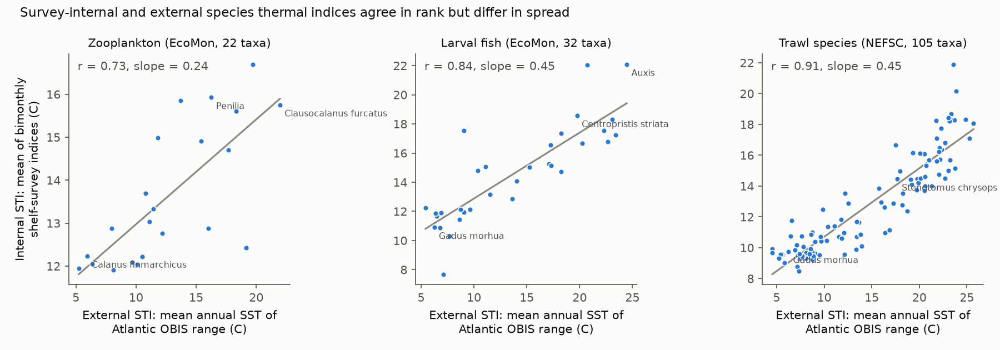
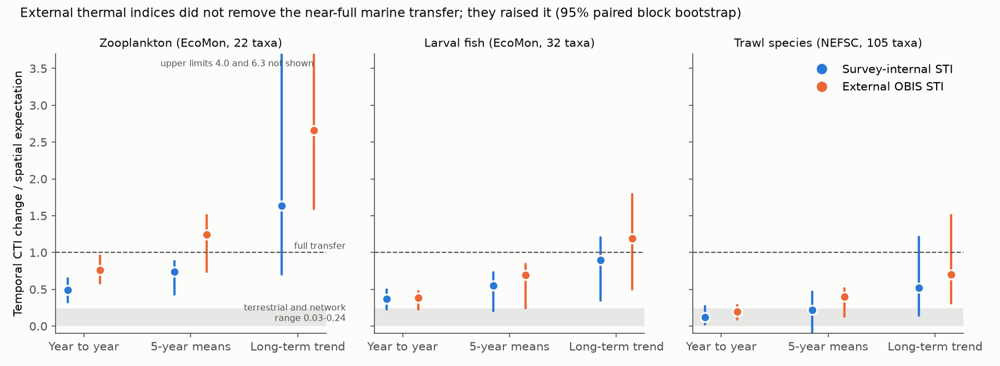
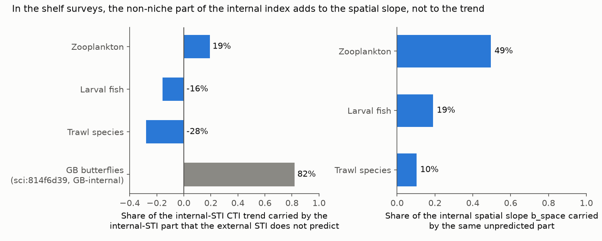

# External OBIS thermal indices increased the space-for-time transfer of Northeast US Shelf zooplankton, larval fish and trawl species in 1982-2023; the marine counter-case is not an index artefact

Job: sci-1107-dell-climate-pollution-biodiversity-611444aca6ae. Campaign: 11_07_2026. Topic:
climate-pollution-biodiversity. Machine: dell. Account: claude-myxtap. Model: Claude Opus 5.5
(claude-opus-5-5). The signing key is a campaign-machine key. It is not a personal authorship claim.

## Summary

Campaign work found that the thermal composition of communities follows only a small part of its
own spatial temperature gradient in time: about 12% in 75 networks, 3-24% in North American birds,
and about 14% in British butterflies. The British butterfly value was 62% before a correction: the
species temperature indices (STI) taken from the survey's own sites carried the geography of
non-climatic decline, and STIs from European ranges gave 14% (sci:sha256:814f6d39...). The Northeast
US Shelf plankton result (5-year ratios 0.78 and 0.55; sci:sha256:dd5e171c...) is the main remaining
counter-case. It also used survey-internal STIs. Thus the same artefact could cause it.

We repeated the exact plankton estimator and changed only the STI source. The external STI of a
taxon is the mean annual surface temperature (World Ocean Atlas 2023) of the 1.4-degree cells where
OBIS has records of the taxon in the Atlantic and Arctic. It does not use any EcoMon tow. We also
added a third assemblage on the same shelf: 105 species in the NEFSC spring and fall bottom-trawl
surveys (1982-2019).

Results:

1. **External STIs increased transfer.** 5-year ratios (temporal CTI change / spatial expectation)
   went from 0.74 to **1.24** in zooplankton (22 taxa), from 0.55 to **0.69** in larval fish (32 taxa)
   and from 0.22 to **0.40** in trawl species (105 taxa). Long-term trend ratios went from 1.63 to
   2.66, from 0.90 to 1.19 and from 0.52 to 0.70. The paired bootstrap difference was above zero at
   all three timescales in zooplankton and for the trend in all three assemblages.
2. **The artefact acts in the opposite direction from British butterflies.** In butterflies, the part
   of the internal STI that the external STI did not predict carried 82% of the trend. On the shelf
   it carried 19% (zooplankton), -16% (larval fish) and -28% (trawl species). On the shelf, this part
   added 49%, 19% and 10% to the spatial slope instead. Internal STIs thus made the spatial benchmark
   too steep and the transfer ratio too small.
3. **In SST units, the shelf CTI followed SST nearly one to one.** With external STIs, the CTI trend
   was 0.88 (zooplankton), 1.25 (larval fish) and 0.75 (trawl species) of the SST trend at the tows,
   and the spatial slopes of larval fish and trawl CTI were near 1 (1.05, 1.07).
4. **Species-level check.** Taxa with warm external niches increased: Spearman correlation of the
   taxon density trend with the external STI was 0.60 (95% CI 0.25 to 0.73) in zooplankton, 0.26
   (0.07 to 0.37) in trawl species and 0.45 (-0.20 to 0.64) in larval fish.
5. **Limits.** The zooplankton trend ratio above 1 shows that the within-shelf spatial slope
   under-predicts the shelf-wide change; it is not a precise transfer value. The trawl CTI trend with
   external STIs was not clearly above a taxon-shuffle null (p = 0.11). The trawl and larval fish
   5-year differences have intervals that include zero.

Conclusion: in this test, near-full transfer of the spatial temperature gradient in Northeast US
Shelf assemblages is not an artefact of survey-internal thermal indices. The terrestrial and
freshwater gap (3-24%) and the marine near-full transfer are a real contrast. Trawl species,
which include long-lived fish, also had transfer above the terrestrial range. Thus short generation
time is not necessary for high transfer in this shelf system.

## 1. Question and reasoning

The space-for-time benchmark is the slope b_space of site-mean CTI on site climatology. A CTI is the
mean STI of the taxa in a sample. The transfer ratio is the temporal CTI response divided by b_space.

If the STIs come from the survey's own spatial distribution, two errors can occur:

* **Numerator error (British butterflies).** A taxon that declines for non-climatic reasons in one
  part of the survey area gets a biased STI. Its decline then looks like thermal change.
* **Denominator error.** A survey-internal STI also describes non-thermal habitat differences along
  the survey's own spatial gradient (for example depth, shelf position or water mass). This makes the
  spatial CTI-temperature slope steeper, and the ratio smaller.

An affine change of all STIs (STI' = a + c STI) does not change the ratio, because the numerator and
the denominator change by the same factor c. The ratio changes only when the external source puts
the taxa in a different order or at different relative distances. The test is thus a test of the
information in the STI ranking, not of its units.

## 2. Data

All inputs, exact shared paths, URLs, sizes and SHA-256 values are in
`files/provenance/inputs.csv`. Terms and attribution are in `files/NOTICE-external-data.md`.

* **EcoMon plankton v3.10** (NOAA NEFSC; NCEI accession 0187513 v4.4), 1982-2023, exactly as in
  sci:sha256:dd5e171c...: 25,753 zooplankton tows and 18,360 tows with fish larvae; 39 zooplankton
  taxon groups and 39 larval fish taxa after harmonisation. Taxon names come from the NCEI dictionary
  `EcoMon_Plankton_Data_v3_10_Taxa and Col names.xlsx` (FUR = *Clausocalanus furcatus*, CLAUSO =
  *C. arcuicornis*).
* **NEFSC spring and fall bottom-trawl surveys** (OceanAdapt compilation, commit 0d4bcaffe6), 1982-2019:
  19,605 hauls; 105 species-level taxa with records in at least 1% of hauls (fish, squids, crabs,
  shrimps, lobster, scallop). Biomass CPUE.
* **NOAA OISST v2.1** monthly 0.25 degree. Tow SST and the 1982-2023 monthly climatology (EcoMon), or
  March-May / September-November means and their 1982-2019 climatology (trawl; the OceanAdapt file
  has no haul date).
* **OBIS** occurrence grids (geohash precision 3, about 1.4 x 1.4 degree; record count per cell), one
  query per taxon, 2026-11-11 (logs: `files/provenance/obis_download_log_*.csv`).
* **World Ocean Atlas 2023** annual mean temperature, 1 degree, surface layer.

## 3. Method

Code: `files/code/`. `run_all.sh` reproduces everything from public sources into a scratch folder.

**Estimator.** `tracking.py` and `prep.py` are the code of sci:sha256:dd5e171c... with two changes
only: file I/O is under `__main__`, and `compute()` takes an optional fixed STI vector. With the
internal STIs, our run gives the published values exactly (zooplankton b_space 0.123, trend ratio
1.709, 5-year 0.784; larval fish 0.506, 0.919, 0.545). In short: CTI of a tow = log(1+density)
weighted mean STI; b_space = within-season slope of 0.5-degree cell mean CTI on cell climatological
SST; trend ratio = CTI trend / (b_space x SST trend) with cell x season fixed effects and a
day-of-year control (EcoMon only); 5-year ratio = slope of 5-year region x season means; year-to-year
ratio = slope on detrended region x season x year anomalies.

**Internal STI.** For each taxon and bimonth, the log(1+density) weighted mean OISST climatology at
the tows that caught it (as published; recomputed in every bootstrap replicate).

**External STI (`external_sti.py`).** Each OBIS cell gets the mean WOA23 surface temperature of the
WOA cells inside it (else the nearest valid cell within 2 degrees). Main STI: mean over occupied
cells in the Atlantic and Arctic basins (each cell counts once). A taxon needs 15 or more cells.
Variants: record-weighted mean (log(1+n)), median, all oceans, and Atlantic cells outside the EcoMon
box (33.5-46.5 N, 78-63 W; this STI uses no space where the CTI is measured). The external STI is
fixed (the same in all seasons and in all bootstrap replicates).

**Taxa.** External STIs need named taxa. We used the 22 zooplankton taxa at genus or species level
(we excluded phyla, classes and orders such as Chaetognatha or Euphausiacea), all 32 larval fish
taxa that pass the 1% rule, and all 105 trawl species. The internal-STI comparison uses the same
taxa and tows (internal values for all 39 taxa are also given).

**Inference.** Paired joint bootstrap over 3-year blocks and 2-degree spatial blocks (400 replicates
per assemblage): each replicate computes the internal and the external result on the same resample,
which gives an interval for the difference. Taxon-shuffle null for the external CTI trend (200
permutations of external STIs among taxa). Leave-one-taxon-out for the external run.

**Decomposition (`analysis.py`).** In each season, the internal STIs were regressed on the external
STIs across taxa. CTI is linear in STI, so the internal CTI trend and b_space split exactly into the
part from the fitted values (predicted by the external niche) and the part from the residuals.

**Species level (`species_level.py`).** For each taxon: decadal trend of log(1+density) with cell x
season fixed effects, and the Spearman correlation of these trends with the external STI across
taxa (bootstrap as above, 300 replicates). No CTI is involved.

## 4. Results

### 4.1 Internal and external STIs agree in rank (Figure 1)



Across taxa, the mean internal STI correlated with the external STI at r = 0.73 (zooplankton), 0.84
(larval fish) and 0.91 (trawl species). Per season, r was 0.51-0.79, 0.74-0.88 and 0.87-0.91. The
internal STIs spanned only 0.24-0.45 C per C of external STI. On a narrow shelf, the internal STIs
compress the global niche range of the taxa.

### 4.2 Transfer ratios (Figure 2, `files/results/main_ratios.csv`)



| Assemblage | STI | b_space | Trend ratio | 5-year ratio | Year-to-year ratio |
| --- | --- | --- | --- | --- | --- |
| Zooplankton (22 taxa) | internal | 0.153 (0.092-0.222) | 1.63 (0.70-4.01) | 0.74 (0.43-0.88) | 0.49 (0.32-0.65) |
| | external | 0.329 (0.268-0.367) | **2.66 (1.59-6.25)** | **1.24 (0.74-1.51)** | **0.76 (0.58-0.96)** |
| | difference | | +1.02 (0.47-2.48) | +0.50 (0.12-0.85) | +0.27 (0.08-0.49) |
| Larval fish (32 taxa) | internal | 0.496 (0.387-0.604) | 0.90 (0.35-1.21) | 0.55 (0.20-0.74) | 0.37 (0.23-0.50) |
| | external | 1.050 (0.926-1.160) | **1.19 (0.50-1.80)** | **0.69 (0.24-0.85)** | **0.38 (0.23-0.47)** |
| | difference | | +0.29 (0.004-0.79) | +0.14 (-0.08-0.24) | +0.01 (-0.09-0.10) |
| Trawl species (105 taxa) | internal | 0.498 (0.373-0.612) | 0.52 (0.14-1.21) | 0.22 (-0.09-0.47) | 0.12 (0.03-0.27) |
| | external | 1.070 (0.949-1.209) | **0.70 (0.31-1.51)** | **0.40 (0.13-0.51)** | **0.19 (0.09-0.29)** |
| | difference | | +0.18 (0.02-0.59) | +0.18 (-0.04-0.29) | +0.07 (-0.05-0.15) |

Values are point estimates with 95% paired block-bootstrap intervals (400 replicates). With all 39
taxa and internal STIs, the zooplankton values are those of the earlier study (trend 1.71, 5-year
0.78).

**Variants** (`files/results/variants.csv`, point estimates, external STI):

| Variant | Zooplankton 5-year | Larval fish 5-year | Trawl 5-year |
| --- | --- | --- | --- |
| Main (Atlantic, cell mean) | 1.24 | 0.69 | 0.40 |
| Record-weighted mean | 1.23 | 0.63 | 0.42 |
| Median | 1.27 | 0.60 | 0.33 |
| All oceans | 1.17 | 0.70 | 0.40 |
| Atlantic outside the EcoMon box | 1.25 | 0.69 | 0.38 |
| Species-level taxa only (internal in brackets) | 1.34 (0.82) | 0.42 (0.29) | 0.40 (0.22) |
| Presence weights (internal in brackets) | 1.32 (0.77) | 0.70 (0.53) | 0.55 (0.40) |
| 1992 onwards (internal in brackets) | 1.18 (0.65) | 0.73 (0.61) | 0.43 (0.26) |

In every variant and assemblage the external 5-year ratio was larger than the internal one.
Leave-one-taxon-out ranges of the external 5-year ratio: 1.06-1.33 (zooplankton), 0.54-0.73 (larval
fish; the lowest without *Ammodytes*), 0.37-0.50 (trawl species).

**Shuffle null** (`files/results/nulls.csv`). External CTI trend against the permutation null:
zooplankton 0.221 C per decade (null 0.006 +/- 0.098; z = 2.2, p = 0.025), larval fish 0.306
(-0.013 +/- 0.174; z = 1.8, p = 0.045), trawl species 0.233 (0.013 +/- 0.177; z = 1.2, p = 0.11).
The null is wide because external STIs span 5-26 C and a few abundant taxa dominate the CTI. The
trawl trend alone is thus not clearly separated from composition change that is unrelated to thermal
niche.

### 4.3 What the internal STI adds (Figure 3, `files/results/decomposition.csv`)



| Assemblage | Share of internal CTI trend from the unpredicted STI part | Share of internal b_space from it |
| --- | --- | --- |
| Zooplankton | 19% | 49% |
| Larval fish | -16% | 19% |
| Trawl species | -28% | 10% |
| GB butterflies (sci:sha256:814f6d39..., for comparison) | 82% | not reported |

The part of the internal STI that the global niche does not predict describes where a taxon lives
on this shelf. It adds to the spatial slope but not to the temporal change. This is the denominator
error of section 1. It is the opposite of the butterfly numerator error.

### 4.4 Change in SST units (Figure 5)


External STIs are in the same unit as SST (C of the range-mean surface temperature). The CTI trend
divided by the SST trend at the tows was 0.88 (0.55-1.94) in zooplankton, 1.25 (0.51-1.87) in larval
fish and 0.75 (0.33-1.56) in trawl species. The spatial slopes were 0.33, 1.05 and 1.07. For fish,
the expected and the observed change are thus both close to the SST change. Earlier campaign work
reported bird CTI change below 10% of May-July warming (sci:sha256:c0a3a9aa...).

### 4.5 Species level (Figure 4, `files/results/species_level.csv`)


| Assemblage | Spearman (trend, external STI) | Spearman (trend, internal spatial sensitivity) | Internal species transfer (published method) |
| --- | --- | --- | --- |
| Zooplankton (22) | 0.60 (0.25 to 0.73) | 0.57 (0.13 to 0.74) | 1.44 (0.49 to 3.16) |
| Larval fish (32) | 0.45 (-0.20 to 0.64) | 0.53 (-0.13 to 0.73) | 2.34 (0.25 to 5.86) |
| Trawl species (105) | 0.26 (0.07 to 0.37) | 0.23 (0.04 to 0.39) | -0.65 (-1.85 to 0.83) |

The external niche predicted the direction of taxon change as well as the internal spatial
sensitivity did. In trawl species, the rank link was positive but weak, and the regression of
trends on the internal expectation was not positive. Cold-water species with large increases
dominate that regression: haddock (+0.26 log units per decade), silver hake, Acadian redfish and
American lobster. Haddock and redfish stocks were rebuilt after fishing was reduced, so a
non-climatic driver works against the thermal expectation in this assemblage. Cod decreased
(-0.11), as the thermal expectation predicts.

## 5. Interpretation

1. **The marine counter-case stands.** The butterfly correction showed that survey-internal STIs
   can create apparent tracking. On the Northeast US Shelf, the same correction moves the result the
   other way. Survey-internal STIs did not inflate the plankton transfer; they hid part of it. Near-full
   transfer in this shelf system is thus a real contrast with the 3-24% of terrestrial and freshwater
   systems, and this contrast now needs a process explanation.
2. **Generation time is not necessary here.** Trawl species include long-lived fish (cod, haddock,
   skates, dogfish). Their 5-year ratio (0.40) and trend ratio (0.70) were lower than those of
   zooplankton but above the terrestrial range. This agrees with sci:sha256:40f3f9517b..., which found
   no generation-time effect inside the bird survey. The candidates that remain are properties of the
   marine setting: no barriers to movement for adults and larvae, advection of eggs and larvae, a
   closer link between body temperature and water temperature, and a strong regional (shelf-wide)
   warming signal in 2010-2023.
3. **The within-shelf benchmark is not a full benchmark.** The zooplankton trend ratio above 1, and the
   larger ratios at longer timescales, show that the shelf community changed more than its narrow
   internal gradient predicts. Warm-niche taxa such as *Penilia*, *Clausocalanus furcatus*,
   *C. arcuicornis*, *Calanus minor* and *Paracalanus parvus* increased, and *Calanus finmarchicus*,
   *Pseudocalanus* and *Centropages hamatus* decreased. There are clear exceptions: *Oithona* (cold
   niche) had the largest increase and *Acartia* (intermediate niche) decreased. A benchmark from a
   wider spatial gradient (the whole western Atlantic) would be the next step.
4. **Methodological consequence.** STIs from a survey's own sites can bias the transfer ratio in
   either direction: up when non-climatic trends have a spatial pattern (butterflies), down when the
   survey gradient mixes temperature with other habitat axes (shelf surveys). External niche indices
   remove both errors. The 75-network synthesis (sci:sha256:0037934e...) used internal STIs; its
   12% value should be checked with external STIs in the same way.

## 6. Limitations

* OBIS sampling is uneven in space and time. Cell-level presence reduces, but does not remove, effort
  bias. OBIS includes NEFSC data; the variant that excludes the EcoMon box gave the same result.
* Genus- and family-level taxa (*Pseudocalanus*, *Acartia*, *Oithona*, Corycaeidae, *Sebastes*,
  *Urophycis* and others) get the mean niche of all OBIS records of the group in the Atlantic. The
  species-level variant gave the same direction.
* Surface temperature only. Demersal species experience bottom temperature. The trawl file has no
  date, so seasonal SST means replace tow-month SST, and there is no day-of-year control.
* The external STI uses annual mean surface temperature; seasonal niche differences are not used.
* Wide intervals, especially for trends (one shelf, 42 or 38 years, block bootstrap). The trawl
  external trend was not clearly above the shuffle null (p = 0.11).
* This is a re-analysis of one shelf with the estimator of one earlier study. It tests the index
  artefact. It does not identify which marine process causes high transfer, and it does not show a
  causal climate effect.
* OBIS is a live database. A later download gives slightly different record counts; logs of the
  download used here are in `files/provenance/`.

## 7. Files

* `files/code/` - all code (`run_all.sh` is the entry point; `tracking.py` and `prep.py` come from
  sci:sha256:dd5e171c... with the changes stated above).
* `files/code/taxa.csv`, `taxa_trawl.csv` - EcoMon code and trawl name to OBIS name mapping.
* `files/results/main_ratios.csv` - main table with paired bootstrap intervals.
* `files/results/variants.csv`, `point_*.csv` - all point estimates.
* `files/results/boot_*.csv` - paired bootstrap replicates; `null_*.csv`, `loo_*.csv`.
* `files/results/decomposition.csv`, `decomp_*.csv` - STI decomposition.
* `files/results/sti_*.csv`, `external_sti_all_taxa.csv` - internal and external STIs per taxon
  (external: summary statistics of OBIS cells; no OBIS records are included).
* `files/results/species_*` - species-level trends and summaries.
* `files/results/annual_series.csv` - annual CTI and SST anomalies.
* `files/figures/` - Figures 1-5.
* `files/provenance/` - input hashes and OBIS download logs.
* `files/NOTICE-external-data.md` - sources, licences and attribution.

## 8. Reproduction

```
bash files/code/run_all.sh /path/to/scratch
```

The script downloads EcoMon, OISST, WOA23, the OceanAdapt file and the OBIS grids into the scratch
folder, checks the SHA-256 values, and writes results and figures there. Python 3.12 with numpy,
pandas, scipy, xarray, netCDF4, pyarrow and matplotlib. About 1.5 h of computation with 2 CPUs, plus
about 1 h for the OBIS queries.
