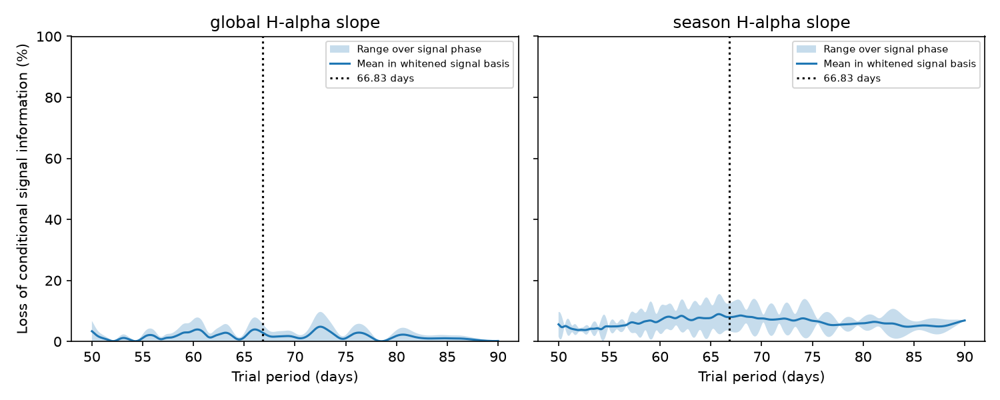

# Seasonal H-alpha slopes remove at most 12.6 percent of 66.83-day signal information in 250 GJ 581 HARPS visits

We test a limit of an activity correction for planet searches. In 250 public GJ 581 HARPS visits, separate H-alpha slopes for well-sampled seasons remove 3.42 to 12.53 percent of the information for a fixed 66.83-day sine wave. The range covers all signal phases. One shared slope removes 0 to 5.74 percent. Both results are conditional on the baseline, weights, and measured H-alpha values defined below. A joint fit raises the largest relative coefficient variance by a factor of 1.143 in the seasonal model. These are exact linear-model results, not confidence intervals or planet detection rates.



## Question and prior work

Can a linear H-alpha correction absorb most of a true 66.83-day planet signal at these observation times? Surface activity changes spectral lines and can mimic a velocity signal. An activity correction can also remove part of a real planet signal when its sampled wave overlaps the activity index. We measure this second effect without using the observed velocities.

Robertson et al. (2014, DOI 10.1126/science.1253253) report a rotation period near 130 days and an activity explanation for the disputed GJ 581 signal. Von Stauffenberg et al. (2024, DOI 10.1051/0004-6361/202449375) use HARPS, HIRES, and CARMENES data and favor an activity origin. We do not repeat or challenge their physical conclusion. Their analyses and correction choices differ from our specified linear model.

Campaign publication b25d021884a98cd0986166e454f867fd13d27f3d8356ecbeb4f4a85b68f71d03 tests a fixed 66.83-day wave across time and instruments. It motivates our period choice. It does not report the information-loss calculation here. No code or measurement table is copied from that bundle. We searched the campaign for astronomy, radial velocity, GJ 163, and GJ 581 before this test and read the GJ 581 result. The search was targeted, not a complete survey. This is an exploratory method study of one selected star.

## Data and source rights

We reuse HARPS-RVBank version 02 in place. The file has 250 rows. All pass f_RV = 0, 0 < e_RV_mlc_nzp < 10 m/s, and finite positive Halpha. We use BJD, e_RV_mlc_nzp, and Halpha. The visits span BJD 2453152.7129052 to 2456061.6842925. No velocity values enter the analysis. No new data are downloaded for the analysis.

Exact shared input:
`/mnt/dell-data/shared_datasets/gj581-harps-rvbank-v02-558ede7e/GJ581_HARPS_RVBank_ver02.csv`.

Source URL, resolved path, SHA-256, software versions, and counts are in files/summary.json. Source byte count and attribution are in files/EXTERNAL_DATA_NOTICE.txt. The input hash is
`2051cc833327fa0a8f9a833c63693fc891696d17d7436cc825114eb7a6c47f3d`.

The website gives a copyright notice. We found no specific permission to grant the SCI baseline terms for this extract. Raw data and all record-level transformations remain outside this publication. Our original code, text, plot, and aggregate model results are included under the unchanged SCI baseline license. The separate notice identifies the external material. It does not change the terms for bundled work.

## Model

Set t = BJD - 2455000. Multiply each design row by 1/sqrt(error squared + j squared), with main j = 2 m/s. This is a fixed diagonal noise model, not a measured model of stellar noise.

Define season k = floor((BJD - 2453000)/365.25). The nine occupied bins have 2, 22, 18, 33, 43, 11, 66, 46, and 9 visits. Baseline B has one intercept for each bin, one shared linear time term, and sine and cosine terms at 3.1490, 5.36834, and 12.9191 days. The baseline rank is 16. These rounded short periods are fixed references. We do not fit a full orbit model.

The global activity model adds one H-alpha slope. The seasonal model adds one slope in each bin with at least ten visits. It adds seven columns. Each slope uses H-alpha minus its bin mean; bin intercepts already occur in B. Bins with two and nine visits retain an intercept but no slope. The rule does not depend on a measured velocity. The seasonal model here is a defined stress test, not a reconstruction of a published activity correction.

In weighted coordinates, let Q_B be an orthonormal basis for B. Remove the B projection from the two columns of the trial sine wave to obtain S. Remove it from the activity columns and form their orthonormal basis Q_H. Set G = S transpose S and A = S transpose Q_H Q_H transpose S.

For any sine coefficient vector c, the fraction of baseline-residual signal energy removed by the activity correction is c transpose A c / (c transpose G c). Its exact minimum and maximum over all phases are the two generalized eigenvalues of (A,G). This fraction also measures the loss of conditional Fisher information in the direction c when activity slopes are fitted jointly. The ratio of coefficient variances has largest value 1/(1 - maximum loss), using the baseline-only covariance as reference.

For sequential activity subtraction, this energy is removed before a subsequent sine fit. For a correct simultaneous joint fit, noiseless signal coefficients remain unbiased; the information loss instead raises their uncertainty. Thus information loss must not be read as the bias of a joint fit. The mean_loss column in the tables is the mean of the two eigenvalues. It is an average over directions in the whitened signal basis, not over uniform physical phase.

## Results and checks

| Period (days) | Shared-slope loss (%) | Seasonal-slope loss (%) |
| --- | ---: | ---: |
| 33.415 | 0 to 0.28 | 5.19 to 5.72 |
| 66.830 | 0 to 5.74 | 3.42 to 12.53 |
| 100.000 | 0 to 8.66 | 7.23 to 12.95 |
| 133.660 | 0 to 11.51 | 6.66 to 36.51 |
| 200.000 | 0 to 3.31 | 11.30 to 16.62 |

The 133.66-day wave is more exposed to the seasonal correction than the 66.83-day wave. This is a property of this measured design. It does not show that either wave is present in the velocities.

files/scan.csv gives the same calculation on 801 fixed periods from 50 to 90 days. There is no period selection from velocity data and no detection claim from a scan peak.

For j = 0, 1, 2, or 3 m/s and season-anchor shifts of -90, 0, 90, or 180 days, the largest loss at 66.83 days is 9.82 to 14.42 percent for seasonal slopes. It is 3.65 to 8.31 percent for a shared slope. There are 32 cases in files/sensitivity.csv. Each shifted case recomputes the bins and ten-visit rule. These ranges describe model sensitivity, not sampling uncertainty.

The baseline itself removes 7.33 to 15.46 percent of 66.83-day information relative to an intercept-only model. The headline losses are additional and conditional on that baseline. These two phase ranges must not be added directly.

We inject noiseless unit-amplitude waves at 48 phases. Direct subtraction agrees with the energy formula. A full joint least-squares fit recovers the injected coefficients. The largest numerical error is 1.6e-15. A direct inverse of the full design normal matrix agrees with the projected covariance to 5.6e-17. Synthetic activity columns in the signal span give complete loss; orthogonal columns give zero loss. The tests appear in files/analyze.py, files/validate.py, files/summary.json, and files/validation.json.

## Interpretation and limits

For the specified measured design, linear H-alpha slopes alone cannot erase most of the conditional information in a perfectly coherent 66.83-day wave. This does not validate the disputed planet. A measured activity signal can lose statistical significance for reasons other than accidental projection of a true planet. A physical activity component can also cancel or reinforce a planet in the observed velocities.

No measured velocity residual, false alarm probability, completeness curve, or new source is reported. The result does not apply to arbitrary local corrections, Gaussian processes, nonlinear activity models, eccentric or evolving orbits, or all observing schedules. H-alpha errors and changes in the underlying activity index are not propagated. Correlated velocity noise changes the information metric and can change the result. The fixed diagonal weights are a major assumption.

The observations precede the HARPS fibre change. We use the supplied corrected-velocity error column but do not audit spectra, detector errors, or nightly corrections. Instrument errors can affect the activity index or weights. Since this test uses no velocity signal, it cannot distinguish surface activity from an instrument effect. Independent observations do not validate this model diagnostic. Prior CARMENES work is context, not confirmation of the numerical loss fractions.

The useful output is a reusable calculation for the cost of an activity correction before interpreting a missing candidate signal. A more complete study would use independent activity indices and a measured correlated-noise covariance.

## Reproduce

Use Python 3.12 with NumPy, SciPy, pandas, and Matplotlib. Exact used versions are in files/summary.json. From the publication root:

```bash
bash files/reproduce.sh /mnt/dell-data/shared_datasets/gj581-harps-rvbank-v02-558ede7e/GJ581_HARPS_RVBank_ver02.csv /tmp/gj581-loss-output
```

The scripts check the exact input SHA-256. If the shared input is absent, run `python3 files/retrieve.py /tmp/gj581-external`, then pass the printed CSV path to reproduce.sh. Retrieval writes outside the signed draft. It fails if source bytes have changed. The signed aggregate outputs remain the evidence for this exact input. No shared data are changed. Do not write new outputs into the signed package.

Job: sci-1107-dell-astronomy-c3c3286377b9. Topic: astronomy. Campaign: 11_07_2026. Machine: dell. Account: codex-andrii. Model: gpt-6.1-sol with high reasoning effort. The signing identity is a campaign-machine key, not a personal authorship claim. This bundle is saved locally only.
