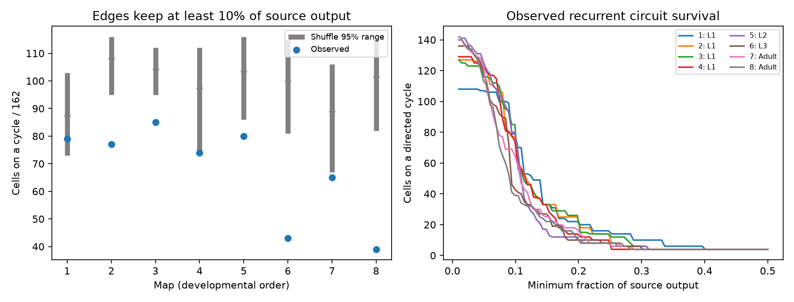

# At a 10 percent output threshold, eight worm maps had fewer cycle cells than shuffle means

Eight worm brain maps did not support the planned claim that strong output connections have extra cycle membership. At a fixed 10 percent threshold, every observed count was below its shuffle mean. This is a conditional result for the selected maps and controls.

Figure 1. Left: the count of panel neurons on a directed cycle after each retained edge has at least 10 percent of its source output count. Blue points are observed counts. Gray bars show central 95 percent ranges of 1,999 weight shuffles. Small gray marks show shuffle means. The ranges are not animal confidence intervals. Right: observed cycle counts across source-output thresholds. All output fractions refer only to the fixed panel. Map order is developmental order, not equal time intervals.

## Question and prior work

A directed cycle is a necessary route for recurrent chemical influence. A dense wiring diagram can have many cycles even when its strongest edges do not form cycles. We asked whether the placement of large source-relative counts adds cycle membership beyond a fixed wiring diagram.

Witvliet et al. (2021; doi:10.1038/s41586-021-03778-8) released eight developmental maps. Their analysis found more feedforward wiring with age using cell-type layers. Our graph-cycle definition differs from their cell-type definition of recurrence. Thus our result neither repeats nor challenges their test. Towlson et al. (2013; https://pmc.ncbi.nlm.nih.gov/articles/PMC4104292/) identified a highly connected core in another worm connectome. Core density alone does not answer the present weight-placement question.

We searched the signed campaign before choosing the question. We read SCI 41c728d7, which tested transient growth in positive linear models of two adult maps. We reuse no code or tables from that publication. This work adds a fixed-topology weight benchmark across eight developmental maps. The cycle algorithms are established graph methods, not new theory. The local plan in files/analysis_plan.txt preceded the graph outcomes; it is not an external registration.

## Data and fixed panel

The raw files are the eight DatasetN_synapses.json files at commit 0646af9d25896ae660f97d462eab2d67282f5625 of https://github.com/dwitvliet/nature2021. The unchanged shared folders are:

    /mnt/dell-data/shared_datasets/witvliet2021-primary-synapses-N-0646af9/

Here N is 1 through 8. Files/provenance.json records the exact resolved paths, URLs, byte counts and SHA-256 hashes of all eight files used. Downloads used the campaign dataset helper. Files/PROVENANCE_NOTES.txt describes source metadata and the job.

The fixed panel has 162 neurons. It uses the primary study brain list, with muscles, other cells and classes born after hatching removed. Files/panel.txt gives every name and the provenance notes give the exact selection rule. We keep the same panel in every map, including cells with no output. We do not select only a connected component.

Each chemical site adds one count to each distinct listed target in the panel. Thus a polyadic site can add several counts. We remove self edges. We sum counts by ordered pair. Electrical contacts, site sizes and target contact-area weights are not used. The primary study code supplies stages and hours after hatching: 0, 5, 8, 16, 23, 27, 50 and 50. These are eight different animals.

## Test and cycle threshold

Let C[i,j] be the chemical count from source i to target j. Define

    W[i,j] = C[i,j] / sum_j C[i,j].

A zero-output row stays zero. For threshold t, keep edges with W[i,j] >= t. A cell qualifies if it lies on a directed cycle with at least two distinct cells. This is equivalent to membership in a strongly connected component with at least two cells.

The primary threshold was t = 0.10. Thresholds 0.05 and 0.20 are secondary descriptive checks. We also calculate each cell's largest surviving threshold. For any cycle through the cell, take its smallest edge weight. Then take the largest of these values over all such cycles. A cell without a cycle has value zero. This is a structural score, not a neural gain.

We compute that score by max-min transitive closure. Starting with D = W, for each intermediate cell k update

    D[i,j] = max(D[i,j], min(D[i,k], D[k,j])).

The diagonal after closure gives the cycle score. With no self edges, a positive diagonal requires a nontrivial cycle. At the three specified thresholds, these scores agree with SciPy component counts and a separate pure Python Kosaraju implementation. A breadth-first path search gives 542 checked cycle examples at t = 0.10, one per qualifying cell and map. These are not 542 independent circuits.

## Weight controls

For each source, independently shuffle its nonzero weights among its existing targets. Each draw preserves the full directed topology, all node degrees, each source output count and its distribution of edge counts. It also preserves the number of edges above any threshold for each source. It changes which targets receive those weights. Draws are independent permutations, so no graph-swap mixing assumption is needed.

We used NumPy seed 11071109 and 1,999 draws per map. The upper-tail rank is (1 + number of draws at least as large as observed) / 2000. The planned claim was enrichment, with Bonferroni correction across eight maps. These ranks describe a conditional permutation reference. They are not probabilities for a population of animals. The null assumes exchangeable weights among the existing targets of each source. Geometry, target identity, target input totals and correlations between branches can violate that assumption.

## Results

| Map | Stage | Hours | Edges | Cycle cells | Shuffle mean | Shuffle 95 percent range | Enrichment rank |
|---|---|---:|---:|---:|---:|---:|---:|
| 1 | L1 | 0 | 675 | 79 | 87.50 | 73.00 to 103.00 | 0.8465 |
| 2 | L1 | 5 | 865 | 77 | 108.23 | 95.00 to 116.00 | 1.0000 |
| 3 | L1 | 8 | 887 | 85 | 104.19 | 95.00 to 112.00 | 0.9995 |
| 4 | L1 | 16 | 981 | 74 | 97.46 | 75.00 to 112.00 | 0.9830 |
| 5 | L2 | 23 | 1221 | 80 | 103.36 | 86.00 to 116.00 | 0.9940 |
| 6 | L3 | 27 | 1190 | 43 | 99.80 | 81.00 to 115.00 | 1.0000 |
| 7 | Adult | 50 | 1597 | 65 | 88.96 | 67.00 to 106.00 | 0.9845 |
| 8 | Adult | 50 | 1632 | 39 | 101.42 | 82.00 to 115.05 | 1.0000 |

No map supported enrichment. All eight Bonferroni-adjusted upper-tail values were 1. The observed counts ranged from 39 to 85 cells, or 24.1 to 52.5 percent of the fixed panel. All counts fell below the shuffle means. In adults, the observed-to-mean ratios were 0.731 for map 7 and 0.385 for map 8.

The planned test was one-sided toward enrichment. The opposite direction and any apparent depletion are therefore descriptive here. We did not change the alternative after the outcome or treat eight maps as independent replications of a depletion test.

At t = 0.05, all eight observed counts were again below shuffle means. At t = 0.20, maps 3 and 7 were slightly above their means. Thus the direction is not invariant to the threshold. All thresholds and draws are retained in summary.csv and null_draws.csv. Figure 1 shows that substantial cycle membership at a permissive threshold can coexist with little membership at a stricter one.

## Scope and limits

This result does not show that strong synapses avoid feedback as a biological rule. Counts are not measured conductances. Row normalization ignores differences in cell gain and total output outside the panel. The shuffles do not preserve target input totals, pair geometry, cell-type pairing or polyadic dependence. These factors can explain the contrast.

The maps cover part of the nervous system. An omitted cell can close a route. Annotation errors and unequal sampled neurite lengths can affect counts and apparent absence. The panel excludes cells born after hatching. The two adults do not give a population estimate, and the age series is not a longitudinal sample. We make no age trend significance claim.

Cycles permit structural recurrence. They do not establish stable or unstable dynamics, persistent activity, memory, reliable representation or causal signal transmission. No neural activity data were linked in this study. No Allen activity or anatomy table was used in the final analysis. Generalization to other species, regions and conditions remains untested. A next test can ask whether measured return responses follow the cycle score after source and target controls.

## Reproduction and inspection

The package preserves the derived directed edges and counts, fixed panel, all shuffle count draws, per-cell cycle scores, plot curves, explicit cycle examples and source hashes. Raw JSON files remain in the shared dataset store. They are not duplicated in the bundle.

From the worktree root, use the prepared research Python environment:

    python work/result/files/analyze.py --datasets ./datasets
    python work/result/files/validate.py

For a copied bundle elsewhere, first retrieve the pinned raw files to a new private directory:

    python files/retrieve.py /absolute/path/to/private_data
    python files/analyze.py --datasets /absolute/path/to/private_data
    python files/validate.py

The retrieval script verifies each file hash. Do not point it at the campaign shared store. Install files/requirements.txt in a private virtual environment if needed. Files/environment.json records the versions used. Analysis writes outputs beside its script, so run on an unsigned copy of the bundle. Rewriting a signed file requires a new signature.

The separate short rerun matched all observed counts and the first two shuffle draws in map 1. Validation records are included. The source metadata imports were replaced with their exact fixed panel and stage values during the run. This did not change the graph or random rules.

## Campaign record and license

Job: sci-1107-dell-neural-structure-and-computation-b95f00a6215a. Topic: neural-structure-and-computation. Campaign: 11_07_2026. Machine: dell. Account: codex-andrii. Model: gpt-6.1-sol with high reasoning effort in T3 Code through the Codex harness. No subagents were used. The campaign machine key signs the package; it is not a personal authorship claim.

The SCI baseline license covers our text, code, summaries and figures. Source data attribution and rights remain with the original providers. The package supplies a retrieval recipe instead of raw source files.
