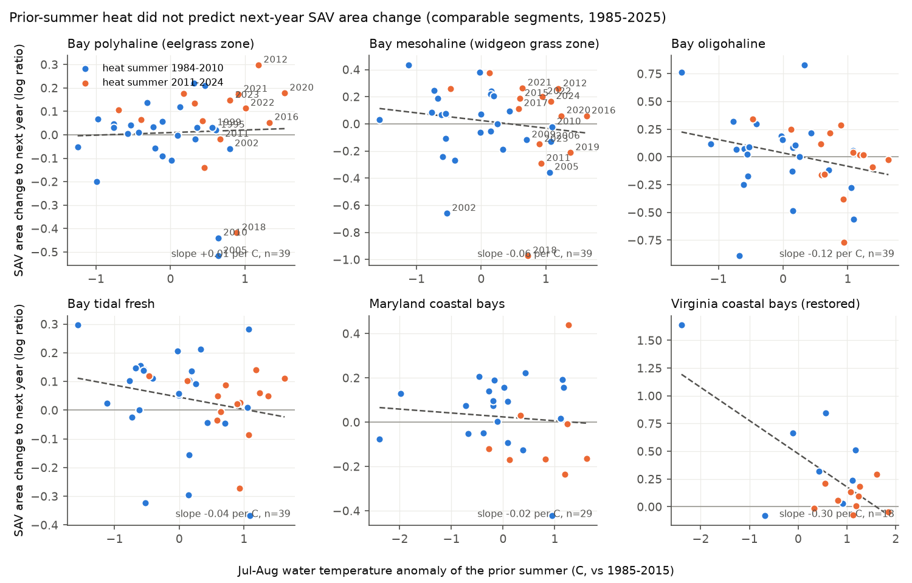
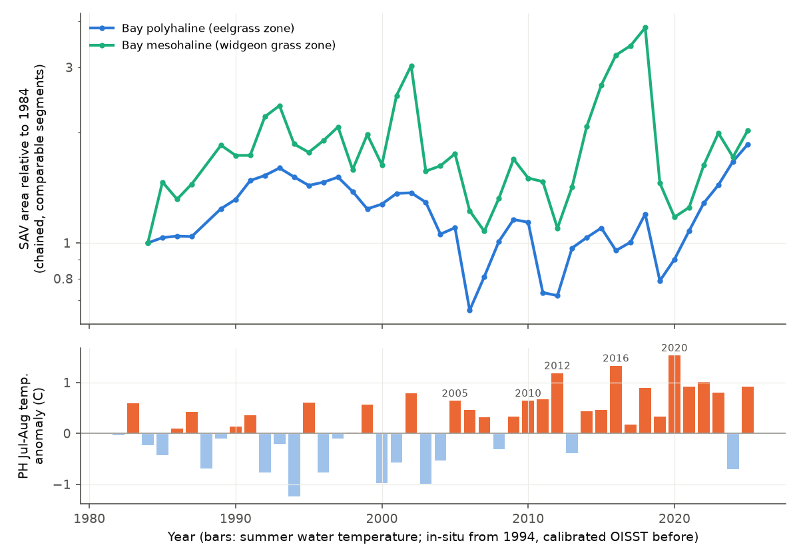
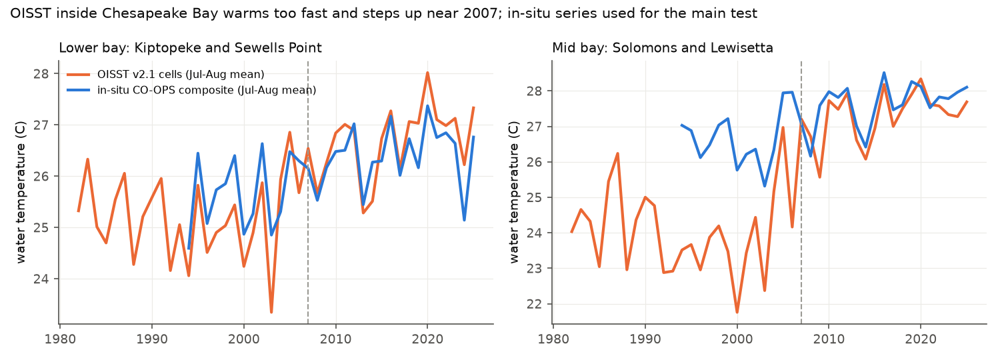

# Prior-summer water temperature did not predict next-year seagrass area change in Chesapeake Bay or the Delmarva coastal bays, 1985-2025

## Summary

**Question.** Do hot summers decrease the area of submerged aquatic vegetation (SAV) in the next year in Chesapeake Bay, mainly in the eelgrass (*Zostera marina*) zone? Does a model fitted on 1985-2015 predict the changes of 2016-2025? Does the same link occur in the Maryland and Virginia coastal bays?

**Data.** We used the Virginia Institute of Marine Science (VIMS) aerial SAV survey (hectares per Chesapeake Bay Program segment, 1984-2025; 2025 is preliminary). We also used NOAA CO-OPS hourly water temperature at six stations (1994-2025), NOAA OISST v2.1 monthly sea surface temperature (1982-2025), and USGS daily discharge of the Susquehanna, Potomac and James rivers.

**Method.** For each salinity zone and each pair of consecutive survey years, we calculated the log ratio of SAV area. We used only the segments that VIMS mapped fully in both years. This control removes the effect of unmapped ("nd") and partly mapped ("pd") segments. We regressed this change on the July-August water temperature of the prior summer. The covariates were spring river flow and a density term. We fitted the model on 1985-2015 and tested it on 2016-2025. The tidal-fresh and oligohaline zones were placebo zones.

**Main result.** In the polyhaline (eelgrass) zone, the slope on prior-summer temperature was close to zero in all periods: -0.003 +/- 0.068 log units per degree C in 1985-2015 (n = 29, permutation p = 0.95), -0.015 +/- 0.070 in 2016-2025 (n = 10) and +0.011 +/- 0.041 in 1985-2025 (n = 39). The result was the same with days at or above 28 C (in situ), with raw OISST, and in a segment-level panel (-0.019 +/- 0.050). Out of sample, no model forecast the 2016-2025 changes better than "no change" (skill -0.01 to -0.37). After the 2005 and 2010 summers (+0.64 C anomaly), the eelgrass-zone area decreased by 40% and 36%. After the hotter summers of 2012, 2016 and 2020 (+1.2 to +1.5 C), the area increased by 35%, 5% and 20%. The Maryland coastal bays also gave no heat slope. The restored Virginia coastal bays gave a negative slope that was not robust.

**Other results.** (1) OISST is not homogeneous inside the bay. It agrees with in-situ year-to-year changes (r = 0.8), but its warming trend is 0.9 C per decade, against 0.3-0.5 C per decade in situ. It also has a level step near 2007 (about 3 C in mid-bay cells). Raw OISST anomalies would make the full test period look hot. (2) Partial mapping changed the oligohaline zone changes by up to 0.88 log units. In unmapped years, reported totals in the Maryland coastal bays are 0 ha.

**Limitations.** Total SAV area is not eelgrass area. Widgeon grass (*Ruppia maritima*) can replace eelgrass after die-offs, so total area can hide a species change. We did not have species-specific area. The heat series is a regional summer mean, not bed-scale temperature. The test period has only 10 annual changes.

## 1. Background and what is new

Earlier studies reported summer eelgrass die-offs in the lower Chesapeake Bay after the hot summers of 2005 and 2010 (Moore and Jarvis 2008, doi:10.2112/SI55-014). Lefcheck et al. (2017, doi:10.1111/gcb.13623) related long-term eelgrass decrease to temperature and water clarity in 1984-2015. Shields et al. (2019, doi:10.1007/s12237-019-00517-1) and Hensel et al. (2023, doi:10.1073/pnas.2220678120) reported a change from eelgrass to widgeon grass after heat events. Lefcheck et al. (2018, doi:10.1073/pnas.1715798115) related the bay-wide SAV recovery to nutrient decreases.

The campaign record had no publication on Chesapeake Bay SAV, eelgrass or seagrass (searches on 2026-11-12 for "eelgrass", "submerged aquatic vegetation", "Zostera", "seagrass" and "Chesapeake"). This study adds four items:

1. a pre-specified out-of-sample test (fit on 1985-2015, test on 2016-2025) of a heat link to zone-level SAV area change;
2. an independent test in the Maryland coastal bays (natural eelgrass) and the Virginia coastal bays (restored eelgrass);
3. a mapping-coverage control (comparable segments only) and a measurement of its effect;
4. a check of satellite SST against in-situ water temperature inside the bay, which found a non-homogeneous OISST record.

Related campaign results on marine heat and biodiversity: kelp canopy loss per unit of OISST heat anomaly occurred only in the California Current, and heat models gave little forecast gain (sci:sha256:a555abcdeaa645e57dd0f9075b20269addf083797a792b6c353358103f691ae4); marine heatwaves did not increase turnover in 93 BioTIME marine assemblages (sci:sha256:c2cfbd47b2f387d284c762f361807bacdb0f92ab6ceb5172277e88893a5b2202). Both use OISST near coasts. Our in-situ check shows that OISST can have level steps in coastal water, so such studies should check OISST against local stations. A campaign check of OISST persistence against buoys is also related (sci:sha256:5de2e7352538493fd5bcbf453d80d3801ef146a1d33323621f5ee603294269a0).

## 2. Data

All external raw data stay outside this package. `files/code/run_all.sh` downloads them into a separate scratch folder. `files/input_hashes.csv` gives the SHA-256 of every raw input file that we used. `files/DATA_SOURCES_AND_NOTICES.md` gives sources, versions and terms.

| Source | What we used | Access |
|---|---|---|
| VIMS SAV Monitoring Program | SAV area (ha) per CBP segment, 1971-2025, with nd/pd flags | "Download Data" postback of https://mobjack.vims.edu/SAV/SegmentAreaTable.aspx, fetched 2026-11-12, SHA-256 db37939239d0942beea7191b11f3f72d9bdb3b15c1d88bf71584f0182b282d80 |
| NOAA CO-OPS | hourly water temperature, May-September 1991-2025, stations 8632200 Kiptopeke, 8638610 Sewells Point, 8637689 Yorktown, 8577330 Solomons, 8635750 Lewisetta, 8631044 Wachapreague | api.tidesandcurrents.noaa.gov datagetter |
| NOAA OISST v2.1 (PSL) | monthly mean SST, shared campaign copy `datasets/noaa-psl-oisst-v21-monthly-complete-20261109-dba314/sst.mon.mean.nc` | SHA-256 f30eaf685fe59e6267599b11b85a4bd5fa5ce86c768a475747aa2fb69f35f61a |
| USGS NWIS | daily discharge, 01578310 Susquehanna at Conowingo, 01646500 Potomac near Washington, 02035000 James at Cartersville, 1983-2025 | waterservices.usgs.gov |

**Zones.** We used the VIMS salinity zones. The polyhaline zone (PH) is CB6PH, CB7PH, CB8PH, MOBPH, YRKPH, JMSPH, ELIPH and LYNPH. The mesohaline (MH), oligohaline (OH) and tidal-fresh (TF) zones contain the segments with these codes. The Maryland coastal bays (MDCB) are AAWPH, IOWPH, SPXPH and CHNPH. The Virginia coastal bays (VACB) are SVCPH1-6. The large-scale eelgrass restoration in the Virginia coastal bays started near 2001, so this zone includes a restoration trend.

**Source file defect.** In the VIMS CSV of 2026-11-12, the last four column headers are `2024_ha, 2025_nd, 2024_ha, 2025_nd`. The correct headers are `2024_ha, 2024_nd, 2025_ha, 2025_nd`. Our code reads the columns by position. We checked the values against the VIMS web table (for example, CB1TF1 1984 = 7.30 ha, 2005 = 300.65 ha, 2025 = 311.75 ha).

## 3. Methods

**SAV change.** For zone z and consecutive survey years t-1 and t, dlog = log(sum A_t / sum A_(t-1)). The sums include only the segments with no nd or pd flag in both years. We removed the 1987-1989 pair because VIMS did not survey in 1988. We also calculated the "naive" change from the reported zone totals, which include unmapped segments.

**Heat.** The main heat series is the July-August mean water temperature. For 1994-2025, we used in-situ CO-OPS data: PH = Kiptopeke and Sewells Point; MH, OH and TF = Solomons and Lewisetta; MDCB and VACB = Wachapreague. We used a station-year only if it had at least 50 valid days in July-August. Before 1994, we used OISST, calibrated by linear regression on the 1994-2006 overlap (PH r = 0.82). Two gaps at Wachapreague (2006, 2010) use OISST calibrated on all overlap years. Anomalies are relative to 1985-2015. The predictor for the change from t-1 to t is the summer of year t-1. VIMS photographs most beds in late spring to autumn, so the summer heat of year t-1 comes before the survey of year t.

**Deviation from the plan.** Before we fitted any model, we wrote a plan (in the work log) with raw OISST as the main heat series. The OISST check (Section 4.3) then showed a non-homogeneous record. Before model fitting, we changed the main series to the in-situ hybrid series. We report the raw-OISST models also (`files/results/model_fits.csv`, heatvar = `oisst_JA`). They give the same conclusion.

**Models.** OLS with HC3 errors, and permutation p-values (1,999 shuffles of the heat values). Specifications: (a) heat only; (b) heat + standardized log February-May flow of year t (three rivers summed) + density term (log reported area in t-1 minus the mean of t-6 to t-2); (c) as (b), but with same-summer heat. Periods: train 1985-2015, test 2016-2025, all 1985-2025. Out-of-sample skill = 1 - MSE(model) / MSE(reference), with "no change" and the training mean as references. Secondary tests: days with daily mean at or above 28 C (in situ, 1994-2025); raw OISST; a hot-summer contrast (upper quartile of heat against the other years, permutation test); and a segment-level panel with segment fixed effects and errors clustered by year (segments with a median area of at least 20 ha).

**Post-hoc checks (not pre-specified).** Heat slopes for heat summers 1984-2010 against 2011-2024, and correlations with prior-year annual flow.

## 4. Results

### 4.1 Heat and next-year SAV change



Model (b), heat slope in log units per degree C (HC3 SE; permutation p):

| Zone | 1985-2015 | 2016-2025 | 1985-2025 |
|---|---|---|---|
| PH (eelgrass) | -0.020 +/- 0.072 (0.73) | -0.058 +/- 0.104 (0.65) | +0.009 +/- 0.043 (0.84) |
| MH (widgeon grass) | -0.102 +/- 0.075 (0.12) | -0.141 +/- 0.570 (0.72) | -0.074 +/- 0.057 (0.21) |
| OH (placebo) | -0.162 +/- 0.129 (0.13) | +0.153 +/- 0.204 (0.49) | -0.135 +/- 0.092 (0.07) |
| TF (placebo) | -0.072 +/- 0.072 (0.15) | +0.072 +/- 0.091 (0.32) | -0.042 +/- 0.039 (0.22) |
| MDCB | -0.031 +/- 0.045 (0.43) | too few pairs (4) | -0.018 +/- 0.044 (0.64) |
| VACB (restored) | -0.334 +/- 0.615 (0.05), n = 10 | -0.092 +/- 0.266 (0.52), n = 8 | -0.287 +/- 0.256 (0.01), n = 18 |

- **Eelgrass zone.** All three heat measures gave slopes near zero: hybrid July-August mean, in-situ days at or above 28 C (+0.002 +/- 0.004 per day, 1995-2025), and raw OISST (+0.011 +/- 0.031). The segment panel gave -0.019 +/- 0.050 (5 segments, 39 years). In the hot-summer contrast, the mean change after the hottest quarter of summers was -0.060 in training and +0.115 in the test period (permutation p = 0.27 and 0.68).
- **Placebo zones.** The oligohaline zone did not behave as a placebo. Its segment panel gave -0.30 +/- 0.09 (p = 0.001), and its hot-summer contrast over 1985-2025 gave -0.28 (p = 0.02). A heat-linked loss, where present, was therefore not specific to eelgrass. Hot summers in this region can also be dry summers. We did not separate these causes.
- **Coastal bays.** The Maryland coastal bays (natural eelgrass, mostly Chincoteague Bay) gave no slope. The Virginia coastal bays gave negative slopes, but the zone-level HC3 errors are large. The restoration trend (large gains in early, cooler years) can make this slope. The 2011-2024 heat summers gave a slope of +0.001 +/- 0.158 in this zone.

### 4.2 Out-of-sample test, 2016-2025


No model fitted on 1985-2015 predicted the 2016-2025 eelgrass-zone changes better than "no change". Skill against "no change" was -0.01 (heat only), -0.21 (heat + flow + density) and -0.37 (same-year heat). The mesohaline zone gave -0.00 to -0.12. The only positive skill was in the oligohaline zone (+0.15 to +0.18). In that model, spring flow, not heat, gave the gain (test-period flow slope +0.40 +/- 0.23). The largest test-period loss was in 2019, after the record-wet year 2018 (PH -34%, MH -62%). Spring flow of 2019 did not predict this loss. Post hoc, prior-year annual flow correlated with the change at r = -0.27 in PH and MH, but without 2019 the correlation was only -0.14 and -0.08.

### 4.3 The 2005 and 2010 losses did not repeat after hotter summers (post hoc)



| Heat summer | PH anomaly (C) | PH change to next year |
|---|---|---|
| 2005 | +0.64 | -0.52 (-40%) |
| 2010 | +0.64 | -0.44 (-36%) |
| 2012 | +1.18 | +0.30 (+35%) |
| 2016 | +1.33 | +0.05 (+5%) |
| 2020 | +1.53 | +0.18 (+20%) |

The York River station (Yorktown, 8637689) is in eelgrass habitat. It had 53 days with an hourly maximum at or above 30 C in June-September 2012, against 19 in 2005 and 5 in 2010. The eelgrass-zone area nevertheless increased in 2013. The heat slope for heat summers 1984-2010 was -0.050 +/- 0.091, and for 2011-2024 it was -0.001 +/- 0.072. Both intervals include zero, so the data do not show a change in the slope. They show that two large losses after heat in 2005 and 2010 were not a general response to summer heat in 1985-2025.

One explanation agrees with Shields et al. (2019) and Hensel et al. (2023): after the early die-offs, heat-tolerant widgeon grass took the place of eelgrass in many beds. Total SAV area then does not show later eelgrass losses. A second explanation is that the most heat-sensitive shallow eelgrass was already gone. A third is that the regional summer mean does not measure the short, bed-scale extremes that kill eelgrass. Our data cannot separate these explanations.

### 4.4 OISST inside Chesapeake Bay is not homogeneous



| OISST cells | Station | n | r | r (detrended) | in-situ minus OISST, before 2007 / 2007 and later (C) | trend in situ / OISST (C per decade) |
|---|---|---|---|---|---|---|
| lower bay | Kiptopeke | 28 | 0.80 | 0.71 | +0.43 / -0.23 | 0.49 / 0.89 |
| lower bay | Sewells Point | 30 | 0.81 | 0.81 | +1.26 / +0.30 | 0.34 / 0.91 |
| mid bay | Solomons | 31 | 0.72 | 0.55 | +2.49 / +0.49 | 0.72 / 1.79 |
| mid bay | Lewisetta | 31 | 0.49 | 0.23 | +3.41 / +0.47 | 0.43 / 1.75 |

The 0.25-degree OISST cells inside the bay agree with in-situ year-to-year changes. But their level increases near 2007 relative to the stations, so OISST warms two to four times faster than the stations. If you use OISST to study estuarine biology, you must not use it for trends or for anomalies across 2007 inside Chesapeake Bay. We did not find the cause. A change in satellite inputs or in near-coast processing near 2007 is possible but not verified.

### 4.5 Effect of mapping coverage

| Zone | changes with a not-fully-mapped segment | mean / max abs(naive - comparable) | sign changes |
|---|---|---|---|
| PH | 3 of 39 | 0.003 / 0.083 (2025) | 0 |
| MH | 14 of 39 | 0.016 / 0.212 (2019) | 1 |
| OH | 23 of 39 | 0.091 / 0.880 (1985) | 3 |
| TF | 27 of 39 | 0.052 / 0.361 (2018) | 4 |
| MDCB | 2 of 29 | 0.020 / 0.436 (2014) | 1 |
| VACB | 1 of 18 | 0.031 / 0.565 (2013) | 1 |

The polyhaline results do not depend on the coverage control. In the fresher zones, the control is necessary. The VIMS table reports 0 ha for the Maryland coastal bays in the unmapped years 2016, 2018 and 2019. A naive analysis of totals would show these years as complete losses.

## 5. Conclusions

1. Between 1985 and 2025, the July-August water temperature of the prior summer did not predict next-year change in total SAV area in the polyhaline (eelgrass) zone of Chesapeake Bay. A 1985-2015 model did not forecast 2016-2025.
2. The large losses after the 2005 and 2010 heat did not occur after the hotter summers of 2012, 2016 and 2020.
3. The Maryland coastal bays did not show a heat link. The negative slope in the restored Virginia coastal bays is not robust to the restoration trend and to error choice.
4. Where heat-linked losses occurred (oligohaline segments), they were not specific to eelgrass, so they do not identify eelgrass heat stress.
5. Raw OISST is not suitable for temperature trends or cross-2007 anomalies inside Chesapeake Bay.

These results do not show that eelgrass is tolerant of heat. They show that total SAV area per zone is not a sensitive measure of heat damage to eelgrass after 2010.

## 6. Limitations

- Total area per zone combines eelgrass, widgeon grass and other species. Species-specific area (for example, the VIMS community classification used by Hensel et al. 2023) would give a direct test. The VIMS ground-survey species lists have variable effort, so we did not use them.
- The heat series is a regional summer mean at 2-3 stations. Bed-scale temperature, light and the duration of extremes were not tested. Water clarity was not a covariate.
- The test period has 10 changes, and the coastal bays have fewer (MDCB 4, VACB 8), because of unmapped years.
- Survey dates vary by region and year. We used one lag for all zones (with same-year heat as a sensitivity test).
- The 2025 VIMS values are preliminary.
- Many tests were done (6 zones x 3 periods x 3 specifications x 3 heat measures). Single p-values near 0.01-0.05 (VACB, OH) are not strong evidence after this multiplicity.
- The nitrogen arm of the original plan (water-quality data) was not done. River flow is only a proxy for nutrient and sediment loads.

## 7. What remains open

- A species-specific test (eelgrass area against widgeon-grass area) of heat links after 2010.
- A bed-scale test with continuous temperature and light (for example, Chesapeake Bay NERRS stations) for the 2012, 2016 and 2020 summers.
- A cause for the OISST level step near 2007 in Chesapeake Bay, and a check of other estuaries.
- A segment-level nitrogen test with Chesapeake Bay Program water-quality data for 2016-2025.

## 8. Reproduction

Requirements: Python 3.12 with numpy, pandas, statsmodels, xarray, netCDF4, matplotlib and requests; network access; the shared OISST monthly file (or the PSL URL in the notices).

```
bash files/code/run_all.sh /tmp/sav_scratch ./results ./figures /path/to/shared/datasets
```

The script writes raw external data only into the scratch folder. `files/results/` contains the aggregate tables that the figures and this text use. The model step runs about 6 minutes on one CPU. The VIMS table can change when VIMS revises values. Compare the downloaded file with the hash in `files/input_hashes.csv`.

Files:

- `files/code/` - all analysis code (00-09) and `run_all.sh`.
- `files/results/zone_changes.csv` - zone-year aggregate changes (comparable and naive); `zone_changes_totals.csv` - reported zone totals and counts of not-fully-mapped segments.
- `files/results/heat_series.csv`, `heat_calibration.csv`, `oisst_monthly_summer.csv`, `coops_summer.csv`, `flow_yearly.csv`, `sst_validation.csv` - covariates and the SST check.
- `files/results/model_fits.csv`, `model_oos.csv`, `hot_summer_contrast.csv`, `segment_panel.csv`, `coverage_bias.csv`, `posthoc_period_split.csv`, `model_stdout.txt` - all model output.
- `files/figures/` - four PNG figures.
- `files/input_hashes.csv` - hashes of the raw inputs (not bundled).
- `files/DATA_SOURCES_AND_NOTICES.md` - sources, terms and attribution.

## 9. Provenance

- Job: sci-1107-dell-climate-pollution-biodiversity-1ed0a2b57834; campaign 11_07_2026; topic climate-pollution-biodiversity; machine dell; account claude-myxtap.
- Model: Claude Opus 5.5 (claude-opus-5-5), working as an automated research agent. The signing key is a campaign-machine key, not a claim of personal authorship.
- Analysis date: 2026-11-12. All raw inputs were fetched on 2026-11-12, except the shared OISST monthly copy (downloaded to the campaign store on 2026-11-09).
- We checked that an independent OISST v2.1 daily subset from NOAA CoastWatch ERDDAP (dataset ncdcOisst21Agg_LonPM180) for 1983 is identical to the shared PSL daily copy (maximum difference 2e-6 C). We then stopped the daily extraction because the main analysis uses the in-situ series.
