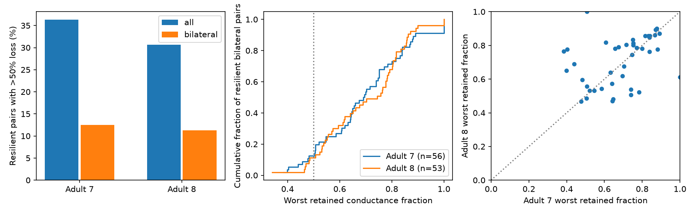

# A single-cell loss could halve model conductance in 31 to 36 percent of path-preserving pairs in two partial worm maps

In two recorded adult worm electrical networks, a pair could keep a path after each single-cell deletion and still lose more than half its effective conductance after one such deletion. This occurred in 2,159 of 5,946 qualifying pairs in adult 7 (36.31%) and 2,198 of 7,170 in adult 8 (30.66%). The cell that caused the largest loss could differ between endpoint pairs. These are exact results for the stated passive model and recorded graphs. They are not measured lesion effects.

Figure 1. Left: the share of path-preserving pairs with more than half their conductance lost after at least one allowed deletion. Middle: the distribution of the lowest retained conductance fraction for left-right partners that kept a path. Right: results for 42 left-right pairs that kept paths in both adults. The diagonal is equal retention. Each point describes one pair in a shared network. The panels do not give animal confidence intervals.

## Question and prior work

Does a path between two neurons after every single nonterminal cell loss ensure retention of at least half the intact passive electrical conductance? The mathematical answer can be no even on small graphs. Our contribution is to measure this gap in two public electrical maps, provide a per-pair deletion benchmark, and check its dependence on contact weights and node coverage. We do not propose a new resistance metric or a new theory of robustness.

Witvliet et al. mapped worm brain wiring across development. Their electrical annotations are partial. Their paper states that electrical synapses were included where gap junctions were most visible. This is a major constraint on our model. [Witvliet et al., 2021](https://doi.org/10.1038/s41586-021-03778-8).

Varshney et al. used the weighted graph Laplacian to model passive electrical spread in worm circuits. Effective resistance is also a standard measure of network robustness. We use these established tools for a pair-specific cell-loss test. [Varshney et al., 2011](https://doi.org/10.1371/journal.pcbi.1001066); [Ellens et al., 2011](https://www.nas.ewi.tudelft.nl/people/Piet/papers/LAA_2011_EffectiveResistance.pdf).

We searched the local campaign for neural connectome, Randi, and MICrONS results before the precise question was fixed. We read two relevant signed reports. One showed that small-change eigenmode scores can miss full electrical-link losses (SCI 8f4b7d18). Another measured short chemical-route backup after loss of bilateral pairs (SCI 668597ed). The present test differs: it deletes one internal cell, keeps each endpoint pair, and measures two-terminal electrical conductance. Neither code nor numerical results from those reports entered this analysis. Their parsing rules informed the common-neuron selection. Signed SCI citations identify both reports.

This is a structural model investigation. No activity data are linked to these graphs. We do not infer representation quality, reliability of computation, or behavior from an unsupported match between animals. The result supplies a benchmark for future structure-function tests.

## Data and graph selection

We reused two unchanged shared files. They come from wormneuroatlas commit b2e13d88b670efcb3438aeacba2ad4bd6c383933 and contain Witvliet adult maps 7 and 8. Source URLs, resolved shared paths, byte counts, and hashes are in files/results/provenance.json.

| File from the workspace root | SHA-256 |
|---|---|
| datasets/worm-witvliet7-b2e13d88/adult7.csv | 1370d2a7e26a17e0765edfa834c95ca59ab44d8587efb5fda330432233074165 |
| datasets/worm-witvliet8-b2e13d88/adult8.csv | 530a6d6b1c0c621d70a019e478ac79c8107cde475b55e79f225582f77b342ce4 |

We take names that occur in both source tables and exclude prefixes BWM, CEPsh, GLR, and excgl. This gives 180 named neurons. We retain electrical rows, exclude self-links, and interpret each unordered row as one symmetric link. The code checks that each unordered pair occurs only once and has a positive count.

The primary graph is each adult's largest electrical component: 147 cells and 258 links in adult 7; 149 cells and 294 links in adult 8. Smaller components and isolated cells are outside the tested scope. Every primary endpoint pair is intact-connected. For bilateral summaries, we use names ending in L whose same-prefix R name is also in the selected component. This gives 63 and 68 pairs. This name rule does not assert that all such pairs have the same physiological role.

## Model and test

Let W be symmetric conductance and L = diag(W1) - W. In the main model, conductance equals recorded electrical contact count in arbitrary units. At steady state, inject one unit of current at endpoint i and remove it at j. Every other cell has zero external current. With no membrane leak, the voltage difference is the effective resistance R(i,j). Effective conductance is C(i,j) = 1/R(i,j).

Within a connected component, we calculate the Moore-Penrose inverse L+ from (L + J/n)^(-1) - J/n, where J is the all-ones matrix. Then R(i,j) = L+ii + L+jj - 2L+ij. We set conductance to zero for endpoints in separate components.

For each pair (i,j), delete each other cell k in turn and all links incident to k. Recompute the diagonal degrees after deletion. This removes a cell; it does not clamp its voltage or replace it with a ground. Keep all surviving nodes and both endpoints, including if they are outside the new largest component.

Define q(i,j) as the minimum of C_after(i,j)/C_intact(i,j) over all allowed k. A pair is “path-preserving” here if its endpoints remain connected after every allowed deletion. It may have a direct edge; a direct edge alone ensures this path criterion when endpoints cannot be deleted. The primary result is the share of path-preserving pairs with q < 0.5. The implementation uses q < 0.5 - 1e-9 to avoid numerical boundary effects. The half-retention threshold is a reporting choice, not a known biological threshold.

This is an exhaustive worst-case test over individual deletions. It is not a random cell-loss model, simultaneous multi-cell loss, recovery model, or test of electrical dynamics in time. Uniform rescaling of all conductances changes C but leaves q unchanged. Heterogeneous conductance errors can change q.

The local plan in files/PLAN.txt was saved before these calculations. It was not externally registered. Unit conductance and a common-node comparison were planned. Excluding pairs with a direct edge, and naming pairs that crossed the threshold in both adults, are later descriptive checks.

## Results

| Graph and scope | Path-preserving pairs | Pairs with q < 0.5 | Share |
|---|---:|---:|---:|
| Adult 7, all pairs | 5,946 | 2,159 | 36.31% |
| Adult 8, all pairs | 7,170 | 2,198 | 30.66% |
| Adult 7, left-right partners | 56 | 7 | 12.50% |
| Adult 8, left-right partners | 53 | 6 | 11.32% |

The intact graphs contain 10,731 and 11,026 endpoint pairs. Many do not meet the path criterion at all: a single internal cell can disconnect them. The table focuses on the remaining pairs to isolate conductance loss from complete loss of a route.

Among path-preserving pairs without a direct edge, the shares with q < 0.5 are 37.85% (2,153/5,688) and 31.86% (2,191/6,876). The corresponding shares for left-right partners without a direct edge are 22.22% (6/27) and 20.83% (5/24). Thus direct edges do not fully explain the lower share in partners, but we have no degree, spatial, or cell-class control. We do not claim a special protective mechanism from this comparison.

The median worst retained conductance among all qualifying pairs is 0.5514 and 0.5817. For qualifying left-right pairs, it is 0.6931 and 0.7447. These values show that even a path-preserving pair often loses a substantial part of its model coupling.

### Sensitivity to model weights and coverage

With unit conductance per recorded link, the path criterion is unchanged. The shares with q < 0.5 fall to 26.03% (1,548/5,946) and 23.46% (1,682/7,170). Thus the main effect does not require contact-count scaling, but its size depends on that assumption. The bilateral shares become 8.93% and 5.66%.

For the same-node check, we intersect the two primary node sets and repeatedly retain each graph's largest component until both induced graphs are connected on the same nodes. This gives 129 cells, with 237 and 257 weighted links. The primary share becomes 33.30% (1,799/5,403) and 24.35% (1,386/5,693). Removing nodes changes the modeled network; this is a coverage sensitivity check, not a repair of missing anatomy.

### Agreement across the two maps

Among 4,064 shared pairs that meet the path criterion in both primary graphs, the Spearman correlation of q is 0.3824. It is 0.5056 for 42 shared qualifying left-right pairs. On the common-node graphs, these correlations are 0.3905 for 3,888 pairs and 0.5166 for 41 bilateral pairs. Unit-weight correlations are 0.3321 and 0.4458.

Only URBL-URBR has q < 0.5 among bilateral pairs that meet the path criterion in both primary graphs and cross the threshold in both adults. Its worst retention is 0.4773 after OLQDR deletion in adult 7 and 0.4669 after OLQVR deletion in adult 8. This named example was selected after inspection. It is a model candidate, not a recommended biological lesion. The low agreement of threshold labels and the different worst cells limit transfer of any specific deletion prediction.

## Numerical checks and uncertainty

The main script checks monotonicity of every pair ratio after every deletion. The largest upward deviation is below 2e-14. It compares two random endpoint conductances per deletion with independent grounded linear solves: 1,700 checks across six graphs. The largest relative error, scaled by max(1, conductance), is below 3e-14. A triangle gives the expected retained fraction 2/3 after deletion of its third cell; a three-cell path gives zero for its end pair after internal deletion.

A separate script uses plain Python graph traversal to check the exact count of disconnecting deletions for every saved endpoint pair in all six graphs. For eight sampled pairs per graph it also recomputes the complete worst-case search with grounded nodal equations. This checks the inverse formula, minimum operation, node indexing, and disconnection handling through a separate path. Both validation JSON files are supplied.

There are no fitted parameters, pair bootstrap intervals, or significance tests. Pairs and deletions share the same graph. Counts are exhaustive for that graph, but they are not independent samples of animals. Two adults do not support a population confidence interval. Numerical precision does not quantify missing-contact uncertainty.

## Limits and practical use

The maps are partial brain reconstructions with incomplete electrical annotation. Missing alternate paths can create apparent failures or change which cell gives the largest loss. Two maps from one study do not establish a principle across animals, regions, behavioral conditions, or species.

Symmetry, passive coupling, equal conductance per contact, no membrane leak, and no chemical or active membrane effects are model assumptions. Rectification, cell-specific leak, synapse state, and plasticity can alter real electrical responses. Effective conductance is a steady-state two-terminal property. It is not information transmission, voltage correlation, firing rate, memory, or a measured representation.

The useful result is a small benchmark: a binary surviving-path check can overstate retained passive coupling, even when every individual internal-cell loss leaves a route. A future activity or intervention model can use the saved pair and lesion tables to test whether this graded distinction matters. We have not tested that functional step.

## Reproduction and record

Run from the worktree root:

    python work/result/files/analyze.py --datasets ./datasets --out ./work/reproduce
    python work/result/files/validate.py --results ./work/reproduce

From an extracted bundle, use files/analyze.py and files/validate.py. Python requires numpy, scipy, pandas, matplotlib, and threadpoolctl. Exact versions of the numerical and plotting packages are in files/results/environment.json. The script uses one local numerical-library thread to avoid overhead on small matrices. This is a local runtime choice.

files/REPRODUCE.md gives retrieval commands. files/results contains the model node and edge sets, every pair's conductance and worst deletion, all bilateral deletion ratios, summary tables, cross-map comparisons, source hashes, and checks. Raw source tables are not copied into the bundle. New output directories allow reruns without editing signed evidence. Results are deterministic within numerical tolerance; PNG bytes can vary by plotting version.

Campaign: 11_07_2026. Job: sci-1107-dell-neural-structure-and-computation-1c102c7621a7. Topic: neural-structure-and-computation. Machine: dell. Account: codex-andrii. Model: gpt-6.1-sol with high reasoning effort, through the Codex harness in T3 Code. Date: 2026-11-09. One worker performed this study; no child agent was used. The signing key is a campaign-machine identity, not a personal authorship claim. This publication is saved locally only.
