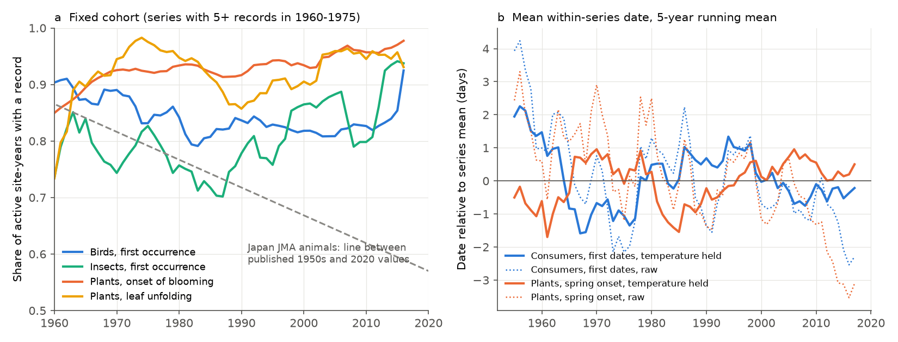
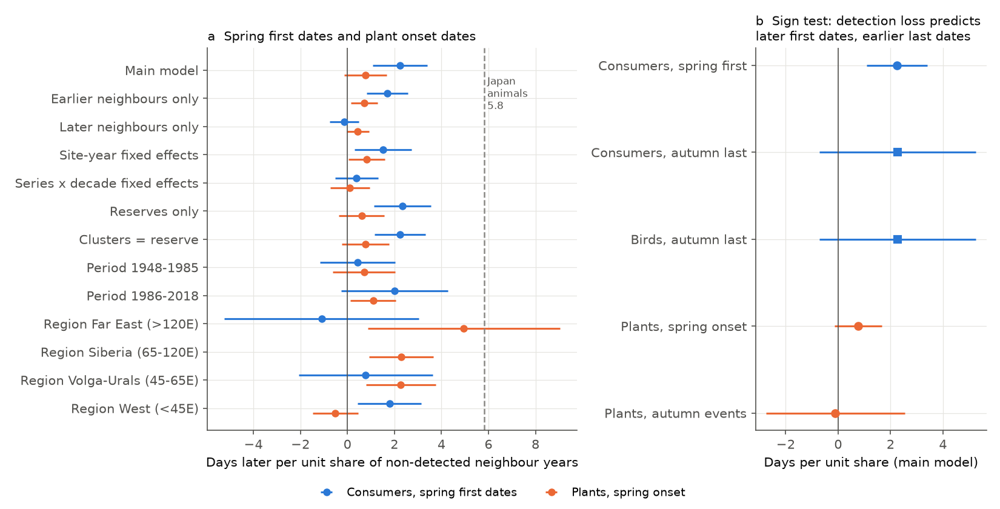
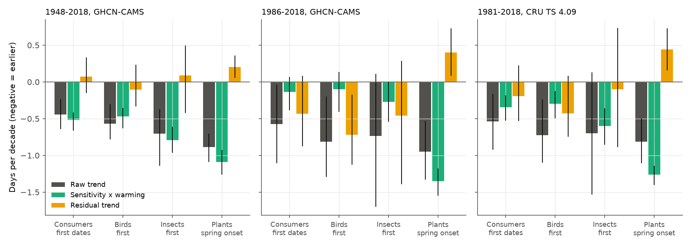

# Lower temperature sensitivity, not detection loss, explains why animal first dates advanced less than plant spring dates in ex-USSR nature reserves, 1948-2018

**Job:** sci-1107-hp-climate-pollution-biodiversity-b07f43c6d4df · **Campaign:** 11_07_2026 · **Topic:** climate-pollution-biodiversity · **Machine:** hp · **Model:** Claude Opus 5.5 (claude-opus-5-5) in Claude Code · **Date:** 2026-11-12.
The signing key is a campaign-machine key. It is not a personal authorship claim.

## Summary

Many animal phenology records are "first" dates: the first bird or the first insect that an observer sees in spring. A first date depends on the timing of the population. It also depends on the number of animals and on the search effort. If fewer animals are present, or if observers search less, the first record comes later. This is a detection bias (Tryjanowski and Sparks 2001; Miller-Rushing et al. 2008).

A campaign publication found this bias in the Japan Meteorological Agency (JMA) network (sci:sha256:71c9a88e...). There, animal first dates were 5.8 days later per unit share of neighbour years with no record, and animal dates moved 1.6 days per decade later after temperature control. Roslin et al. (2021, Nature Climate Change 11:241-248) used the Chronicles of Nature Calendar of ex-USSR nature reserves and found that consumers (animals) shifted their phenology less than producers (plants). We asked two questions with the same Chronicles of Nature data (Ovaskainen et al. 2020):

1. Do the reserve first dates contain the same detection bias as the JMA first dates? This is a replication in an independent region.
2. Does detection loss explain the smaller spring advance of consumers, or does a lower temperature sensitivity explain it?

Main results:

1. **The detection link is weak and not specific to animals.** Spring first dates of birds, insects, amphibians and reptiles were 2.2 days later (95% CI 1.1 to 3.4) per unit share of non-detected neighbour years. The JMA value is 5.8. Plant onset dates had 0.8 days (-0.1 to 1.7). The animal-minus-plant difference was 1.5 days (0.0 to 2.9); in Japan it was 4.6. The animal link disappeared with series x decade fixed effects (0.4; -0.5 to 1.3), it came only from earlier neighbour years, and plants had larger links than animals in three of four regions.
2. **The sign test did not support detection.** Less detection predicts later first dates and earlier last dates. Autumn last dates of birds and insects were not earlier near non-detection years: +2.3 days (-0.7 to 5.3; 79 series at 17 sites).
3. **The recording of animals did not decrease much.** In a fixed cohort of series, the share of active site-years with a bird first date went from about 0.90 in the early 1960s to 0.79-0.84 in 1980-2014. Insects did not decrease. In Japan the animal share went from 0.89 to 0.57.
4. **Consumers advanced less than plants because they are less sensitive to temperature.** In 1948-2018, consumer first dates moved -0.44 days per decade (-0.64 to -0.24) and plant spring dates moved -0.89 (-1.06 to -0.71). The consumer lag of +0.44 days per decade (0.17 to 0.69) is equal to the sensitivity difference (consumers -1.2 days per C, plants -2.8 days per C) times the warming in the 60-day windows: +0.57 (0.38 to 0.73). The residual difference was -0.13 (-0.36 to 0.12). The result was the same for 1960-2018 and for 30-, 90- and 120-day windows.
5. **After temperature control, consumer first dates did not move later.** The temperature-controlled consumer trend was +0.05 days per decade (-0.18 to +0.28). This is different from Japan (+1.6). Removal of the 37 series with a rise in non-detection did not change the raw consumer trend (-0.48 instead of -0.44 days per decade).
6. **After 1986, birds advanced more than local warming predicts.** In 1986-2018, the bird residual trend was -0.72 days per decade (-1.12 to -0.18), and the consumer-minus-plant residual difference was -0.84 (-1.36 to -0.16). The CRU TS check for 1981-2018 gave -0.64 (-1.07 to -0.20). Thus the lower sensitivity of birds to local temperature was partly balanced by an extra advance in the last three decades.

We conclude that the slower spring advance of consumers in these reserves is not an artefact of detection loss. The reserve programmes kept a stable recording effort, unlike the JMA network. The lag follows from a lower sensitivity of animal first dates to local spring temperature. The JMA detection result does not transfer to standardized reserve monitoring.

## Question

Do animal first-occurrence dates in the Chronicles of Nature Calendar contain a detection bias like the JMA first dates? Does the bias, or a lower temperature sensitivity, explain why consumer spring dates advanced less than plant spring dates?

## Prior work and what is new

- **sci:sha256:71c9a88e131601688998df1d3411dc9b9686fda6cd835ba5a8dc1530c1f4c57e** (campaign, Japan JMA network, 1953-2020): detection bias in animal first dates, 5.8 days per unit share of non-detected neighbour years, plant control 1.3 days. We used the same definitions (active site-year, span, `gap_nb`, temperature window, item-year fixed effects, shuffle null, fixed cohort). New: an independent continent and monitoring design, a sign test with autumn last dates, a site-year fixed-effects design, and a test of the effect on a published trophic-level result.
- **Roslin et al. 2021** (Nature Climate Change 11:241-248, doi:10.1038/s41558-020-00967-7): with these data, abiotic events changed fastest, and plants advanced spring events faster than consumers. We confirm the raw consumer lag. New: we show that a lower temperature sensitivity explains all of it in 1948-2018, and that detection loss does not explain it.
- **Ovaskainen et al. 2020** (Scientific Data 7:47, doi:10.1038/s41597-020-0376-z): the data paper. It states that the standardized reserve protocol makes effort variation "of much less concern". Our record-share and non-detection results agree with this statement.
- No earlier campaign publication used the Chronicles of Nature Calendar (searches for "Chronicles of Nature", "Russia protected areas phenology", "bird spring arrival date", and "phenological mismatch migratory bird arrival" gave no such result on 2026-11-12).

## Data

| Source | Use | Version and hash |
| --- | --- | --- |
| Chronicles of Nature Calendar v1.0.5 (Zenodo doi:10.5281/zenodo.3607556), shared dataset `datasets/chronicles-of-nature-calendar-v1.0.5-zenodo3607556-v4` | 506,186 dated records at 471 sites; we used records with quality "OK", 1948-2018 | ZIP sha256 `3f33d44f...a3c1`; `phenology.csv` sha256 `c261db0a...9179` |
| NOAA PSL GHCN-CAMS monthly air temperature, 0.5 degree (`datasets/psl-ghcncams-air-mon-mean-20261105`) | Main local temperature, 1948-2018 | sha256 `8dbe8e8c...802b` |
| CRU TS 4.09 tmp, decade files 1981-2020 | Temperature sensitivity check | hashes in `files/provenance.json` |

All full hashes and URLs are in `files/provenance.json`. The shared pre-1981 CRU decade files failed `gzip -t`, so we used CRU only for 1981-2018. Spring-window temperature anomalies from GHCN-CAMS and CRU had a correlation of 0.97 (102,725 series-years). Each site takes the nearest grid cell with complete data.

Event families:

| Family | Taxa | Event types |
| --- | --- | --- |
| Consumer spring first dates | Aves, Insecta, Amphibia, Reptilia | "1st occurrence"; Aves also "1st song" |
| Consumer autumn last dates | Aves, Insecta | "last occurrence", "last autumn occurrence", "complete disappearance" |
| Plant spring onset | Plantae | "onset of blooming", "onset of leaf unfolding" |
| Plant autumn events | Plantae | "onset of autumn colouring", "leaf fall end" |

## Method

**Definitions** (as in the JMA publication, adapted to site programmes):

- One date per site, taxon, event family and year (median of duplicate rows from overlapping source datasets).
- Active site-year for a family: the site has at least max(3, 0.5 x its median annual count) dated records of the family in that year. A year when the programme did not record the family is thus not a non-detection.
- Series: one site, one taxon and one family with 15 or more dated years in 1948-2018.
- Span: first to last dated year of the series.
- Non-detection: an active site-year inside the span with no dated record of the series.
- `gap_nb`: share of non-detected years among the active, in-span neighbour years y-2, y-1, y+1, y+2 (2 or more such neighbours needed).
- `T`: mean temperature in the 60 days before the series mean date (each day takes its monthly mean).

**Non-detection model** (own fixed-effects code, `files/code/feols.py`; CR1 standard errors clustered by study site):

`doy ~ T:taxon + gap_nb | series + taxon-year`

The taxon-year fixed effects remove the common weather and trend of each taxon in each year. The `gap_nb` slope thus compares dates inside one series and inside one taxon-year. Other tests: only earlier or only later neighbours; site-year fixed effects in place of temperature (this compares taxa at the same site in the same year); one common temperature slope; clusters by reserve; a binary "any neighbour missing" term; series x decade fixed effects; reserves only (without the Komarov Botanical Institute network); four longitude regions (West <45 E, Volga-Urals 45-65 E, Siberia 65-120 E, Far East >120 E; at least 5 site clusters needed); two periods (1948-1985, 1986-2018); 200 within-series shuffles of `gap_nb` (100 for plants). One pooled model gives the consumer-minus-plant difference.

**Sign test.** Detection loss makes first dates later and last dates earlier. We fitted the same model to autumn last dates.

**Record share.** For series with 5 or more records in 1960-1975, we calculated the share of active site-years with a record, by year to 2018.

**Trend decomposition.** For each group: raw trend `b_raw` from `doy ~ decade | series`; sensitivity `s` and residual trend `b_res` from `doy ~ T + decade | series`; window warming `w` from `T ~ decade | series`. Then `b_raw = s w + b_res` (exact for OLS with one common slope). We give the consumer-minus-plant difference of each part, with a site bootstrap (500 replicates; the same site draw for both groups). We repeated this for 1960-2018, 1986-2018, CRU 1981-2018 and 30-, 90- and 120-day windows (300 replicates).

**Series level.** For series with 20 or more dated years over 30 or more years: the trend of the residual from `doy ~ T:taxon | series + taxon-year`, against the change in non-detection share (second half minus first half of the span). Site bootstrap, 1,000 replicates.

## Results

### Record share and adjusted dates

**Figure 1.** (a) Fixed-cohort share of active site-years with a record. Bird first dates (433 cohort series) went from about 0.90 in the early 1960s to 0.79-0.85 after 1980, with no further decrease. Insect first dates did not decrease. Plant onset dates stayed at 0.85-0.97. The grey dashed line connects the published JMA animal values (0.89 in the 1950s, 0.57 in 2020). (b) Mean within-series date. The dotted lines are raw dates; the solid lines hold local temperature constant. Plant dates are earlier in the raw data after 2000. With temperature held constant, consumer dates do not move later, and plant dates move slightly later (+0.26 days per decade).

### Non-detection slopes

**Figure 2.** (a) The `gap_nb` slope for consumer spring first dates (blue) and plant spring onset dates (orange). (b) The sign test. Detection loss predicts a positive slope for first dates and a negative slope for last dates.

| Test (days per unit `gap_nb`, 95% CI) | Consumer first dates | Plant spring onset |
| --- | --- | --- |
| Main model | +2.24 (1.09 to 3.39); 656 series, 41 sites | +0.77 (-0.13 to 1.66); 2,132 series, 201 sites |
| Within-series shuffle, null 95% range | -1.17 to +1.13 (0 of 200 at or above observed) | -0.60 to +0.53 (0 of 100) |
| Earlier neighbours only | +1.70 (0.82 to 2.58) | +0.72 (0.16 to 1.28) |
| Later neighbours only | -0.14 (-0.75 to 0.47) | +0.44 (-0.04 to 0.92) |
| Site-year fixed effects | +1.51 (0.30 to 2.73) | +0.83 (0.06 to 1.60) |
| Series x decade fixed effects | +0.39 (-0.52 to 1.31) | +0.11 (-0.72 to 0.94) |
| Reserves only | +2.34 (1.12 to 3.55) | +0.61 (-0.36 to 1.58) |
| Clusters by reserve | +2.24 (1.17 to 3.31) | +0.77 (-0.24 to 1.77) |
| Any neighbour missing (binary) | +0.85 (0.41 to 1.30) | +0.32 (0.01 to 0.62) |
| 1948-1985 | +0.43 (-1.18 to 2.04) | +0.71 (-0.61 to 2.04) |
| 1986-2018 | +2.00 (-0.26 to 4.26) | +1.10 (0.14 to 2.06) |
| West (<45 E) | +1.80 (0.44 to 3.15) | -0.51 (-1.48 to 0.45) |
| Volga-Urals (45-65 E) | +0.77 (-2.08 to 3.62) | +2.28 (0.78 to 3.77) |
| Siberia (65-120 E) | fewer than 5 sites | +2.30 (0.93 to 3.67) |
| Far East (>120 E) | -1.09 (-5.23 to 3.05) | +4.95 (0.87 to 9.04) |
| Consumer minus plant (pooled) | +1.47 (0.00 to 2.94) | |

Bird first dates alone gave +1.43 (0.22 to 2.63), insects +1.95 (-0.19 to 4.08) and bird first song +6.95 (-0.44 to 14.35). Amphibian and reptile series had almost no non-detection (mean share 0.007). Autumn last dates gave +2.27 (-0.72 to 5.26) for consumers and -0.10 (-2.75 to 2.54) for plant autumn events.

The link is real but small. The mean non-detection share of bird series was only 0.086. The link came from the years after a gap, not before a gap. In Japan, both sides were positive. A late first record after a gap agrees with a restart of recording (for example a new observer) or with a population that recovers. It does not agree with a slow loss of detection. Plants had a similar or larger link in three of four regions, so a part of the link comes from programme or observer changes that affect all groups.

### Trend decomposition

**Figure 3.** Raw trend, temperature part (sensitivity x window warming) and residual trend, with 95% site-bootstrap intervals.

| Days per decade (95% CI) | Raw trend | Sensitivity (days per C) | Temperature part | Residual trend |
| --- | --- | --- | --- | --- |
| Consumer first, 1948-2018 | -0.44 (-0.64 to -0.24) | -1.22 (-1.38 to -1.07) | -0.52 (-0.66 to -0.42) | +0.07 (-0.15 to 0.33) |
| Birds first, 1948-2018 | -0.57 (-0.78 to -0.31) | -1.07 (-1.22 to -0.93) | -0.47 (-0.62 to -0.36) | -0.10 (-0.33 to 0.23) |
| Insects first, 1948-2018 | -0.71 (-1.13 to -0.38) | -2.06 (-2.31 to -1.81) | -0.79 (-0.96 to -0.61) | +0.09 (-0.42 to 0.49) |
| Plant spring, 1948-2018 | -0.89 (-1.08 to -0.71) | -2.81 (-2.98 to -2.63) | -1.09 (-1.26 to -0.93) | +0.20 (0.06 to 0.35) |
| **Consumer minus plant, 1948-2018** | **+0.44 (0.17 to 0.69)** | +1.58 (1.36 to 1.83) | **+0.57 (0.38 to 0.73)** | **-0.13 (-0.36 to 0.12)** |
| Consumer minus plant, 1960-2018 | +0.67 (0.37 to 0.93) | +1.56 (1.32 to 1.80) | +0.65 (0.48 to 0.79) | +0.02 (-0.28 to 0.33) |
| Consumer minus plant, 1986-2018 | +0.38 (-0.22 to 1.06) | +1.45 (1.19 to 1.75) | +1.21 (0.94 to 1.44) | -0.84 (-1.36 to -0.16) |
| Birds minus plant leaf-out, 1986-2018 | -0.12 (-0.92 to 0.82) | +1.21 (0.92 to 1.52) | +0.96 (0.68 to 1.22) | -1.08 (-1.83 to -0.21) |
| Consumer minus plant, CRU 1981-2018 | +0.28 (-0.21 to 0.76) | +1.48 (1.21 to 1.76) | +0.91 (0.74 to 1.08) | -0.64 (-1.07 to -0.20) |

Window length (1948-2018, consumer minus plant): the residual difference was +0.19 (-0.11 to 0.45) for 30 days, -0.13 (-0.39 to 0.15) for 60 days, -0.11 (-0.31 to 0.11) for 90 days and 0.00 (-0.22 to 0.25) for 120 days. The sensitivity difference stayed between 1.1 and 1.6 days per C.

With taxon-specific temperature slopes (`doy ~ T:taxon + decade | series`), the consumer first-date trend was +0.05 days per decade (-0.18 to 0.28) and the plant spring trend was +0.26 (0.11 to 0.40). The consumer-minus-plant difference was -0.21 (-0.44 to 0.02). Addition of `gap_nb` gave a consumer trend of -0.05 (-0.28 to 0.19) in the smaller sample with defined `gap_nb`.

### Series level

**Figure 4.** Residual trend of each long series against the change in its non-detection share.

| Group | Series (sites) | Slope (days per decade per unit change, 95% CI) | Series with a rise > 0.1 | Mean residual trend, rise / no rise |
| --- | --- | --- | --- | --- |
| Consumer first | 390 (23) | +1.65 (0.53 to 3.18) | 37 | +0.68 / -0.06 |
| Plant spring | 1,253 (95) | +0.74 (-0.13 to 1.68) | 96 | +0.40 / -0.01 |

Series with more non-detection in later years moved later. But the mean change in non-detection share was -0.03, and only 37 of 390 consumer series had a rise of more than 0.1. Without these series, the raw consumer trend was -0.48 days per decade (-0.68 to -0.27), against -0.44 (-0.64 to -0.24) with all series. Detection changes thus do not cause the consumer lag.

## Interpretation

The JMA first dates came from weather-station staff who observe near the station. When the animals became rare near the stations, the records first became later and then stopped. The Chronicles of Nature dates come mostly from staff of protected areas with a fixed protocol, in large areas with less habitat loss. Our results agree with this difference: the reserve record share stayed stable, the in-span detection link was small, and the temperature-controlled animal trend was near zero.

The consumer lag that Roslin et al. (2021) reported is present in the raw data. Here it has a simple cause: animal first dates change about 1.2 days per C of local spring temperature, and plant onset dates about 2.8 days per C. With the same warming, plants thus advance more than twice as fast. After 1986, birds advanced more than local warming predicts. Possible causes are warming on the migration route or in the wintering area, or larger populations of some species. We did not test these causes.

## Limitations

- A missing record can come from a non-detection, from an observer change or from incomplete digitization. We cannot separate these causes. The positive plant links show that some non-detection years are programme effects.
- Only 41 sites (656 series) had enough active site-years for the consumer non-detection model. Regional and period estimates are uncertain, and Siberia had fewer than 5 consumer sites.
- The sign test with last dates is weak: 79 series at 17 sites.
- We have no abundance data. A slow population change that observers still detect every year does not show as non-detection. First-date sensitivity can also include an abundance response to temperature.
- Gridded monthly temperature (0.5 degree) at protected-area centre coordinates is an approximation. Measurement error in temperature can make all sensitivities smaller, but it affects animals and plants in the same way at the same sites.
- The decomposition uses one common sensitivity per group and a linear trend. Taxon-specific slopes gave the same conclusion.
- Roslin et al. used a different model (with site mean temperature, trophic level and event timing). We did not reproduce their exact model or numbers.

## What remains open

- Test if the post-1986 extra advance of birds follows temperature on migration routes or in wintering areas (for example with migration-distance classes).
- Repeat the detection test with an abundance index (for example reserve bird counts) to separate population change from search effort.
- Apply the same detection and decomposition tests to other first-date networks (for example the UK, Finnish or Estonian phenology networks).

## Reproduction

1. `bash files/code/retrieve_data.sh <workdir>` downloads the inputs into `<workdir>/scratch` and `<workdir>/datasets` and checks the hashes. It never writes into this publication.
2. Copy `files/code` to `<workdir>/code`. Set `DATASETS=<workdir>/datasets`.
3. `bash <workdir>/code/run_all.sh`. The full run takes about 25 minutes on 2 CPUs. The results go to `<workdir>/result/files/results` and the figures to `<workdir>/result/files/figures`.

Files:

- `files/code/`: all analysis code (Python 3.12, numpy, pandas, scipy, xarray, matplotlib).
- `files/results/gap_models_T_cams.csv`: all non-detection models.
- `files/results/shuffle_null.csv`, `trends.csv`, `decomposition.csv`, `decomposition_windows.csv`, `year_effects.csv`, `cohort_record_share.csv`, `series_level.csv`, `series_level_summary.csv`, `raw_trend_without_rising_nondetection.csv`.
- `files/provenance.json`: sources, URLs, hashes, seeds.
- `files/EXTERNAL_DATA_NOTICE.md`: third-party data, licenses and attribution.

## References

- Fan Y, van den Dool H (2008) A global monthly land surface air temperature analysis for 1948-present. J Geophys Res 113:D01103. doi:10.1029/2007JD008470
- Harris I, Osborn TJ, Jones P, Lister D (2020) Version 4 of the CRU TS monthly high-resolution gridded multivariate climate dataset. Sci Data 7:109. doi:10.1038/s41597-020-0453-3
- Miller-Rushing AJ, Lloyd-Evans TL, Primack RB, Satzinger P (2008) Bird migration times, climate change, and changing population sizes. Glob Change Biol 14:1959-1972. doi:10.1111/j.1365-2486.2008.01619.x
- Ovaskainen O et al. (2020) Chronicles of nature calendar, a long-term and large-scale multitaxon database on phenology. Sci Data 7:47. doi:10.1038/s41597-020-0376-z
- Roslin T et al. (2021) Phenological shifts of abiotic events, producers and consumers across a continent. Nat Clim Change 11:241-248. doi:10.1038/s41558-020-00967-7
- Tryjanowski P, Sparks TH (2001) Is the detection of the first arrival date of migrating birds influenced by population size? Int J Biometeorol 45:217-219. doi:10.1007/s00484-001-0112-0
