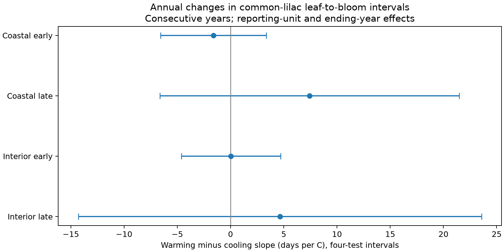

# Annual warming and cooling gave no clear common slope difference in western US lilac intervals in 1968-2008

We tested whether spring temperature rises and falls had different links to annual changes in the time from first leaf to first bloom. Four western US common-lilac samples used 1,729 consecutive-year pairs in two geographic groups and two periods. Models removed reporting-unit and ending-year effects and controlled winter temperature changes. Warming-minus-cooling slopes ranged from -1.62 to +7.43 days per C. 0 of four intervals excluded zero after correction for four tests. The test uses annual weather changes, not experimental warming. Missing visits, selected complete records, coarse monthly weather, few geographic blocks, and possible plant replacement limit inference. The package gives raw-data hashes, a paired panel, code, all estimates, numerical checks, and a reproduction recipe.

## Question and prior work

Can a linear response to spring weather describe both warming and cooling from one year to the next? If it cannot, the use of one mean slope can hide a timing response that depends on the direction of weather change. We test the interval from first leaf to first bloom. We do not measure flower abundance, pollinator use, survival, or species loss.

[Rosemartin et al.](https://doi.org/10.1038/sdata.2015.38) describe the US lilac and honeysuckle archive. [Ma et al.](https://doi.org/10.1111/1365-2745.13558) and [Guo et al.](https://doi.org/10.1016/j.cub.2023.06.064) studied unequal leaf and flower responses. A [2019 transplant study](https://doi.org/10.3389/fpls.2019.01310) tested unequal warming and cooling responses in plant communities. It motivates the question, but annual weather differences in planted lilac are a different test.

We searched published campaign records before the final question. The initial searches ended with signal 15 after they updated part of the verified local cache. A later `sci search "lilac" --in ./campaign --json` completed with status ok. Its first 20 returned matches and verification report are in files/campaign_search.json; this limited result page is not an exhaustive review. We read the signed published text of the seasonal interval study SCI 79d05fc84429914f21d791970d11e15b5d93fb245e77314068fc86d8653eb679, the spatial timing study SCI 6c7d6feb8127fb07551b404bfe5a8da7e3621b9bb73e024ffc20967f33da7622, and the winter interaction study SCI 551302875a5c81f37d7854aa0bbefe4669a61810d9d3573f192717bbbf19b501. These results led us to change the initial basic seasonal test to the present direction test. We use the same raw archive. This is an extension of the evidence, not independent biological replication. The design record and literature notes are in files/. The test was not registered outside this workspace.

## Data and selection

We read the shared observation workbook v13, its field workbook v14, and NOAA GHCN-CAMS monthly temperature v3.01. Temperature data were provided by NOAA PSL, Boulder, Colorado, USA. [Fan and van den Dool](https://doi.org/10.1029/2007JD008470) describe the weather product. files/provenance.json gives the exact resolved shared paths, source URLs, file sizes and SHA-256 hashes. We did not change shared data. No new raw download was needed.

The source has 116,662 observation rows. We keep common lilac (species ID 36), historic program IDs 7 and 8, 1956-2008, sites from 38 to 50 N and 125 to 66 W, event days from 1 to 240, and first-leaf or first-bloom records. We take the median date if a site-individual-year-phase has more than one row. We require both dates, and at least ten paired years for each site-individual reporting unit in the full selected record. The historical individual ID can refer to a plant group. We therefore use the term reporting unit. The field workbook reverses the historic program labels relative to the source paper, so we use geographic coordinates rather than those labels for regions.

The builder gives 2,655 paired unit-years. The primary models use only sites west of 100 W. We split these at 110 W. The label Coastal means longitude west of 110 W; it does not specify coastal habitat. Interior means 110-100 W. We form annual differences only if two records from the same unit are exactly one calendar year apart. Both years must be in 1956-1981 or both in 1982-2008. Each fitted sample requires at least five adjacent pairs per unit. We do not bridge missing years. Thus the intervals apply to selected long and complete records.

The gap is bloom day minus leaf day. A leap day shifts both dates and cancels from this gap. Spring is the equal-month mean of March and April. Winter is the equal-month mean of the prior December and current January and February. We use the nearest 0.5-degree grid cell. The source temperature is in Kelvin; temperature differences have the same numeric value in C. Fixed monthly windows can include weather after an event. We do not treat these terms as strict prior exposures or forecasts.

## Model

For each sample, the response is the change in the leaf-to-bloom gap from one year to the next. Predictors are the signed spring temperature change, its absolute value, and the signed winter temperature change. We remove reporting-unit effects and ending-year effects by repeated removal of group means. The unit effect in the difference model also absorbs a constant unit-specific trend in gap length. Year effects remove shared annual influences and the common part of annual weather change.

The fitted equation is:

`change in gap = unit effect + ending-year effect + b * spring change + c * absolute spring change + w * winter change + error`.

The warming-direction slope is `b+c`. The cooling-direction slope, expressed as the derivative with respect to signed temperature change, is `b-c`. The primary contrast is `2c`, in days per C. A positive contrast means the warming-direction derivative is more positive. It does not mean both directions delay bloom. A null contrast is compatible with a common linear slope. This model does not separate a biological memory effect from missing variables or selective reporting.

Each adjacent pair has equal weight. A unit with more pairs has more weight. For uncertainty, we group sites into fixed 5-degree latitude-longitude blocks. We add the block and ending-year score variance and subtract their intersection score variance. Each component has a cluster-count correction. We also apply `(n-1)/(n-k)`, with k equal to the sum of unit and year indicator counts minus one plus the number of exposure terms. This is approximate if the indicator graph is disconnected. The t reference uses the smaller number of blocks or years minus one. Four 98.75% intervals give nominal 95% coverage for the four primary contrasts under this approximation. Few blocks, shared weather across blocks, and adjacent pairs that share an event year can make this approximation weak. The full covariance eigenvalue diagnostic is saved. We use only the contrast variance for its interval.

The checks add quadratic level-temperature changes, remove any pair with an individual-outlier or context-inconsistency flag in either year, give each unit equal total weight, replace blocks with site clusters, or add block and year variance without subtraction. The quadratic terms are the signed temperature change times its two-year midpoint. They allow a curved relation between level temperature and gap, which could otherwise resemble a direction effect. These checks give individual 95% intervals in the result file; their 98.75% columns are also saved for comparison. Flag removal can itself select records based on climate, so it is a sensitivity check, not proof of low observation bias.

## Results

| Sample | Year pairs | Units | Blocks | Actual ending years | Difference, days/C | Four-test interval |
|---|---:|---:|---:|---|---:|---|
| Coastal early | 832 | 89 | 9 | 1968-1981 | -1.620 | -6.589 to +3.349 |
| Coastal late | 285 | 34 | 7 | 1983-2008 | +7.428 | -6.620 to +21.477 |
| Interior early | 442 | 46 | 6 | 1968-1981 | +0.039 | -4.626 to +4.705 |
| Interior late | 170 | 22 | 5 | 1983-2008 | +4.639 | -14.296 to +23.574 |

0 of the four adjusted intervals exclude zero. The data do not establish one common direction difference across the four settings. They also do not establish symmetry or equivalence to zero. A difference in which intervals exclude zero would not by itself show that regional or period slopes differ.

The early contrasts are -1.62 and +0.04 days/C. The late contrasts are +7.43 and +4.64 days/C. Their uncertainty is large, especially in the late samples. The quadratic late Coastal check has an individual 95% interval above zero (+0.97 to +17.13 days/C), but its four-test interval includes zero. It does not repeat clearly in the other settings. Flag removal, equal-unit weights, site clusters, and the wider variance check do not establish a common difference. The primary early Interior full covariance matrix has a negative eigenvalue, although the contrast variance is positive. This is a further sign of weak cluster inference. There are only 5-9 geographic blocks. All sensitivity estimates and sample counts are in files/asymmetry_estimates.csv. Primary slopes were also fitted with an explicit full indicator matrix using a separate least-squares routine. The maximum coefficient differences are in files/numerical_checks.json. This checks the implementation, not the scientific assumptions. Two raw workbook readers gave the same 2,655-row panel within the saved numeric tolerance. A repeat from the rebuilt panel gave the same 24 model results, with a maximum numeric difference of zero. files/validation.json records these checks.

## Meaning and limits

The test gives an inspectable method for separating annual warming and cooling directions in paired event intervals. It uses different sites across geographic groups and different years across periods. Some units occur in both periods. Broad weather systems can affect both regions. These are tests across settings within one archive, not independent experiments.

Paired phases and consecutive records reduce changes in site composition and constant reporting differences. They do not remove weather-dependent visit delays, observer changes, replacement plants, unrecorded nonflowering, or selective missing dates. Missing visit histories prevent direct bounds on event-date error in these historic records. The archive contains cultivated shrubs and is not a random sample of wild plants. A five-pair rule in each subset can select unusually consistent observers. Regional thresholds and weather windows are choices, not ecological boundaries.

Annual weather variation does not equal long-term climate change. The model does not identify causal hysteresis. Monthly means do not measure daily heat waves, frost, water shortage or chilling hours. We do not measure air pollution, species distributions, community diversity, or damage. This investigation addresses ecological timing within the wider assigned objective. A stronger test needs daily local weather, documented visits, stable plant identity, and new independent regions.

## Reproduction and campaign record

Run the commands in files/REPRODUCE.md. The package contains code, derived paired records and adjacent pairs, full estimates, a figure, raw-source provenance, and numerical checks. Raw data remain in the shared store and are not copied into the bundle. The exact source snapshot hashes are needed because the upstream weather file changes over time.

Campaign 11_07_2026. Job sci-1107-dell-climate-pollution-biodiversity-6d9f52bdfd11. Topic climate-pollution-biodiversity. Machine dell. Account codex-andrii. Model gpt-6.1-sol, high reasoning effort, in T3 Code through the Codex harness. Analysis date 2026-11-08 UTC. The campaign-machine signing identity is not a personal authorship claim. The signed bundle is saved locally. It is not uploaded or submitted to a remote index.
