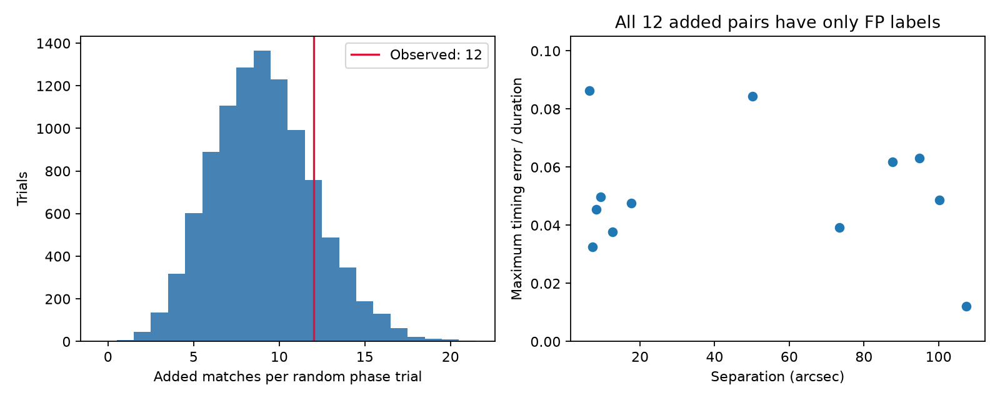
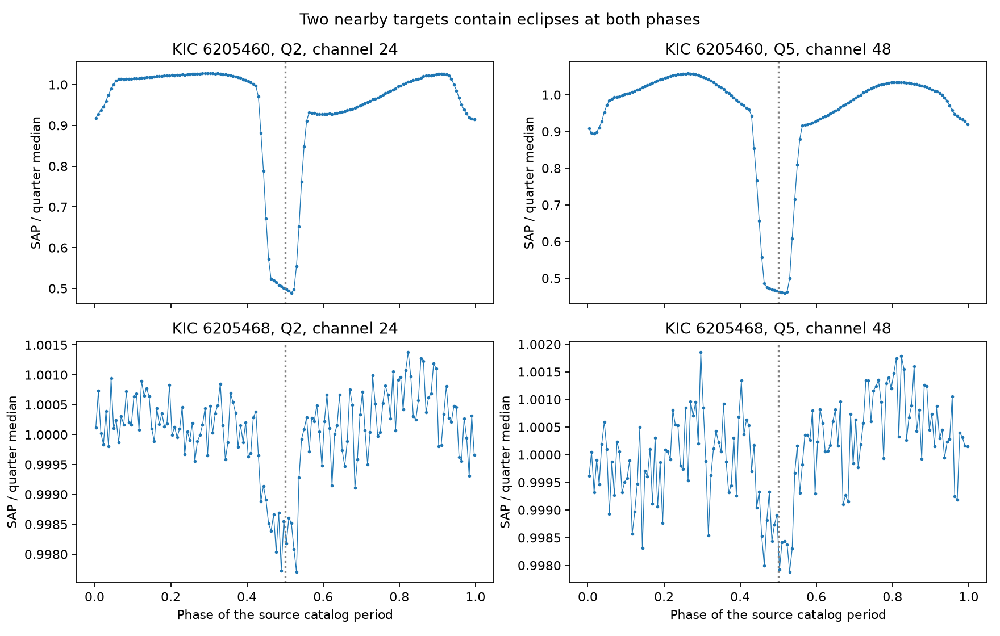
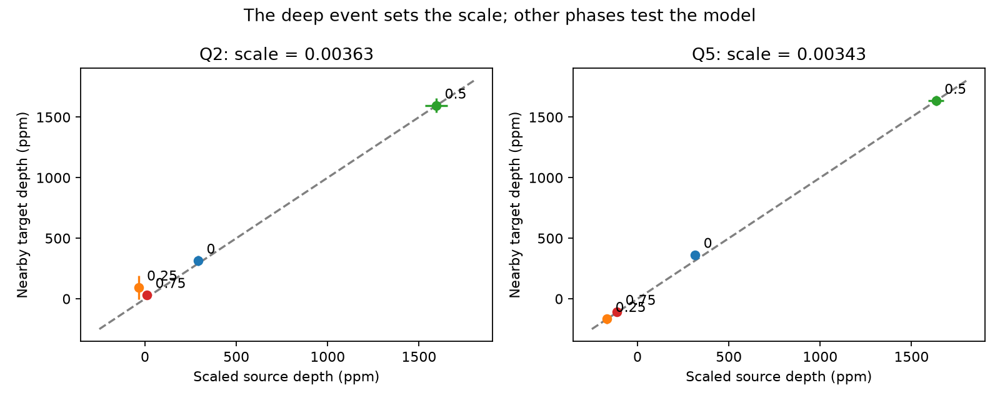

# A shared-light model predicts the weaker KOI-1037.01 eclipse in Kepler quarters 2 and 5

A model in which variable light from V461 Lyr enters a nearby target predicts that target's weaker eclipse in two Kepler quarters. The model uses the deeper eclipse to set one scale per quarter. The weaker eclipse then provides a separate phase test. This supports the existing false-positive status of KOI-1037.01. It does not establish a new planet or a new binary.

An extended catalog search adds 12 half-cycle pairs to a previous campaign search. All have false-positive labels. The added count is not a significant excess over the specified random-phase control. The useful products are the bounded search, its null result, and a test of the physical explanation for one pair.

## Question and prior work

Can half-cycle offsets reveal shared eclipse signals that a search for equal transit times misses? Can one scale explain both eclipse phases in two nearby targets?

Coughlin et al. (2014, DOI 10.1088/0004-6256/147/5/119) established contamination searches through period and epoch matches. Thompson et al. (2018, DOI 10.3847/1538-4365/aab4f9) applied related tests to DR25. Secondary eclipses and period aliases are known parts of this problem. This work does not introduce that general method.

We searched the local campaign for `astronomy` and `TESS` before selection. We read SCI publications `sha256:8946c7d3b3a657457da108b9de52c797bfb82ccccc5a4d7b4609c6e745b52f06` and `sha256:4bf050e40d93454082770b0fe5bb055c687816755bbc375dddc739219659e0d9`. The first tests equal-time matches at period ratios 1, 2, and 3 and studies KOI-3006.01. The second tests TESS catalog depth ratios. We reuse the first publication's shared Kepler catalog snapshot and sample limits. We extend its search to half-cycle offsets and integer ratios through 10, and study a different pair with light curves.

KIC 6205460 is the known binary V461 Lyr. Yoldas and Dal studied its light curves, spots, and flares (2021, DOI 10.22201/ia.01851101p.2021.57.02.07). Kirk et al. (2016, DOI 10.3847/0004-6256/151/3/68) provide the full Kepler binary catalog. A public search for the exact target names and for secondary eclipse matching found this prior binary work. It did not establish a complete publication history for all 12 pairs. We claim no new source identification or priority for an individual association.

## Data and provenance

The fixed NASA Exoplanet Archive `q1_q17_dr25_koi` table contains 8,054 rows. We reuse this shared file without change:

`/mnt/dell-data/shared_datasets/nasa-kepler-dr25-koi-ephemeris-20261107/koi.csv`

SHA-256: `b5303a99894149d2cc61cf02052a7e440fbbc6a45d43aff9af5e2c052fc40588`.

The byte-identical snapshot is included as `files/koi.csv`. The original TAP query URL, checksum, and retrieval time are in `files/catalog_provenance.json`. The DR25 table is a fixed delivery, not a current candidate list. We did not retrieve a new cumulative table.

Four public Kepler long-cadence light curves from MAST's S3 archive are included under `files/raw/`. They cover KIC 6205460 and 6205468 in quarters 2 and 5. `files/raw_provenance.json` gives each exact URL, byte count, and SHA-256. These are DR25 files, processed with SOC 9.3.22 or 9.3.23. Selected release headers are in `files/photometry_results/fits_headers.json`. Downloads and derived files stayed on the local disk. No shared data were changed. All five raw inputs are included, so no network access is needed to reproduce the results.

## Catalog test

We retain rows with finite position, period, epoch, and duration; period from 0.5 through 500 days; duration greater than zero and at most 48 hours; and duration/period less than 0.2 after conversion to days. There are 7,679 selected rows. We form 2,257 spherical pairs within 120 arcsec, excluding equal KIC IDs.

For each pair, A has the shorter period. Set n to the nearest integer to P_B/P_A and require 1 <= n <= 10. Require at least three B events in BKJD 120 to 1600. BKJD is BJD minus 2,454,833. We test two A sequences: its catalog epoch, and that epoch plus P_A/2. At a B event near the window center, choose the nearest A event. Advance A by n periods per B event. The residual slope is P_B - n P_A. The maximum absolute residual occurs at one endpoint because this function is linear. We divide that maximum by the smaller catalog duration D. A match requires this ratio, eta, to be at most 0.1.

The first sequence tests common event times. The second permits opposite eclipses in a nearly circular binary. It does not cover arbitrary secondary phases in eccentric systems. We use nominal catalog values without error propagation. The test predicts times; it does not require that each predicted event was observed.

The equal-time search at ratios 1 through 3 recovers all 707 matches in the earlier campaign result. The half-cycle search adds 12 pairs. All 12 have ratio 1. The search finds no added equal-time pair at ratios 4 through 10. The full table has 719 pairs. No added pair contains a DR25 pipeline candidate. Each added pair has at least one ephemeris contamination flag; none provides a newly unflagged association. All saved matches also pass an independent check that explicitly enumerates every B event and finds its nearest A event.

The 12 added pairs include four with KIC 6205460 and three with KIC 10858737. Pair counts are not independent source counts. `files/search_results/matches.csv` gives all pairs, target IDs, periods, epochs, durations, labels, separations, flags, and timing residuals. Select `phase == 0.5` for the added subset.

## Random-phase control and null result

We keep the positions, periods, durations, and pair graph fixed. The control includes all modes with total endpoint drift <= 0.2D before use of their observed relative phase, not just detected pairs. For each of 10,000 trials, each selected KOI receives one uniform random phase shift. Shared KOIs keep the same shift across pairs. We shift the midpoint residual by u_B P_B - u_A P_A, wrap it into one A period, and retain the fixed nominal endpoint drift and event window. This is a conditional timing control. It does not model instrument faults, copied fits, or physical binary populations.

For one mode, the analytic random probability is max(0, 0.2D - drift)/P_A. The added search has analytic mean 9.093 matches; simulation gives 9.085. Its central 95% range is 4 to 15, and its maximum is 21. The observed count of 12 has a plus-one upper-tail estimate of 0.2025. Thus the aggregate added count gives no strong evidence against this null. This result does not invalidate a specific pair with a clear physical light-curve match.

An early diagnostic summed probabilities only for detected pairs and gave 0.179. That conditional subset is unsuitable for this control. We corrected the code to include every period-eligible mode before the final calculation. Only the complete control above supports the reported inference. The random seed is 6156316. Every final trial count is saved in `null_counts.csv`.



## Two-quarter light-curve test

We chose the pair with the bright known binary and a nearby, much shallower signal: KIC 6205460 (KOI-6673.01, V461 Lyr) and KIC 6205468 (KOI-1037.01). They are 17.64 arcsec apart. Their catalog periods are 3.722775537 and 3.7228551 days. Their half-cycle match has eta = 0.04763. This is an exploratory choice after the catalog search, not a blind validation set.

We selected Q2 and Q5 to test separate times and detector orientations. The two stars use channel 24 in Q2 and channel 48 in Q5. All data still come from Kepler. We use only finite samples with `SAP_QUALITY == 0`. We analyze both SAP and PDC flux, divided by each quarter's median. SAP and PDC are two reductions of the same observations, not independent measurements.

We fix P = 3.722775537 days and E = BKJD 136.515472 from the source catalog row. Phase zero is this catalog event; it is the weaker source eclipse. The much deeper eclipse is near phase 0.5. The labels do not assume that phase zero is the binary's primary eclipse.

For every event at phases 0, 0.25, 0.5, and 0.75, use D = 0.534016667 days. Fit a local line to 0.7D < |time from event| < D. Require eight baseline samples and data on both sides. Measure mean baseline minus flux inside |time from event| < 0.3D, with at least three samples. Average the event depths per quarter and phase. These are local mean depths relative to a quarter median; they are not physical central eclipse depths. Negative values are retained.

We estimate errors from 5,000 circular block bootstrap samples of three consecutive retained events, with seed 6673. Gaps can break physical adjacency even when retained events are consecutive. Errors do not include all long-term systematics. All event depths and all phase summaries are saved.

| Target | Quarter | Phase 0 depth (ppm) | Phase 0.5 depth (ppm) |
| --- | ---: | ---: | ---: |
| KIC 6205460 | 2 | 80,277 +/- 1,169 | 439,545 +/- 3,373 |
| KIC 6205468 | 2 | 315 +/- 39 | 1,595 +/- 59 |
| KIC 6205460 | 5 | 92,072 +/- 2,387 | 476,548 +/- 1,459 |
| KIC 6205468 | 5 | 363 +/- 35 | 1,635 +/- 42 |

Values are SAP means and bootstrap standard errors. There are 21 retained events at both phases for both targets in Q2. In Q5, there are 23 and 24 source events, and 22 and 24 nearby-target events. PDC also retains both eclipse signals. The raw folded figure retains broad stellar changes and should not replace the local depth measurements.



## Physical explanation and prediction

A simple shared-light model gives y_near(t) = constant + alpha times y_source(t), locally, after the stated normalization. The local depth operator is linear, so each phase depth should also scale by alpha. Background errors and changes in source fraction can violate this approximation.

Set alpha separately in each quarter using only the ratio of the two phase-0.5 depths. Then predict the nearby target's phase-zero depth from the source's phase-zero depth. This is a separate phase test within the same selected data, not independent discovery confirmation.

For SAP, alpha is 0.003629 +/- 0.000138 in Q2 and 0.003431 +/- 0.000088 in Q5. These are ratios of normalized variability, not direct fractions of stellar luminosity. The predicted weaker depths are 291 and 316 ppm. The measured values are 315 and 363 ppm. Residuals are 24 and 47 ppm, or 0.57 and 1.26 estimated standard errors. PDC residuals are 55 and 21 ppm, or 1.60 and 0.58 estimated standard errors.

We propagate errors in the two scale-setting depths and the source weak depth. The diagnostic residual error assumes zero covariance between stars and phase estimates. They can share noise; these scores are approximate and are not formal discovery probabilities.

The same scale predicts the other phase measurements. In Q5, the source gives negative local depths of -48,582 and -32,635 ppm at phases 0.25 and 0.75. The predicted nearby values are -167 and -112 ppm; the measured values are -166 and -108 ppm. Thus these controls are not flat-noise samples. They also contain broad variation consistent with a common source. In Q2 the larger control discrepancy is 129 +/- about 100 ppm. The deep event used to set the scale is not counted as a successful prediction.



An alternative calculation uses the inner |time| < 0.25D, baseline 0.8D to 1.2D, and blocks of five events. SAP weaker-event residuals are -29 and 60 ppm. The largest weaker-event diagnostic across both reductions and quarters is 2.12 standard errors. The broad agreement persists, but exact scaling is not established. Alternative events, summaries, and model predictions are included.

The repeated two-eclipse pattern and the scaled broad variation support shared variable light from the known binary. A separate planetary transit on KOI-1037.01 alone does not explain both matching eclipses and their relative strengths. The existing contamination flag provides catalog context, not independent evidence: it derives from the same mission.

## Limits and next observations

We did not use pixels, difference images, aperture models, resolved spectra, or a second telescope. We cannot prove which physical star hosts the binary or distinguish optical leakage from every detector effect. The brighter known binary is the plausible source, but a blend in its aperture remains possible. A constant scale is only an approximation; source spots, flares, aperture changes, shared background errors, and long noise correlations can affect it. Local lines can leave curvature, as the nonzero quadrature depths show. Only two selected quarters and one pair were tested with light curves.

A difference image in each quarter could locate the variable light. Resolved photometry during both eclipses with another telescope would provide a stronger host test. No such independent observation was obtained here. No physical binary parameter fit or new planet candidate is claimed.

The catalog test omits non-integer ratios, periods outside the stated range, arbitrary secondary phases, eclipse timing changes, pairs beyond 120 arcsec, and stars absent from the KOI catalog. The result is not a completeness or planet-occurrence estimate. A match does not justify rejection of both targets. A missed match does not certify a planet.

## Reproduction

Use Python 3.14 and `files/requirements.txt`. Create a virtual environment outside the extracted signed bundle. Install the pinned packages. From the bundle root run, with absolute paths:

```sh
python3 -m venv /tmp/eclipse-venv
/tmp/eclipse-venv/bin/pip install -r files/requirements.txt
PYTHON=/tmp/eclipse-venv/bin/python sh files/reproduce.sh /absolute/local/path/to/reproduced
```

The script checks all five raw hashes, then runs the search, figures, photometry, model, and alternative analysis through `campaign-compute`. It sets library threads to one and writes to the chosen local directory. Do not set that directory to an input directory. The bundled inputs support offline reproduction after package installation. On a different host, use an equivalent CPU and memory limit if `campaign-compute` is absent. The calculation takes seconds to tens of seconds on this host.

`files/search.py` contains the timing method, control, and explicit enumeration check. `files/photometry.py` contains all light-curve measurements. `files/physical_test.py` gives every prediction and approximate residual score. `files/download.py NEW_EMPTY_DIRECTORY` gives the four FITS retrieval URLs. The catalog query is in `catalog_provenance.json`; future retrieved bytes must be checked against the frozen hash. `verify_inputs.py` checks the included originals. The results were reproduced in a second local output directory; numerical CSV and JSON outputs matched.

## Campaign identity and credit

Job: `sci-1107-syam2-astronomy-6156316be32c`. Topic: astronomy. Campaign: `11_07_2026`. Machine: `syam2`. Account: `codex-myxtap`. Model: `gpt-6.1-sol`, high reasoning effort. No child agents were used. The campaign-machine signature proves bundle integrity; it is not a personal authorship claim. Private keys are outside this package.

This work uses NASA Exoplanet Archive and NASA Kepler data served by MAST. The NASA Science Mission Directorate funded Kepler. Credit for source observations remains with their providers. The baseline license covers the new text, figures, tables, and code subject to source rights. This signed publication is stored only in the local campaign.
