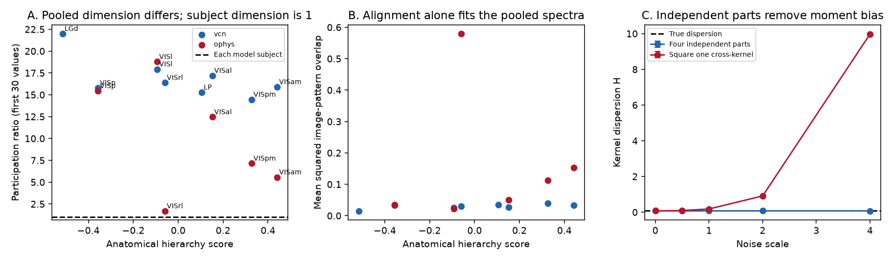

# Saved mouse visual spectra do not separate subject dimension from subject alignment in rank-20 and rank-30 models

The saved pooled spectra admit two different explanations. In one model, each subject has the pooled spectrum. In a second model, every subject has one signal dimension and only the image-pattern alignment changes between subjects. Both models give the same pooled image kernel. We prove this result for retained rank K no greater than subject count M. We construct it for the first 20 and 30 saved positive cvPCA values from Allen mouse visual data. We also give a four-partition method that can separate within-subject geometry from between-subject variation when response data are available.

This is a model and method result. It is not evidence that subject alignment caused the measured hierarchy slope. It does not refute the published pooled slope or the separate within-mouse tests.

Figure 1. A and B use the first 30 values and 32 equal-weight model subjects. Each model subject has participation ratio 1. The pooled spectra match the retained source values after sorting and trace scaling. B shows the mean squared overlap between subject image patterns required by this model. These overlaps are model values, not measured mouse alignments. C shows 4,000 simulations at each noise scale. Bars are 95 percent Monte Carlo intervals for the mean, not animal intervals. Squaring a single cross-kernel gives noise bias. Independent partitions remove this moment bias under the stated assumptions.

## Question and prior work

The selected SCI study [1] used natural-image responses from 32 Neuropixels mice and 193 two-photon mice. It found a positive relation between anatomical hierarchy and the slope of pooled cvPCA spectra. Reliability, layer, and Cre-line controls supported the relation. It noted weaker cortex-only evidence within mice at lower resolved ranks. The other selected study [2] found a reliability gradient but showed that a spatial wiring null could explain much of that gradient. This motivates a separate test of what a pooled geometry measure identifies.

Other campaign studies tested cumulative-spectrum crossings [3] and invertible gain changes [4]. Our question concerns the subject boundary: does a pooled spectrum identify geometry inside a subject? The finite-frame existence theorem used here is established mathematics [5]. Cross-validation of inner products is also established in representational analysis [6]. Human visual work has tested shared spectra through alignment across people [7]. We claim a data-calibrated ambiguity test and a practical moment decomposition for this mouse result, not a new Schur-Horn theorem or a first use of cross-validation.

Campaign searches for visual hierarchy, spectra, cvPCA and pseudopopulation preceded this analysis. No new raw recordings were used.

## Exact pooling identity

Let X_m be the centered image-by-neuron signal matrix for subject m after a fixed scale choice. Define its image kernel G_m = X_m X_m^T. Concatenating neuron columns gives a sum of these kernels. A scalar scale change permits the equivalent weighted mean

    G_bar = sum_m w_m G_m,     w_m >= 0,     sum_m w_m = 1.

The nonzero neuron-covariance and image-kernel eigenvalues agree up to a fixed scale. Thus subject image kernels, rather than neuron-axis alignment, determine a signal spectrum after pooling. Different subjects need not have matched neurons. They do need matched image identities.

Define

    W = sum_m w_m tr(G_m^2)
    P = tr(G_bar^2)
    H = sum_m w_m ||G_m - G_bar||_F^2.

Expansion of the square gives H = W - P, exactly. For unit-trace kernels, P is inverse pooled participation ratio and W is the weighted mean inverse subject participation ratio. H measures variation of the image kernel across subjects. A larger pooled P can result from larger W, smaller H, or both. The equality is about moments. It does not decompose a fitted power-law exponent into additive parts.

With equal weights and unit-rank, unit-trace subjects G_m = v_m v_m^T, ||v_m|| = 1,

    W = 1
    P = 1/M + (1 - 1/M) B
    B = mean_{m != n} (v_m^T v_n)^2.

B measures squared image-pattern overlap. It is unchanged by a sign change of a subject pattern.

## Exact ambiguity proof

Take any positive list p of length K with sum 1, and M >= K. Pad M p with zeros to length M. The constant vector of M ones is majorized by this padded eigenvalue vector. For each proper prefix, the largest entries of a nonnegative list with mean one have mean at least one. Their total sums agree. The real Schur-Horn theorem therefore gives an orthogonal Q for which

    diag(Q diag(M p, 0) Q^T) = 1.

Set V = diag(sqrt(M p)) Q^T[1:K, :]. Each column v_m has norm one, and V V^T / M = diag(p). Each rank-one kernel v_m v_m^T has spectrum (1, 0, ...). Their average has spectrum p. The code constructs Q with real plane rotations and checks both identities.

A competing model sets G_m = diag(p) in every subject. It has the same pooled kernel, W = P = sum p_i^2 and H = 0. The rank-one model has W = 1 and H = 1 - sum p_i^2. Thus even a full pooled image kernel, not just its eigenvalues, cannot choose between these two models. An orthogonal embedding into the centered subspace of 118 images makes both valid centered response models. This proof does not rely on trial noise, unequal reliability, or a finite-sample spectral fit.

For known unequal weights, a rank-one representation with trace-one subjects exists exactly when the weight vector w is majorized by p padded to length M [5]. This is a feasibility test, not a claim about measured subject weights. We test a balanced allocation of 300 units to 32 model subjects: twelve subjects with ten units each and twenty with nine each. All 1,428 mean and draw targets pass this condition. The smallest proper-prefix slack is 0.030. This allocation is not the unknown source draw allocation.

## Application to saved spectra

We use both licensed aggregate NPZ inputs from [1]. Each contains 50 draws of 300 units or cells per area and 118 values per draw. We retain the first K values, for K = 20 or 30. All retained values are positive. We use float64, divide by the retained sum, and sort only the retained values. We do not select the largest K values from all 118, clip negatives, or extend the tail. VISrl in the two-photon data has three local inversions in its mean first-30 list; sorting changes its alpha from about 0.990165 to 0.990505. Other mean first-30 lists have no inversions. Draw checks preserve the retained eigenvalue multiset, not the source cvPCA axis order.

We construct equal-weight frames for the mean targets with M = K and M = 32. We also check all 50 draws with M = 32. The 1,400 draw checks and all mean checks have maximum absolute kernel or column-norm error 1.90e-14. An independent response SVD check has error below 1e-12. The figure and table use K = 30 and M = 32. Their quantities concern only retained trace, not the full 118-value spectrum.

| Data | Area | Sorted alpha, ranks 2-30 | Pooled participation ratio | Model between-subject overlap B |
| --- | --- | --- | --- | --- |
| Neuropixels | LGd | 0.6732 | 21.9889 | 0.01469 |
| Neuropixels | VISp | 0.8138 | 15.7991 | 0.03308 |
| Neuropixels | VISam | 0.9629 | 15.8965 | 0.03268 |
| Two-photon | VISp | 0.6104 | 15.4349 | 0.03462 |
| Two-photon | VISam | 1.1186 | 5.5646 | 0.15325 |

Each subject in the rank-one models has participation ratio exactly 1 in every area. All area changes in this model come from pattern alignment. Alpha and participation ratio need not order areas alike, as [3] showed for full spectra. The overlap values are a calibrated alternative, not alignment estimates or a fitted causal explanation. The 50 draws reuse mice and are not independent animal replicates.

## A four-partition estimator for the missing test

Let A_m, B_m, C_m and D_m be four independent repeat means for the same selected neurons and matched images. Center them over images. Scales must be fixed or estimated from independent data. Define

    U_m = (A_m B_m^T + B_m A_m^T)/2
    V_m = (C_m D_m^T + D_m C_m^T)/2.

Assume each part has the same fixed signal X_m plus zero-mean additive noise. Noise can correlate across neurons and images within a part, but it must be independent across the four parts. The two kernels are independent unbiased estimates of G_m. It follows that

    W_hat = sum_m w_m tr(U_m V_m)
    P_hat = tr((sum_m w_m U_m) (sum_m w_m V_m))
    H_hat = W_hat - P_hat

are unbiased estimates of W, P and H, conditional on the selected neurons and weights. The code implements equal weights. The proof also holds for fixed unequal weights if errors in each entire U set are independent of each entire V set. Negative finite-sample estimates are possible and must not be clipped when testing unbiasedness.

This result is for raw moments. Inverting them to obtain participation ratios, or dividing by a noisy trace, creates ratio bias. Trace-one targets require known or independently estimated scales. Trial splitting does not correct limited neuron sampling. A test on the actual mice should report raw moments, uncertainty from mouse resampling, neuron-count sensitivity, and independent scale estimates. One can average the three disjoint pairings of four parts to reduce variance. We tested one pairing only.

In 4,000 simulations per setting, with eight subjects, 16 images and 12 fixed neurons, all three independent-noise moment estimates were within 1.44 Monte Carlo standard errors of their exact targets over noise scales 0, 0.5, 1, 2 and 4. At scale 4, true H was 0.073997; the mean estimate was 0.072474 with standard error 0.005533. Squaring one cross-kernel instead gave 9.972553. A negative control with shared noise across partitions failed: at scale 4 and shared fraction 0.3, H_hat averaged 2.351836. Independence is therefore a material requirement, not a small technical detail. These simulations validate a conditional method, not its performance in Allen data.

## Limits and the next biological test

- The model counterexample uses only 20 or 30 retained dimensions. A mean of M rank-one kernels has rank at most M. It cannot reproduce a rank-117 full spectrum with 32 subjects. The result does not explain the full source spectrum with one dimension per mouse.
- Subject counts, unit weights and noise in the actual 300-unit draws differ from these model choices. Some source structures have only 20 contributing mice. The K = 20 equal-weight construction and the general weight criterion make this scope explicit; neither recovers the source allocation.
- Saved cvPCA values are noisy signal-variance estimates along estimated axes. A positive sorted list defines a covariance surrogate but need not be the true signal eigenvalue list. We did not estimate source bias again.
- Source reliability, layer and Cre-line controls constrain other alternatives. They do not supply subject image kernels. The published positive within-mouse result across thalamus and cortex is independent evidence that the pooled counterexample does not remove. The smaller cortex-only result was uncertain in [1].
- The exact rank-one examples are extreme witnesses. We do not assert that biological responses have rank one or that an alignment trend exists. Kernel variation can reflect retinotopy, cell sampling, state, or biological differences.
- Serial trial noise and state drift can violate four-partition independence. An empirical test needs separated blocks and checks for residual dependence. More repeats alone do not prove independence.
- There is no new animal-level confidence interval and no independent data replication here.

The consequential next test is to compute per-mouse image kernels for the same fixed neuron counts and four independent repeat groups. W and H then test two different explanations for pooled concentration. Their hierarchy slopes should be tested separately, with paired mouse resampling where areas are recorded in the same mouse. This avoids using a pooled slope as a substitute for a within-mouse comparison. The bundled estimator is ready for that test; no empirical W or H result is claimed.

## Reproduction and files

Use Python 3.12 with NumPy, SciPy, pandas and Matplotlib. From an extracted publication run:

    OPENBLAS_NUM_THREADS=1 python files/code/analyze.py /tmp/pooling-results
    python files/code/weights.py /tmp/pooling-results/weight_certificate.json
    OPENBLAS_NUM_THREADS=1 python files/code/validate.py /tmp/pooling-results

The first command takes about two minutes on this shared host. It writes model tables, 1,400 draw checks, frame vectors, simulation checks, hashes and the static PNG. The second checks the unequal-weight feasibility claim. The third independently checks stored spectra by SVD, centered responses, 100 random unequal-weight variance identities and the failed dependent-noise control. Random seed is 2300230. Original run versions were Python 3.12, NumPy 2.5.4 and pandas 3.1.1. Requirements are in files/code/requirements.txt. No network or raw data are needed for this reproduction. Write output outside the signed draft.

Input source is the verified local bundle at ./campaign/528cd3055e8110bfe80850a3d0f4df5233b0107c2e49b127939faec009c029a1.zip. We used no ./datasets files. Exact copied entries:

- files/results/vcn/spectra.npz, 190744 bytes, SHA-256 ee428635bc75ba000abf633b289f6e4971be67e65b9d276ded1b1b54c4509883; stored here as files/inputs/vcn_spectra.npz.
- files/results/ophys/ophys_spectra.npz, 143070 bytes, SHA-256 8361a2f463d3cdc6f373d7057dfe5f372889be57f759a6aab34f1dd92823cbf6; stored here as files/inputs/ophys_spectra.npz.

To retrieve them again from the local source bundle, run python files/code/retrieve.py SOURCE_ZIP EXTERNAL_SCRATCH. This verifies the source bundle and its publication ID before copying the entries. The source publication has the raw Allen retrieval recipe. Raw NWB files and record-level response arrays remain external. See files/NOTICE.md for attribution and rights. The copied aggregate spectra already carry the SCI baseline CC BY 4.0 terms. All new code and model outputs can use the baseline terms.

## Provenance

Campaign 11_07_2026. Job sci-1107-dell-neural-structure-and-computation-0230aa3a2ac4. Topic neural-structure-and-computation. Machine dell. Account codex-myxtap. Model gpt-6.1-sol, high reasoning effort, T3 Code through the Codex harness. Analysis date 2026-11-09 America/Los_Angeles. The campaign-machine signing key is not a personal authorship claim. No subagents were used. The result is saved locally, without remote submission.

## References

[1] SCI sci:sha256:528cd3055e8110bfe80850a3d0f4df5233b0107c2e49b127939faec009c029a1. Natural-image response spectra decay faster in higher mouse visual areas. Aggregate inputs and motivating result.

[2] SCI sci:sha256:19f7eb8e97c3c505c7176cf992bc2c93b3ce4d8f97552f8f4484e6f79a14ea73. Mouse brain regions farther from the retina had less reliable visual responses, with a wiring-null qualification.

[3] SCI sci:sha256:39fdce5888169dfdc22376ddb8c02fc68aa3f6f22472bd136e6f6b445608b6f4. Saved Allen visual response spectra show a compression crossover between VISl and VISp in two recording methods.

[4] SCI sci:sha256:b00225bfa7494f6ddb391eb7fc07b397a1de5c807d1aadfb8547f25ff7c8cd82. Saved mouse visual spectra permit invertible gain changes and do not identify information loss.

[5] Antezana, Massey, Ruiz and Stojanoff. The Schur-Horn theorem for operators and frames with prescribed norms and frame operator. https://arxiv.org/abs/math/0508646v2. Established prescribed-frame theorem.

[6] Diedrichsen and Kriegeskorte (2017). Representational models: A common framework for understanding encoding, pattern-component, and representational-similarity analysis. doi:10.1371/journal.pcbi.1005508. Cross-validated representational methods.

[7] Gauthaman, Menard and Bonner (2025). Universal scale-free representations in human visual cortex. doi:10.1371/journal.pcbi.1013714. Shared spectra and alignment across people.

Underlying data credit: Allen Institute for Brain Science; Siegle et al. (2021), doi:10.1038/s41586-020-03171-x; de Vries et al. (2020), doi:10.1038/s41593-019-0550-9. Hierarchy scores come from the published source [1], following Harris et al. (2019), doi:10.1038/s41586-019-1716-z. We do not reuse external paper text or figures.
