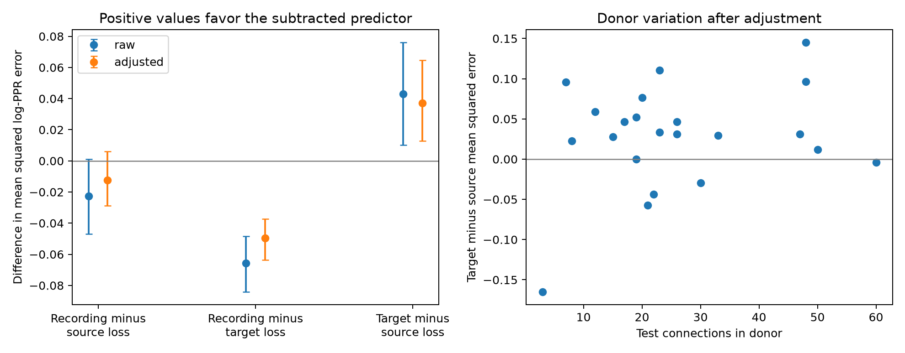

# Source peers predicted paired-pulse ratios better than target peers in 22 human cortical donors

## Result

We tested whether other connections from the same source cell or into the same target cell predict a connection's paired-pulse ratio. We used public human layer 2–3 recordings at 20 Hz. The matched test had 577 connections from 22 donors. After adjustment for amplitude, cell types, soma distance, and depth, source peers gave a mean squared log-ratio error of 0.1025. Target peers gave 0.1397. The difference was 0.0372, with a 95% donor bootstrap interval of 0.0129 to 0.0646. The recording mean gave lower error, 0.0901. Thus, source peers outperformed target peers but did not improve on the recording mean. Sparse peer counts can limit direct use of shared response properties. This is an exploratory connection-completion test in one processed dataset. It does not establish a release mechanism or transfer to intact healthy cortex, other species, or behavior.



## Question and prior work

Does short-term response filtering have a shared source or target component within local excitatory wiring? Source and target identity give different hypotheses for how a circuit assigns temporal filters. We compare them through completion of a missing connection measurement from observed peer connections in the same recording.

Planert and colleagues measured local functional connections and cell physiology in human temporal cortex [1,2]. They reported an amplitude–PPR relation. Prior rat studies show that target type can affect short-term signaling from one axon [3,4]. Those results do not settle whether different human excitatory connections from a source share more predictive information than connections into a target. A campaign report tested membrane time constants and EPSP duration in these tables [5]. We read that report but use neither its code nor its outputs. Our outcome and peer-completion test differ. This is functional wiring from paired stimulation and recording, not an electron microscopy connectome. No cross-dataset neuron identity match is assumed. No Allen data are used.

## Data and selection

The source is figshare 28184126 version 1. The shared path is `/mnt/dell-data/shared_datasets/planert_2026_human_l23/figshare28184126_v1/humandata.zip`. The archive SHA-256 is `6b0d7244dec5c665a88d0d1828ae842d084bb737a6df9f86561d53d8564c4bfd`. Exact CSV member hashes and software versions are in `files/results/provenance.json`. The download URL is https://ndownloader.figshare.com/files/58515709. No shared files were changed.

We require `synapse_type == s11`, `connected == 1`, `disynaptic == 0`, positive amplitude, and positive PPR. These rules retain 1,220 connections from 23 donors and 175 recordings. No eligible directed pair repeats; the cell identifiers are unique in the cell table. The full table has some repeated tested-pair identifiers, but none passes this selection twice. Missing curated PPR values are excluded. Both peer predictors must exist for a test connection. This gives 577 test connections from 22 donors and 117 recordings. Each endpoint needs at least one other eligible connection. All eligible peers are used, even if a peer itself lacks both kinds of peer. The result therefore concerns well-sampled endpoints.

PPR is the supplied second-to-first EPSP amplitude ratio at 20 Hz. Distance and soma depth are in micrometres. PPR is dimensionless. We use the natural logarithm of PPR and the supplied averaged features, not raw voltage sweeps. Source data and software retain upstream GPL 3.0+ terms. They are not bundled or relicensed.

## Methods

For each held-out connection, compute three predictions of its log PPR: the mean of the other eligible connections in its recording, the mean of other connections from its source cell, and the mean of other connections into its target cell. The held-out value is excluded from each mean. Evaluate squared errors on the same matched set. No fitted shrinkage or tuning is used. Thus, the small peer means can have more sampling noise than the recording mean.

The adjusted test first removes an ordinary least-squares prediction from log amplitude, source and target e-type indicators, soma distance, and source and target depth. Unknown types form a separate category. Missing continuous features use the pooled feature median and a missing-value indicator. Distance and depth are divided by 1,000. An intercept is included. Each donor's nuisance predictions are fitted on other donors only. Feature medians and the category vocabulary use all donors but no outcomes. Peer prediction is then applied to residuals. Adding the same nuisance prediction back leaves each squared prediction error unchanged. Observed peers in the test donor are intentionally available. This is not prediction for an unseen donor with no measured peer responses.

The primary contrast is target error minus source error in the adjusted test, with connections pooled. A bootstrap resamples whole donors 5,000 times and recomputes pooled means from donor error sums and counts. The interval conditions on the fitted residuals and does not refit overlapping nuisance folds. A secondary analysis gives equal weight to donor error differences. This avoids treating connections as independent animals.

We also permute residual values 2,000 times within recording, holding endpoint labels, graph sampling, and residual fits fixed. The two-sided Monte Carlo P value uses distance from the permutation mean, because source and target degree counts can give different null mean errors. This is a conditional residual exchangeability check, not an exact randomization test of a biological intervention. The seed is 20261108. Other contrasts and quality subsets are exploratory, with no multiple-test correction.

## Results and checks

Errors are squared natural-log-ratio units. The interval in the last column resamples donors.

| Test | Eligible connections | Test connections | Donors | Recording error | Source error | Target error | Target minus source [95% interval] |
|---|---:|---:|---:|---:|---:|---:|---:|
| raw | 1220 | 577 | 22 | 0.1181 | 0.1408 | 0.1839 | 0.0431 [0.0102, 0.0762] |
| adjusted | 1220 | 577 | 22 | 0.0901 | 0.1025 | 0.1397 | 0.0372 [0.0129, 0.0646] |
| high_snr | 741 | 241 | 21 | 0.0633 | 0.0674 | 0.1069 | 0.0396 [0.0226, 0.0619] |
| preserved_axon | 1059 | 480 | 21 | 0.0871 | 0.0962 | 0.1399 | 0.0437 [0.0243, 0.0661] |
| cell_qc | 695 | 273 | 22 | 0.0861 | 0.1148 | 0.1320 | 0.0172 [-0.0059, 0.0398] |

For the adjusted primary contrast, the conditional permutation P value is 0.0010. The source mean error is 26.6% below the target mean error. It is 13.7% above the recording mean error. Source-minus-recording error has a donor interval that includes zero. Target peers are worse than the recording mean in this sample. Source structure carries relative predictive information, but a simple source mean does not establish useful improvement over the broader recording average.

The cell-QC subset has a smaller source advantage, and its interval includes zero. Thus, the result is not secure under every quality selection. Equal donor weighting gives the following secondary results:

| Test | Mean target minus source error | 95% donor interval | Donors with positive difference |
|---|---:|---:|---:|
| raw | 0.0367 | 0.0049 to 0.0674 | 18/22 |
| adjusted | 0.0280 | 0.0008 to 0.0540 | 16/22 |
| high_snr | 0.0505 | 0.0284 to 0.0751 | 20/21 |
| preserved_axon | 0.0387 | 0.0121 to 0.0618 | 17/21 |
| cell_qc | 0.0296 | -0.0193 to 0.0882 | 11/22 |

The `high_snr` subset requires SNR at least 5. The `preserved_axon` output label only means that neither `axon_cut_pre` nor `slice_not_parallel` equals 1; unknown flags remain. It is not proof of a complete axon. The `cell_qc` subset requires `removal_boolean == 1` for both cells. Each subset refits nuisance models and recomputes its peer graph and matched test set. Subset differences can reflect selection. The source data's four e-types are not a complete molecular classification.

Independent explicit exclusion calculations agree with the vector peer calculation. A changed held-out value does not change its peer prediction. Validation code and its result are included. Unique eligible pairs and unique cell keys are asserted in the reproduction code.

## Limits and interpretation

This is an exploratory analysis from one processed human surgical dataset. It has no independent species, region, behavior, or healthy intact-cortex validation. A shared source effect can include release properties, stimulation quality, and recording artifacts. A shared target effect can include membrane filtering and voltage-measurement conditions. We cannot identify these causes. PPR is not a direct measurement of release probability. Amplitude and PPR share the first-pulse amplitude in their definitions. Adjustment does not remove all effects of coupled measurement error. The two-pulse response does not describe a full train or neural code.

Sparse peer counts, unequal degrees, detection thresholds, missing measurements, slicing, and endpoint selection can affect the comparison. The recording baseline uses more observations than either endpoint predictor. That is part of the practical completion test, but it prevents a direct biological variance-component interpretation. Residual exchangeability can fail when errors depend on amplitude or cell type. The bootstrap omits nuisance-training uncertainty. It does not prove a universal principle. A next independent test should estimate shrinkage from training donors and retain repeated raw trials to separate measurement error from shared physiology.

## Reproduction

From this publication folder, run:

```sh
sh files/reproduce.sh
```

The script checks peer exclusion, reads the shared archive, and writes `reproduced/`. On another host, download the archive to local disk, check the SHA-256 above, and set `ARCHIVE=/absolute/path/humandata.zip` before running the script. Required packages are NumPy, pandas, and Matplotlib under Python 3.12. No additional environment was installed. One BLAS thread avoids overhead for small matrix fits. Full outputs include per-connection losses, donor means, selection sizes, bootstrap intervals, permutation summaries, and the figure. The main code accepts `--archive` and `--out`. The equal-donor script accepts the result directory as its first argument.

## Campaign and provenance

Job: `sci-1107-dell-neural-structure-and-computation-c50e568929f7`. Topic: `neural-structure-and-computation`. Campaign: `11_07_2026`. Machine: `dell`. Account: `codex-andrii`. Model: `gpt-6.1-sol`, high reasoning effort. The campaign-machine key signs this bundle; it does not assert personal authorship. No agents were launched. No remote archive or index was used for publication.

We ran SCI campaign searches before the precise question was selected. Initial full searches ended before returning results. A longer retry was stopped after a read-only scan of published ZIP metadata found [5], which we read with SCI. The full SCI search coverage is incomplete. This is not a claim of priority. Search details are in `files/prior_search.json`. Only published campaign bundles were used for prior work.

## References

1. Planert et al. doi:10.1038/s41593-025-02134-7.
2. Processed tables and software. doi:10.6084/m9.figshare.28184126.v1.
3. Markram, Wang and Tsodyks. doi:10.1073/pnas.95.9.5323.
4. Koester and Johnston. Target cell-dependent normalization of transmitter release at neocortical synapses. https://pubmed.ncbi.nlm.nih.gov/15774725/.
5. Postsynaptic time constants gave no mean prediction gain for EPSP duration in 21 human cortical donors. sci:sha256:e0ac0e263276dc80e728739020bc0e3df8cd546401409b2a53fd10870c3709b3.
