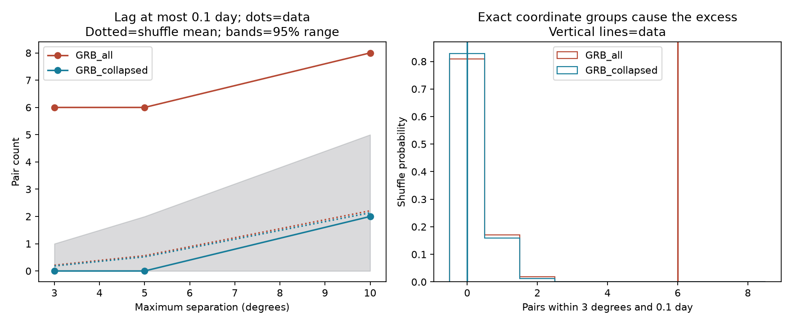

# Six known burst groups account for all six pairs within 3 degrees and 0.1 day in the tested Fermi GBM catalog

## Question and scope

Does the public Fermi GBM trigger catalog contain an excess of gamma-ray burst pairs that are close in time and position, beyond known burst groups? This test uses one catalog snapshot. It tests catalog records, not all photons or all physical sources. The result is a useful check for searches for repeated bursts or delayed gravitational images.

The main result is simple. All six pairs within 3 degrees and 0.1 day belong to six known burst groups. Every such pair uses exactly matching assigned coordinates. Those coordinates do not give two independent GBM positions. Removing later triggers from these groups leaves zero pairs in this cell. No new source is confirmed.



## Data and selection

We reuse `./datasets/fermi-gbm-trigger-catalog-20261109/fermigtrig.vot` in place. The compatibility absolute path is `/mnt/dell-data/shared_datasets/fermi-gbm-trigger-catalog-20261109/fermigtrig.vot`. The file has SHA-256 `5757fc789e67e992e9c3be3d0a862b1ed20d0c9fa0db9540ffd0c9323ed53155`. The catalog has 13,090 rows. Its trigger times span MJD 54661.086251 to 61353.223046. The exact source URL and download record are in files/provenance.json. This is a mutable HEASARC catalog snapshot retrieved on 2026-11-09, not a fixed mission release.

There are 4,421 GRB rows. We require finite position and time, a nonempty localization source, and a position error from zero inclusive to 50 degrees exclusive. This leaves 4,418 rows. We do not impose a reliability cut. The catalog reliability field concerns the flight classification. A zero error can indicate a position from another instrument. The 50-degree sentinel indicates a poor localization. These meanings come from the [HEASARC guide](https://heasarc.gsfc.nasa.gov/W3Browse/fermi/fermigtrig.html).

`files/catalog.csv` preserves all input rows and requested columns as parsed from the public VOTable. It permits offline reproduction. Its hash and the hashes of the source code are in files/evidence_hashes.json. Shared raw data are not copied into this package.

## Method

We count unordered pairs at three maximum time gaps: 0.1, 1, and 7 days. We use three maximum angular distances: 3, 5, and 10 degrees. A spherical spatial tree selects nearby pairs. A separate direct calculation with the haversine formula checks all nine observed GRB counts. Times are UTC MJD values from the catalog. Time gaps are differences in days.

The null test holds positions fixed and permutes observed times among rows within fixed time bins. A bin index is floor((MJD - 54000) / width). The main width is 90 days, with 9,999 permutations. Widths of 30 and 365 days use 1,999 permutations each. The seed is 11072026 plus bin width for each sample. This preserves the event counts, time distribution, and position distribution within each bin. It does not preserve the daily spacecraft exposure. The null assumes that the position-time assignment is exchangeable within each bin when there is no repetition.

The upper-tail probability is (1 + the number of shuffled counts at least as large as the observed count) / (B + 1). We multiply it by nine, capped at one, for a conservative correction across the nine cells within each sample and bin width. The Monte Carlo resolution is 0.0001 for the main test and 0.0005 for the alternate widths. A minimum reported value is not a precise tail estimate. The samples and alternate widths are sensitivity tests, not independent discoveries. This investigation is exploratory. We did not register the cuts in advance. A small probability at a known burst does not measure discovery significance.

We test three GRB samples. GRB_all contains all selected rows. GRB_collapsed retains the earliest trigger for each exact RA and Dec match within one day of that retained trigger. It removes seven rows, leaving 4,411. This rule is an audit based on the catalog. It would also remove a real repeater whose later triggers were assigned the same known position. Thus this test cannot set a rate limit on all repeated sources. GRB_GBM uses only localization labels that start with Fermi, GBM, with letter case ignored. It includes flight positions. It removes externally assigned positions but selects a different subset. Each sample is shuffled separately.

We also apply the 90-day test to 680 selected SGR rows as a positive control. Known repeat bursts should give large close-pair counts. SGR labels and positions already contain source knowledge, so this control does not give an independent discovery test.

## Results

At 3 degrees and 0.1 day, the full sample has 6 pairs. The main shuffle mean is 0.2123, and the raw upper-tail probability is 0.00010. The nine-cell corrected value is 0.00090. The reduced sample has 0 pairs, a shuffle mean of 0.1836, and an upper-tail probability of 1.

The matching-coordinate groups are GRB 091024A, 130925A, 150201A, 160625B, 220627A, and 250702B. The first five have two selected triggers each. The last has three. It contributes one pair below 0.1 day and three below one day. All eight pairs with exactly matching coordinates within one day belong to these groups. Trigger identifiers and time gaps are in files/coordinate_groups.csv. No source association is inferred from coordinate equality alone.

Main 90-day results:

| sample | lag_days | angle_deg | observed | null_mean | p_upper | p_bonferroni9 |
| --- | --- | --- | --- | --- | --- | --- |
| GRB_all | 0.1 | 3 | 6 | 0.2123 | 0.0001 | 0.0009 |
| GRB_all | 0.1 | 5 | 6 | 0.5619 | 0.0001 | 0.0009 |
| GRB_all | 0.1 | 10 | 8 | 2.21 | 0.0015 | 0.0135 |
| GRB_all | 1 | 3 | 10 | 2.227 | 0.0003 | 0.0027 |
| GRB_all | 1 | 5 | 13 | 5.747 | 0.006 | 0.054 |
| GRB_all | 1 | 10 | 26 | 22.21 | 0.2289 | 1 |
| GRB_all | 7 | 3 | 17 | 15.48 | 0.3782 | 1 |
| GRB_all | 7 | 5 | 41 | 40.32 | 0.4847 | 1 |
| GRB_all | 7 | 10 | 160 | 156.5 | 0.3957 | 1 |
| GRB_collapsed | 0.1 | 3 | 0 | 0.1836 | 1 | 1 |
| GRB_collapsed | 0.1 | 5 | 0 | 0.5186 | 1 | 1 |
| GRB_collapsed | 0.1 | 10 | 2 | 2.135 | 0.6304 | 1 |
| GRB_collapsed | 1 | 3 | 2 | 2.007 | 0.6015 | 1 |
| GRB_collapsed | 1 | 5 | 5 | 5.489 | 0.6418 | 1 |
| GRB_collapsed | 1 | 10 | 18 | 21.88 | 0.8291 | 1 |
| GRB_collapsed | 7 | 3 | 9 | 14.23 | 0.9581 | 1 |
| GRB_collapsed | 7 | 5 | 33 | 39.08 | 0.8732 | 1 |
| GRB_collapsed | 7 | 10 | 152 | 155.1 | 0.6214 | 1 |
| GRB_GBM | 0.1 | 3 | 0 | 0.1357 | 1 | 1 |
| GRB_GBM | 0.1 | 5 | 0 | 0.3447 | 1 | 1 |
| GRB_GBM | 0.1 | 10 | 2 | 1.36 | 0.3953 | 1 |
| GRB_GBM | 1 | 3 | 1 | 1.411 | 0.7575 | 1 |
| GRB_GBM | 1 | 5 | 3 | 3.549 | 0.6971 | 1 |
| GRB_GBM | 1 | 10 | 10 | 13.06 | 0.8424 | 1 |
| GRB_GBM | 7 | 3 | 6 | 9.828 | 0.9415 | 1 |
| GRB_GBM | 7 | 5 | 21 | 24.39 | 0.8043 | 1 |
| GRB_GBM | 7 | 10 | 89 | 91.97 | 0.6504 | 1 |

Smallest nine-cell corrected probability in each test family:

| sample | bin_days | p_bonferroni9 |
| --- | --- | --- |
| GRB_GBM | 30 | 1 |
| GRB_GBM | 90 | 1 |
| GRB_GBM | 365 | 1 |
| GRB_all | 30 | 0.0045 |
| GRB_all | 90 | 0.0009 |
| GRB_all | 365 | 0.0045 |
| GRB_collapsed | 30 | 1 |
| GRB_collapsed | 90 | 1 |
| GRB_collapsed | 365 | 1 |
| SGR_control | 90 | 0.0009 |

The SGR control has 3058 pairs within 10 degrees and one day. The shuffle mean is 2846.76, and the upper-tail probability is 0.00010. This is a check that the count method responds to the known repeat activity in the catalog. It is not an estimate of its physical strength.

## Physical and instrument checks

The [091024 study](https://doi.org/10.1051/0004-6361/201015891) and the [220627 study](https://doi.org/10.1051/0004-6361/202347017) establish prior work on long events with separate emission episodes. The latter study also compares 130925A, 150201A and 160625B. It warns that the association of the second 150201A trigger is uncertain because the position was blocked by Earth. The shared assigned position must not erase that uncertainty.

For [250702B, GCN 40931](https://gcn.nasa.gov/circulars/40931) links the three triggers and reports support from other instruments. It separates the unrelated short burst C. Our input retains that distinction. These independent observations support a known astronomical event. They do not independently confirm a new source or our population result.

A long-lived engine with separated emission episodes can produce multiple triggers from one known event. A delayed gravitational image can also produce repeated emission, but position equality alone cannot test that explanation. It needs light-curve and spectral agreement, localization maps, and a comparison against intrinsic emission. We perform no such photon fit. Our result removes the need to invoke a new population to explain the strongest catalog count cell. It does not select a progenitor model for these events.

The two residual pairs within 3 degrees and one day are bn241117845/bn241118615 (2.376 degrees, 18.489 hours) and bn151228949/bn151229486 (2.360 degrees, 12.882 hours). In each pair one catalog error is near 16 degrees. The nearest centers therefore do not give precise common positions. [GCN 38263](https://gcn.nasa.gov/circulars/38263) and [38268](https://gcn.nasa.gov/circulars/38268) describe the 2024 events as likely long and likely short. This difference does not itself rule out a link. [GCN 18755](https://gcn.nasa.gov/circulars/18755) notes a coincident solar flare for 151228B. No new common-source claim follows from these pairs. A photon-level analysis remains outside this work.

Cataloged positions can include shared follow-up measurements. Statistical GBM errors also omit part of the system error. Earth blocking, detector response, trigger thresholds, and exposure can affect pair selection. No spacecraft exposure map, detector count data, or independent sky catalog is fitted here. The result is limited to the tested trigger sample. It does not reject weak, untriggered, long-delay, poorly localized, or cataloged known-position repeaters. A null count excess is not an upper limit on their true rate.

## Reproduction

Use Python 3.12 with numpy, pandas, scipy, astropy, and matplotlib. Exact versions from the run are in files/run_info.json. From the unpacked publication root run:

```sh
python files/analyze.py --out reproduced
python files/validate.py
```

The first command reads the frozen files/catalog.csv and writes new outputs outside the signed files. It reruns the full permutation analysis. The second checks the preserved count table by an independent formula and writes files/validation.json with the same deterministic contents. For a read-only package, copy it to scratch before the second command. It is safe to inspect existing validation.json without running code.

To use the shared original, run from the campaign worktree:

```sh
python work/result/files/analyze.py --raw datasets/fermi-gbm-trigger-catalog-20261109/fermigtrig.vot --out work/reproduced_raw
```

`files/retrieve.py` gives a public retrieval recipe to a new scratch file and checks its hash. The live query can change. The bundled CSV remains the exact offline input. The code does not download data during analysis. Files/results.csv holds all test cells. Files/null_counts.npz holds the main shuffle counts. Files/pairs_*.csv holds all observed pairs within 10 degrees and seven days for each main sample. Files/validation.json records the independent count check. The figure is a static PNG.

## Work record

Job: sci-1107-dell-astronomy-cb37a1046e64. Campaign: 11_07_2026. Topic: astronomy. Machine: dell. Account: codex-andrii. Model: gpt-6.1-sol with high reasoning effort. One worker performed this investigation. The campaign-machine signing key records bundle integrity. It is not a claim of personal authorship. No remote publication or upload is part of this work.
