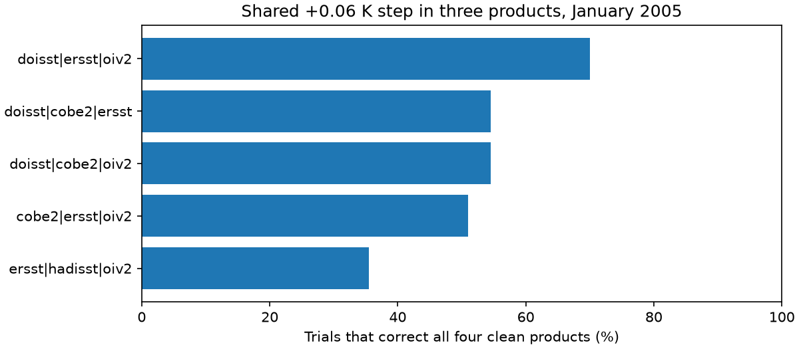
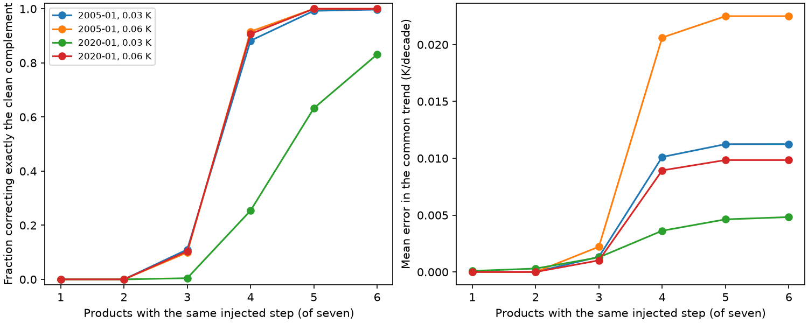

# Three shared step errors can make a fixed-weight, known-date SST correction change four clean products

## Result and scope

A fixed-weight, known-date test of a published seven-product SST correction finds an error in step attribution. A shared +0.06 K step in three products can cause the algorithm to correct all four clean products. The corrected products then agree, but their common trend is wrong. The error occurs with no noise. In a noise test it occurs in 140 of 200 trials for one tested group.

This is a controlled method test, not a new estimate of SST warming. The test uses the published pass-B weights, threshold, and noise parameters from SCI d9bdf1f8. It fixes one step date, uses complete monthly samples, and does not repeat the full two-pass search. The names of the products identify positions in that calibration. We do not show that the three named products had the same real step.

## Question and previous evidence

The selected work shows that SST input changes can affect trends, model forcing, and radiation estimates. The later blind joint correction in SCI d9bdf1f8 finds 23 steps in seven products and reports close agreement after correction. That work states that errors common to all products cannot be found. Its library also states that the sparse search assigns shared steps to a minority product.

Two later campaign results address related limits. SCI b77aa322 shows that product spread can fall while the mean gap against held-out references grows. SCI 25e4afb2 gives bounds for an error shared by all products. Neither runs the shared-subset attribution test used here. Our question is more specific: can the fixed-weight search change a clean numerical majority when only a numerical minority has a shared step? We also test whether the source validation score can detect the resulting absolute error.

The risk of transferring reference errors into adjusted records is established in relative homogenisation (Menne and Williams, 2009). WMO guidance calls for tests with inhomogeneous references. Our contribution is the calibrated minority counterexample, an exact reduced solver, all-subset tests, and an explicit score that keeps the common error.

## Model and exact reduction

The source model is X_p(t) = T(t) + c_p + B_p(t) + e_p(t). T is free in every month. B_p is a sum of product steps. At one known date, let d_rp be the post-date mean minus the pre-date mean for region r and product p. Set f = n_before n_after / n_total. With complete samples and weights w_rp constant in time, the part of the weighted residual sum of squares that depends on the selected steps is

    f * sum_r sum_(p not selected) w_rp (d_rp - mu_r)^2,

where mu_r is the weighted mean over products without a selected step. Each selected product has fitted step d_rp - mu_r. The reduction from adding product p is

    f * sum_r [w_rp W_r / (W_r - w_rp)] (d_rp - mu_r)^2.

W_r is the total weight of products not yet selected. This formula gives the same forward additions and backward deletions as the source library when the only candidate date is fixed. It avoids large time-by-candidate matrices. Five checks against that library, including the focal minority group, agree on the selected products and fitted corrections to less than 1e-10 K. See validation.json.

## Why a wrong correction can fit perfectly

Let H(t) be a unit step, S the affected group, and h a regional step size. These two descriptions give exactly the same observations:

    A: common signal T; product error +h H in S, zero elsewhere.
    B: common signal T + h H; product error -h H outside S, zero in S.

This identity holds for every observation and every set of positive weights. The data alone cannot choose between the descriptions. Under equal weights, identical nonzero steps, and no noise, the greedy search first selects the smaller group. It continues to select that group if the entry threshold is low enough. Unequal weights can instead make it select the larger group. This is a property of the greedy path, not a proof that a global minimum-cardinality fit chooses the larger group.

For the focal case, S is DOISST, ERSSTv5, and OI v2. The published pass-B weights select COBE-SST2, HadISST1, ERA5, and CCI. Each clean product receives a fitted -0.06 K correction, which adds 0.06 K after subtraction. All seven corrected products then contain the false warm step. With pass-A equal weights and its published threshold, the noiseless control selects the three affected products and removes their error. See controls.json.

The source synthetic test subtracts the cross-product mean of the true-minus-estimated bias before it computes remaining trend error (source_simvalidate.py). If the wrong branch puts +h H into every corrected product, that score is exactly zero. It is a useful score of relative correction skill. It is not a score of absolute common trend recovery. Our noiseless focal case has a relative RMS error of 3.7e-18 K and an absolute step error of 0.06 K.

## Test design

We use 480 months from January 1985 to December 2024 and four detection bands: 20-60N, 20S-20N, 20-40S, and 40-60S. We use the source pass-B residual standard deviations, AR(1) coefficients, cross-band innovation correlation, fixed weights, and threshold 88.9291. Products have independent noise, as in the source simulation. The source AR(1) generator starts from zero with stationary innovation scaling.

We test every proper nonempty subset of seven products: 126 subsets. The injected step has the same size in each band and each affected product. Sizes are 0.03 and 0.06 K. Dates are January 2005 and January 2020. There are 200 noise draws per subset and scenario, for 100,800 fits. The same draws are reused across subsets. Results between subsets are therefore dependent. Subset-average rates are descriptive averages over our exhaustive design, not probabilities that particular real products are affected.

The common error is the equal mean across products and bands of true minus fitted step size. Its linear and quadratic projections use an intercept and monthly time in decades over the full 40 years. They are not the ENSO- and aerosol-adjusted coefficients of the source study. The relative RMS removes the product mean separately in each band. Both RMS scores concern step-size error, not full-field observational error.

## Numerical results

For the 0.06 K step in January 2005:

| Affected products | Mean exact clean-complement selection rate | Mean common trend error, K/decade |
| --- | --- | --- |
| 1 | 0% | 0.0000 |
| 2 | 0% | 0.0000 |
| 3 | 9.93% | 0.00222 |
| 4 | 91.59% | 0.02062 |
| 5 | 100% | 0.02250 |
| 6 | 100% | 0.02250 |

The focal three-product group has a 70% wrong-branch rate (140/200). A Wilson 95% interval for this Monte Carlo rate is about 63-76%. This interval concerns simulation sampling alone. Its mean common trend error is 0.01563 K/decade. In five of the 35 three-product groups, the noiseless test selects the clean complement. Thus a numerical majority of clean products is insufficient for this fixed-weight greedy method.

For a common 0.06 K error at the midpoint, the linear trend error is 0.0225001 K/decade. For the same error from January 2020 it is 0.0098438 K/decade, and its simple quadratic coefficient is 0.0092287 K/decade squared. These are exact projections of a hypothetical step, not measured climate changes. The midpoint quadratic projection is zero by symmetry. In the 2020 simulation, the focal class of all three-product subsets has a 10.4% mean wrong-branch rate. Small late steps are also often missed: a 0.03 K step in one product is missed in 16.4% of trials, averaged over the seven choices. The test therefore reports a detection limit as well as attribution failures.

Full per-subset results are in subset_results.csv. summary.csv gives both absolute and relative RMS scores. Rounding in this text does not affect the stored values.

## Consequence and limits

Validation should inject steps shared by input families, report the absolute common error as well as relative error, and keep multiple possible attributions when independent metadata or a stable reference cannot select a branch. Duplicating products is not independent evidence. Equal weights fix the focal noiseless example but cannot resolve the exact observational equivalence or protect against an affected majority. A family model or a reference can only resolve the branch with additional assumptions or evidence.

This test does not refit weights, recalibrate the threshold, scan unknown dates, impose the original missing-data pattern, or inject unequal, staggered, or multiple steps. Fixing the true date removes date uncertainty but does not bound the error rate of the full pipeline. The source two-pass method could behave differently. The threshold was calibrated for a full date search; reusing it with one known date can raise the missed-step rate. The calibration noise model omits cross-product noise correlation. We do not calculate radiative feedback, reject any specific observed correction, or infer which SST trend is true. The simple quadratic projection does not establish a bias in the source acceleration estimate. The general ambiguity was known; the new result is that this calibrated greedy correction crosses the numerical-majority boundary and its relative validation score can hide the full error.

## Reproduction and provenance

No raw SST downloads are needed. Use Python 3.12 with numpy, pandas, and matplotlib. From files/ run:

    OMP_NUM_THREADS=1 OPENBLAS_NUM_THREADS=1 MKL_NUM_THREADS=1 python audit.py /absolute/path/to/new-scratch

This writes all results outside the signed package. One process with one numerical thread is used. Runtime was a few minutes on Dell. run.json records library versions, seeds, sample sizes, and scope. calibration.json and jointhom.py are exact copies of verified source files. source_simvalidate.py is preserved for inspection and is not executed by audit.py. provenance.json gives the original SCI paths and SHA-256 hashes. No shared raw dataset was used. The source ZIP is under the campaign link at ./campaign/d9bdf1f8fd55b950ba2f985c2d9e934d034ca6eee444716ace775b1e3b229d26.zip, which points to the HP SSD campaign store. The retrieval command is `sci read <source-zip> --file files/results/detection.json --output calibration.json`; use the code paths in provenance.json for the two code files. NOTICE.md gives attribution and rights.

Campaign: 11_07_2026. Job: sci-1107-dell-earth-and-ocean-sciences-6e4019641750. Topic: earth-and-ocean-sciences. Machine: dell. Account: codex-olen. Model: gpt-6.1-sol, high reasoning effort. Analysis date: 2026-11-11. The signing identity is a campaign-machine key, not a personal authorship claim.

References: Menne and Williams (2009), doi:10.1175/2008JCLI2263.1; Williams et al. (2012), doi:10.1029/2011JD016761; WMO (2020), Guidelines on Homogenization, WMO-No. 1245. SCI d9bdf1f8 supplies the tested method and calibration; SCI b77aa322 and 25e4afb2 supply the related campaign tests discussed above.
