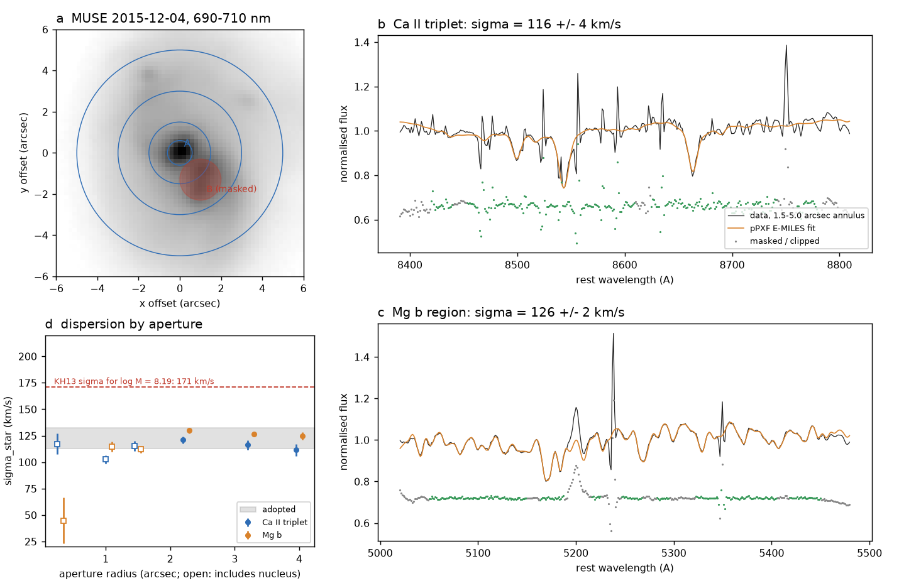
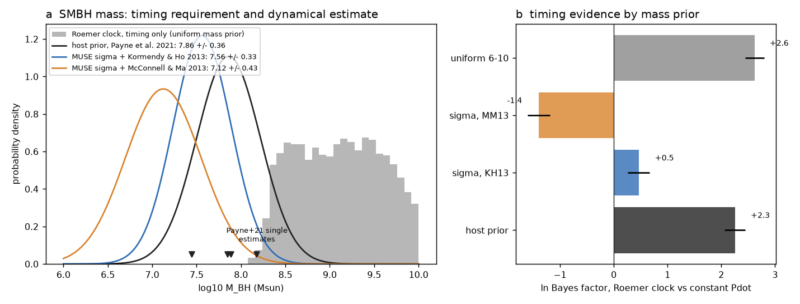
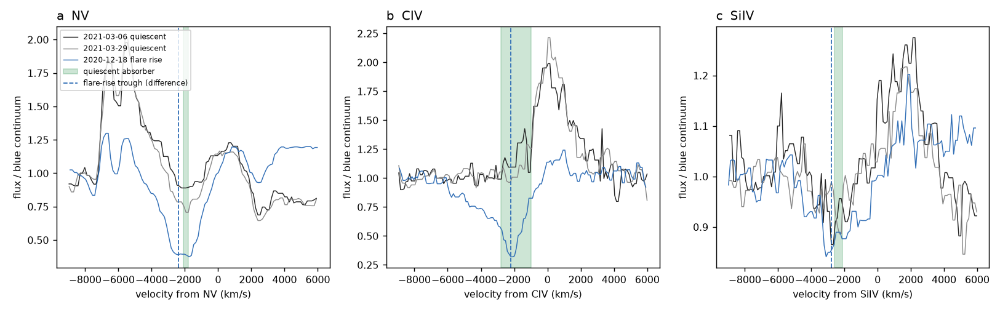

# MUSE stellar kinematics give the ASASSN-14ko black hole about 10^7.6 solar masses, below the 10^8.2 that a light-travel-time clock needs; with this mass the flare timing no longer prefers that clock

Campaign 11_07_2026, job sci-1107-hp-astronomy-5cad48e9b169, topic astronomy, machine hp, model Claude Opus 5.5 (claude-opus-5-5). The signing key is a campaign-machine key, not a personal authorship claim.

## Summary

**Question.** The period of the repeating nuclear transient ASASSN-14ko (nucleus of ESO 253-G003) decreased before 2020, stayed constant in 2020-2024 on the soft X-ray clock, and possibly decreased again after 2024. SCI 8e6f3b54 showed that a light-travel-time (Roemer) clock can make this stall without an orbital change: the flaring system (a star bound to an intermediate-mass black hole) orbits the central supermassive black hole (SMBH), and the light delay changes the observed period. With the host-mass prior of Payne et al. (2021), log10 M = 7.86 +/- 0.36, that clock had a Bayes factor of about e^2 over a constant period derivative, but it needed log10 M_BH = 8.19-8.80. SCI 8e6f3b54 asked for a direct test (line velocities or a better mass). Which is true for the archival data?

**Data (not used before in the campaign).** The public MUSE cube of 2015-12-04 (ESO), nine PESSTO EFOSC2 spectra of 2014-11-25 to 2015-01-27 (ESO), and 28 HST/STIS G140L/G230L spectra of 2020-12-18 to 2021-04-01 (MAST).

**Results.**

1. **First dynamical mass.** pPXF fits of the Ca II triplet and the Mg b region in annuli outside the AGN point-spread function (1.5-5 arcsec, companion nucleus masked) give a stellar velocity dispersion sigma_star = 123 +/- 10 km/s. 72 fit variants (two template libraries, polynomial degrees, fit windows) give 107-133 km/s (median 125). The M-sigma relations give log10 M_BH = 7.56 +/- 0.33 (Kormendy & Ho 2013, KH13) or 7.12 +/- 0.43 (McConnell & Ma 2013, MM13), including intrinsic scatter. log10 M = 8.19 needs sigma_star = 171 km/s (KH13) or 190 km/s (MM13).
2. **The timing alone needs a higher mass.** With a uniform mass prior (log10 M in 6-10), the Roemer clock needs log10 M_BH = 8.31-9.92 (95%). Under the sigma-based priors, P(log10 M >= 8.19) = 0.027 (KH13) and 0.006 (MM13).
3. **The evidence for the Roemer clock goes away.** Repeating the nested sampling of SCI 8e6f3b54 with the same 61 flare markers, likelihood, sampler and seeds, the ln Bayes factor of the Roemer clock against a constant period derivative is +2.25 with the host prior (8e6f3b54: about +2), +0.46 with the KH13 prior and -1.39 with the MM13 prior (statistical error about 0.25). An importance-reweighting check gives +1.43, -0.63 and -2.06. Both methods agree that the dynamical mass lowers ln Z by 1.8-2.1 (KH13) and 3.5-3.7 (MM13) relative to the host prior. With the sigma prior, the posterior mass moves to log10 M = 8.16-8.65, which is 2.4 sigma above the dynamical estimate.
4. **The archival flare spectra cannot test the Roemer clock directly.** (a) The 2014 PESSTO spectra were taken 15-78 d after the peak of flare n = 1. ASAS-SN shows that the optical continuum excess had fallen to about 10% of its peak value at +15 d and was at baseline from +32 d. The broad H-beta excess is nevertheless strong at +15 d and +32 d (Delta chi2 = 242 and 226) and is centred at +400 km/s (95%: +200 to +600) and +300 km/s (+100 to +600) from the narrow lines. This is an echo of the AGN broad-line region, which moves with the SMBH in every model. The Roemer posterior puts the flaring system at +3000 to +6100 km/s (68%, host prior) at that time; an extra H-beta component there has at most 0.4-1.1 times the echo flux (95%, depending on width), so the limit is weak. (b) The HST/STIS spectra of the 2021 quiescent phase show narrow absorbers at -2000 +/- 100 km/s (N V, Delta chi2 = 145-202 in three visits), -2200 to -2500 km/s (Si IV) and -1100 to -2700 km/s (C IV). The transient broad troughs at the flare rise (2020-12-18) have centroids at -2400 (N V), -2200 (C IV) and -2800 km/s (Si IV), at the velocities of these quiescent absorbers. The rise absorption is thus most simply the persistent AGN absorber seen against the flare continuum, not new outflowing debris. Its velocity is also near the Roemer prediction for 2020 December (-1700 km/s, 68%: -2700 to -800), so it does not separate the clocks.
5. **Aperture effect in the 2014 spectra.** MUSE shows the obscured companion nucleus 1.6 arcsec from ASASSN-14ko. It has strong, redshifted [O III]. Its flux in the 1-arcsec PESSTO slit depends on the slit angle, which explains [O III] fluxes that change by up to six times between epochs. The broad-line SMBH mass of Payne et al. (2021; 10^8.18, the highest of their estimates) used the 2014-11-25 spectrum, which contains the flare echo, flare continuum, host light and the companion.

**Conclusion.** The first dynamical mass of the ASASSN-14ko SMBH is about 10^7.6 solar masses (10^7.1 with MM13). A Roemer (light-travel-time) clock needs at least 10^8.2-10^8.3 to make the observed stall. With the dynamical mass, the timing no longer prefers the Roemer clock (ln B from +2.3 to between +0.5 and -1.4). The Roemer clock is not excluded: it remains possible if the true mass is 2.5-3 times above the M-sigma value. A light-travel-time origin of the period stall is now unlikely, and an orbital or emission-geometry cause (drag, precession, period kicks) remains the more probable explanation.

**Limitations.** The M-sigma relations have 0.3-0.4 dex intrinsic scatter, and ESO 253-G003 is a disturbed host with two nuclei; a pseudobulge or merger state can move it off the relations in either direction. We use aperture dispersions in 1.5-5 arcsec annuli (1.3-4.3 kpc), not a measured sigma_e; inner apertures give lower values (103-117 km/s). We did not make a reliable virial mass: the quiescent broad H-alpha is strongly asymmetric and the extended narrow lines prevent a clean decomposition at this stage. Absolute ln Z values differ by about 1 between nested sampling and importance reweighting; the differences between priors agree within 0.3. The Bayes factors use the same flat unit-width prior on the quadratic term as SCI 8e6f3b54 (a proper prior shifts them by +0.6). The PESSTO line test uses only two slit-angle-matched pairs; H-alpha fits are less reliable because the masked [N II] cores cover the line centre. No flare-intrinsic emission line was found in any spectrum, so a direct kinematic test of the flaring system is still missing.

## 1. Background

ASASSN-14ko flares every about 108 d. Campaign work found that the period decrease of Payne et al. (2022) stopped in 2020-2024 on an X-ray clock (SCI 049d6e3e, 2b5fd32c, 967e3773), with a fast decrease in 2018-2020 and a slow one before 2016 (SCI 067e9565). Clocks with orbital change (drag with precession, SCI cd4bd328), random period kicks (SCI 77860d3a, c9cc95cf) and a geometric light-travel-time clock (SCI 8e6f3b54) were tested. The light-travel-time clock is the only tested clock that stops a period change without an orbital change or an emission-delay change. Its main free physical parameter is the SMBH mass, because the amplitude of the light delay is at most a/c, and a grows as M^(1/3) at fixed outer period. SCI 8e6f3b54 found that the clock is better than a constant period derivative only for M above about 10^8.05 and asked for line velocities or a better mass.

## 2. Data

| Data | Epoch | Use |
| --- | --- | --- |
| MUSE WFM cube (ESO ADP.2016-09-07T11:17:58.674, programme 096.D-0296(A), 2476 s, seeing 0.84 arcsec) | 2015-12-04 (MJD 57358.3; 47 d after the peak of flare n = 4, 61 d before n = 5) | stellar kinematics, nuclei positions |
| PESSTO EFOSC2 1-D spectra, 1-arcsec slit (Gr13; Gr11 + Gr16 pairs) | 2014-11-25, 12-12, 12-28, 2015-01-26, 01-27 | flare-minus-quiescent Balmer lines |
| HST/STIS G140L + G230L, 52x0.2 slit (programmes 16451, 16498) | 2020-12-18, 12-22, 12-29, 2021-03-06, 03-29, 04-01 | UV absorbers and flare lines |
| ASAS-SN V light curve (from SCI b29ea789) | 2014-2015 | continuum state at the PESSTO epochs |
| 61 flare markers 2014-2026 (from SCI 8e6f3b54) | 2014-2026 | Roemer and constant-Pdot clock evidence |

The X-shooter spectrum of 2019-10-02 was examined but not used: it was taken about 8 d before the half-rise of flare n = 17, without a quiescent X-shooter reference.

## 3. Methods

**Stellar kinematics (04_muse_kinematics.py, 04_muse_kinematics_lib.py).** We centred apertures on the continuum peak of nucleus A (ASASSN-14ko) and masked 1.0 arcsec around the companion nucleus B. We fitted the Ca II triplet (rest 8420-8780 A) and Mg b (5050-5450 A) regions with pPXF 9.5.2 and E-MILES SSP templates broadened to the MUSE line-spread function of Bacon et al. (2017), with additive degree 4 (AGN dilution) and multiplicative degree 2 polynomials. We masked [N I], broad Fe II, [Fe VII], [Fe XIV], He II, O I, [Fe II] and Pa 12, and clipped 4-sigma sky residuals after one iteration. Errors come from 50 wild-bootstrap fits. The adopted value uses a fixed rule (05_mass_priors.py): the median of the six fits in the 1.5-3.0, 3.0-5.0 and 1.5-5.0 arcsec annuli (outside most of the AGN light), with the half-range as systematic error. This rule gives the highest dispersion of the tested aperture sets, so it is conservative for the Roemer clock. 04b_sigma_robustness.py refits the 1.5-5.0 arcsec spectrum with E-MILES and XSL templates, additive degrees 2/4/8, multiplicative degrees 0/2/4 and two windows per region (72 fits).

**Clock evidence (01_roemer_posterior.py).** We repeat the full-data nested sampling of SCI 8e6f3b54 (dynesty 2.1.5, 600 live points, rwalk, the same seeds) for a constant intrinsic period plus a Keplerian Roemer delay with K = (a/c) sin i, isotropic inclination, and four mass priors: host N(7.86, 0.36), uniform 6-10, KH13 N(7.56, 0.33) and MM13 N(7.12, 0.43). We also run the constant-Pdot clock. We keep the orbital elements of all posterior draws and compute the line-of-sight velocity of the flaring system v_r = K c ds/dt at the spectral epochs. 07_summary.py also reweights the uniform-mass posterior to each prior as a check.

**2014 Balmer lines (02_optical_flare_lines.py).** We put each spectrum in its own narrow-line frame, scaled, shifted and smoothed the quiescent spectrum to null the narrow lines of the target, and fitted the difference with a free multiple of the quiescent broad line, a linear continuum and one Gaussian at trial velocity v (b >= 0). We used only pairs with slit angles within 25 degrees (2014-11-25 and 2014-12-12 against 2015-01-26), because the companion nucleus enters the slit at other angles. For a second Gaussian at a fixed velocity we derived the 95% upper flux limit relative to the main excess.

**UV lines (03_uv_lines.py).** We combined the sub-exposures per visit, formed flare-minus-quiescent differences against 2021-03-06, removed a linear continuum and fitted one Gaussian (absorption or emission) per line. We measured narrow absorbers in the quiescent visits on spectra normalised by a running median.

## 4. Results

### 4.1 Stellar velocity dispersion and systemic redshift

| Aperture (arcsec) | Ca II triplet sigma (km/s) | Mg b sigma (km/s) |
| --- | --- | --- |
| r < 0.6 (nucleus) | 117 +/- 10 | 45 +/- 22 (AGN-diluted) |
| 0.6-1.5 | 103 +/- 4 | 115 +/- 5 |
| 1.5-3.0 | 121 +/- 3 | 130 +/- 2 |
| 3.0-5.0 | 112 +/- 6 | 125 +/- 3 |
| 1.5-5.0 | 116 +/- 4 | 126 +/- 2 |
| r < 3.0 | 115 +/- 5 | 112 +/- 3 |

Adopted sigma_star = 122.8 +/- 9.8 km/s. Robustness grid: 107-133 km/s (16-84%: 116-129); E-MILES median 124, XSL median 125. The stellar redshift of the nucleus is z = 0.04266 (0.04263-0.04270), about 50 km/s above the value of Payne et al. (2021).



**Figure 1.** (a) MUSE continuum image with the apertures and the masked companion nucleus B. (b, c) pPXF fits of the 1.5-5.0 arcsec annulus. (d) Dispersion against aperture; open symbols include the nucleus. The dashed line is the dispersion that KH13 needs for log10 M = 8.19.

### 4.2 Mass required by the timing and evidence

| Mass prior | log10 M prior | Posterior log10 M (95%) | ln Z (nested) | ln B vs constant Pdot | ln B (reweighting check) |
| --- | --- | --- | --- | --- | --- |
| host (Payne et al. 2021) | 7.86 +/- 0.36 | 8.11-8.73 | -157.67 +/- 0.19 | +2.25 | +1.43 |
| uniform 6-10 | - | 8.31-9.92 | -157.30 +/- 0.18 | +2.62 | - |
| MUSE sigma + KH13 | 7.56 +/- 0.33 | 8.16-8.65 | -159.46 +/- 0.20 | +0.46 | -0.63 |
| MUSE sigma + MM13 | 7.12 +/- 0.43 | 8.14-8.69 | -161.32 +/- 0.21 | -1.39 | -2.06 |

The constant-Pdot clock has ln Z = -159.92 +/- 0.13 (8e6f3b54: -159.85) with a flat unit-width prior on the quadratic term; with the proper prior of 8e6f3b54 (-160.54) all ln B values rise by 0.62.



**Figure 2.** (a) The SMBH mass that the Roemer clock needs from the timing alone (grey) against the host prior and the two dynamical priors from MUSE. Triangles: single estimates of Payne et al. (2021). (b) ln Bayes factor of the Roemer clock against a constant period derivative for each mass prior.

### 4.3 2014 flare spectra: an echo of the broad-line region


**Figure 3.** (a) ASAS-SN V light curve of flare n = 1 and the PESSTO epochs. (b, c) H-beta difference spectra against the slit-angle-matched quiescent spectrum of 2015-01-26 (linear continuum removed; grey points are masked narrow-line cores). Green: 95% interval of the centroid of the extra broad emission. Red: 68% interval of the Roemer velocity of the flaring system (uniform mass prior; the host-prior interval is +3000 to +6100 km/s).

The broad H-beta excess remains when the continuum is back at baseline (+32 d), so it is a reverberation response of the AGN broad-line region and has the SMBH velocity in all models. 95% upper limits for an extra Gaussian at +3000 to +6000 km/s, relative to the excess flux: 0.41/0.62/1.06 (2014-11-25) and 0.57/0.92/1.55 (2014-12-12) for dispersions 1000/1900/3200 km/s. H-alpha gives 0.08-0.29, but these fits are less reliable (the [N II] masks cover the line centre). The non-matched pairs (slit angle 44 or 108 degrees) give inconsistent results and are listed in `files/results/optical/optical_velocity_fits.json` only for completeness.

### 4.4 UV absorbers



**Figure 4.** N V, C IV and Si IV in two quiescent visits (black, grey) and at the flare rise (blue), normalised to the blue continuum. Green: velocity range of the narrow absorbers fitted in the three quiescent visits. Dashed: centroid of the flare-rise trough in the flare-minus-quiescent difference.

| Line | Quiescent absorber (2021-03-06 / 03-29 / 04-01), km/s | Flare-rise trough (2020-12-18), km/s |
| --- | --- | --- |
| N V | -2000 / -2000 / -1900 | -2400 |
| C IV | -1100 / -2700 / -2200 | -2200 |
| Si IV | -2500 / -2300 / -2200 | -2800 |
| Ly-alpha | -3400 / -3200 / -3000 | (blended with N V) |

At the flare peak and at +7 d the difference spectra show no significant emission line, only a possible C III] excess near 0 to -500 km/s (Delta chi2 = 7-10).

## 5. Discussion

The SMBH mass decides whether a light-travel-time clock can make the observed stall, because the light delay is at most a/c. The only earlier mass above 10^8 came from a broad-line estimate on a spectrum that we show to contain a flare echo, extra continuum and a second nucleus. The stellar dispersion is a direct dynamical tracer and gives a mass 0.3-0.7 dex lower than the host prior used in SCI 8e6f3b54. The timing then needs a mass 2.4 sigma above the M-sigma value, and the Bayes factor for the Roemer clock drops to about 1 (KH13) or e^-1.4 (MM13). Thus the stall is unlikely to be a geometric light-travel effect. This result supports the earlier campaign conclusion that the X-ray clock records the orbit, and it points the open question back to orbital mechanisms (star-disc drag with precession, SCI cd4bd328; period kicks, SCI 77860d3a) or to emission-geometry modulation.

The line data do not give a kinematic test of the flaring system. The Balmer response belongs to the AGN broad-line region, and the transient UV absorption sits at the velocity of an absorber that exists between flares. The coincidence of this absorber velocity with the Roemer prediction for 2020 December is a caveat: if the absorber were gas bound to the flaring system, it would be at that velocity in the Roemer model. Its presence 36-100 d after the flare against the AGN light favours an AGN absorber.

A direct test needs a spectrum during the rise of a flare, with a quiescent reference at the same slit angle, and lines that form in the debris (for example He II 4686 or Bowen lines); it also needs spectra separated by several years. A reverberation mass from the broad-line echo of the periodic flares can replace the M-sigma mass.

## 6. Reproduction

```
bash files/code/run_all.sh <scratch_dir> <folder with the signed SCI ZIPs>
```

`run_all.sh` calls `00_get_data.sh` (ESO, MAST, pPXF templates, verified SCI inputs) and writes all outputs into the scratch folder. Python 3.12 with `files/code/requirements.txt`. Run time on 2 CPUs: about 3 h, mostly the five nested-sampling runs (20-60 min each). Compare the downloaded files with `files/data/provenance/input_sha256.txt`.

## 7. Files

- `files/code/`: all code (MIT under the SCI baseline license). `ltte_lib_8e6f3b54.py` is an unchanged copy from SCI 8e6f3b54.
- `files/data/inputs/timing_all_8e6f3b54.csv`: the 61 flare markers (from SCI 8e6f3b54).
- `files/data/provenance/`: SHA-256 of all input files, the ESO ObsCore query result and the list of HST files.
- `files/results/muse/`: dispersions and redshifts per aperture, robustness grid, adopted mass priors.
- `files/results/roemer/`: evidences, equal-weight posterior samples (orbit elements, mass and v_r at each spectral epoch) and velocity bands for each prior.
- `files/results/optical/`, `files/results/uv/`: line-velocity fits.
- `files/results/summary.json`: Bayes factors, reweighting check and probabilities.
- `files/NOTICE_external_data.md`: sources, terms and acknowledgements of the external data, which are not redistributed.

## References

- Bacon R. et al. 2017, A&A 608, A1 (MUSE line-spread function).
- Cappellari M. 2023, MNRAS 526, 3273 (pPXF).
- Kormendy J. & Ho L. C. 2013, ARA&A 51, 511.
- McConnell N. J. & Ma C.-P. 2013, ApJ 764, 184.
- Payne A. V. et al. 2021, ApJ 910, 125; Payne A. V. et al. 2022, ApJ 926, 142; Payne A. V. et al. 2023, ApJ 951, 134 (HST/STIS spectra).
- Smartt S. J. et al. 2015, A&A 579, A40 (PESSTO).
- Vazdekis A. et al. 2016, MNRAS 463, 3409 (E-MILES); Verro K. et al. 2022, A&A 661, A50 (XSL).
- Wu X.-J. et al. 2024, MNRAS (light-travel-time model of ASASSN-14ko).
- Speagle J. S. 2020, MNRAS 493, 3132 (dynesty).

Acknowledgements: based on observations collected at the European Southern Observatory under ESO programmes 096.D-0296(A) and 191.D-0935 (PESSTO); on observations made with the NASA/ESA Hubble Space Telescope obtained from MAST at STScI (programmes 16451 and 16498); and on ASAS-SN data.
