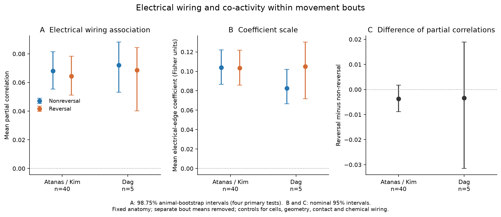
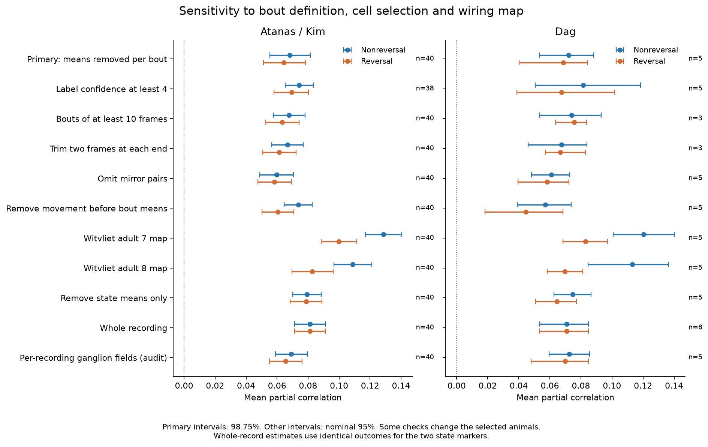
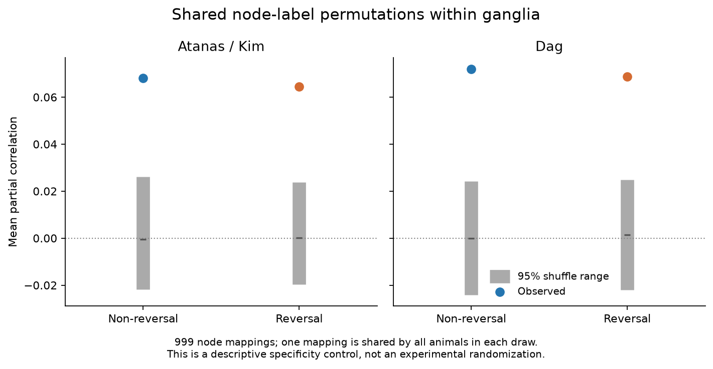

# Electrical links had positive activity associations within reversal and non-reversal bouts after cell and contact controls in 40 and five selected worms

Electrical annotations had a small positive link to shared activity inside both movement states in two selected worm samples. The link remained when each bout's mean activity was removed. The data did not resolve a difference between the two states. This result concerns a fixed anatomical map and selected identified head neurons. It does not establish direct electrical transmission.

## Question and prior work

A whole-record correlation can come from two neurons that change their mean activity when an animal changes behavior. This need not imply that they vary together inside a bout. We asked whether anatomical electrical links still predict shared activity after the mean of every movement bout is removed.

Atanas, Kim and colleagues measured brain-wide activity and behavior across time and state. A RIM manipulation study showed that electrical outputs can help maintain a movement state. These results motivate a test inside movement bouts. [Atanas, Kim et al., 2023](https://doi.org/10.1016/j.cell.2023.07.035), [Sordillo and Bargmann, 2021](https://doi.org/10.7554/eLife.67723).

The campaign had already found a static electrical-wiring association after movement regression, soma distance and neurite contact controls. A later study compared slow and fast activity. The present test changes the unit of centering: it removes separate bout means inside each state. It also tests the two states on the same cell panel in each animal. This is an extension of the prior association, not a first report that electrical links can coordinate neurons. [Static study](sci:sha256:a250df14782a179b8bee744662c1a654f7fcf33a416f07366774b9b9bb58ab5a), [temporal-band study](sci:sha256:9bd20c58e0e056305f2e5c4227de1c838bebc40b648c7c6ffef896d2e479bb97).

PLAN.md gives the local plan fixed before the first new score. ANALYSIS_NOTES.md records a later metadata correction. The plan was not registered with an external service.

## Data and fixed selection

The main source is the processed activity and matched NeuroPAL labels of Atanas, Kim et al. The fixed release is Zenodo 19388374 v4. The separate source is the eight labelled recordings from Dag, Nwabudike, Kang et al., Zenodo 19414639 v1. We use the full labelled recordings. We do not balance genotype or align food encounter. This is a separate-sample check, not a controlled comparison of food or serotonin. Both samples came from one lab. [Dag et al., 2023](https://doi.org/10.1016/j.cell.2023.04.023).

There are 40 main source recordings with 1,600 to 1,615 frames and eight separate source recordings with 799 to 800 frames. The median frame step is about 0.600019 seconds. The 48 used source HDF5 files have distinct hashes.

We kept unique cell labels with confidence at least 3, no question mark, finite nonconstant activity, a map node, an atlas position and a contact-table node. ROI keys are one-based. We used one cell and pair panel for the two states. Reversal is the supplied reversal_vec flag. Its complement is called non-reversal because it can contain pauses and turns.

A bout is a maximal contiguous run of one flag value. The primary rule requires at least five frames per retained bout, at least five bouts and 60 retained frames per state, at least 30 cells and 10 electrical pairs. All 40 main animals passed. Five of the eight separate animals passed. The other three lacked the required bout coverage. The thresholds were not relaxed after the scores.

| Sample | Retained animals | Cells per animal | Electrical pairs per animal | Non-reversal frames | Reversal frames |
|---|---:|---:|---:|---:|---:|
| Atanas / Kim | 40 | 42 to 97 | 32 to 165 | 720 to 1207 | 357 to 886 |
| Dag | 5 | 71 to 89 | 96 to 162 | 527 to 676 | 100 to 207 |

Anatomy is the Cook hermaphrodite map, corrected in July 2020. Adult Witvliet maps 7 and 8 are fixed checks. Neurite contact is from Witvliet Dataset 8. Soma positions are from the pinned OpenWorm Virtual Worm atlas. Counts are structural annotations, not conductance. Anatomy and activity came from different animals. Witvliet electrical annotations are partial. [Cook et al., 2019](https://doi.org/10.1038/s41586-019-1352-7), [Witvliet et al., 2021](https://doi.org/10.1038/s41586-021-03778-8).

The exact shared paths, source versions, URLs and hashes of files actually used are in files/provenance.json. The shared paths with /mnt/dell-data are HP compatibility paths. No failed /data path was used. No shared raw file was changed or newly downloaded.

## Within-bout measure

For state s, let each retained bout b have n_b frames and a vector mean m_b. We sum centered cross-products:

    C_s = sum over bouts b in state s, and frames t in b:
          (x_t - m_b) (x_t - m_b)^T

We divide each entry by the square root of its two diagonal entries. This gives a pooled within-bout correlation. Every frame contributes to the pooled cross-product. We do not join traces or take differences across bout boundaries. We then take the signed Fisher transform. No Fisher clipping was required.

The standard covariance identity explains the distinction from a state-only calculation:

    state-centered cross-product
      = within-bout cross-product
        + sum_b n_b (m_b - state_mean) (m_b - state_mean)^T

Thus the primary measure excludes the second term. This is standard covariance algebra, not a new biological law. Separate normalization means that a difference between correlation slopes cannot be read as the fraction caused by bout means. Shorter bouts also remove more slow variation.

## Conditional model and inference

For every animal and state, we fit all unordered cell pairs:

    Fisher(within-bout correlation_ij)
      = cell_i + cell_j
        + chemical presence_ij + log(1 + summed chemical count_ij)
        + shared chemical input_ij
        + mirror pair_ij + same ganglion_ij
        + distance spline_ij
        + contact presence_ij + log(1 + contact area_ij)
        + beta_state * electrical presence_ij + error_ij

The cell terms are additive fixed effects with separate fitted values for each state. Chemical counts sum both directions. Electrical counts use the maximum of opposite entries before conversion to presence. Shared input is the cosine similarity of log(1 + chemical count) input vectors over the full anatomical source set. The distance term is a linear spline of log(1 + atlas distance), with knots at pair-distance quantiles 0.1, 0.25, 0.5, 0.75 and 0.9 in each animal. The contact term uses zero for absent entries among contact-table nodes. There is no ridge penalty.

The primary statistic is the mean per-animal partial correlation of electrical presence with the Fisher outcome after these controls. We also report beta in Fisher units. QR projection handles the nuisance terms. Each animal has equal weight. The 20,000-draw percentile bootstrap resamples animals, with seed 20261109. Pair rows are not treated as independent animals.

The four primary intervals have nominal 98.75% coverage, to address the family of two states in two samples at nominal 5%. Other intervals are nominal 95%. These are conditional resampling intervals. They hold the map, cell panels, lab and analysis choices fixed. They do not establish generalization across anatomical maps or labs. With only five separate animals, the bootstrap has weak population coverage. The exact two-sided sign-test p value is 0.0625 for five positive values of five. The interval criterion and the sign test answer different statistical questions.

The source region field was often empty and sometimes held comments. The first fit used each recording's field. The shuffle audit exposed this problem. We then pooled only six valid anatomical region categories by neuron identity, without activity values. The mode defines each label; missing-only identities stay unknown. Of 139 eligible identities, 112 have a valid anatomical region and 27 remain unknown. Two eligible identities have conflicting valid region labels; the modal rule is used. This correction occurred after the first scores. The initial rule is retained as local_ganglion. The change in a primary cohort mean partial correlation was at most 0.0013. This is an implementation correction, not an independently registered confirmation.

## Main results

| Sample | State | Animals | Mean partial correlation (98.75% interval) | Positive animals |
|---|---|---:|---:|---:|
| Atanas / Kim | Non-reversal | 40 | 0.0681 (0.0554 to 0.0814) | 40/40 |
| Atanas / Kim | Reversal | 40 | 0.0644 (0.0511 to 0.0784) | 39/40 |
| Dag | Non-reversal | 5 | 0.0720 (0.0532 to 0.0882) | 5/5 |
| Dag | Reversal | 5 | 0.0686 (0.0402 to 0.0844) | 5/5 |

All four nominal lower limits were positive. This meets the local plan's interval criterion. The five-animal check is still limited. In the 40-animal sample, exact two-sided sign tests gave p=1.82e-12 for non-reversal and p=7.46e-11 for reversal. In the five-animal sample, both gave p=0.0625.

The mean electrical-edge coefficients were 0.1041 (0.0865 to 0.1220) for non-reversal and 0.1035 (0.0859 to 0.1217) for reversal in Atanas / Kim. They were 0.0827 (0.0665 to 0.1020) and 0.1050 (0.0718 to 0.1301) in Dag. These coefficient intervals are nominal 95%. They are adjusted associations, not causal effects.

Figure 1. A: mean partial correlations with 98.75% animal-bootstrap intervals. B: electrical-edge coefficients with nominal 95% intervals. C: paired state differences of partial correlations with nominal 95% intervals. All panels use the same primary cell panels within each animal. Both states had small positive means. The state contrast was uncertain.

### State differences were not resolved

| Sample | Reversal minus non-reversal partial correlation (95% interval) | Coefficient difference in Fisher units (95% interval) |
|---|---:|---:|
| Atanas / Kim | -0.0037 (-0.0088 to 0.0018) | -0.0006 (-0.0085 to 0.0081) |
| Dag | -0.0034 (-0.0315 to 0.0189) | 0.0224 (-0.0154 to 0.0557) |

The intervals include zero. This does not prove equal coupling. Bout lengths, retained frame counts, calcium noise and temporal content differ between states. Even a clear contrast would require further controls before a causal state effect could be claimed.

### The fixed checks kept positive mean associations

| Check | Atanas / Kim: non-reversal / reversal | Dag: non-reversal / reversal |
|---|---:|---:|
| Confidence at least 4 | 0.074 / 0.069 (n=38) | 0.081 / 0.067 (n=5) |
| At least 10 frames per bout | 0.068 / 0.063 (n=40) | 0.074 / 0.076 (n=3) |
| Trim two frames at each end | 0.067 / 0.061 (n=40) | 0.067 / 0.067 (n=3) |
| Omit mirror pairs | 0.060 / 0.058 (n=40) | 0.061 / 0.058 (n=5) |
| Remove measured movement | 0.074 / 0.060 (n=40) | 0.057 / 0.044 (n=5) |
| Adult Witvliet map 7 | 0.129 / 0.100 (n=40) | 0.120 / 0.083 (n=5) |
| Adult Witvliet map 8 | 0.109 / 0.083 (n=40) | 0.113 / 0.070 (n=5) |
| Remove only the state means | 0.079 / 0.079 (n=40) | 0.075 / 0.065 (n=5) |
| Whole recording, positive control | 0.081 / 0.081 (n=40) | 0.071 / 0.071 (n=8) |
| Initial per-recording ganglion fields, added audit | 0.069 / 0.065 (n=40) | 0.072 / 0.070 (n=5) |

All fixed-check intervals for the two mean partial correlations had positive lower limits. These checks have no correction for multiple comparisons. The minimum-length and trimmed separate-sample checks each use only three animals. Their resampling intervals provide little information about a wider animal population. The whole-record positive control uses all eight separate animals and the same outcome for both displayed state markers.

The movement check regresses each full trace on velocity, head angle, angular velocity, pumping, curvature and reversal state. Each variable passes through causal exponential filters with constants of 1, 5, 15 and 50 frames, plus constant, linear and quadratic time terms. We then remove separate bout means from those residuals. This removes measured linear movement effects, not all movement or state dependence.

Figure 2. All fitted configurations. Primary intervals are 98.75%; other intervals are nominal 95%. Animal counts are shown at the right. The last row is the added metadata audit. The two adult maps use the same external contact table and atlas positions.

Deleting one whole neuron class from all animals kept both mean partial correlations positive. We tested 60 classes in the main panel and 54 in the separate panel. The ranges were Atanas / Kim: non-reversal 0.052 to 0.082, reversal 0.043 to 0.085; Dag: non-reversal 0.047 to 0.085, reversal 0.047 to 0.083. This is an influence check, not an uncertainty model for unobserved neuron classes.

### Observed labels exceeded the sampled label shuffles

For each of 999 draws, we used one node mapping shared by all animals and both samples. The mapping was sampled within the pooled anatomical-region groups. Unknown identities formed their own group. Nuisance designs and measured outcomes stayed fixed. We projected each shuffled electrical feature on the real controls before scoring it.

No draw reached any observed mean. Each one-sided Monte Carlo p value was 0.001, or 0.004 after a four-test Bonferroni correction. The intervals in files/results/permutation.csv are ranges of the shuffle distribution, not animal confidence intervals.

Figure 3. Observed means and central 95% shuffle ranges. A shared mapping preserves dependence from repeated identities across animals. This is a descriptive specificity control. It is not an experimental randomization. It does not preserve neuron type, mirror family, exact panel degrees or distance. It cannot remove unmeasured pair-specific causes.

## Scope, limits and scientific use

The selected electrical annotations carry information about shared activity within both types of bout. Whole-record changes of bout means are therefore not sufficient to explain the association. This remains a small conditional statistical result. The test does not identify which electrical contacts carry current, measure rectification or show a mechanism that stabilizes a neural representation.

The source activity is slow calcium imaging, not voltage. Indicator kinetics, movement inside a bout, optical cross-talk, common chemical input, sensory drive and neuromodulation can remain. The shared-input covariate is a structural proxy. The atlas positions and one-animal contact table cannot control all geometry. Missing region labels and cell-identity errors can remain. The primary rule selects long enough bouts and excludes three separate-sample animals. It does not cover all behavior.

The map and recordings come from different animals. Both recording samples share a lab and many neuron identities. Class deletion and a shared-label shuffle reduce some dependence concerns, but they do not give independent circuits, species, regions or labs. The five-animal sample is a descriptive replication check. The result does not establish a general law across animals or tasks.

A useful next test would combine matched anatomy and voltage measurements with a cell-specific electrical perturbation. It would test the same within-bout statistic with equal temporal sampling in an independent lab. That test could separate direct electrical coupling from correlated drive and calcium filtering.

## Validation and reproducibility

The source audit matched every one of 7,707 nonzero Cook entries. The pooled estimator matched correlations of explicitly stacked bout residuals to 2.22e-16. Adding an arbitrary constant to each bout changed it by at most 3.86e-15. The exact covariance decomposition error was 7.99e-15. The QR coefficient agreed with independent full SVD regression in all 45 primary animals to 1.17e-15. These are calculation checks, not independent biological validation.

files/REPRODUCE.md gives the full commands. files/code contains source retrieval, extraction, analysis, class deletion, permutation, source audit, numerical audit and plotting code. files/results contains cohort-level findings and checks. files/provenance.json gives every used source hash and exact shared input path.

External records and all animal, cell and pair-level derivatives stay outside the signed package. The activity API records give no license field. Public access was not treated as permission to relicense external databases. files/EXTERNAL_DATA_NOTICE.md gives attribution and source-term decisions. The unchanged SCI baseline LICENSE applies to the original bundled text, code, figures and aggregate findings.

Campaign: 11_07_2026. Job: sci-1107-hp-neural-structure-and-computation-23e2aff9a718. Topic: neural-structure-and-computation. Machine: hp. Account: codex-myxtap. Model: gpt-6.1-sol, high reasoning effort, through the Codex harness in T3 Code. One worker did this investigation. No agents were launched. The campaign-machine signing key is not a personal authorship claim. The publication is saved locally; this worker made no remote archive or index submission.
