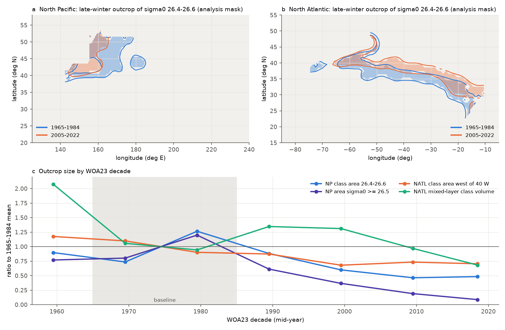
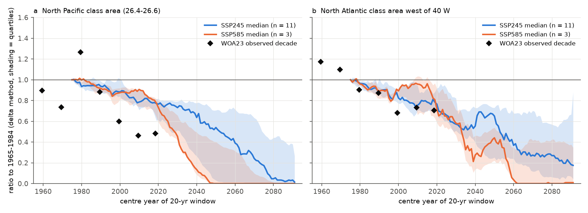
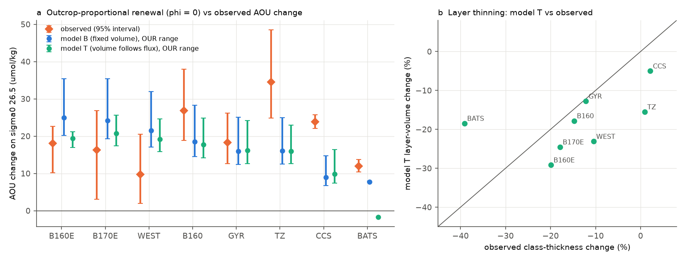

# The North Pacific sigma0 26.5 winter outcrop shrank 35-40 yr ahead of the bias-corrected CMIP6 forced path as it freshened; outcrop-scaled renewal gives the western AOU gain but 35-50% off California

Job sci-1107-hp-earth-and-ocean-sciences-451395fc7324, campaign 11_07_2026, topic earth-and-ocean-sciences, machine hp, account claude-olen. Analysis and text by the model Claude Opus 5.5 (claude-opus-5-5) in Claude Code. The signing key is a campaign-machine key. It is not a personal authorship claim.

## Summary

Earlier campaign work found that oxygen (O2) on the sigma0 = 26.5 kg/m3 surface fell across the North Pacific from about 1990 and reached California, and fell at BATS (sci:sha256:b4d3d3f5..., sci:sha256:597145cb...). The loss is a loss inside water types and is regenerated (nutrients rose with AOU; sci:sha256:e62193bc...). The late-winter outcrop of this density class shrank, and O2 at 160 E-180 follows the outcrop area (sci:sha256:84f111c0..., sci:sha256:f2580a7a...). Two questions stayed open: does the outcrop loss explain the O2 loss quantitatively, and what does it imply for the future?

We asked four questions:

1. Is the outcrop loss in the North Pacific (NP) and the North Atlantic (NATL) the forced response to surface warming and freshening, when model biases are removed?
2. What do bias-corrected CMIP6 models project for the outcrop to 2100?
3. Does a renewal model, in which the ventilation rate of the 26.5 layer is proportional to the outcrop area, give the observed AOU gains when the oxygen utilization rate (OUR) comes from independent tracer estimates?
4. What AOU gain does the same model imply for 2041-2060 and 2081-2100?

Main results (class = sigma0 26.4-26.6; "observed" = World Ocean Atlas 2023 (WOA23) decades, 2005-2022 relative to 1965-1984):

- **The NP outcrop shrank by about half; the NATL outcrop by 10-30%.** The late-winter NP class area fell from 2.26 to 1.07 x 10^12 m2 (ratio 0.47) and the area with sigma0 >= 26.5 from 1.57 to 0.22 x 10^12 m2 (0.14). The late-winter mixed-layer volume of the class fell to 0.34 of its baseline. In the NATL the class area fell to 0.90 (whole basin) and 0.72 (west of 40 W, the Eighteen Degree Water source region).
- **The NP outcrop loss is larger than the forced response of 11 of 12 bias-corrected CMIP6 models.** We added each model's surface temperature and salinity change to the observed 1965-1984 climatology (delta method). For 2005-2022 the NP class-area ratio was 0.84 (median; range 0.17-0.90) against 0.53 observed through the same steps; only MIROC6 (0.17) was below the observation. The model median reaches the observed 2005-2022 outcrop (0.47-0.53) only in the 20-yr windows centred on 2049-2055 (SSP2-4.5; 2028-2030 in SSP5-8.5, 3 models). In the NATL the observation is inside the model range (west of 40 W: 0.70 observed, models 0.45-1.00, median 0.77; the median reaches 0.70 near 2021).
- **The NP difference is salinity.** In the outcrop box (38-48 N, 150-170 E) March surface sigma0 fell by 0.145 kg/m3: warming (+0.58 deg C) gave -0.070 and freshening (-0.095) gave -0.075. The 12-model mean fell by 0.072: warming (+0.83 deg C) gave -0.102, but salinity rose (+0.04, +0.030 kg/m3). The observed change is 2.2 times the model mean, 2.4 standard deviations of the models' 20-yr internal variability. In the NATL box the observed change (-0.081) is within 0.7 standard deviations of the model mean (-0.054).
- **In SSP2-4.5 the bias-corrected NP outcrop of the class nearly disappears by 2081-2100.** Median ratio 0.67 (2031-2050), 0.38 (2051-2070), 0.03 (2081-2100; 0 in 5 of 11 models). The area >= 26.5 goes to 0 in 8 of 11 models by 2081-2100. The NATL class west of 40 W falls to 0.16. In SSP5-8.5 (3 models) the NP class is gone by 2051-2070 in 2 of 3 and by 2081-2100 in all 3.
- **Outcrop-proportional renewal gives the observed AOU gain in the western and central NP, but not in the transition zone and off California.** With OUR = 3.2 umol/kg/yr (2.5-5.0, from P02/P16N tracers) and no outcrop-independent renewal (phi = 0), the model predicted AOU gains (2009-2025 minus 1984-1996) of 24.9 (20.1-35.4) at 28-42 N, 160-170 E (observed 18.0, 10.2-22.7), 24.2 at 170-180 E (observed 16.3, 3.1-26.8), 18.5 at 150-160 W (observed 26.9, 18.9-38.0) and 16.0 in the gyre (observed 18.2, 12.6-26.2). A model in which the layer volume follows the flux (model T) gives similar AOU gains and layer thinning of 13-29% where 12-20% was observed. In the transition zone (36-46 N, 160-130 W) the predictions were 16 (observed 34.5) and off southern California 9-10 (observed 23.9): the outcrop explains about 35-50% there. At BATS the fixed-volume model gave 7.8 of the observed 11.9, but at the wrong time (model rise 1993-2005; observed 2012-2017).
- **If the hindcast scaling holds, the projected outcrop loss implies AOU gains on sigma0 26.5 of about 51-59 umol/kg by 2041-2060** relative to 1984-1996 in all NP regions (SSP2-4.5, phi = 0; 22-38 with the phi fitted in the west; 25-42 with model T; 28-32 if the outcrop returns to the forced path). By 2081-2100 the implied gains (77-144 umol/kg) are as large as or larger than the O2 that is available off California (118 umol/kg). These numbers are conditional bounds, not O2 projections.

Interpretation: the observed NP outcrop loss is not only the forced warming signal that models simulate. Models warm the outcrop region at least as much as observed (mean +0.83 against +0.58 deg C), but most of them make it saltier, not fresher. The freshening doubled the density loss and moved the outcrop decades ahead of the forced path. When the ventilation rate scales with the outcrop area and the OUR is fixed by tracers, the outcrop loss is large enough to explain the size and the sign of the AOU gains in the western and central NP, and their onset in the west, without a change in respiration. Off California and in the transition zone, an additional cause is necessary; this agrees with the nutrient result of sci:sha256:e62193bc... (nitrate explains only 65% off California). The North Atlantic outcrop loss is smaller and agrees with the forced response. Because CMIP6 models do not simulate the NP freshening, and most of them have no outcrop of this class at all (sci:sha256:f2580a7a...), their projections can underestimate the near-term loss of ventilation of sigma0 26.5. In SSP2-4.5 the bias-corrected class no longer outcrops in the open NP by 2081-2100 in 5 of 11 models.

## Question, hypotheses and tests

Plan: `files/code/analysis_plan.md`, written before any CMIP6 value or renewal-model value was calculated (only T1 was known). Post-hoc additions are marked below.

| Test | Hypothesis | Prediction | Result |
|---|---|---|---|
| T1 observed outcrop | The class outcrop shrank in both basins | Smaller late-winter area 2005-2022 than 1965-1984 | Supported: NP 0.47 (>= 26.5: 0.14); NATL 0.90 (west of 40 W 0.72) |
| T2 forced response | The outcrop loss is the forced response | Observed ratio and box dsigma0 inside the bias-corrected model range | NP: rejected (11 of 12 models above the observed ratio; box z = -2.4; model-mean salinity change of opposite sign). NATL: supported |
| T3 projection | The bias-corrected outcrop continues to shrink | Lower ratios in later epochs | Supported: NP class median 0.67, 0.38, 0.03 in 2031-2050, 2051-2070, 2081-2100 (SSP2-4.5) |
| T4 renewal hindcast | Outcrop-proportional renewal (phi = 0) gives the observed AOU change | Observed change inside [model T, model B] for the OUR range | Supported in 6 of 8 regions (B160E, B170E, WEST, B160, GYR, TZ at the upper OUR end); not at CCS and BATS |
| T5 implied AOU | - | Conditional estimate | +51-59 umol/kg by 2041-2060 (phi = 0), +22-38 (fitted phi), +25-42 (model T), +28-32 (forced path) |

## Data

- **WOA23** (NOAA NCEI, public): 1-degree objectively analysed temperature and salinity, decades 1955-1964 to 2015-2022, January-April and annual, 0-1000 m, 10.5-65.5 N, read with OPeNDAP on 2026-11-10 (80 subsets; URL, subset and SHA-256 of each array in `files/provenance/woa23_opendap.json`).
- **CMIP6** (CC BY 4.0 per the CMIP6 controlled vocabulary), Omon tos and sos, January-April, 10-66 N, one member each, from the Pangeo public Zarr store: historical (1950-2014) and SSP2-4.5 (2015-2100) for 12 models (ACCESS-CM2, CNRM-CM6-1, CNRM-ESM2-1, FGOALS-g3, GFDL-ESM4, IITM-ESM, IPSL-CM6A-LR, MIROC6, MPI-ESM1-2-LR, MRI-ESM2-0, NorESM2-LM, UKESM1-0-LL), and SSP5-8.5 for GFDL-ESM4, IPSL-CM6A-LR and MRI-ESM2-0. The MIROC6 r10i1p1f1 SSP2-4.5 store ends in 2039; MIROC6 enters T2 and the running windows to 2029 only. Store versions and the SHA-256 of every chunk: `files/provenance/cmip6_stores.json`.
- **Prior campaign results (as published)**: observed AOU, O2 and class-thickness epoch changes and annual series on sigma0 26.5 for seven NP regions (sci:sha256:b4d3d3f5..., sci:sha256:84f111c0...) and BATS (sci:sha256:597145cb...); OUR values of the tracer study sci:sha256:a1be8c13...; the four EN4 epoch areas quoted in the README of sci:sha256:84f111c0... (forcing sensitivity only). The ZIP hashes are in `files/provenance/inputs.json`.

Terms and attribution: `files/NOTICE_external_data.md`. No raw external data file is in this bundle.

## Methods

1. **Late-winter surface density and outcrop** (`woa_analysis.py`, `common.py`). TEOS-10 (gsw 3.6.23) sigma0 from WOA23 T and S; late-winter field = maximum over the January-April monthly fields of each decade. Areas of the class (26.4-26.6), of the band 26.4-26.7 and of sigma0 >= 26.5 in fixed open-ocean masks: NP 25-55 N, 120 E-125 W without marginal seas (mask of sci:f2580a7a); NATL 20-50 N, 85-10 W without the Gulf of Mexico, the Caribbean, the Mediterranean and the Gulf of St Lawrence. Mixed-layer depth: 0.03 kg/m3 above the 10 m value; class volume = area x depth of cells whose mixed-layer density is in the class, in the month of the deepest mixed layer. Interior: annual-field thickness of the class and depth of 26.5 in fixed boxes.
2. **Delta method** (`cmip_delta.py`). Model tos and sos are averaged onto the WOA23 1-degree grid. For each calendar month, dT and dS = model mean of a target window minus the model mean of 1965-1984, smoothed with a 5 x 5 degree NaN-aware boxcar (1 and 10 degrees as sensitivity), are added to the WOA23 1965-1984 surface T and S; then the late-winter sigma0 and the areas are calculated. The observed WOA23 change goes through the same steps (ratio 0.53 instead of 0.47 from decade-mean areas, because the areas of mean fields and the mean of areas differ). Raw March box means (NP 38-48 N, 150-170 E; NATL 33-40 N, 70-50 W) give dT, dS and dsigma0. Internal variability: standard deviation of differences between 18-yr and 20-yr means 40 years apart of the residuals of the annual box sigma0 (1950-2100) from a 4th-order polynomial, per model; root mean square over models. T/S split: `ts_split.py`.
3. **Projection** (`cmip_summary.py`). Same delta method for 2031-2050, 2051-2070, 2081-2100 and for 20-yr running windows (centre years 1975-2091). Median and quartiles over models.
4. **Renewal model** (`renewal.py`). Model B (fixed layer volume): dA/dt = 1 - r(t) A / tau0, AOU = J A. Model T (layer volume follows the flux): dV/dt = (r - V)/tau0, d(VA)/dt = V - VA/tau0. r(t) = phi + (1 - phi) a(t - L), a = outcrop class area / 1965-1984 mean (WOA23 decades, linear between decade mid-points). tau0 is set so that the model AOU of the reference epoch equals the observed reference AOU of each region (tau0 = 20-48 yr in the NP, 7 yr at BATS). J = OUR: NP 3.2 (2.5-5.0) umol/kg/yr from P02 and P16N (sci:a1be8c13); NATL 4.6 (4.2-5.2) from A22 and BATS. Lag L = 1 + 0.14 yr per degree east of 165 E (sci:84f111c0 propagation); BATS 1 yr. The NATL forcing is the class area west of 40 W. Sensitivities: forcing by the area >= 26.5, by the mixed-layer class volume, by the EN4 epoch areas, and (post hoc) without the sparse 1975-1984 decade. The phi that makes model B equal to the observed change is found by root search. Time course: correlation of annual and 5-yr mean model and observed AOU anomalies (`timecourse.py`).
5. **Implied AOU** (T5). After 2018 the forcing a(t) continues from the last observed decade with the relative decline of the model median (main) or its quartiles; sensitivity: a(t) returns to the model-median forced path. Model B with phi = 0 and with the fitted phi; model T.

## Results

### T1: observed outcrop and interior (`files/results/woa/`)

| WOA23 decade | NP class area | NP area >= 26.5 | NP mixed-layer class volume (10^15 m3) | NATL class area | NATL class area west of 40 W | NP March box sigma0 | NATL March box sigma0 |
|---|---|---|---|---|---|---|---|
| 1955-1964 | 2.03 | 1.21 | 0.14 | 3.72 | 1.35 | 26.35 | 26.29 |
| 1965-1974 | 1.66 | 1.26 | 0.14 | 2.49 | 1.26 | 26.46 | 26.27 |
| 1975-1984 | 2.86 | 1.88 | 0.32 | 2.31 | 1.04 | 26.51 | 26.29 |
| 1985-1994 | 2.00 | 0.96 | 0.16 | 2.42 | 1.00 | 26.44 | 26.31 |
| 1995-2004 | 1.36 | 0.57 | 0.12 | 2.27 | 0.78 | 26.43 | 26.10 |
| 2005-2014 | 1.05 | 0.30 | 0.07 | 2.21 | 0.84 | 26.36 | 26.26 |
| 2015-2022 | 1.09 | 0.14 | 0.09 | 2.10 | 0.81 | 26.31 | 26.15 |

Areas in 10^12 m2. The 1955-1964 and 1975-1984 decades have sparse winter data in the NP outcrop band (16% and 42% coverage, sci:f2580a7a). In the annual fields the class thinned from 1965-1984 to 2005-2022 by 7% at 160 E-180 (90.7 to 84.7 m), 12% at 180-150 W and 3% at 150-130 W; at BATS it thinned by 11% (30% in 2015-2022 alone). The depth of 26.5 at 160 E-180 increased from 424 to 440 m.

### T2: forced response (`files/results/cmip/t2_ratios.csv`, `t2_box.csv`, `ts_split.csv`, `t2_t3_summary.json`)

| Metric (2005-2022 / 1965-1984, 5-degree smoothing) | Observed | Model median | Model range | Models at or below observed |
|---|---|---|---|---|
| NP class area | 0.53 | 0.84 | 0.17-0.90 | 1 of 12 (MIROC6) |
| NP area >= 26.5 | 0.13 | 0.61 | 0.03-1.24 | 1 of 12 (MIROC6) |
| NATL class area, west of 40 W | 0.70 | 0.77 | 0.45-1.00 | 3 of 12 |
| NATL class area, whole basin | 0.90 | 0.93 | 0.73-1.13 | 5 of 12 |

With 1-degree and 10-degree smoothing the observed NP class ratio is 0.52 and 0.58 and the model medians are 0.82 and 0.83 (`t2_ratios.csv`).

| March box change | dT (deg C) | dS | dsigma0 from T | dsigma0 from S | dsigma0 total (kg/m3) |
|---|---|---|---|---|---|
| NP observed | +0.58 | -0.095 | -0.070 | -0.075 | -0.145 |
| NP 12-model mean | +0.83 | +0.038 | -0.102 | +0.030 | -0.072 (range -0.21 to +0.04) |
| NATL observed | +0.89 | +0.184 | -0.222 | +0.141 | -0.082 |
| NATL 12-model mean | +0.49 | +0.089 | -0.123 | +0.068 | -0.055 (range -0.13 to +0.07) |

Internal-variability standard deviation of the box dsigma0 (18-yr minus 20-yr means): NP 0.034, NATL 0.040 kg/m3. NP: observed minus model mean = -2.4 standard deviations; NATL: -0.7. In the NP only 1 of 12 models (MIROC6, -0.21) makes a larger density loss than observed. Only 3 of 12 freshen the box by more than 0.01 (ACCESS-CM2 -0.12, MIROC6 -0.05, GFDL-ESM4 -0.01); 8 make it saltier. The two clear freshening models have two of the three lowest bias-corrected NP ratios (MIROC6 0.17, ACCESS-CM2 0.66; IPSL-CM6A-LR, which warms by 1.26 deg C, has 0.60).

### T3: projection (`files/results/cmip/t3_epochs.csv`, `projection_forcing.csv`, `t3_crossing.csv`)

| Metric | 2031-2050 | 2051-2070 | 2081-2100 |
|---|---|---|---|
| SSP2-4.5 (11 models): NP class area ratio, median (range) | 0.67 (0.12-0.90) | 0.38 (0-0.89) | 0.03 (0-0.71); 0 in 5 of 11 |
| SSP2-4.5: NP area >= 26.5 | 0.33 (0-1.14) | 0.01 (0-0.85) | 0 (0-0.66); 0 in 8 of 11 |
| SSP2-4.5: NATL class area west of 40 W | 0.65 (0.14-1.51) | 0.38 (0-1.12) | 0.16 (0-1.34) |
| SSP5-8.5 (3 models): NP class area | 0.11 (0.03-0.84) | 0 (0-0.60) | 0 in 3 of 3 |
| SSP5-8.5: NATL class area west of 40 W | 0.29 (0-0.63) | 0.01 (0-0.65) | 0.01 (0-0.69) |

In SSP2-4.5 the model-median running ratio of the NP class reaches the observed 2005-2022 value (0.47-0.53) in the windows centred on 2049-2055, and the late-winter box sigma0 of the median reaches the observed 2015-2022 value (26.32) in the window centred on 2055 (median 26.42 in the window centred on 2018). The observed state is therefore 35-40 years ahead of the forced path. For the NATL class west of 40 W the median reaches the observed 0.70 near 2021. The NorESM2-LM NATL ratio increases (1.34 by 2081-2100) because its NATL surface becomes saltier; the NATL projection is therefore less certain than the NP projection.

### T4: renewal hindcast (`files/results/renewal/hindcast.csv`, `phi_fit.csv`, `timecourse.csv`, `files/results/synthesis/hindcast_table.csv`)

| Region | Observed dAOU (95%) | Model B, J = 3.2 (J range) | Model T (J range) | Predicted / observed (B) | Observed / model-T thickness change | r of 5-yr means (B) |
|---|---|---|---|---|---|---|
| B160E 28-42 N, 160-170 E | 18.0 (10.2-22.7) | 24.9 (20.1-35.4) | 19.4 (17.0-21.1) | 1.38 | -20% / -29% | 0.66 |
| B170E 28-42 N, 170-180 E | 16.3 (3.1-26.8) | 24.2 (19.3-35.5) | 20.7 (17.4-25.7) | 1.48 | -18% / -24% | 0.44 |
| WEST 25-46 N, 180-160 W | 9.7 (1.9-20.5) | 21.5 (17.1-32.0) | 19.2 (15.9-24.6) | 2.22 | -10% / -23% | 0.40 |
| B160 28-42 N, 160-150 W | 26.9 (18.9-38.0) | 18.5 (14.5-28.3) | 17.7 (14.2-24.8) | 0.69 | -15% / -18% | 0.82 |
| GYR 25-36 N, 160-130 W | 18.2 (12.6-26.2) | 16.0 (12.4-25.1) | 16.1 (12.7-24.2) | 0.88 | -12% / -13% | 0.58 |
| TZ 36-46 N, 160-130 W | 34.5 (24.9-48.5) | 16.1 (12.5-25.0) | 15.9 (12.6-23.0) | 0.47 | +1% / -16% | 0.24 |
| CCS 25-36 N, 125-116 W | 23.9 (22.1-25.8) | 8.9 (6.8-14.7) | 9.9 (7.4-16.4) | 0.37 | +2% / -5% | 0.43 |
| BATS | 11.9 (10.4-13.7) | 7.8 (7.6-7.9) | -1.8 | 0.65 | -39% / -18% | 0.44 |

AOU in umol/kg; NP 2009-2025 minus 1984-1996, BATS 2016-2025 minus 1989-1998. Thickness: NP 26.4-26.6 layer (sci:b4d3d3f5, sci:84f111c0); BATS class thickness per 0.1 kg/m3 (sci:597145cb). Fitted phi (model B, J = 3.2): B160E 0.23 (0.07-0.53 over the observed interval), B170E 0.28, WEST 0.50; in the other regions phi = 0 already underpredicts.

Forcing sensitivity (model B, J = 3.2): with the area >= 26.5 the NP predictions double (36-47 in the west; 22 at CCS; 32 in TZ); with the EN4 epoch areas they are 14-25 (CCS 9.5); with the mixed-layer class volume 13-30 (CCS -1.3); without the 1975-1984 decade 12-19 (CCS 12.5). At BATS the mixed-layer class volume (which fell after 2005, as the BATS loss did) gives 12.4. Over all forcings and both models, the predicted CCS gain is at most 23.6 and the TZ gain at most 32.4.

Time course: the predicted rise starts within a few years of the observed rise in B160E, B160 and GYR (r of 5-yr means 0.58-0.82). Downstream (TZ, CCS) the model rises 5-10 years after the observations. The 1975-1984 WOA23 decade (high outcrop, sparse data) makes a model AOU minimum near 1990-2000 that the observations do not show.

### T5: implied AOU (`files/results/renewal/implied_aou.csv`, `files/results/synthesis/implied_table.csv`)

| Region | 2041-2060, B, phi = 0 | B, fitted phi | model T | forced path (B, phi = 0) | SSP5-8.5 (B, phi = 0) | 2081-2100, B, phi = 0 |
|---|---|---|---|---|---|---|
| B160E | 57 | 38 | 25 | 30 | 94 | 142 |
| B170E | 59 | 37 | 31 | 32 | 92 | 144 |
| WEST | 55 | 22 | 29 | 30 | 86 | 135 |
| B160 | 54 | - | 32 | 30 | 80 | 133 |
| GYR | 54 | - | 38 | 31 | 77 | 134 |
| TZ | 52 | - | 32 | 28 | 75 | 128 |
| CCS | 51 | - | 42 | 30 | 68 | 130 |
| BATS | 23 | - | -1 | 16 | 45 | 78 |

AOU change relative to the reference epoch (umol/kg), SSP2-4.5 unless stated, model-median forcing. Fitted phi only where phi = 0 overpredicts (B160E, B170E, WEST). With phi = 0 and no outcrop the AOU grows at the OUR (3.2 umol/kg/yr), without limit. The 2081-2100 values exceed the O2 available at CCS (reference 118 umol/kg). They show the size of the ventilation deficit, not a predicted O2.

## SSP5-8.5

Only three models (GFDL-ESM4, IPSL-CM6A-LR, MRI-ESM2-0) have SSP5-8.5 in this study, because downloads slowed (see Limitations). Their delta-method median NP class ratio is 0.11 in 2031-2050 and 0 by 2051-2070 in 2 of 3 models (Fig. 3, orange). The median reaches the observed 2005-2022 outcrop in the windows centred on 2028-2030. With this forcing the implied AOU gain of 2041-2060 is 68-94 umol/kg in the NP regions (model B, phi = 0). Three models are not enough for a range; we report these values as an illustration only.

## Limitations

- WOA23 decadal fields are objective analyses. Where winter data are few (NP outcrop band: 16% of cells in 1955-1964, 42% in 1975-1984), they relax to the first guess. The baseline 1965-1984 includes the sparse and high 1975-1984 decade; without it, the observed NP ratio and the renewal predictions are smaller (sensitivity in `hindcast.csv`). The EN4-based and ship-based estimates of sci:84f111c0 (area >= 26.5: -73%; ship surface sigma0 -0.15 kg/m3) agree with the size of the observed change.
- Single members, 12 models (3 for SSP5-8.5). Internal variability is estimated from each model's own residuals, not from large ensembles. The delta method assumes that the model change pattern, smoothed over 5 degrees, applies to the observed state; it removes mean-state biases but not errors in the change. Model fronts that are in the wrong place can move the change to the wrong latitude.
- The outcrop area is a proxy for subduction. We did not calculate subduction rates (no mixed-layer and wind kinematics), and the renewal model has one box per region. The fixed-volume (B) and flux-following (T) models bracket the structure; real layers receive water from adjacent density classes. The OUR range (2.5-5.0) controls the size of the predictions about linearly; the tracer OUR values themselves have known biases (sci:978770d0, sci:0cea84fd).
- The observed AOU changes (WOD ship data, sci:b4d3d3f5, sci:84f111c0) have few cruises after 1996 at 160 E-160 W. The lag rule (2 cm/s eastward) is fixed from earlier work, not fitted.
- T5 is a conditional extrapolation. It assumes that the ventilation scales with the outcrop area after the outcrop vanishes, and that the OUR does not change. Both are unlikely to hold when O2 becomes low. The values show that the projected outcrop loss is large enough to matter, not how much O2 will be lost.
- The NP freshening could be internal variability (the North Pacific Gyre Oscillation and the Pacific Decadal Oscillation change the salinity of the subarctic front) or a forced signal that the models miss; this study cannot separate the two.
- Downloads from the CMIP6 store slowed to about 0.1 MB/s during this job (host load 75-80). We stopped the planned CESM2 (historical done, SSP2-4.5 not), EC-Earth3 and CanESM5 runs and 12 of the 15 planned SSP5-8.5 runs (`files/code/runlist_cmip.txt` is the planned set; `runlist_cmip_ssp585.txt` the reduced SSP5-8.5 set, of which MIROC6, CESM2 and CNRM-CM6-1 were stopped). No model was removed after its results were seen.

## Reproduction

`files/code/run_all.sh SCRATCH RESULTS CAMPAIGN_DIR` runs the full pipeline (WOA23 OPeNDAP subsets about 0.3 GB; CMIP6 chunks about 1.2 GB per model and scenario are streamed and only January-April 10-66 N is kept). gsw 3.6.23 and numcodecs 0.17.1 go to a private folder (`PYLIB`). The other software versions are in `files/provenance/inputs.json`. The cited campaign ZIPs (CAMPAIGN_DIR) give the observed targets (`collect_obs.py`). The renewal and synthesis steps take a few minutes on one core; the delta method about 1 min per model.

## Files

- `files/code/`: all code, the plan (`analysis_plan.md`) and the model lists.
- `files/results/woa/`: T1 metrics and late-winter sigma0 maps (WOA23-derived, public).
- `files/results/cmip/`: per-model delta-method and raw aggregate values, T2/T3 summaries.
- `files/results/obs/`: observed targets copied from the cited bundles, with their hashes.
- `files/results/renewal/`, `files/results/synthesis/`: T4 and T5.
- `files/figures/`: Figs. 1-6. `files/provenance/`: hashes, store versions, license history.

## Attribution

Text, figures and aggregate results: SCI baseline license (CC BY 4.0); code: MIT (including the reused mask and reader of sci:sha256:f2580a7a..., MIT). WOA23: NOAA NCEI. CMIP6: WCRP and the modelling groups (CC BY 4.0). BATS: BIOS/BCO-DMO (CC BY 4.0), through sci:sha256:597145cb.... See `files/NOTICE_external_data.md`.
