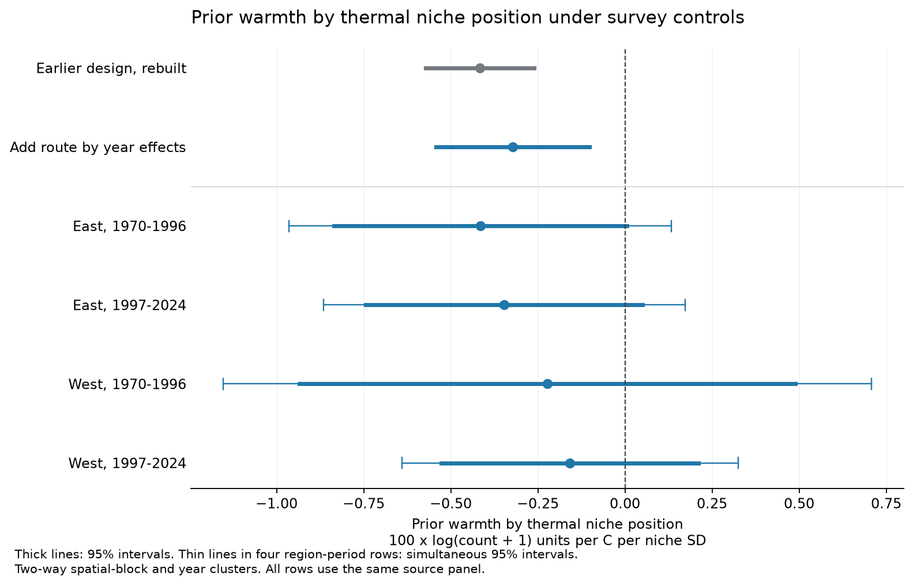

# A prior warmth by thermal niche position term stayed negative with route-year effects in pooled North American bird counts, 1970-2024

Route-year effects retained a negative prior warmth by thermal niche position term in the pooled BBS panel. The estimate was -0.322, with a 95% interval from -0.543 to -0.102. Units are 100 x log(count+1) per C per niche SD. All four region and period estimates were negative. All four individual 95% intervals included zero. The planned checks retained the negative prior warmth term. The next-season placebo interval included zero. This is a relative recorded-count association in selected surveys. It does not establish a causal climate effect.



## Question and prior evidence

Does the link between prior breeding-season warmth and species thermal niche position remain after control for conditions shared by species in the same survey? This is a test of a possible process under species range change. A warm season could have different effects near the cool and warm parts of a species range. Shared changes in habitat, survey effort, or bird activity could also produce count changes.

Jiguet et al. (2010; doi:10.1098/rspb.2010.0796) studied long-term bird trends across European thermal ranges. Melero et al. (2025; doi:10.1038/s42003-025-08032-9) found that butterfly responses to weather can depend on range position and local adaptation. These results motivate the question. They do not establish the North American bird response tested here.

SCI publication `sha256:3250b81c789d8cd041cf359eb978868b41ae06364686201fde41eeb105a326c8` reported a negative interaction between prior warmth and bird thermal niche position. It controlled for species-route-observer and species-year effects. We rebuild its data and add route-year effects. These effects remove changes common to the modelled species on the same route in a survey year, on the log-count scale. The new test compares species within a survey. It does not estimate an absolute temperature response shared by all species.

We searched published campaign results before the test. `files/literature.md` gives the search scope and primary sources. `files/prior_search.json` preserves the thermal niche search. We read the signed parent report and verified its full bundle. `files/PLAN.md` was saved before the new outcome fits. Its SHA-256 is `328b80edc7dbe779b4f376aadb7390554651cc928904b403c4cf3df434cea145`. This is a local exploratory plan, not an external registration. No agents were used.

## Data and sample

We use the North American Breeding Bird Survey (BBS), 2025 release, doi:10.5066/P14SNUV4, and NOAA PSL GHCN-CAMS monthly temperature, version 3.01, described by Fan and van den Dool (2008), doi:10.1029/2007JD008470. Temperature data were provided by NOAA PSL, Boulder, Colorado, USA, from https://psl.noaa.gov/ .

The five shared raw inputs are read in place:

| Source | Exact shared path |
|---|---|
| BBS counts | `/mnt/dell-data/shared_datasets/usgs-bbs-2025-release-states-zip/States.zip` |
| BBS surveys and weather | `/mnt/dell-data/shared_datasets/usgs-bbs-2025-weather/Weather.csv` |
| BBS route positions | `/mnt/dell-data/shared_datasets/usgs-bbs-2025-routes/Routes.csv` |
| BBS species names | `/mnt/dell-data/shared_datasets/usgs-bbs-2025-specieslist/SpeciesList.csv` |
| GHCN-CAMS temperature | `/mnt/dell-data/shared_datasets/noaa-psl-ghcncams-air-mon-mean-20261105/air.mon.mean.nc` |

`files/provenance.json` records source URLs, versions, actual shared metadata, byte counts, and SHA-256 hashes. `files/data/input_sha256.txt` records hashes computed by this job. All five match the parent snapshots. The dates inside shared directory names are aliases; the stored download metadata give the actual acquisition record. No new raw data were downloaded. Shared data were not changed. The early shrub-data inspection helped select the question but supplied no input to this bird analysis.

We preserve the parent sample rules. Surveys have RunType 1 and RPID 101, are in the United States or Canada, and occur in May-July in 1970-2024. The builder keeps one survey per route and year, ordered by RouteDataID, and routes with at least 10 such surveys. It merges subspecies forms to genus and first species name. It removes taxa labelled unidentified, hybrid, or slash forms. A species-route pair enters if the species is recorded in at least one third of that route's selected surveys. A species must have at least 40 eligible routes. A missing species count on an otherwise selected survey becomes a zero recorded count.

The rebuilt panel has 7,140,090 records, 368 species, 4,068 routes, 118,194 surveys, and 239,706 species-route pairs. It includes 87,525,596 recorded birds, with nonzero counts in 5,626,877 records. These totals precede model exclusions. The models remove records with missing controls or observer IDs and groups with only one species-route-observer record. The parent `obs_first` flag marks one selected survey, rather than all surveys in a first year. The planned year-removal check derives and removes the full first calendar year represented for each observer in the compact panel; `files/observer_flag_note.md` gives the source audit and the implementation. There are no 2020 surveys. The sample covers 54 survey years.

This is a selected roadside network. Eligibility uses detections over the full study period. It can exclude rare populations, range edges, and routes with record loss. The sample does not represent all habitats, species, or geographic ranges. Canada, the United States, and the sampled species share climate fields and monitoring methods.

## Exposure and thermal niche position

Each route uses its nearest complete 0.5 degree GHCN-CAMS land cell. The largest distance is 35.23 km. The builder averages May-July temperature in each year. The route climate C is the 1971-2000 mean. The annual anomaly a is the residual from a route-specific linear trend in 1966-2024. Prior warmth is a in year t-1; the outcome is in survey year t. Thus prior warmth precedes the survey. Current May-July warmth is a control and can include months after the survey. Neither measure resolves heat waves, daily maxima, nights, or local microclimates.

For each species, the builder computes the mean m and population standard deviation s of C across eligible routes. Each route is weighted by its mean count across the full period. Thermal niche position is z = (C-m)/s, clipped to -3 to +3. Positive z means a relatively warm position within that species' sampled range. One unit is one species-specific niche SD before clipping. The niche measure is an observed distribution index. It is not a measured physiological limit. The network excludes Mexico and much of the far north.

The main model retains the parent niche weights so the control comparison uses the same definition. The unweighted check gives all eligible routes of a species equal weight. It does not remove full-period eligibility selection. Full-period counts used in niche weights can relate to the outcome, even when a time-constant niche main effect is absorbed by fixed effects.

## Model and uncertainty

The outcome is y = log(1 + recorded count). The main model is:

`y(s,r,o,t) = FE(s,r,o) + FE(s,t) + FE(r,t) + bL*a(r,t-1)*z(s,r) + bC*a(r,t)*z(s,r) + sum_j d_j*survey_j(r,t)*z(s,r) + error`.

The survey controls are the mean of start and end temperature in C, mean wind code, mean sky code, and day of year. They are centred before interaction with z. The route-year effects absorb their main effects, the main effects of the climate anomalies, and the inherited first-observer-record indicator. The species-route-observer effects control for stable differences in each species' counts under the same observer on a route. Species-year effects remove changes shared across the sampled range of each species in a year.

The earlier two-effect design omits FE(r,t) and includes the main effects of the anomalies, survey controls, and the inherited first-observer-record flag. We fit it again in double precision. The pooled comparison has the same finite-data and singleton rule in both designs. Region-period models fit all effects anew in each subset. East is longitude greater than -100 degrees. West is longitude at or below -100 degrees. The two periods are 1970-1996 and 1997-2024.

The coefficient bL is the primary target. A negative value means a smaller relative recorded-count response to prior warmth at a warmer niche position, conditional on this model. Once route-year effects are included, we cannot infer that the absolute response is positive in a cool population or negative in a warm one. The model removes the response common to a survey.

Coefficients are reported in 100 x log(count+1) units per C per niche SD. They are not percentage changes in raw counts, especially at low counts. We project the two nested species effects exactly through small sparse Schur-complement blocks. We combine that projector with route-year demeaning through a symmetric matrix-free conjugate-gradient solve in SciPy. At most two columns run in local threads. `files/projection_note.md` gives the projection identity and the compatible-system argument. The two-effect base model uses the parent exact species-by-species projection. Both use double precision. The stopping check requires the largest residual group mean to be below 1e-9. Saved diagnostics include final group means, iteration counts, cross-products, residual variation, and covariance eigenvalues.

Uncertainty uses two-way clusters by 2 by 2 degree spatial block and survey year, with the usual inclusion-exclusion covariance. Each cluster includes all modelled species. Cluster terms use G/(G-1). Intervals use Student t critical values with min(blocks, years)-1 degrees of freedom. Any negative covariance eigenvalues are set to zero, with the original matrix preserved. This is an approximate cluster method; there is no claim of exact finite-sample coverage. The four region-period primary intervals also have a Bonferroni correction for simultaneous 95% coverage. The pooled primary test is separate. Other checks are descriptive.

## Results

The pooled model uses 6,870,825 records, 368 species, 4,068 routes, and 113,483 surveys. It has 410 spatial clusters and 54 year clusters. The earlier design uses the same records. Its rebuilt coefficients and standard errors match the signed parent reference to within 2 x 10^-8.

| Pooled design | Records | Prior warmth by niche position | 95% interval |
|---|---:|---:|---|
| Species-route-observer and species-year effects | 6,870,825 | -0.416 | -0.571 to -0.262 |
| Add route-year effects | 6,870,825 | -0.322 | -0.543 to -0.102 |

The primary new pooled test gives p = 0.00489 under the stated approximate cluster method. The point estimate is less negative after route-year control. We did not test the difference between these two coefficients. The new model retains 37.2% of the lag interaction's residual sum of squares after the other predictors and effects. This is a measure of the remaining contrast, not a measure of the fraction of bias.

| Region | Period | Records | Estimate | Individual 95% interval | Simultaneous 95% interval for four tests |
|---|---|---:|---:|---|---|
| East | 1970-1996 | 2,100,855 | -0.415 | -0.835 to +0.005 | -0.964 to +0.133 |
| East | 1997-2024 | 2,786,308 | -0.346 | -0.744 to +0.051 | -0.866 to +0.173 |
| West | 1970-1996 | 683,387 | -0.223 | -0.935 to +0.490 | -1.152 to +0.707 |
| West | 1997-2024 | 1,261,843 | -0.158 | -0.528 to +0.212 | -0.641 to +0.325 |

All four point estimates have the predicted negative sign. Each interval includes zero before and after correction for four tests. Thus the pooled result does not give four separate clear estimates. The four record counts sum to less than the pooled count because the singleton rule is applied again within each sample. These samples also contain different species mixtures. Exact species, route, block, and year counts are in the result tables.

The following checks use the same three effect sets. Intervals are individual 95% intervals. The future-warmth row is the placebo term; the other rows are prior-warmth terms.

| Check | Records | Term | Estimate | 95% interval |
|---|---:|---|---:|---|
| Add next-season warmth | 6,741,547 | Prior warmth by niche position | -0.321 | -0.540 to -0.103 |
| Add next-season warmth | 6,741,547 | Future warmth by niche position | +0.184 | -0.060 to +0.428 |
| Remove full first represented observer year | 6,302,462 | Prior warmth by niche position | -0.334 | -0.550 to -0.117 |
| Give eligible routes equal niche weights | 6,870,825 | Prior warmth by niche position | -0.405 | -0.701 to -0.110 |

The prior warmth interval stays below zero in these checks. The future term is uncertain. Its interval permits a relevant positive association, so this check does not establish that all time-related bias is absent. The builder's anomaly table ends in 2024. The future check therefore omits 2024 surveys, even though the raw weather snapshot extends later. The full first-year rule also removes all 1970 surveys because the panel starts in 1970. It changes time support and does not identify true career experience. Equal route weights change the operational niche mean and SD; this is a definition check, not an equal-species weighting scheme.

## Observation bias and interpretation

The pooled negative term remains after control for a shared survey shift on the model scale. This narrows one class of shared-survey explanations for the parent pattern. The direction agrees in all four samples, but their separate estimates are uncertain. The evidence supports a pooled relative count association under the stated model. It does not establish a common biological effect in each region, period, or species.

Route-year effects remove a local shock only if it enters each modelled species' log(1+count) outcome as the same additive shift. They can absorb common habitat changes, survey effort, or weather responses on that scale. They also absorb true ecological responses shared by species. The test therefore changes the target of the earlier model. It does not label the removed variation as bias.

The transformation also matters. A common proportional change in raw counts need not give a common additive change in log(1+count), especially at low counts. Thus the new effect set does not remove every shared process on the raw count scale.

These effects do not remove species-specific detection, habitat responses, migration, or changes in timing. The survey-control interactions allow only a linear change with niche position. There are no repeat within-season visits used to estimate detection probability. Species traits correlated with thermal affinity or niche width can affect the coefficient. A prior warm season can change next-year availability or timing without changing population size. Count changes can also reflect breeding, survival, movement, or settlement. These records cannot separate those paths.

The four samples have different records and regions or periods, but share species, full-period niche estimates, methods, and some large-scale climate patterns. They are robustness checks, not independent data replications. Each record has equal weight. Species with many eligible records can have more influence; we do not use equal species weights. A coefficient change between model designs is not a tested difference between coefficients. We do not infer a causal explanation from that change.

This study does not test air pollution, drought, damaging heat extremes, species loss, or causal long-term climate effects. Its result concerns annual weather variation in selected records. It does not establish how a long-term range shift will respond to climate change.

## Reproduction and files

The signed package includes a lossless compact panel. The main analysis needs no network or shared raw files. `counts.parquet` stores species, survey ID, and recorded count. `surveys.parquet` stores route, year, observer, weather, positions, and climate anomalies. `niches.parquet` stores species-route climate and both niche definitions. Numeric fields retain their source precision. Tables join on survey ID and species-route identifiers. The fitter recodes only identifiers to integer keys to reduce memory use.

From an extracted publication directory:

```sh
python3 -m venv /tmp/bird-survey-env
/tmp/bird-survey-env/bin/pip install -r files/requirements.txt
OPENBLAS_NUM_THREADS=4 OMP_NUM_THREADS=4 /tmp/bird-survey-env/bin/python files/code/fit.py files/data /tmp/bird-survey-results
/tmp/bird-survey-env/bin/python files/code/summarize.py /tmp/bird-survey-results
/tmp/bird-survey-env/bin/python files/code/check_parent.py files/data /tmp/bird-survey-results
/tmp/bird-survey-env/bin/python files/code/check_backend.py files/data /tmp/bird-survey-results
/tmp/bird-survey-env/bin/python files/code/figures.py /tmp/bird-survey-results /tmp/bird-survey-figures
OPENBLAS_NUM_THREADS=2 /tmp/bird-survey-env/bin/python files/code/validate.py files/data /tmp/bird-survey-results/validation.json
```

`fit.py --only pooled_route_year` runs just the main new model. The default uses the reduced route-year normal equations. `--solver symmetric` repeats the full-observation primary backend. The default runs the earlier design, pooled new model, four region-period fits, next-season placebo, full first-observer-year removal, and equal-route niche weighting. Thread settings are a reproduction choice, not a campaign limit. The computations ran directly in this worktree.

To rebuild the compact data from the five exact shared snapshots:

```sh
DATASETS=/mnt/dell-data/shared_datasets SCRATCH=/tmp/bird-raw OUTDATA=/tmp/bird-raw-tables python files/code/prep.py
python files/code/compact.py /tmp/bird-raw/panel.pkl /tmp/bird-compact
python files/code/check_build.py /tmp/bird-raw/panel.pkl /tmp/bird-compact files/provenance.json /tmp/bird-raw-check.json
python files/code/retrieve.py
```

`retrieve.py` prints source and checksum retrieval commands; it does not download. For a different raw-data mount, set DATASETS in `prep.py`. The optional raw hash check uses the exact paths in provenance.json; update only the mount prefix in a private copy for an outside-campaign check. Source URLs can change. A changed checksum requires the archived snapshot, not silent acceptance of new data. The scratch pickle is about 1.6 GB and is not part of the bundle.

`files/results/raw_build_check.json` records an exact compact-panel comparison with the raw rebuild and checks all five raw hashes. `validation.json` records independent explicit-dummy checks on synthetic and actual small panels. Projection and coefficient errors were below 1e-8. It also checks cluster sums, all nine saved model cross-products, count integrity, the integer-index joins, and the derived first-year rule. All reported fits met the 1e-9 group-mean criterion. `parent_model_check.json` confirms the 13-term parent comparison. The two backend checks compare both new solvers with a completed 683,387-record direct projection fit; coefficients and interval limits differ by less than 3 x 10^-12. No covariance eigenvalue correction was needed in the nine reported fits. `input_quality.json` records basic source ranges and missing fields. Recorded counts are non-negative. These are numerical and data checks; they do not validate causal assumptions.

The results folder preserves every fitted coefficient, intervals, cross-products, and model diagnostics. `provenance.json` gives software versions and source hashes. `parent_provenance.json` is the inherited source record; its job and compute fields describe the earlier study. They do not describe this job. The new provenance file is authoritative for this publication.

## Job and rights

Campaign: `11_07_2026`. Job: `sci-1107-hp-climate-pollution-biodiversity-1340d3a659e2`. Topic: `climate-pollution-biodiversity`. Machine: `hp`. Account: `codex-andrii`. Model: `gpt-6.1-sol`, high reasoning effort, in T3 Code through the Codex harness. Date: 2026-11-08. No agents were launched. No service, account, or campaign controller was changed.

The campaign-machine signing key is not a personal authorship claim. No private key is in this package. The SCI baseline license covers new text, figures, code, and derived evidence, subject to source rights. The public parent code and derived methods retain its SCI baseline terms. USGS, BBS contributors, and NOAA PSL retain source attribution. The package is saved and verified locally. It is not uploaded or submitted to a remote index.
