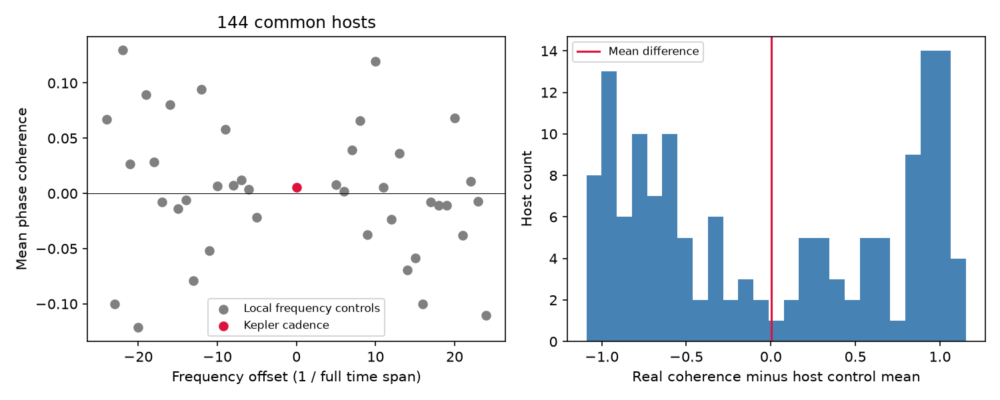
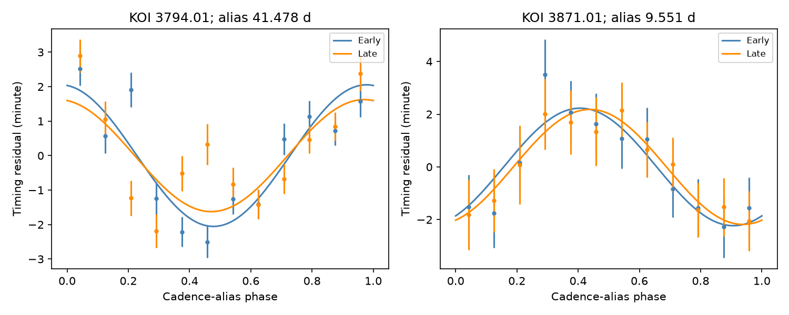

# A fixed-cadence phase test finds no mean excess in 144 selected Kepler timing sequences

We find no mean excess of phase agreement at a fixed Kepler cadence alias in 144 selected timing sequences. The mean agreement between two mission halves is 0.00522. The mean at 40 nearby control frequencies is 0.00208. Their difference is 0.00315, with a host bootstrap 95 percent interval from -0.12307 to 0.13043. This is a null result for a restricted sample and model. It is not proof that Kepler timing measurements have no cadence errors. No new planet is reported.

## Question and prior work

Can a simple phase test identify stable timing waves tied to the observing cadence, before those waves are used to infer unseen planets? A change in transit shape or a finite exposure can shift a fitted transit time. A true gravitational perturbation can also shift a transit time. A frequency near the sampling alias alone cannot distinguish these causes.

Holczer et al. (2016; DOI 10.3847/0067-0049/225/1/9) supply the full-mission timing catalog. That paper and Mazeh et al. (2013; DOI 10.1088/0067-0049/208/2/16) discuss cadence and stellar-spot causes of apparent timing waves. Holczer et al. used the sampling interval for each target, rather than one fixed interval for all targets. Thus, our test is a simpler diagnostic, with a more limited scope. It does not replace their analyses.

The parent SCI publication, sci:sha256:b533f85480cfb8409940d512eead9f64186fda13867f962c3121d34e62029e60, tests a common phase at 372.5 days. We reuse its checked timing subset, not its phase fits. Here each host has its own predicted alias frequency. The new result is a local-frequency control test and a check of phase agreement across mission halves. Campaign searches for "TESS transit", "Holczer", "stroboscopic", and "3871" preceded or informed the work. We read the verified parent publication. The search for stroboscopic gave no campaign result. This does not establish priority outside the campaign.

## Data and provenance

The input is files/selected.csv.gz from the verified parent bundle. It has 175,162 records for 1,104 sequences, with one sequence per integer KOI host. The parent required finite timing values and positive errors, removed flagged timing values, outliers and overlaps, and selected sequences by coverage. It required at least 40 records, a span of at least 1,000 days, orbital period at most 30 days, and at least 12 records on each side of BKJD 790. It chose the eligible sequence with most records per host, with smaller KOI as a tie break. We do not repeat those source cuts.

The columns o_c and o_c_err are in minutes. The parent checked this against the original catalog and corrected a days label in the public mirror. The column t_obs_bjd is a linear ephemeris time in BKJD (BJD minus 2454833), not a separately measured transit time. We use it to set phase. The parent checked the source units on displayed original records, not all source rows.

The original source is Holczer 2016, CDS J/ApJS/225/9 table 3, mirrored at:
https://huggingface.co/datasets/juliensimon/kepler-transit-timing/resolve/main/data/kepler_transit_timing.parquet
The raw file SHA-256 in the parent record is 0bda1c2c48cd81aa72db741054e6c6ab5591ca6cfed662f49a3633b789c7d084. Its exact former shared object path is preserved in files/parent_provenance.json. The dataset store now has no such exposed dataset. We did not read that absent raw file or the failed disk. We used the preserved, verified subset in this package. Its exact hash is in files/provenance.json and files/environment.json. No new shared raw dataset was added.

We also saved a two-row NASA Exoplanet Archive cumulative-table response in files/current_status.csv. Its exact query URL, retrieval time and hash are in files/provenance.json. This catalog check is not independent photometry. Current status can change after retrieval. The cumulative-table source is https://exoplanetarchive.ipac.caltech.edu/docs/API_kepcandidate_columns.html.

## Model and selection

The fixed cadence C is 29.4244 minutes, or 29.4244/1440 days. We fit an orbital period P to ephemeris time against transit number. The folded alias frequency is

f = abs(P/C - round(P/C)) / P.

At exact linear transit epochs, a sinusoid at 1/C is equal to a sinusoid at this alias, up to a fixed phase and possibly a sign change. The alias period is 1/f. This relation explains why a cadence effect can appear as a much slower timing wave.

For each host, the 40 controls have frequencies f + k/L, where L is that host's full ephemeris span and k is each integer from -24 through -5 and from 5 through 24. These controls test nearby frequencies. They are not measured alternate observing cadences. The gap of five resolution units limits direct overlap with a narrow peak. It cannot remove leakage from all irregular windows or broad signals.

At each tested frequency, we fit each half separately:

o_c(t) = a + b*(t-790)/1000 + c*cos(2*pi*f*(t-790)) + s*sin(2*pi*f*(t-790)).

Weights are the inverse squared catalog errors. Early data have t < 790. Late data have t >= 790. We require a positive frequency, an alias period of at least three orbital periods, and at least five cycles in EACH half at ALL 41 tested frequencies. We reject a weighted design matrix with condition number above 100,000. Selection uses times and errors, not fitted timing phases. It leaves 144 hosts and 50,513 records. This common-host rule strongly favors shorter orbital periods and excludes many long alias periods.

We first attempted common-host controls at 40 artificial cadence offsets. No host passed all period cuts. We abandoned that coverage design and used the local-frequency controls above. We did not inspect a nonempty phase statistic from that first design. These choices were made during the investigation, not in a registered protocol.

For each frequency, let v=(c,s) in the early half and w=(c,s) in the late half. Phase agreement is v dot w / (length(v)*length(w)). It ranges from -1 for opposite phases to +1 for equal phases. Every host has equal weight, even if its wave is weak. The main contrast is the host mean of real agreement minus that host's mean control agreement. We use 10,000 host bootstrap draws for a descriptive percentile interval. This assumes hosts are independent representatives of this selected sample. It is not a bound on an instrument error amplitude.

A secondary one-sided sign test flips the sign of each late vector in 20,000 draws. It gives p=0.47033 for the real-frequency mean. It assumes independent, sign-symmetric late vectors conditional on early vectors under the null. True stellar or planetary waves, correlated errors and shared light can violate this null. The local-control contrast is therefore more useful than this probability alone. The real mean ranks 19th among the 41 means. That rank is descriptive; the controls are correlated and are not 40 independent null experiments. Seed 11074 fixes the random draws.

## Results



The left panel compares the fixed cadence frequency with the local controls. The right panel shows the host contrasts. No narrow population excess is visible.

| Quantity | Value |
| --- | ---: |
| Common hosts | 144 |
| Common records | 50,513 |
| Mean real-frequency agreement | 0.005225 |
| Mean control agreement | 0.002079 |
| Real minus control mean | 0.003145 |
| Host bootstrap 95 percent interval | -0.123069 to 0.130432 |
| Smallest and largest control means | -0.121536 to 0.129681 |
| Secondary sign probability | 0.470326 |

The base-frequency test alone is possible for 570 hosts. The other 426 have mean agreement 0.04351. Together with the common 144, their mean is about 0.03384. These additional hosts have no matched 40-frequency control test under our cuts. They do not widen the scope of the main contrast.

For the 144 hosts, alternative split times of BKJD 700 and 880 give mean agreement 0.00502 and 0.05190. A quadratic time baseline gives -0.00103. Removal of the 5 percent largest absolute median-centered residuals divided by their errors in each half gives 0.08322. Cadences of 29.4243 and 29.4245 minutes give 0.02385 and 0.03171. These are diagnostic values without matched control or significance claims. They do not establish a stable positive excess. Complete per-host results are in files/robustness.csv.

## Individual leads and physical interpretation

We ranked the 144 hosts by the smaller of the early and late harmonic signal-to-noise measures. This measure is sqrt(v transpose Cov(v) inverse v), with covariance scaled by at least the residual reduced chi-square. It is descriptive. It is not a probability of a planet or a corrected false-alarm probability. Ranking and examination use the same data.

| KOI | KIC | Alias period (day) | Early amplitude (minute) | Late amplitude (minute) | Phase agreement | Smaller signal-to-noise |
| --- | --- | ---: | ---: | ---: | ---: | ---: |
| 3794.01 | 12557548 | 41.4780 | 2.054 | 1.625 | 0.99896 | 5.105 |
| 3871.01 | 9752982 | 9.55123 | 2.230 | 2.182 | 0.98018 | 4.539 |



Dots are weighted phase-bin means after removal of each half's fitted offset and slope. Error bars use catalog errors only. Curves are the separate fits. Binning is for display; all fits use individual events.

KOI-3794.01 is Kepler-1520, the known variable dust-transit system. The disintegration explanation predates this work (Rappaport et al. 2012, DOI 10.1088/0004-637X/752/1/1). KOI-3871.01 is a FALSE POSITIVE in both status fields of the saved NASA response. Neither object is a new planet candidate from this test. Their phase agreement remains above 0.99 after the residual trim, and above 0.98 with the quadratic baseline. Changing the cadence by 0.0001 minute reduces their agreement to between 0.56 and 0.84. These checks show phase sensitivity and persistence in these timing values, not a cause.

A finite-exposure template bias is one possible explanation because the test frequency is derived from the cadence. Stellar variability, transit-shape changes, and a chance nearby physical frequency remain alternatives. A gravitational fit would need more constraints than one timing sinusoid. We did not fit planet masses or orbits. We searched public prior work and checked catalog status but obtained no independent timing extraction, short-cadence data or telescope observation for these waves. The false-positive status is not proof of the cause of the 9.55-day wave. We do not claim that either wave was previously unrecognized.

## Limits

A single fixed cadence in barycentric time is approximate. Barycentric corrections and target-specific sampling can change phase. Murphy et al. (2013; DOI 10.1093/mnras/stt105) describe this sampling effect. The present null cannot rule out cadence errors in individual systems, waves whose phase evolves, other harmonics, or signals outside the strict coverage cuts. An unmodeled long-period physical wave can leak into fitted harmonics. Catalog times share extraction methods and are not independent measurements of the same sky event. Integer KOI hosts can have correlated light. Small noisy vectors have the same weight as clear vectors. The bootstrap interval is broad. The numerical response checks below do not give a detection-efficiency estimate or an upper limit on artifact rates.

## Reproduction and checks

From the publication root, run with Python 3.12 and the versions in files/requirements.txt:

```sh
OPENBLAS_NUM_THREADS=1 python files/analyze.py
OPENBLAS_NUM_THREADS=1 python files/checks.py
```

No network or shared dataset is needed. These commands regenerate the tables, summaries, checks and figures in files/. One BLAS thread avoids overhead in small fits; it is not a compute cap. CSV results should agree to numerical precision. PNG bytes can depend on the plotting environment.

The checks use a separate SciPy QR solver for each half of each primary host. The largest coefficient difference from the main NumPy SVD solver is 6.04e-13 minute. Noise-free injected harmonics with nuisance offset and slope are recovered within 5.56e-16 minute. The code asserts small errors. Direct high-frequency and folded-alias unit-circle values differ by at most 0.00193, consistent with rounding in the saved ephemeris. These tests check algebra and implementation, not the sky-noise null.

To restore the input from the parent bundle, verify that ZIP, then use:
```sh
sci read PARENT.zip --file files/selected.csv.gz --output files/selected.csv.gz
```
Require the subset hash in provenance.json. For the status table, repeat the exact query URL there; a later catalog can give a different answer. For source selection from raw data, use the parent publication's preserved selector and require its raw-file hash. That step is not necessary to reproduce this analysis.

## Job and rights record

Campaign 11_07_2026. Job sci-1107-syam2-astronomy-4ca79c7d1e6b. Topic astronomy. Machine syam2. Account codex-myxtap. Model gpt-6.1-sol with high reasoning effort, through the Codex harness in T3 Code. We ran computations directly in this isolated worktree. No agents were launched. The campaign-machine key is not a personal authorship claim. Private keys are outside the package. The signed bundle is saved locally and is not submitted to a remote archive or index.

The SCI baseline license applies to our text, figures, code and derived results. Source measurements retain attribution to Holczer et al., CDS, the public mirror, the parent publication and the NASA Exoplanet Archive. The baseline license does not replace source terms or claim ownership of source observations.
