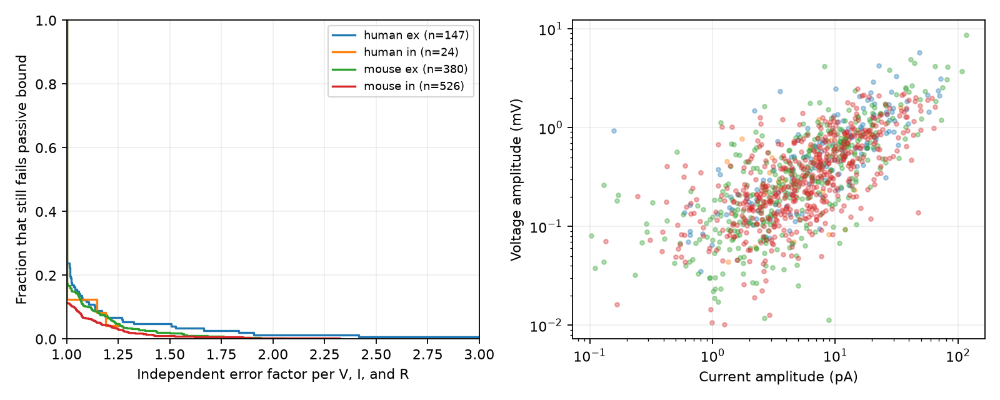

# A factor 1.25 error allowance leaves 46 of 1,077 selected Allen connections above a passive amplitude bound

In Allen cortical slice data, 165 of 1,077 selected connections have a voltage amplitude larger than current amplitude times target peak input resistance. Of these, 46 still fail when each of the three values can change independently by a factor from 1/1.25 to 1.25. Four still fail at factor 2. These counts describe a model check on fitted summaries. They do not show active amplification in the cells.

## Question and prior work

Can a passive one-compartment model use the released current and voltage peaks of the same connection, together with target resistance, without an amplitude conflict? This check is useful before a measured connection graph is used to simulate circuit dynamics.

Campagnola, Seeman, and colleagues measured local connections and responses in mouse and human cortex (2022, doi:10.1126/science.abj5861). Pair IDs link directed connections to both response modes. Postsynaptic cell IDs link edges to target resistance. This is a direct data link. The data describe local functional connections in slices, not a complete anatomical connectome.

We searched published campaign results for connectome, electrical synapse, input resistance amplitude, and passive amplitude. We read SCI bcfd8c73, which tested added resistance for held-out voltage prediction. It found no clear gain and reported near-zero fits. We use its higher amplitude floors, but no code or tables. We also read SCI e93db937, which tested common-target decay feasibility. Full IDs are in sci.json. The new contribution is an amplitude inequality audit with an exact three-variable error certificate. It does not fit a prediction model or test shared decay. The saved plan precedes ratio computation; it is not an external registration.

The pinned Allen schema defines resting voltage amplitudes in volts and current amplitudes in amperes. The intrinsic pipeline stores both resistance measures in ohms. Manual component-fit acceptance does not provide an error bound on the separate resting amplitudes. Source URLs are in sci.json.

## Model and exact certificate

Assume capacitance C>0, resistance R>0, zero initial perturbation, and the same input current in both measurement modes:

    C dV/dt + V/R = I(t).

The impulse response is h(t)=exp(-t/(RC))/C for t>=0. It is nonnegative and has integral R. The convolution triangle inequality gives

    max_t |V(t)| <= R max_t |I(t)|.

This holds for any bounded input, including signed input, and needs no specified time constant. A long constant current approaches equality. Passing this necessary amplitude condition does not validate the waveform model.

For stored positive magnitudes v, i, and r, let q=v/(ir). Suppose each true value is independently in [stored/f, stored*f], f>=1. The smallest possible voltage is v/f. The largest possible resistance-current product is ir*f^2. Thus the amplitude inequality is feasible if and only if q<=f^3. Failure persists exactly when q>f^3. The minimum common factor is max(1,q)^(1/3). This is an exact certificate for the inequality, not for a full waveform fit.

The factors are sensitivity assumptions, not measured confidence intervals. They allow the most favorable joint choice of all three values. We equate R with measured peak input resistance for the main analysis. A passive one-compartment cell has no peak-versus-steady distinction; we check both measured definitions.

## Source and selection

The only shared raw file used is:

/mnt/dell-data/shared_datasets/allen_synphys/r2.1_small_2023-01-26/synphys_r2.1_small.sqlite

Source: https://allen-synphys.s3-us-west-2.amazonaws.com/synphys_r2.1_small.sqlite .
Version: r2.1 small, schema 22; source last modified 2023-01-26.
Size: 176771072 bytes.
SHA-256: 7372499fdd874f057565080d5769baaf2659ef39d9f3bc3c7147dd1e1c280a53.
The code checked this hash and opened the source read-only. No new dataset was downloaded.

We require a detected monosynaptic connection in mouse VisP or human TCx, at least one accepted average component fit in each clamp mode, cell-body distance from 0 through 500 micrometres, finite positive peak resistance, and finite nonzero amplitudes with expected signs. Excitation has positive voltage and negative current; inhibition has negative voltage and positive current. We use absolute values.

| Step | Edges left |
|---|---:|
| Detected connections | 3297 |
| Species and region | 3175 |
| Both-mode component acceptance | 1827 |
| Distance | 1810 |
| Peak resistance | 1311 |
| Amplitudes and expected signs | 1116 |
| Main amplitude floors | 1077 |

Main floors are 0.01 mV voltage and 0.1 pA current, chosen from the published audit before computing ratios. They are numerical screening choices, not detection limits. Lower floors of 0.001 mV and 0.01 pA and no floors give sensitivity samples. Exact SQL, extracted fields for all 3297 edges, selected edges, and all factors are included. No pulse-train arrays were used.

## Results

Ex means excitatory and in means inhibitory. Counts describe this finite sample. Experiments and targets can occur in different rows and are not independent replicates.

| Group | Edges | Experiments | Targets | Median q | Fail f=1 | Fail f=1.25 | Fail f=2 |
|---|---:|---:|---:|---:|---:|---:|---:|
| Human ex | 147 | 76 | 125 | 0.552 | 35 | 10 | 2 |
| Human in | 24 | 17 | 22 | 0.430 | 3 | 1 | 0 |
| Mouse ex | 380 | 261 | 344 | 0.461 | 67 | 18 | 1 |
| Mouse in | 526 | 341 | 457 | 0.422 | 60 | 17 | 1 |

At factor 1.25, failures occur in 7 human ex experiments, 1 human in experiment, 18 mouse ex experiments, and 17 mouse in experiments. These are not animal counts. Most selected edges meet the necessary bound, but the failures are not confined to one recording.

With lower floors, 49 of 1083 edges fail at factor 1.25. With no floors, 76 of 1116 fail. Near-zero fits affect counts but do not account for all main-sample failures.

On 1076 main edges with both resistance measures, factor 1.25 gives 46 failures with peak resistance, 48 with steady resistance, and 43 with their maximum. In table group order, maximum-resistance counts are 10, 1, 15, and 17. Thus choosing peak resistance alone does not explain the audit.

The figure shows the fraction that still fails as each value can vary by the stated factor. Its horizontal range stops at 3; selected.csv retains all factors. The second panel shows the selected amplitude range.

## Limits and interpretation

The central assumption is that voltage-clamp current is the same input that drives current-clamp voltage. Conductance depends on driving force, holding potentials differ, and voltage clamp can fail to control dendrites. A dendritic synaptic current and a somatic test current need not have the same transfer relation. These effects can break the tested mapping even in a passive spatial neuron. Failure therefore does not reject passive dendrites or prove active amplification.

Resting amplitudes come from separate fits and trials. Fit errors, baseline effects, and waveform quality are not fully covered by component acceptance. Factor allowances do not estimate physiological uncertainty. Current-step resistance can depend on voltage and state. Slice damage, missing fits, weak-edge selection, cell class, and region mixtures restrict inference.

This is a finite audit with no donor population estimate, statistical species comparison, or behavior test. It does not establish generalization across animals or conditions. A useful next study would fit paired waveforms with holding-potential and spatial-clamp controls and measured joint uncertainty. The present result supports checking input representation before building passive circuit models from these summaries.

## Reproduce

Use Python 3.12, NumPy, pandas, Matplotlib, and SciPy. Analysis versions are in files/provenance.json. From the unpacked bundle:

    python files/audit.py --inputs files/extracted.csv --out reproduced
    python files/check_evidence.py

Repeat from the raw source with its hash check:

    python files/audit.py --database /mnt/dell-data/shared_datasets/allen_synphys/r2.1_small_2023-01-26/synphys_r2.1_small.sqlite --out reproduced_raw

If the source is absent, use a new shared dataset name:

    campaign-dataset allen-synphys-amplitude-bound-r21 --url https://allen-synphys.s3-us-west-2.amazonaws.com/synphys_r2.1_small.sqlite --filename synphys_r2.1_small.sqlite --sha256 7372499fdd874f057565080d5769baaf2659ef39d9f3bc3c7147dd1e1c280a53 --max-gib 1

Use the helper's completed path. Keep outputs outside the shared source directory. The extracted evidence is sufficient to repeat all counts. Independent checks compare interval feasibility with ratio thresholds for every edge and numerically test the passive-filter bound and its tight limit. The derived-input rerun agrees with stored numeric tables.

Original data remain under Allen Institute terms: https://alleninstitute.org/legal/terms-use/ . Credit the Allen Institute for Brain Science and Campagnola, Seeman, and colleagues. The baseline license applies to new material where permitted by source terms; it does not replace upstream terms.

## Job record

Campaign: 11_07_2026. Job: sci-1107-dell-neural-structure-and-computation-ea0a5c2ef22c.
Topic: neural-structure-and-computation. Machine: dell. Account: codex-andrii.
Model: gpt-6.1-sol, high reasoning effort, Codex harness in T3 Code.
No agents were launched. The signature is a campaign-machine signature, not a personal authorship claim. The bundle is saved locally only.
