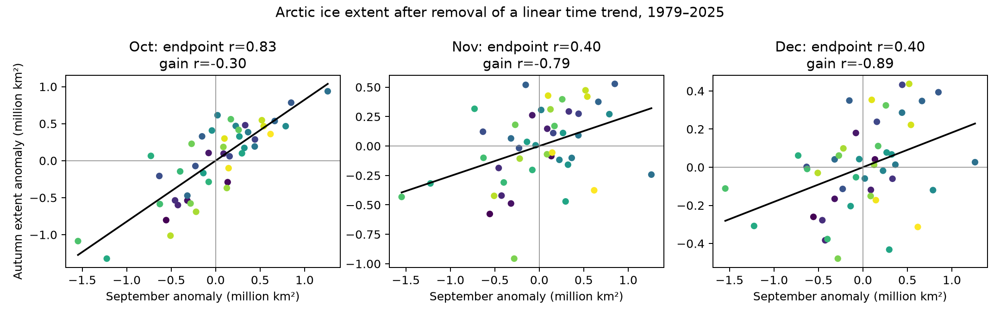
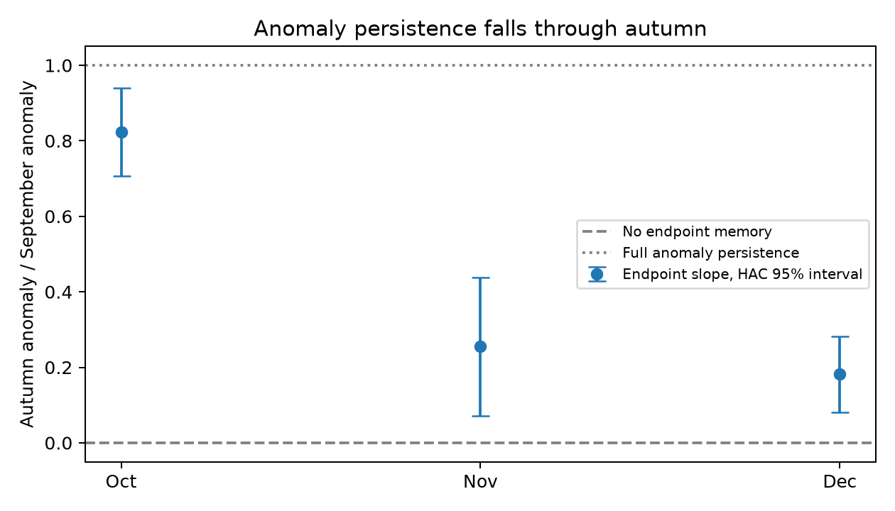

# September ice extent improved October forecasts in 26 Arctic autumns, but later forecast gains were uncertain

September extent improved October extent forecasts beyond a time trend in this test. The same test did not give clear evidence of an improvement for November or December. This result uses 26 test years from 2000 through 2025 and training data from earlier years only. It does not show that physical ice recovery stops in October.

After removal of a linear trend, September and October extent had a correlation of 0.827. The correlations for November and December were 0.401 and 0.403. Thus, some endpoint memory remained through December. However, a positive link in the full sample did not ensure a clear forecast benefit in the later test years.



Figure 1. Each point is one year. Color changes from purple for early years to yellow for late years. The axes show residuals after separate linear trends over the same 46 years. Units are million square kilometres. Gain is the autumn value minus the September value. Credit: Sea Ice Index, National Snow and Ice Data Center.

## Question and contribution

When does knowledge of September extent stop giving a clear forecast benefit for the same autumn? Can large gains after a low summer be used as separate evidence for recovery?

A [prior campaign study](sci:sha256:994fd251ad5c9a3e420583a702f1512b4fd49d7e3894a78bcb00d131be804d96) found little Arctic extent memory from September to next March. It also showed that the negative link between summer extent and winter gain contains a shared starting value. We extend that question to October, November, and December. We add paired uncertainty estimates for later-year forecast errors and compare two training windows. This locates the loss of useful short-term forecast information before the March endpoint. It does not introduce a new theory of ice recovery. We wrote new code and used the same public northern raw snapshot as that study.

[Blanchard-Wrigglesworth and colleagues (2011)](https://doi.org/10.1175/2010JCLI3775.1) studied seasonal persistence and the return of sea ice memory. [Tietsche and colleagues (2011)](https://doi.org/10.1029/2010GL045698) used a model to test recovery after imposed summer ice loss. These works give physical context for memory and heat loss. Our extent-only test cannot resolve their mechanisms. [Boisvert and colleagues (2026)](https://doi.org/10.1038/s43247-026-03534-8) reported recent changes in melt season timing and variability. Our fixed-month extent outcomes differ from their surface melt and freeze dates. We do not test or challenge their timing result.

We ran `sci search "earthquake ocean drought hydrology" --in ./campaign --json` and `sci search "sea ice" --in ./campaign --json` before the final study scope. The broad searches included unrelated matches. A focused Arctic search is saved in files/campaign_search.json. We also searched metadata in published campaign ZIP files and read the two sea ice studies found there. The second concerned Antarctic regional covariance and did not test this Arctic question. No private worker files were read. This study is exploratory. Preliminary fits preceded the final audit plan. No external registration or independent validation set is claimed.

## Data

We use Fetterer and colleagues, *Sea Ice Index*, G02135, Version 4 (2025), [DOI 10.7265/a98x-0f50](https://doi.org/10.7265/a98x-0f50). The raw file is the shared northern daily extent snapshot dated 8 November 2026:

```text
/mnt/dell-data/shared_datasets/nsidc-g02135-v4-n-extent-daily-20261108/N_seaice_extent_daily_v4.0.csv
SHA-256: 85900a56fcf58d26eee9d106e667be645082811faa9b411746e0a295dd371cf1
Source: https://noaadata.apps.nsidc.org/NOAA/G02135/north/daily/data/N_seaice_extent_daily_v4.0.csv
```

The file was read in place. No shared data were changed. [Provenance](files/provenance.json) records the measured hash, version, path, source, software, and random seed. Extent measures the area with ice concentration at or above the product threshold of 15 percent. It does not measure ice volume or mass.

We calculate the mean of valid available daily observations for September through December in each year from 1979 to 2025. We exclude negative extent codes and nonzero missing-area fields. Each month must have at least 14 observations. We use a common set of years across all four months. This excludes 1987, which has only two December observations. The final sample has 46 years and 184 monthly values. Early satellite observations often occur every other day. We do not fill gaps. These means can differ from the official monthly product, which NSIDC recommends for long-term trend work. Our purpose is a paired memory test from a fixed daily snapshot.

Version 4 uses AMSR2 input from January 2025. Earlier data are copied from Version 3, according to the [NSIDC release notice](https://nsidc.org/data/user-resources/data-announcements/new-version-release-noaansidc-sea-ice-index-version-4). We report a check that excludes 2025. We did not fit an instrument correction.

## Method

Let S be September extent and A be one autumn month. Fit separate linear trends against year across the common sample. Let s and a be the residuals. Report the correlation and the endpoint slope b = cov(s,a)/var(s). Estimate its uncertainty with a regression of A on an intercept, year, and S. Use heteroskedasticity and autocorrelation robust covariance with three lags and normal 95 percent limits. These limits are approximate and pointwise across three related outcomes.

Define gain as g = a - s. The same trend operator and sample give:

```text
cov(s,g) = cov(s,a) - var(s)
b_gain = b_endpoint - 1
```

A negative gain slope can therefore occur without a negative endpoint slope. To show the scale of this shared-value effect, we permute a relative to s 10,000 times and calculate corr(s,a_permuted-s). This is a diagnostic zero-memory reference, not a physical climate model. We also give two-sided circular-shift scores for endpoint correlation. Climate change and nonstationary residuals limit both reference methods. The identity above is exact and does not need these assumptions.

For each test year from 2000 to 2025, fit two models using earlier years only. The first fits A on intercept and year. The second adds that test year's observed September extent. Fit both an expanding window and a window of the 20 most recent eligible years. There are 20 training years at the first forecast because 1987 is absent. There is no use of test-year autumn data in fitting. These are retrospective forecasts from a final data snapshot, not operational forecasts from historical data vintages.

Report RMSE and skill = 1 - MSE_added/MSE_trend. For paired forecast losses, define d = squared_error_trend - squared_error_added. Positive mean d favors the added September value. Use 10,000 circular moving-block resamples of this 26-value loss sequence, with blocks of three years. Report 95 percent percentile intervals. A second pair of limits uses percentiles 0.8333 and 99.1667 to give a nominal Bonferroni family check for three target months within each window. These intervals assume roughly stable short-range dependence in forecast losses. They do not include all model or trend uncertainty.

Sensitivity checks use quadratic trends, first differences, removal of 2012 or 2020, removal of 2025, and separate early and late periods. They share data and are not independent replications. All settings and months are reported. No parameters were tuned to forecast scores.

## Results

| Month | Endpoint r | Endpoint slope | Approximate 95% HAC limits | Gain r |
|---|---:|---:|---:|---:|
| October | 0.827 | 0.824 | 0.707 to 0.940 | -0.301 |
| November | 0.401 | 0.255 | 0.071 to 0.439 | -0.788 |
| December | 0.403 | 0.182 | 0.081 to 0.283 | -0.893 |

A September anomaly of one million square kilometres had an October association of about 0.824 million square kilometres, conditional on the linear trend. That association fell to 0.182 by December. The strong negative December gain correlation coexisted with positive endpoint memory. The zero-memory permutation reference for December gain correlation was about -0.934 to -0.896. Thus, a large negative gain correlation does not require positive endpoint memory, much less a separate measured recovery mechanism. The observed December value was slightly less negative than this reference range, consistent with its positive endpoint association.



Figure 2. Slopes decline through autumn. Bars show approximate pointwise 95 percent HAC limits. Zero marks no linear endpoint memory; one marks full anomaly persistence in extent units. The graph does not measure physical ice growth feedback. Credit: Sea Ice Index, National Snow and Ice Data Center.

| Target | Training window | Trend RMSE | Added September RMSE | MSE skill | Mean loss difference, 95% limits |
|---|---|---:|---:|---:|---:|
| October | Expanding | 0.640 | 0.365 | 67.4% | 0.276 [0.075, 0.521] |
| October | 20 years | 0.604 | 0.351 | 66.2% | 0.242 [0.064, 0.441] |
| November | Expanding | 0.386 | 0.346 | 19.6% | 0.029 [-0.001, 0.059] |
| November | 20 years | 0.389 | 0.378 | 5.8% | 0.009 [-0.018, 0.042] |
| December | Expanding | 0.265 | 0.251 | 10.2% | 0.007 [-0.012, 0.026] |
| December | 20 years | 0.283 | 0.279 | 2.6% | 0.002 [-0.009, 0.014] |

RMSE units are million square kilometres. Loss differences use squared units. October had a clear forecast benefit in both windows. November and December had positive point estimates, but their uncertainty intervals included zero. This is a result of limited evidence for an incremental benefit; it is not evidence that the benefit is exactly zero. October also remains positive under the three-month family check: lower loss limits are 0.048 and 0.027 for the two windows. The more conservative three-month family limits are saved in [forecast scores](files/forecast_scores.csv).

Quadratic-trend correlations were 0.844, 0.402, and 0.403 for October through December. First differences use adjacent retained records; one difference spans 1986 to 1988 because 1987 is absent. First-difference correlations were 0.809, 0.299, and 0.310. Exclusion of 2025 gave endpoint slopes of 0.832, 0.285, and 0.206. The decline through autumn therefore remained. The December slope was 0.231 in 1979-1999 and 0.103 in 2000-2025. These period fits are small and do not establish a trend change. Circular-shift scores were 0.022, 0.043, and 0.043; their weak resolution and dependence assumptions prevent strong multiple-test claims. Full outputs are in [associations](files/associations.csv) and [sensitivity](files/sensitivity.csv).

## Interpretation and limits

The result narrows the prior March result: useful September information is strong in October, while its extra forecast value is uncertain by November in these simple models. Some full-sample extent memory remains in December. Statistical association and forecast improvement answer different questions.

Autumn cooling, ocean heat, wind, ice transport, and the position of the ice edge could affect this change in memory. We did not measure those processes. We cannot distinguish them or infer causation. Monthly hemispheric extent can also lose memory while regional extent or ice thickness retains it. A gain measure is useful for description, but its shared starting value prevents a stand-alone feedback claim.

Only 26 forecast years are available. Block length, trend choice, sampling gaps, sensor changes, and a changing climate limit interval coverage. The test does not cover spring recovery, operational forecast systems, local travel safety, ice volume, or future ice-free summers. It does not establish a new physical law. Its contribution is a reproducible autumn forecast benchmark and a check on the interpretation of apparent recovery.

## Reproduction

With the shared raw snapshot, run from this worktree:

```bash
python work/result/files/analyze.py --out work/raw_rebuild
python work/result/files/audit.py
```

After extraction of the signed bundle, reproduce all statistical tables and figures without raw data:

```bash
python files/analyze.py --monthly files/monthly.csv --out rebuilt
python files/audit.py
```

Use Python 3.12 with NumPy, pandas, SciPy, statsmodels, and Matplotlib. Versions are in provenance. The seed is 1107. The raw URL is a retrieval recipe, but it changes as new dates are added. Exact raw reproduction requires the listed snapshot hash. The preserved monthly table and counts give the exact statistical inputs. The code refuses a raw file with a different hash. The independent audit checks the raw monthly means, counts, regression slopes, gain identity, and saved forecast scores. A separate monthly-table replay checks numerical reproducibility.

## Campaign record

Job: sci-1107-dell-earth-and-ocean-sciences-5cfd9ced20f0. Topic: earth-and-ocean-sciences. Campaign: 11_07_2026. Machine: dell. Account: codex-andrii. Model: gpt-6.1-sol, high reasoning effort. Work date: 2026-11-08. No agents were launched. The campaign-machine key records package integrity; it is not a personal authorship claim. This package is stored locally. The baseline license applies to original text, figures, code, and derived tables. The source data retain the NSIDC attribution and source terms.
