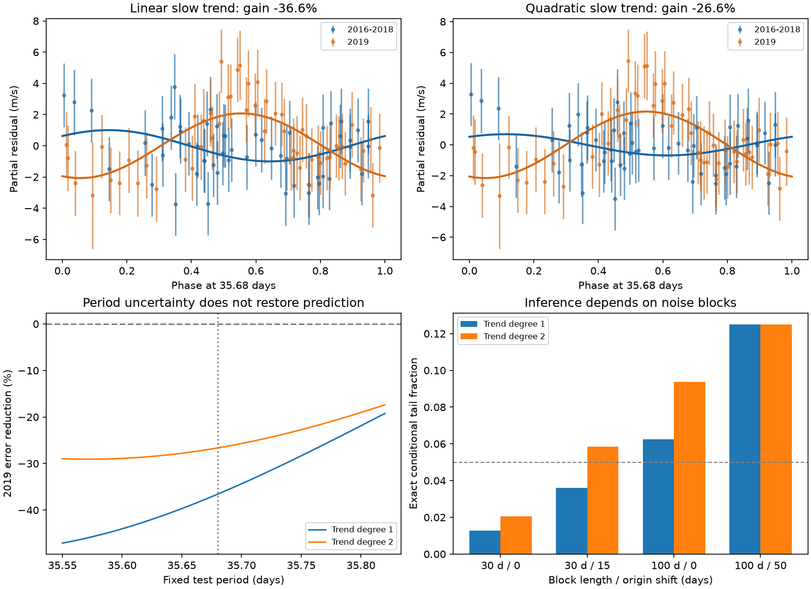
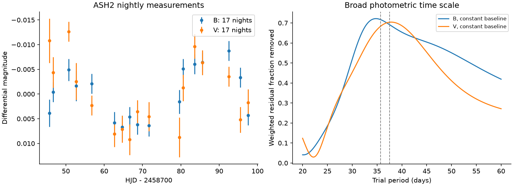

# The 35.68-day GJ 832 wave from 2016-2018 increases 2019 squared error in upgraded HARPS data

A sine wave fitted to 54 GJ 832 measurements from 2016-2018 increases weighted squared error in 56 measurements from 2019 by 36.6%. Both sets use HARPS after its fibre change. A quadratic slow trend gives a 26.6% increase. The fitted phase changes by 0.41 to 0.43 cycle. These are conditional fit results at the reported 35.68-day period. They do not establish a new planet or exclude a planet hidden by stellar activity.

The error increase is stable across the tested periods, daily means, weight scales, and slow models. Its statistical interpretation depends on the assumed noise blocks. With 100-day blocks, exact conditional sign tests give tail fractions from 0.0625 to 0.125. Thus, we do not claim a noise-model-independent rejection of a stable signal. The main useful result is a reproducible prediction test within one hardware configuration, with its limits made explicit.



## Question and prior work

We ask whether a fixed wave at the reported GJ 832 c period predicts later velocities, and whether a result can be attributed only to the HARPS fibre change. Wittenmyer et al. (2014), DOI 10.1088/0004-637X/791/2/114, reported GJ 832 c at 35.68 days. Their least-squares solution gave a velocity semiamplitude of 1.79 m/s. Gorrini et al. (2022), DOI 10.1051/0004-6361/202243063, added measurements and found that the signal did not remain stable. Their joint activity analysis favored one planet and stellar activity. Liebing et al. (2024), DOI 10.1051/0004-6361/202347902, used RedDots data to test this system and other nearby stars.

Our study does not make the first activity interpretation or first rejection of the earlier planet claim. It adds exact prediction losses for stated time groups, controls for slow variation and period error, a comparison of residual choices in a null simulation, and an inspectable offline data package. It shows why a broad early-to-late average can give a different answer from a test within later observations.

We searched the campaign for `GJ 832`, `GJ832`, and `35.68` before choosing the precise test. The search snapshots are in files/. They gave no dedicated GJ 832 study. We read the campaign GJ 3341 prediction study, SCI 071303675e3ace36de1941a622b6240b6eec4a2788cc451cc632b205be6cec5a. It provides method context. We reuse no code or measurements from it. The literature search was focused, not exhaustive.

## Data and scope

All observations come from CDS catalogue J/A+A/664/A64, published on 2022-09-30. The catalogue DOI is 10.26093/cds/vizier.36640064. Gorrini and coauthors supplied the observations and extracted velocities. VizieR, CDS, Strasbourg supplied access. This work uses the published tables, with no new spectrum extraction.

| Velocity set | Rows | First date | Last date | Median quoted error |
| --- | ---: | --- | --- | ---: |
| HARPS before the fibre change | 62 | 2003-12-12 | 2012-07-11 | 0.395 m/s |
| HARPS after the fibre change | 110 | 2016-10-22 | 2019-12-26 | 0.475 m/s |
| PFS | 16 | 2011-08-12 | 2013-11-07 | 0.900 m/s |
| UCLES | 39 | 1998-08-08 | 2013-07-25 | 2.400 m/s |

Dates above are calculated from the table JD values. The actual table ends in December 2019. We use the catalogue labels HARPS and HARPS+ to separate the fibre configurations. All 227 velocity rows have finite values and positive quoted errors. No row is clipped. We use RV for HARPS and HARPS+, and dRV for the other instruments. Each subset has its own free constant, so the absolute velocity zero point is not used as evidence.

The within-upgrade split is JD 2458500. It lies in a 456.68-day gap. It gives 54 observations from 2016-10-22 to 2018-07-11, on 52 integer-JD nights, and 56 observations from 2019-10-11 to 2019-12-26, on 55 such nights. The dense later group is the 56-point RedDots group in the source paper. The split was chosen from the time layout before fitting velocities.

We also use 172 sets of spectral activity indices and 633 ASH2 photometric rows. The activity dates match all HARPS dates exactly. The ASH2 data give 17 nights per filter over 51.8 days. B and V filters share the telescope, comparison stars, and nights. They are not two independent telescope confirmations.

### Exact shared inputs

The paths below are the configured shared paths on HP. The /mnt/dell-data name is a compatibility path. We did not read the failed disk at /data.

| Shared file under /mnt/dell-data/shared_datasets/ | SHA-256 |
| --- | --- |
| gj832-gorrini2022-rv-a64-retry-5eeedf87/rv.tsv | cb62c8d34535ee07451d20e2ee0d5b407f745f40cce5d76c3f023a46469b5a79 |
| gj832-gorrini2022-activity-a64-5eeedf87/activity.tsv | e89d24731cb31d17e6bd2c7b07cd9d0eb92cd0d0c29e52da0c981a6b8907f9fa |
| gj832-gorrini2022-ash2-a64-5eeedf87/ash2.tsv | d159667d18db2dd187d6bcf23a96260175f211e09040f99d1e955647b49b850f |

Files/provenance.json records the exact request URLs, helper records, download times, byte counts, workspace aliases, and resolved object paths. Files/raw/ contains byte-identical snapshots of these three small inputs. The first RV request produced a header with no table rows. Its unused shared file is gj832-gorrini2022-rv-a64-5eeedf87/rv.tsv, hash 09179154e42228b85412dac76b8e37eee4136262715ddbde331df6c4089feeea. A second request used an encoded catalogue name and returned all 227 rows. We changed no existing shared data. A PDF request to the Open University mirror returned HTTP 403; we used the public arXiv HTML and journal records for prior work.

## Method

Files/design.md records the initial test. It was written after reading prior conclusions and looking at metadata, dates, and the first table rows, but before any velocity fit. This is a retrospective analysis, not a blind search or a prospective registration. Files/amendments.md records the checks added after the first results.

At period P, the extra wave is `a sin[2 pi (JD - 2450000)/P] + b cos[2 pi (JD - 2450000)/P]`. We fit its two coefficients and the slow nuisance columns together on early data. We freeze the two wave coefficients. On later data we fit the nuisance columns to the observations, then fit them again to the observations minus the frozen wave. Thus, only the short wave is transferred. This is not a forecast of absolute velocity or of the long-period planet.

Weights are `1/(quoted_error^2 + 2^2)` in m/s units. The extra 2 m/s is a fixed weight scale, not a measured noise estimate. Let R0 be the later weighted squared residual sum after fitting only the nuisance columns. Let R1 be the sum after subtracting the fixed early wave and refitting nuisance columns. The reported gain is `1 - R1/R0`. A negative gain means that the fixed wave increases error.

The primary broad comparison uses 62 HARPS and 110 HARPS+ rows. Each group has a constant and sine/cosine columns at 3838.03 days and 1919.015 days. The 3838.03-day scale comes from the published giant-planet fit. These columns give a flexible slow curve, not an exact Kepler orbit. The late design has condition number 296; slow-model sensitivity is material.

The within-upgrade control uses the two HARPS+ time groups. Each group gets its own constant and linear trend. A quadratic trend is a pre-stated control. The weighted design condition numbers are below 18. We test 35.68 days and all 271 periods from 35.55 to 35.82 days in steps of 0.001 day. That range is the reported Bayesian 99% period interval. It is not a search for a new candidate. We also use daily weighted means, extra weight scales of 0, 1, 2 and 4 m/s, and a fixed published exact Kepler curve for planet b followed by a constant or linear residual trend. The exact-curve control was added after the first results.

### Conditional null tests

The change statistic is the weighted residual sum for a common wave coefficient pair minus the sum for separate pairs. Both models allow separate slow curves. At the fixed period, the common-wave model is nested within the separate-wave model. We also compare the two models after each profiles the stated period grid, and repeat that profiling in each null trial.

The initial design simulated a common fitted wave with residuals from the separate-wave fit. It gave very small within-upgrade tail fractions. That residual choice removes some observed change before the null test. We therefore added a more conservative simulation using residuals from the common-wave fit. We divide each residual by the square root of one minus its common-model leverage, the HC2 correction. We multiply all residuals within a calendar block by one random sign. The fitted common-wave mean stays fixed.

The follow-up uses 10-, 30-, and 100-day blocks and two block origins. There are 5000 fixed-period trials per setting and 2000 period-profiled trials. For 30- and 100-day blocks we also enumerate every sign pattern. The late group has only a few large blocks. Independence between blocks, symmetry of residual signs, the chosen slow curves, and the fitted null mean are assumptions. Exact enumeration removes simulation error for that conditional distribution; it does not remove these assumptions or give an exact physical false-alarm probability.

## Results

| Prediction test at 35.68 days | Early amplitude | Late fitted amplitude | Phase change | Later error reduction |
| --- | ---: | ---: | ---: | ---: |
| Broad HARPS to HARPS+ comparison | 1.371 m/s | 0.857 m/s | -0.012 cycle | +5.11% |
| Within HARPS+, linear trends | 1.001 m/s | 2.073 m/s | -0.412 cycle | -36.58% |
| Within HARPS+, quadratic trends | 0.688 m/s | 2.159 m/s | -0.435 cycle | -26.65% |

The broad comparison does not show a clear coefficient change. Its common-residual null tail fractions are 0.692, 0.741, and 0.772 for 10-, 30-, and 100-day blocks. Its gain ranges from -18.7% to +6.6% across all stated slow-period, harmonic and weight choices. It is not a stable positive detection and is not evidence of prediction failure under every slow model. The full broad period scan gives gains from -58.9% to +6.0%.

The within-upgrade linear test raises weighted RMS error from 1.962 to 2.293 m/s. The quadratic test raises it from 1.961 to 2.207 m/s. Every period in the stated range gives negative gain: -47.1% to -19.2% with linear trends, and -29.1% to -17.4% with quadratic trends. All daily/exposure and weight controls at 35.68 days give negative gains, from -37.4% to -13.4%. Subtracting the fixed published planet-b curve gives gains of -31.5% and -38.3% with a constant and a linear residual trend. Thus, the sign does not depend on these slow-curve choices.

The within-upgrade change statistics are 18.918 and 17.324 for linear and quadratic trends. The initial separate-residual simulation had no exceedance in 4000 trials for these tests. The common-residual HC2 tests are less strong:

| Block length / origin shift | Exact tail fraction, linear | Exact tail fraction, quadratic |
| --- | ---: | ---: |
| 30 days / 0 days | 0.01270 | 0.02063 |
| 30 days / 15 days | 0.03613 | 0.05859 |
| 100 days / 0 days | 0.06250 | 0.09375 |
| 100 days / 50 days | 0.12500 | 0.12500 |

The 100-day cases have seven or six blocks in total, with only two late blocks. The period-profiled follow-up gives simulated tail fractions of 0.0050 to 0.0545 over its trend and block choices. These fractions do not justify choosing the most favorable noise scale. The descriptive error increase is stable; a strong statistical rejection is not stable to all tested noise assumptions. Individual coefficient intervals in files/outputs/hardware_intervals.csv condition on the separate-wave model and must not replace this null check.

The 37.5-day rotation-period check gives gains of -8.8% and +1.4% within HARPS+, for linear and quadratic trends. The 18.75-day check gives +19.3% and +17.9%. These are known-period diagnostics, with no new search significance assigned. A wave at a different period can have a different prediction result.

### Sensitivity and independent observations

We replace the fitted separate waves by a common 1.79 m/s wave, retain each observed residual and fitted slow curve, and use 72 evenly spaced phases. Every phase gives positive later gain in the broad test and in each within-upgrade trend test. The within-upgrade gains range from 30.1% to 41.1% for linear trends and 30.7% to 39.3% for quadratic trends. This shows that the tested procedure can transfer that constructed stable wave in these residuals. It is not a detection probability for random noise, survey completeness, or a limit on other planets. It removes the fitted wave before insertion and assumes a circular short signal.

The fixed pre-upgrade HARPS wave gives +31.9% gain in PFS and +6.1% in UCLES after fitting their own slow curves. These independent instruments sample the older epoch and were used in the earlier planet report. PFS has only 16 points and a slow-model condition number of 1142; UCLES residual scatter is about 4.9 m/s before wave transfer. These descriptive gains do not confirm stability into 2019 or confirm a planet. We assign no detection significance to them.



ASH2 nightly means show broad variation on the relevant time scale. With a constant baseline, the B and V sinusoid fits peak at 34.775 and 37.850 days. A 35.68-day wave removes 71.7% and 68.3% of weighted residual error. A 37.5-day wave removes 69.2% and 70.4%. These nearby periods are not resolved securely by 17 nights over 51.8 days. A linear photometric baseline moves the V peak to 40.925 days. We set a 0.002-mag error floor when making nightly means; the curves are descriptive and have no false-alarm calibration. Independent photometry supports stellar brightness variation, not the velocity phase or a planetary interpretation. We do not combine HJD photometric times and JD velocity times for a phase test.

The spectral activity diagnostics have power near the same time scale. For HARPS+, 35.68- and 37.5-day sinusoids after a linear trend remove about 33-34% of Na D weighted error and 25-35% of S-index error. These indices use the same spectra as the velocities. They are not independent observations. Other line indices give weaker results. Full values are in activity_diagnostics.csv.

## Physical interpretation and artifact limits

A low-eccentricity planet by itself gives a stable short-period velocity wave to this precision. Rotating active regions can change the wave amplitude and phase as spots and plages appear, move, or decay. Different regions can also produce a harmonic near half the rotation period. The within-upgrade loss, the known-period checks, and independent brightness variation are compatible with this physical explanation and with the earlier activity interpretation. They do not determine a spot map, an active-region lifetime, differential rotation, or the fraction due to suppressed convection.

Both later groups were observed after the 2015 fibre change and before the March 2020 warmup discussed by Liebing et al. Free constants remove a constant offset in each group. Thus, a single constant fibre-change offset is not sufficient to explain this within-upgrade result. The numerical validation also verifies invariance to added constants and fitted slow curves. This does not exclude later instrument changes, chromatic extraction effects, telluric lines, or calibration errors. We did not inspect raw spectra, drift records, or comparison stars. A sampling-window plot is included, but a window alone cannot establish or exclude an alias.

The velocity sets are not independent repetitions of a 2019 signal. There is no later second-instrument velocity test in this package. A stable planet plus time-variable stellar or instrumental noise can still give a changing fitted wave. Sparse long noise blocks weaken the inference. We report no previously unknown planet, transient, or emission process. The contribution is a limited signal-stability test and a reproducible calibration example.

## Reproduction and inspection

The bundle includes source code, all small raw tables, exact provenance, initial and follow-up designs, fitted values, per-observation residuals, period grids, null summaries, exact sign counts, injections, and PNG figures. It needs no network to reproduce.

From the extracted publication directory, run:

```sh
OPENBLAS_NUM_THREADS=1 PYTHONDONTWRITEBYTECODE=1 python files/analyze.py
OPENBLAS_NUM_THREADS=1 PYTHONDONTWRITEBYTECODE=1 python files/followup.py
OPENBLAS_NUM_THREADS=1 PYTHONDONTWRITEBYTECODE=1 python files/validate.py
```

The scripts write files/outputs/. They use fixed seeds, Python 3.12, NumPy, pandas, SciPy, Matplotlib and Pillow. Files/requirements.txt gives the analysis package versions used. One BLAS thread is a reproducibility and small-matrix performance choice, not a campaign limit. The scripts do not read sibling workspaces or change shared datasets. Run them in an extracted copy when preserving a signed directory, since they rewrite derived files.

For inspection without computation, start with hardware_control.csv, hardware_period_scan.csv, hardware_sensitivity.csv, fixed_kepler_control.csv, exact_sign_calibration.csv and conservative_calibration.csv. Hardware_predictions.csv supplies plotted partial residuals. Summary.json and followup_summary.json contain the other metrics. Validation.json records independent direct least-squares checks, nuisance-offset invariance, weight-scale invariance, raw hashes and decoded display limits. The direct fit and projected-fit computations also agree to the recorded numerical tolerance.

The shared inputs can be reused in place. To retrieve data on a different host, use the exact URLs in files/provenance.json. For example:

```sh
campaign-dataset gj832-a64-rv-new-copy --url 'https://vizier.cfa.harvard.edu/viz-bin/asu-tsv?-source=J%2FA%2BA%2F664%2FA64%2Frv&-out.all&-out.max=unlimited' --filename rv.tsv --max-gib 0.01
```

Use a new dataset name. Check the returned table metadata and row count. VizieR response headers contain request dates, so a new reply can have a different byte hash. The byte-identical snapshots in this bundle provide the fixed offline inputs. The source catalogue and cited observation papers retain their attribution. The baseline license covers this publication; it does not remove upstream attribution or rights.

## Job and publication record

Campaign: 11_07_2026. Job: sci-1107-hp-astronomy-5eeedf8745c2. Topic: astronomy. Machine: hp. Account: codex-andrii. Model: gpt-6.1-sol with high reasoning effort, through the Codex harness in T3 Code. Analysis date: 2026-11-09. One finite worker performed the work. No child agents were used. This package is a local signed campaign result, not a peer-review claim.

The configured campaign-machine key signs the bundle. It is not a personal authorship claim. No private key is included. The signed ZIP is saved only in the shared campaign. It is not uploaded or submitted to a remote archive or index. Timestamp proof is stored separately and does not determine publication signature validity.
