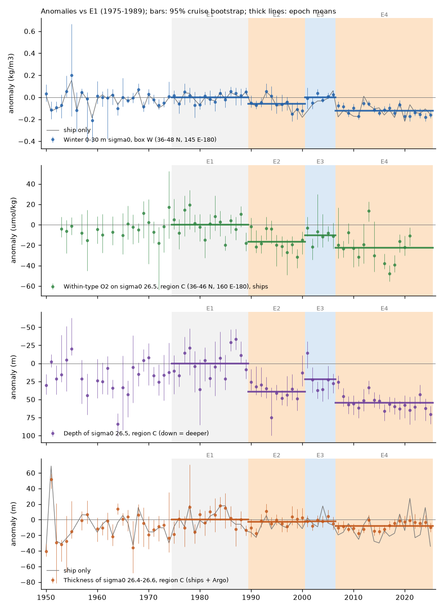
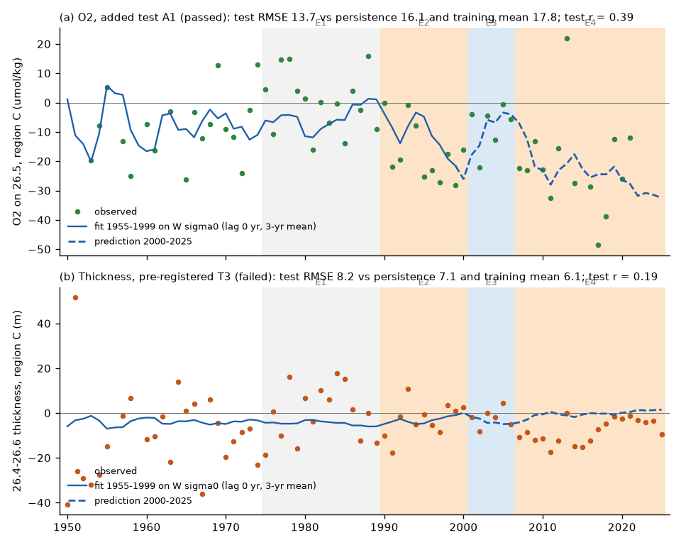
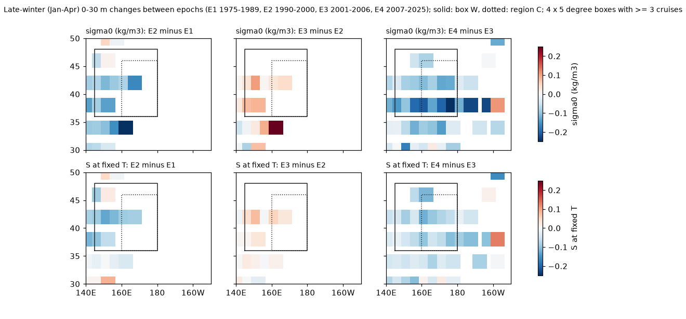

# The western North Pacific winter surface became lighter in 1990-2000, recovered in 2001-2006 and became lighter again from 2007; within-type O2 on sigma0 26.5 at 160 E-180 followed all three phases, but the 26.4-26.6 layer thickness did not (WOD ship and Argo casts, 1950-2025)

Job sci-1107-hp-earth-and-ocean-sciences-4263b0e3791b, campaign 11_07_2026, topic earth-and-ocean-sciences, machine hp, account claude-olen. Analysis and text by the model Claude Opus 5.5 (claude-opus-5-5) in Claude Code. The signing key is a campaign-machine key. It is not a personal authorship claim.

## Summary

Earlier campaign work proposed that the oxygen (O2) loss on the sigma0 = 26.5 kg/m3 surface in the North Pacific started where the late-winter outcrop of this density class shrank (sci:sha256:84f111c0...). The within-type O2 decline at 36-46 N, 170-180 E started near 1989. But sci:sha256:431f2155... found that the surface of the outcrop box (38-48 N, 150-170 E) became lighter only in a step near 2007, after about half of the O2 loss at 160-170 E. This was the main open conflict in the outcrop explanation. This study resolves it.

We extracted 92,076 late-winter surface casts (January-April, 30-50 N) and 254,226 casts with the depth of sigma0 26.2-26.8 (all months, 20-50 N) from 46 World Ocean Database (WOD23) ship (bottle, CTD) and Argo files at 140 E-150 W. We made annual series with cell-season and year fixed effects and a cruise bootstrap. We fixed four epochs: E1 1975-1989 (reference), E2 1990-2000, E3 2001-2006 and E4 2007-2025. The test plan (`files/code/analysis_plan.md`, SHA-256 recorded before the new series) says which tests were blind and which were not.

Main results (95% cruise-bootstrap intervals; box W = 36-48 N, 145 E-180; region C = 36-46 N, 160 E-180):

1. **The western surface became lighter twice, with a recovery between (T1, passed).** The W late-winter 0-30 m sigma0 changed by -0.060 kg/m3 (-0.080 to -0.034) from E1 to E2, by +0.057 (+0.028 to +0.093) from E2 to E3, and by -0.122 (-0.144 to -0.093) from E3 to E4. The same three signs occur with ships only, in OB, in the local box 38-46 N, 160 E-180 and in the east box (180-150 W), with 1-degree cells and for all 36 tested epoch boundaries (E2 start 1989-1992, E3 start 2000-2002, E4 start 2006-2008). In E2 the surface was fresher at fixed temperature (S' -0.089) and slightly warmer (+0.30 deg C, interval includes 0). The lightening in E2 was largest at 32-44 N, 145-170 E (Fig. 3).
2. **The earlier "no change before 2007" result was an effect of the epoch limits.** Our OB series agrees with that of sci:431f2155 (annual r = 0.96). Both show OB at -0.11 kg/m3 in 1994-1999. The epochs of sci:431f2155 (1985-1993 and 2000-2005) did not include these years, and its text described them as having almost no casts (3 years with data). With the epochs of this study, its own series gives OB -0.094 in 1990-2000 (`files/results/reconcile.csv`).
3. **Within-type O2 on sigma0 26.5 in region C followed all three phases.** It changed by -16.6 umol/kg (-24.7 to -10.9) from E1 to E2, by +6.2 (+1.6 to +15.3) from E2 to E3, and by -12.1 (-21.9 to -6.6) from E3 to E4. Bottle data alone, 1-degree cells and all 36 epoch-boundary choices give the same signs. The region 36-46 N, 145-160 E (919 cruises) also has this pattern (-4.6, +5.7, -17.7). A step or trend model cannot make the E3 recovery; the surface sequence can.
4. **Annual O2 follows the surface density (added tests).** Over 1950-2025, O2 in region C follows the 3-yr mean W surface sigma0 at lag 0 with a slope of 147 umol/kg per kg/m3 (5-yr block bootstrap 70-230; r = 0.53). After linear detrending, r = 0.33 (phase-randomised surrogate p = 0.028). Fitted on 1955-1999 only, the model predicts the 2000-2025 epoch means of O2 in region C (E3: -8.8 predicted, -8.2 observed; E4: -21.7 predicted, -21.5 observed) with a test RMSE of 13.7 umol/kg, lower than persistence (16.1) and the training mean (17.8) (Fig. 2a). For within-type O2 the result is the same in sign (RMSE 13.5 against 14.5 and 18.9). With this slope the surface change gives 53% of the E1-E2 O2 loss and 81% of the E1-E4 loss.
5. **The 26.4-26.6 layer thickness is not the link (T2-T4, failed).** With ships and Argo, the thickness in region C changed by -2.8 m (-7.8 to +2.9), +0.7 (-2.5 to +4.7) and -5.9 (-8.2 to -3.1) in the three steps. It does not follow the surface out of sample (T3: test RMSE 8.2 m against persistence 7.1 m), and O2 does not follow the thickness (T4: k = 0.11 umol/kg per m, -0.29 to +0.51). Ships alone show the three signs in the thickness (-8.2, +7.3, -11.4 m), so the ship-only thickness used before (sci:84f111c0) is not wrong, but the larger Argo-era sample does not confirm it.
6. **The 26.5 surface moved deeper when the surface became lighter.** The depth of sigma0 26.5 in region C changed by +39 m (+30 to +45), -17 m (-23 to -7) and +33 m (+24 to +40) in the three steps. O2 on 26.5 is lower when this surface is deeper (slope -0.36 umol/kg per m, -0.53 to -0.19). The depth has a strong trend, so its surrogate test is not significant (p = 0.94).

Interpretation: the O2 loss at 160 E-180 did not start before the western outcrop surface became lighter. It started with a first lightening episode in the 1990s, which was mostly a freshening at fixed temperature, like the later one. O2 recovered in part when the surface recovered in 2001-2006, and it fell again with the second lightening from 2007. This removes the timing objection to the outcrop explanation at the western source. The link is in the density of the winter surface water (and the depth of the isopycnal), not in the volume of the 26.4-26.6 layer: the evidence agrees with a change in which density classes are ventilated (the equivalent density shift of sci:sha256:21ae52cf...), not with a thinner ventilated layer. The size of the O2 change per unit of surface lightening was larger in E2 (278 umol/kg per kg/m3, 191-584) than in E4 (99, from E3 to E4), so the surface density does not explain the E2 loss completely.

## Question, hypotheses and tests

The plan was written after we looked at the published annual series of sci:431f2155 and sci:84f111c0, and before we calculated any new series. The epochs therefore came from a look at the surface series, so T1 is a re-measurement, not a blind test. T2-T4 (thickness and O2 responses with the new ship + Argo data) were blind. Tests A1-A4 and the downstream check were added after T1-T4 were known; they are marked "(added)".

| Test | Hypothesis | Pass rule | Result |
|---|---|---|---|
| T1 surface episodes | W surface lighter in E2, recovered in E3 | E2-E1 < 0 and E3-E2 > 0, both intervals exclude 0 | Passed (also ship-only, OB, local box) |
| T2 thickness sequence (blind) | 26.4-26.6 thickness in C has the same three signs | All signs; first two intervals exclude 0 | Failed (ships + Argo); ship-only signs agree but the E3-E2 interval touches 0 |
| T3 thickness lag model (blind) | Lagged W surface predicts 2000-2025 thickness | b > 0; test RMSE below persistence and training mean | Failed in C (b < 0, RMSE 8.2 against 7.1 and 6.1); passed for region B (30-42 N) but with test r = 0.03 |
| T4 O2 vs thickness (blind) | O2 follows thickness | k > 0 at 95% | Failed in C and B; passed only in N170E (k = 0.29, 0.01-0.83) |
| A1 O2 lag model (added) | Lagged W surface predicts 2000-2025 O2 | as T3 | Passed in C (O2 and within-type O2); failed narrowly in B (RMSE 9.6 against persistence 9.0) |
| A2 O2 vs isopycnal depth (added) | - | - | Slope -0.36 umol/kg per m (-0.53 to -0.19) |
| A3 epoch ratios (added) | - | - | 278 (E2-E1), 108 (E3-E2), 99 (E4-E3) umol/kg per kg/m3 |
| A4 surrogates (added) | Correlation exceeds red-noise chance | p < 0.05 | O2 C p = 0.037, B p = 0.021; detrended C p = 0.028, B p = 0.032 |
| Downstream (added, exploratory) | The phases arrive later at CalCOFI | - | Not resolved (see below) |

## Data

- **World Ocean Database 2023** (NOAA NCEI; US Government work, public domain): OSD, CTD and PFL observed-level files of WMO squares 1314-1317, 1414-1417, 7315-7317 and 7415-7417, and OSD 1214-1217 (46 files, 1.03 GB compressed), read in place from the campaign dataset store (`datasets/wod-geographic-{osd,ctd,pfl}-obs-o<square>-2026111{0,1}`). Source URLs, sizes and SHA-256 hashes: `files/results/wod_inputs.json`. All 46 hashes equal the hashes that the store recorded at download.
- **Prior campaign results**: the annual 0-30 m series of sci:431f2155 (`series.csv`, for the reconciliation) and the CalCOFI-band within-type O2 series of sci:sha256:b4d3d3f5... (`bands/series_26.5.csv`, for the downstream check).

Terms and attribution: `files/NOTICE_external_data.md`.

## Methods

1. **Extraction** (`extract.py`, `fastwod.py`). WOD level flag 0 for depth, temperature (T), salinity (S) and O2; profile flag 0; 30 < S < 36; -2 < T < 32; TEOS-10 (gsw 3.6.23). The level data are read by a string-slice parser that gives the same values as wodpy 1.6.2 (0 mismatches in 8,484 test profiles from PFL, CTD and OSD files; `fastwod_check.py`), 10-25 times faster. Winter table: as sci:431f2155 (shallowest level <= 12 m, mean T and S in 0-30 m, mixed-layer depth with a 0.03 kg/m3 criterion). Isopycnal table: depth of sigma0 26.2-26.8 by linear interpolation with one accepted level on each side no more than 100 m apart, and T, S and O2 on 26.5.
2. **Series** (`series.py`). Cruise (Argo: float) x 2-degree cell x season means (season = month for the surface, quarter for the interior). A robust screen removes values more than 5 scaled MADs from the cell-season median. Only cell-seasons seen in at least 2 years are used. Model: value = cell-season effect + year effect, solved by alternating means. Year effects are relative to the E1 mean. 200 cruise-cluster bootstrap draws give intervals for years and epoch contrasts. Within-type O2 = O2 - b S on sigma0 26.5, with b the within-cell O2-S slope of 1950-1996 ship data in each region (`wt_slopes_o2_per_salinity.json`). O2 series use ship data only (OSD, CTD); thickness and depth series use ships and Argo. S' = S minus a cubic fit of S on T for W 0-30 m casts of 1950-1995.
3. **Tests** (`tests.py`, `added_tests.py`). Lag models use the 3-yr mean of the W surface series ending L years before (L = 0-3 by leave-one-out error on 1955-1999); prediction for 2000-2025; persistence = 1995-1999 mean. Slopes over all years use a 5-yr block bootstrap of years. Surrogates: 2,000 phase-randomised versions of the surface series (gaps filled only for the Fourier transform), with the maximum correlation over lags 0-3.
4. **Sensitivity** (`sensitivity.py`). 1-degree cells; region B (30-42 N, 160 E-180); ships only; bottles (OSD) only for O2; 36 combinations of epoch limits; linear detrending.
5. **Maps** (`maps.py`). Anomaly of each cruise x 1-degree cell x month mean against its E1 cell-month mean; mean over 4 x 5 degree boxes and epochs; boxes with fewer than 3 cruises are blank.
6. **Reconciliation and downstream check** (`reconcile.py`, `downstream.py`).

## Results

### Epoch contrasts (`files/results/epochs.csv`)

| Series | E2-E1 | E3-E2 | E4-E3 | E4-E1 | Cruises |
|---|---|---|---|---|---|
| W sigma0, 0-30 m (kg/m3) | -0.060 (-0.080, -0.034) | +0.057 (+0.028, +0.093) | -0.122 (-0.144, -0.093) | -0.124 (-0.139, -0.091) | 1,249 |
| W sigma0, ships only | -0.070 (-0.100, -0.042) | +0.036 (+0.009, +0.066) | -0.092 (-0.132, -0.057) | -0.126 (-0.163, -0.088) | 578 |
| OB sigma0 (38-48 N, 150-170 E) | -0.090 (-0.112, -0.040) | +0.098 (+0.057, +0.127) | -0.149 (-0.164, -0.121) | -0.142 (-0.162, -0.102) | 586 |
| East box sigma0 (36-48 N, 180-150 W) | -0.088 (-0.230, -0.032) | +0.045 (+0.012, +0.155) | -0.115 (-0.141, -0.091) | -0.158 (-0.239, -0.100) | 378 |
| W T (deg C) | +0.30 (-0.03, +0.63) | -0.30 (-0.58, -0.03) | +0.86 (+0.66, +1.06) | +0.87 (+0.63, +1.08) | 1,256 |
| W S' (salinity at fixed T) | -0.089 (-0.114, -0.068) | +0.037 (+0.019, +0.058) | -0.065 (-0.076, -0.048) | -0.117 (-0.128, -0.098) | 1,250 |
| C within-type O2 (umol/kg) | -16.6 (-24.7, -10.9) | +6.2 (+1.6, +15.3) | -12.1 (-21.9, -6.6) | -22.5 (-32.1, -15.7) | 172 |
| C O2 on 26.5 | -17.0 (-25.1, -7.9) | +8.8 (+2.1, +20.8) | -13.3 (-26.5, -6.4) | -21.5 (-32.4, -12.1) | 172 |
| 36-46 N, 145-160 E within-type O2 | -4.6 (-7.3, -1.3) | +5.7 (+1.5, +9.1) | -17.7 (-20.8, -12.2) | -16.6 (-19.6, -11.7) | 919 |
| B (30-42 N, 160 E-180) within-type O2 | -8.6 (-16.2, -2.1) | +0.4 (-8.7, +9.6) | -9.5 (-16.8, +0.8) | -17.7 (-24.2, -8.9) | 179 |
| C depth of 26.5 (m) | +39 (+30, +45) | -17 (-23, -7) | +33 (+24, +40) | +55 (+47, +63) | 857 |
| C thickness 26.4-26.6 (m), ships + Argo | -2.8 (-7.8, +2.9) | +0.7 (-2.5, +4.7) | -5.9 (-8.2, -3.1) | -8.0 (-12.3, -2.8) | 837 |
| C thickness, ships only | -8.2 (-14.1, -1.3) | +7.3 (-0.0, +14.4) | -11.4 (-17.8, -4.3) | -12.3 (-19.9, -5.4) | 417 |

Sensitivity (`sensitivity.json`): with 1-degree cells, W sigma0 -0.081, +0.058, -0.101 and C within-type O2 -15.3, +8.1, -12.6 (all intervals exclude 0). Bottle-only O2 in C: -14.6, +5.6 (+0.5 to +17.0), -13.5. CTD-only O2 has 17 cruises and cannot be tested. All 36 epoch-limit choices keep the three signs for the W surface and for C O2 (E3-E2 O2 from +2.3 to +7.9).

### Out-of-sample tests (`tests_preregistered.json`, `tests_added.json`)

### Where the 1990s lightening occurred

The E2 lightening and the fall of S' were largest at 32-44 N, 145-170 E, the region of the dense Central Mode Water formation and of the 26.5 outcrop in the reference period. Few winter casts east of 170 E have data in E2; the east-box series uses the few that exist. Box values: `files/results/maps.csv`.

### Downstream at CalCOFI (added, exploratory; `downstream.csv`)

The CalCOFI-band within-type O2 (28-36 N, 116-125 W; sci:b4d3d3f5) correlates best with region-C O2 at a lag of 12 yr (r = 0.72, surrogate p = 0.039), which agrees with the 2 cm/s eastward spread found before. After linear detrending, r = 0.32 (p = 0.40), and with the W surface series p = 0.36-0.43. The ship data between 180 and 140 W are too sparse (10-21 cruises in 1990-2025 per 10-degree band) to see the 2001-2006 recovery move east. The downstream arrival of the three phases is therefore not shown.

## Limitations

- Ship O2 data in region C are sparse: 1-6 cruises per year, 172 cruises in total. The epoch contrasts are clear in the cruise bootstrap, but single cruises have a large effect on single years.
- The epochs were chosen after a look at the published surface series. T1 is a re-measurement; the O2 recovery in E3 and the thickness results are the independent parts. The O2 lag model (A1) was added after the thickness tests failed.
- Winter casts east of 170 E are almost absent in 1990-2000. The surface history of the eastern part of the outcrop in E2 is not known well.
- The surface series is a 0-30 m late-winter proxy of the ventilated density. We did not calculate an outcrop area, a subduction rate or mixed-layer volumes by class.
- The O2 response per unit of surface density was larger in E2 than in E4. Other causes (for example, changes in respiration or in the Oyashio source) can add to the E2 loss. The thickness results show that the volume of the 26.4-26.6 layer does not carry the O2 signal at the annual scale.
- The depth of 26.5 contains wind-driven heave as well as ventilation changes; we did not separate them.
- The cause of the two freshening episodes at fixed temperature is not examined here (see sci:431f2155).

## Reproduction

`files/code/run_all.sh SCRATCH [DATASETS_DIR] [CAMPAIGN_DIR]` writes everything into SCRATCH. With DATASETS_DIR it re-extracts the 46 WOD files (about 45 min on 2 processes at a host load of 30); without it, it starts from the bundled cast tables in `files/data/` (values rounded to 3-4 decimals). A check run from the bundled tables gave the same epoch contrasts for the main series (W sigma0 to 0.0001 kg/m3, C within-type O2 to 0.005 umol/kg, C thickness to 0.04 m); single sparse years of secondary O2 series differ by up to 6 umol/kg because rounding moves a few values across the robust-screen limit (`files/results/repro_check.txt`). The series take about 15 min on one core. Software: `files/code/requirements.txt`. Random seeds are fixed in the code.

## Files

- `files/code/`: extraction, fast reader and its check, series, tests, sensitivity, maps, reconciliation, downstream check, figures, provenance, `analysis_plan.md` with its SHA-256 and time (`analysis_plan.sha256`), `run_all.sh`.
- `files/data/wod_winter_casts.csv.gz`: one row per late-winter cast (WOD unique cast number, platform, cruise, position, date, 0-30 m T and S, mixed-layer values).
- `files/data/wod_isopycnal_casts.csv.gz`: one row per cast with the depth of sigma0 26.2-26.8 and T, S and O2 (umol/kg) on 26.5.
- `files/results/series.csv`: annual year effects with 95% intervals, cruise and float counts, for all series. `epochs.csv`: epoch contrasts. `bootstrap_draws.npz`: the 200 bootstrap draws of each series (float32, years 1950-2025).
- `files/results/tests_preregistered.json`, `tests_added.json`, `sensitivity.json`, `sensitivity_boundaries.csv`, `reconcile.csv`, `downstream.csv`, `maps.csv`, `ts_relation_W.json`, `wt_slopes_o2_per_salinity.json`, `wod_inputs.json`.
- `files/figures/`: the three figures.
