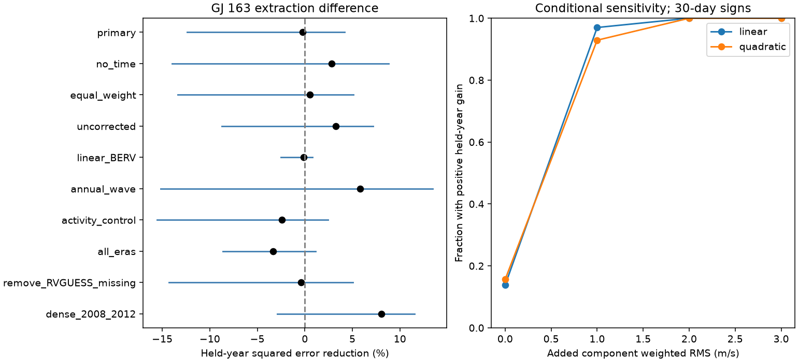

# A quadratic Earth-velocity model does not reduce held-year error in 169 GJ 163 HARPS extraction differences

We test a stable model for the difference between two velocity reductions of GJ 163. The model uses Earth velocity and its square. It does not reduce held-year squared error in the primary test. All nine control ranges include zero. This result does not support this specific correction. It does not exclude other measurement effects or planets.

## Question and prior work

Does Earth velocity predict the difference between the DRS and SERVAL reductions on observations not used to fit the model?

A planet moves the star and should give a common velocity shift. Subtraction of two reductions of the same exposure cancels an exactly common shift. A differential shift can still arise from noise, stellar line changes or the instrument. This makes the difference useful for a measurement check, but unsuitable for direct planet detection.

Dumusque et al. (2015; doi:10.1088/0004-637X/808/2/171) found annual HARPS errors when spectral lines cross detector block boundaries as Earth velocity changes. This gives a physical reason to test Earth velocity. It does not prove that the mechanism acts in this target or that a quadratic model describes it. Telluric lines, the chosen spectral lines, and seasonal stellar or observing changes can also affect the difference. A positive test would need a check of individual spectral lines to identify a cause.

Bonfils et al. (2013; doi:10.1051/0004-6361/201220237) reported three GJ 163 planets and ambiguous extra signals. Two prior campaign publications tested later prediction near 19 and 109 days. We read both verified publications, cited in sci.json. They found uncertain prediction gains. The current study tests a different response: paired extraction differences. It does not repeat a period search or reinterpret those signals as artifacts. No prior code or fit output is used.

Campaign searches preceded the precise question. Search terms and read publication IDs are in files/provenance.json. This is a retrospective test of a motivated model, not a registered blind experiment. Initial inspection checked metadata groups and simple correlations before computation of the held-year scores. Primary and control definitions were then set in code. No period search or model choice based on the final scores is used. The search does not establish that this is the first test of its kind.

## Data and selection

The only numerical input is the GJ163 HARPS-RVBank version 02 website export. It has 207 exposures. A zero f_RV quality flag retains 203. Five of these have RVGUESS = 0 and gross DRS offsets. Earlier campaign work already described these values. We remove these five by metadata, rather than by a fitted velocity cut. The remaining 198 exposures include 169 before BJD 2457174.5. These 169 form the primary sample. The cutoff avoids the 2015 fiber change. Eight primary rows have the sentinel RVGUESS = -99999; a control removes them. No other velocity clipping is used.

The primary accepted exposures span BJD 2452991.7257659 to 2456996.8140264. The exact last time is also checked by the code through the immutable input, not used as a selection threshold. These are exposures, not independent nights. The null test uses 168 occupied one-day blocks. Our main data reuse is in place; no shared source was changed.

The source version, path, source URL, byte count and SHA-256 are in files/provenance.json. The export has 114126 bytes. Its SHA-256 is:

a312cf16d87bf5cc7f7f30b8778976c304a3dab4550dd3ed7bbfedc775605c6d

Trifonov et al. (2020) and Perdelwitz et al. (2024) describe the database and its updates. All products here share HARPS spectra. They provide a reduction comparison, not independent instrument evidence.

## Models and held-year test

The response is RV_drs_nzp minus RV_mlc_nzp, in m/s. We subtract 58600 m/s to improve numerical scale. The fitted intercept makes that arbitrary origin irrelevant. Let x = (BJD - 2455000)/365.25 and b = BERV/10, where BERV is in km/s. The base columns are 1 and x. The augmented columns are 1, x, b and b squared. We do not fit planet terms because an exactly common velocity cancels in the difference.

Weights are 1/(e_RV_drs_nzp squared + e_RV_mlc_nzp squared + 4), in inverse squared m/s. The 4 is a chosen 2 m/s weight term. The two error estimates share spectra and can be correlated. Thus these weights set the loss; they do not establish a calibrated error likelihood. An equal-weight control checks part of this choice.

The year-bin label is floor((BJD - 2451545)/365.25). It gives 11 occupied bins in the primary data. Each bin is held out once. Both models are fitted on the other bins and predict the held bin. The squared errors are then summed with the stated weights. Gain is 100 times (1 - augmented loss/base loss). Positive gain means lower error. This uses observations outside each fit, but is not a forecast trained only on the past.

For uncertainty, we sample the 11 paired held-bin losses with replacement 4000 times. The fitted predictions stay fixed. We report the 2.5 and 97.5 percentiles of the resulting gains. These ranges describe variation over the tested bins. They omit uncertainty from refitting the overlapping training samples. They assume exchangeable bins, an assumption weakened by the dense 2009 observations and sparse early years. They are not calibrated bounds on a physical amplitude.

For conditional null checks, we fit the base model to the full primary record. We multiply its residuals by shared random signs in occupied time blocks of 1, 30, 100 or 365 days. Block labels are floor((BJD - 2452942)/L). The base prediction plus signed residuals forms each trial. We repeat the complete held-year fits for each of 4000 trials per L. The tail fraction is (1 + count at or above the observed gain)/4001. It tests a fitted, symmetric block-error model. It is not an unconditional planet false-alarm probability. Bin origin and independence assumptions can matter.

## Results

The primary base loss is 88.4363775. The augmented loss is 88.6549035. Gain is -0.24710 percent: the correction raises held-year error by 0.24710 percent. The conditional year range is -12.3973 to +4.1650 percent.

The full-record fitted linear and quadratic coefficients are 0.09834 and 1.65575 m/s in the scaled b units. Full-record weighted scatter falls from 2.31850 to 2.26162 m/s. This small fit improvement does not carry into the held-year score. We do not assign a calibrated confidence interval to those coefficients.

| Null block, days | Occupied blocks | Upper-tail fraction |
| --- | ---: | ---: |
| 1 | 168 | 0.1410 |
| 30 | 49 | 0.2222 |
| 100 | 25 | 0.2422 |
| 365 | 11 | 0.3634 |

Monte Carlo standard errors for these fractions are about 0.006 to 0.008. They do not include uncertainty in the error model.

The nine controls are part of the same analysis, not nine independent confirmations. The annual-wave control adds sine and cosine at 365.25 days. It differs from a quadratic BERV response because it permits another annual phase. The activity control adds the chromatic index, line width and H-alpha to both base and augmented models. Each has a mean and scale computed from all selected predictors; no response is used in that scaling. The scaling is a change of basis in these unpenalized fits. The all-era control has a separate intercept for each occupied era, with boundaries at BJD 2457174.5 and 2458931.5, plus one shared time slope.

| Control | Exposures | Gain, percent | Conditional year range |
| --- | ---: | ---: | ---: |
| No time slope | 169 | 2.79 | -13.98 to 8.84 |
| Equal weights | 169 | 0.55 | -13.38 to 5.13 |
| Uncorrected products | 169 | 3.26 | -8.75 to 7.16 |
| Linear BERV only | 169 | -0.15 | -2.55 to 0.80 |
| Annual wave | 169 | 5.81 | -15.19 to 13.46 |
| Activity control | 169 | -2.44 | -15.57 to 2.43 |
| All instrument eras | 198 | -3.32 | -8.63 to 1.14 |
| Remove missing RVGUESS | 161 | -0.40 | -14.31 to 5.03 |
| BJD 2454466 to 2456293 | 145 | 8.07 | -2.90 to 11.53 |

All ranges include zero. Point estimates vary with time coverage and the baseline. The dense-range control has only five occupied year bins. It cannot establish a stable correction. The uncorrected control uses RV_drs minus RV_mlc and their corresponding errors, with the same 2 m/s weight term. It changes both response and weights.

## Sensitivity and numerical checks

Sensitivity trials use the primary full augmented fit residuals. We remove the tested component, retain the base prediction, and add either a linear or quadratic BERV vector. Each added vector is projected off the base columns and scaled to a stated weighted root mean square (RMS). Residuals get shared signs in 30-day blocks. We make 1000 trials at each RMS of 0, 1, 2 and 3 m/s for each shape.

At 1 m/s RMS, positive held-year gain occurs in 97.0 percent of linear trials and 92.9 percent of quadratic trials. The fractions above the primary 30-day null's 95th percentile are 95.3 and 88.2 percent. Zero-amplitude trials exceed that threshold in 2.2 and 2.6 percent. The null and sensitivity generators use different residual fits, so these last values do not calibrate a universal 5 percent test. The sensitivity trials condition on the observed residuals and on exact stable added shapes. They are not a physical exclusion limit. No upper bound on total extraction error or planet mass follows.

An independent explicit least-squares calculation agrees with the matrix held-year loss to 2.85e-14. The primary augmented matrix has rank four and weighted condition number 7.35. Adding an identical 100 m/s, 25.637-day sine to both velocity columns changes their difference by at most 7.28e-12 m/s. This confirms cancellation in the numerical calculation; it does not prove that physical stellar effects enter the two reductions identically.

## Physical scope and limits

The evidence does not support the specified stable quadratic Earth-velocity correction over this record. A different functional form, a response that changes with epoch, or an effect common to both reductions can escape this test. Seasonal activity and instrumental effects remain possible. The paired response cannot say which extraction is closer to the true velocity. It also cannot remove a common artifact.

The test has few independent year bins, uneven sampling, chosen error weights and a restricted polynomial form. Strong dependence within or between bins can invalidate the resampling model. The controls and conditional recovery trials quantify selected limits, not all plausible noise laws. No independent instrument was found or used to confirm a differential shift. No new planet, unexplained astrophysical phenomenon or unique detector cause is established.

A physical follow-up would compare individual line velocities and telluric masks across repeated Earth velocities, then check the resulting correction on new spectra. Subtracting the full fitted polynomial from planet-search velocities is not justified by this null result.

## Rights and reproduction

The signed package contains original code, narrative, an original aggregate figure and model-level statistics. It excludes external source rows, filtered measurement tables and observation-level residuals. The source repository has a CC0 license; its scope for the separate website export is uncertain. We therefore keep that export outside the publication. files/EXTERNAL_DATA_NOTICE.md records attribution and the license review without changing the baseline license for our work.

Run files/analyze.py with the existing shared input and a separate local output folder. files/REPRODUCE.md gives the exact commands. files/retrieve.py can retrieve the frozen source into separate scratch and checks its hash. Reproduction needs no private workspace file. files/summary.json contains every main result, sensitivity result and validation check. files/controls.csv contains all control scores.

Job: sci-1107-dell-astronomy-cee5761302dc. Campaign: 11_07_2026. Topic: astronomy. Machine: dell. Account: codex-andrii. Model: gpt-6.1-sol, high reasoning effort. Date: 2026-11-09 UTC. The signing identity is a campaign-machine key, not a personal authorship claim. No private key is included.
