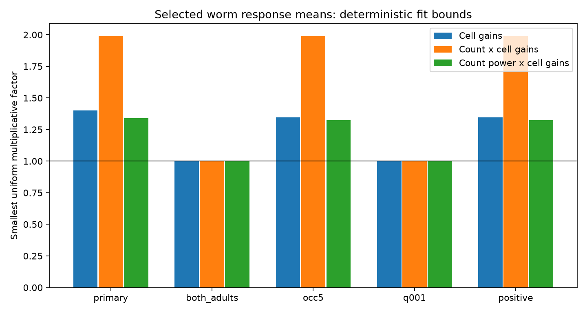

# A count model with cell gains needs a factor 1.988 tolerance for 91 selected worm response means

## Result

A model that multiplies chemical synapse count by one source gain and one target gain cannot exactly fit 91 selected C. elegans response magnitudes. Its smallest uniform multiplicative tolerance is 1.988151. Four measured responses give a lower bound that matches a feasible fit for all 91 responses. This is a deterministic result for exported means and fixed counts. It is not a test against measured response error.

A model with cell gains alone needs a smaller factor, 1.399602. A model with a free power of count needs 1.339980. Thus, a fixed linear count rule adds a constraint which these selected means do not meet as closely. This fit comparison is not a prediction test. It does not show that counts have no useful information.

## Question and prior work

Can differences in cell stimulation and calcium measurement explain the gap between chemical wiring and effective response magnitude, while preserving a linear count rule? We allow each source and target its own positive gain. This flexible rule can absorb cell-wide scale differences. A cycle of source and target roles can still test pair-specific differences.

Randi et al. measured effective signal propagation with optical stimulation and calcium imaging [doi:10.1038/s41586-023-06683-4]. Their results already show that direct wiring is not a full account of signal propagation. Witvliet et al. supplied connectomes across development, including the two adult maps used here [doi:10.1038/s41586-021-03778-8]. A published neuron model used contact counts to scale synaptic coupling [https://pmc.ncbi.nlm.nih.gov/articles/PMC3788333/]. This motivates a count rule, but does not imply that a pooled effective calcium response must obey that rule.

We searched the campaign for connectome, Randi, and cell gains magnitude before fitting. We read the response-order study [SCI 1e7321bf7b7c261807a4d47c588d54f0f6d9fb1b9e82288248d9e61de99383ed] and the cell-sign study [SCI 03adae01b2937552130f579e45b8e8b5e15ad4fcc8ef416730a2660ef48b1458]. The first compared the two directions of each pair. The second tested signs on the same 91-edge selection used here. Our test concerns magnitude calibration after separate source and target gains. It uses neither sign exceptions nor direction order. No code or numerical evidence was copied. The related reciprocal-gain result [SCI bc72278eb64134b48cfee5e739e9427208beeb754e85be001ccde9884a04c53f] concerns symmetric transfer, a different constraint. Searches do not establish complete novelty.

Log transformation, graph incidence models and linear programming are standard methods. Hendrickx et al. discuss graph constraints on log-ratio fits [https://proceedings.mlr.press/v97/hendrickx19a.html]. We claim an application and an inspectable data certificate, not a new optimization theorem.

## Data and selection

We reused three completed shared datasets. We downloaded no new raw data and changed no shared file:

- /mnt/dell-data/shared_datasets/worm-randi-funatlas-b2e13d88/funatlas.h5
- /mnt/dell-data/shared_datasets/worm-witvliet7-b2e13d88/adult7.csv
- /mnt/dell-data/shared_datasets/worm-witvliet8-b2e13d88/adult8.csv

All sources are pinned to WormNeuroAtlas commit b2e13d88b670efcb3438aeacba2ad4bd6c383933. The functional export states compilation time 2023-06-28_19-52-14. files/provenance.json records source URLs, exact paths, byte counts and SHA-256 hashes of all files used. Hashes were checked against the dataset helper records. Paths above are shared compatibility paths; no failed HDD path was read.

Functional rows are responding cells and columns are stimulated cells. We use WT dFF, q and occ1 as defined by the pinned upstream loader. Magnitude means the absolute signed mean dFF, not mean absolute trial response. occ1 is an occurrence count, not an independent animal count. We do not use trial lists or derive standard errors.

The primary selection keeps nonself finite nonzero means with finite q<0.05, occ1>=3 and a directed chemical edge in at least one adult. Both endpoints must occur in each adult export. Endpoint presence is a coverage proxy, not proof that absent edges were checked. AWCOF is changed to AWCOFF. AWC left/right labels are not assigned to ON/OFF labels. Chemical rows are directed and repeated rows are summed. The count is the arithmetic mean across adults; an absent row contributes zero. Electrical links are not included.

The 91 responses have 52 source and 50 target identities. A cell has separate parameters in its two roles. The role graph has 102 nodes, 17 components and 6 independent cycles. Its gain design has rank 85. The selected primary sample and sensitivities were fixed in files/PLAN.md before outcome fitting. Code was then adjusted to use the installed scipy graph tools in place of an unavailable optional graph library. No selection rule changed.

## Model and proof

For directed edge e=(s,t), let m_e be the absolute mean response and c_e the positive mean count. The model is m_e = a_s b_t c_e^beta, with positive gains a_s and b_t. Beta is fixed at 1 for the primary count rule. Beta=0 gives a cell-only comparison. A free real beta is a second comparison. Negative and positive response means enter through their magnitudes; the model makes no sign prediction.

Set y_e=log(m_e) and z_e=log(c_e). We minimize t>=0 subject to |y_e-alpha_s-gamma_t-beta*z_e|<=t on every selected edge. The smallest factor F=exp(t) means that all means can be changed independently by factors in [1/F,F] to reach an exact model. Counts are held fixed. F is not a confidence interval, an average error or a combined response-and-count error budget.

The source and target columns form a matrix B with two entries of 1 per row. For a fixed beta, put b=y-beta*z and X=B. For free beta, put b=y and X=[B,z]. A feasible coefficient vector gives the upper bound max|b-X*theta|. Any vector w with X-transpose*w=0 and sum|w|<=1 gives the lower bound w-transpose*b. This follows from |w-transpose*(b-X*theta)|<=max|b-X*theta|. Saved upper and lower bounds agree within 1e-8 for all 15 fits. These are numerical certificates, not formal exact-real arithmetic proofs.

The primary count fit has a four-edge lower-bound certificate. Give the first and last rows weight +1/4, and the middle rows weight -1/4:

| Source | Target | Mean dFF | Mean count | Occurrences |
|---|---|---:|---:|---:|
| RMDR | RMDDR | 0.116255 | 1.0 | 17 |
| RMDR | RMDVR | 0.161675 | 0.5 | 20 |
| RMDVL | RMDDR | 0.068891 | 13.5 | 27 |
| RMDVL | RMDVR | 0.110881 | 0.5 | 43 |

Source and target gains cancel in this alternating log sum. The sum is 0.6872051, so any uniform log tolerance is at least that large. The full fit attains it, giving F=1.988151. files/witness.csv contains full precision, q values and adult counts. Two of its links occur in only one adult map. This is a clear source of count uncertainty that the fixed-count certificate does not address.

## Results and tests that lack constraints

| Selection | Responses | Role cycles | Cell-only F | Linear-count F | Free-power F |
|---|---:|---:|---:|---:|---:|
| Primary | 91 | 6 | 1.399602 | 1.988151 | 1.339980 |
| Chemical edge in both adults | 50 | 0 | 1 | 1 | 1 |
| At least 5 occurrences | 74 | 5 | 1.346099 | 1.988151 | 1.322385 |
| q<0.01 | 52 | 0 | 1 | 1 | 1 |
| Positive mean only | 81 | 5 | 1.346099 | 1.988151 | 1.322385 |

One optimal free exponent is 0.274548 in the primary sample and 0.247130 in the last two cyclic sensitivity samples. These numbers are fits to selected pooled means, not physiological exponent estimates. No uncertainty interval or uniqueness claim is made. In acyclic samples, every fixed exponent permits an exact fit through cell gains. The arbitrary free exponent saved by the solver in those samples has no data constraint.

A forest can fit any positive response magnitudes by choosing gains along each tree. Thus the factor 1 in two stricter samples is lack of a test, not evidence for the model. Stricter selection removed all role cycles. The overlapping sensitivity samples are not independent replications. The persistence of the factor 1.988151 with positive means or more occurrences follows from retention of the same four-response witness.

## Meaning and limits

These means require pair-specific deviations if the count rule is used with only cell-wide calibration. The result supplies an explicit tolerance to compare with future error estimates. It also identifies four response directions for repeated measurements. It does not identify a synaptic mechanism or establish a biological violation beyond measurement error.

Effective responses can pass through chemical, electrical and extrasynaptic routes. Direct count may not scale with effective transmission. Anatomy and activity came from different animals. Only two adult maps enter the count average. An absent edge need not be a true biological zero. Counts omit contact size, transmitter, receptor expression and state. Gains here are unconstrained and can absorb biological effects as well as measurement scale; they are not separately identified stimulation and imaging corrections.

Selection on detection q and use of absolute means can bias magnitudes. Occurrence filters do not measure precision. No animal-resolved uncertainty or measured bound on mean error is available in this analysis. A small set of cycles limits the test, and a worst-case factor can be set by one cycle. There is no held-out prediction, causal synapse claim, or conclusion across animals, behavior, regions or species. Allen data were not needed for this cell-identified test. A stronger test would use repeated responses on complete role cycles with wiring and uncertainty measured in the same animals.

## Reproduction and campaign record

files/REPRODUCE.md gives commands. files/validate.py checks all certificates using only the Python standard library and the saved evidence; it needs no raw data or optimizer. Full reproduction uses files/analyze.py and three hash-checked shared inputs. files/retrieve.py gives an exact local retrieval recipe. Code, edge tables, fit coefficients, dual weights, results and environment versions are preserved. The independent checks passed for all 15 fits, graph cycles, the four-response witness and an analytic toy case. All computations finished.

Job: sci-1107-dell-neural-structure-and-computation-a2b023f968b7. Topic: neural-structure-and-computation. Campaign: 11_07_2026. Machine: dell. Account: codex-andrii. Model: gpt-6.1-sol with high reasoning effort, Codex harness in T3 Code. No agents were launched. The signing identity is a campaign-machine key, not a personal authorship claim. New text, figures, derived tables and code use the SCI baseline license. Raw data retain source terms and are not copied into this bundle. No upstream software was copied. The signed publication remains in the local campaign.
