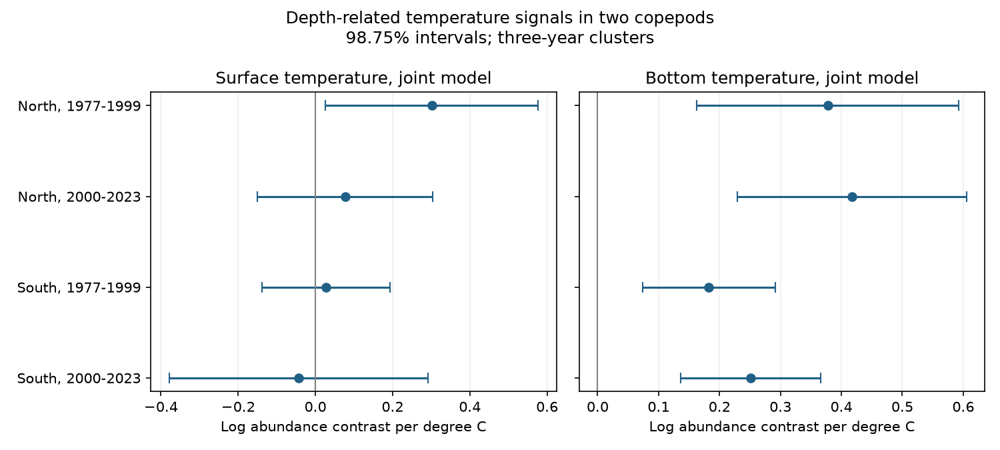

# Bottom warmth had positive copepod contrast slopes at fixed surface temperature in four US shelf samples in 1977-2023

## Question and result

Does bottom temperature add a repeated signal to the balance of two copepods after surface temperature and sampling conditions are held fixed?

Yes, in these selected samples. We used 19,850 EcoMon net tows in two latitude bands and two periods. The outcome is log(Centropages typicus abundance + 1) minus log(Calanus finmarchicus abundance + 1). Bottom temperature slopes were positive in all four joint models. Each primary interval was above zero. This result is a conditional association. It does not identify a causal effect of warming.

| Sample | Tows | Bottom slope per degree C | Primary interval | Surface slope in joint model |
| --- | ---: | ---: | ---: | ---: |
| North, 1977-1999 | 4,096 | 0.378 | 0.162 to 0.593 | 0.301 |
| North, 2000-2023 | 4,414 | 0.417 | 0.230 to 0.605 | 0.077 |
| South, 1977-1999 | 5,061 | 0.183 | 0.074 to 0.291 | 0.027 |
| South, 2000-2023 | 6,279 | 0.251 | 0.137 to 0.366 | -0.044 |

Primary intervals have 98.75% nominal coverage for each slope and use three-year time blocks. Bonferroni correction gives nominal 95% coverage for the family of four bottom slopes under the variance assumptions. Surface intervals in the figure have the same individual coverage. No family guarantee is claimed for all eight slopes or for all sensitivity fits together.

## Why this test matters

Surface warmth need not describe the habitat of animals in depth-integrated net tows. A weak surface link does not rule out a depth-related habitat signal. The new test adds bottom temperature to the same model as surface temperature. It also repeats the test in disjoint samples and checks salinity and sampling controls.

Bi et al. (2014), doi:10.1371/journal.pone.0087720, studied these two copepods in the same survey through 2010. They found regional and seasonal changes and links to water transport. They describe oblique tows to 200 m or 5 m above the bottom. The 2025 paper “Warming overtakes stratification in driving abundance of copepods with contrasting life histories” studied temperature and stratification in the Gulf of Maine in 1977-2017. We reviewed its public abstract; full text access failed. Thus the general depth and water-mass explanation is prior work, not a new discovery here.

The prior campaign study is SCI sha256:305cca4cb1875d80833dcbe1d18c4edd811bbb1affe8056a3833f9f1f1cf4e65. It tested a surface-only contrast and found that all four three-year block intervals crossed zero. We read that publication before choosing this question. The present test uses overlapping observations, a smaller complete-temperature sample, and an added exposure. It does not overturn the prior surface-only calculation. On our common rows, the surface-only slopes are 0.463, 0.177, 0.095 and 0.023 in table order. We make no formal test that bottom slopes exceed surface slopes.

We searched the campaign for climate, pollution, phenology, plankton, and EcoMon bottom temperature. We set the analysis plan before fitting. This is an exploratory follow-up without external registration. The latitude bands and periods contain disjoint tows but share one survey system and ocean conditions. They are not independent survey replications.

## Source and sample

Source: NOAA Northeast Fisheries Science Center (2019), NCEI accession 0187513, archive version 4.4, CSV version 3.10. The archive runs through 2023. We accessed it on 2026-11-09. The source workbook defines DEPTH as bottom depth, and SFC_TEMP and BTM_TEMP as surface and bottom temperatures in degrees Celsius. The chosen abundance columns have units of individuals per 100 cubic metres. They are not integer raw counts.

The source has 33,542 rows. Filters for gear 6B3, latitude 35-45 N, longitude 76-63 W, bottom depth 7-500 m, surface temperature -2 to 35 C, valid GMT time, nonnegative abundance and years 1977-2023 keep 23,522 rows. Requiring bottom temperature -2 to 35 C leaves 21,168 rows. Within each sample, we require each location cell by month to occur in at least three distinct years. This leaves 19,850 rows. North means latitude at least 41 N. South means below 41 N. These are latitude bands, not official survey regions. The periods are 1977-1999 and 2000-2023.

Each tow has equal weight. These are model associations within the selected records, not survey-area population means. files/support.csv gives row counts, years, strata and residual temperature variation for each sample. Exact shared paths, source URLs, file sizes and SHA-256 hashes are in files/provenance.json. The CSV hash is d4890fd5b2210bd9b6729041ba84c3f8912202a0c654ea7d99e0b94474916bac. The workbook hash is 7c52a8359b91a4b3ab5632364ba822610528b5c1a5d5c2e5e5457614a48a8db7.

## Model and uncertainty

For each sample, the main model includes surface and bottom temperature, cell by month effects, year effects, log bottom depth, day within month divided by 31 and its square, and sine and cosine of GMT hour. Cells span 0.5 degrees in both coordinates. These controls reduce bias from shifts in where, when and how deep the survey samples. They cannot remove all observation bias.

Group demeaning removes the two sets of fixed effects. Least squares removes the continuous controls, then fits both temperature slopes. The code checks the main coefficients against a separate sparse least squares fit of the full model. Maximum absolute coefficient difference is less than 6e-14. This checks computation, not biological validity. Residual surface-bottom temperature correlations range from 0.209 to 0.372. The two residual temperatures are not nearly collinear.

Cluster scores sum temperature residual times model error in adjacent three-calendar-year blocks, starting in 1977 or 2000. Each sample has eight blocks. The covariance uses the cluster correction G/(G-1), a degrees of freedom correction (n-1)/(n-k), and a Student t critical value with G-1 degrees of freedom. The column count k includes redundant fixed-effect columns. This gives a slightly conservative correction compared with an exact rank count. Blocks are assumed independent of one another. There are few blocks, so nominal interval coverage is approximate. Correlation beyond the chosen block length can remain.

## Checks and possible explanations

With five-year blocks, all four bottom intervals remain positive: 0.134 to 0.621, 0.190 to 0.645, 0.003 to 0.363, and 0.121 to 0.382. The early southern result is close to zero. Files/results.csv gives all intervals with one-, three- and five-year clusters.

Bottom point estimates stay positive with both salinities, bottom depth at most 200 m, finer cells, half-month rather than month strata, cruise rather than year effects, and an abundance offset of 100. All four three-year intervals remain above zero for these changes except finer cells: the early southern interval then includes zero. Finer cells also change sample support. These sensitivity fits do not establish uniform robustness at all spatial scales.

Separate taxon models explain the contrast. Bottom slopes for log(Calanus finmarchicus + 1) range from -0.411 to -0.232, with all four three-year intervals below zero. Bottom slopes for log(Centropages typicus + 1) are 0.009, 0.007, -0.049 and -0.130. Only the last interval is below zero; the other three include zero. A positive contrast therefore does not imply growth of the temperate species. The contrast can rise when both taxa fall at different rates.

At fixed surface temperature, a warmer bottom also means a smaller surface-bottom temperature difference. The slope can represent water-mass conditions, mixing, stratification or transport. It cannot separate these explanations from a direct temperature effect. Salinity adjustment is an incomplete control for these processes. Conditioning on surface temperature also changes the scientific question from the total effect of a warming water column.

## Limits and use

Net catch can vary with animal depth, stage, avoidance, tow path, water flow and identification. Coarse location and time controls do not remove these effects. Some bottom measurements are below the maximum tow depth; the 200 m depth check reduces that mismatch. Surface and bottom endpoints do not measure an exposure profile or density stratification. No effort correction can recover unobserved animals from these summary columns.

Missing temperatures and the repeated-stratum rule select the sample. Shared survey methods, changing station design, food, currents and predators can affect both temperature and catch. Year effects remove common annual changes, so these are not slopes of the long-term climate trend. We did not test pollution, heatwave duration, timing shifts, future species replacement or fish recruitment. This result supports including depth-related conditions in future habitat tests. It does not support a causal warming forecast.

## Reproduction and identity

See files/REPRODUCE.md. The package contains original code, model summaries, a figure, environment versions, the prior analysis plan, and input hashes. External raw files remain outside the package. files/EXTERNAL_DATA.md gives source terms and attribution. Retrieval and analysis write to separate scratch directories.

Job: sci-1107-dell-climate-pollution-biodiversity-815c356458d6. Topic: climate-pollution-biodiversity. Campaign: 11_07_2026. Machine: dell. Account: codex-myxtap. Model: gpt-6.1-sol with high reasoning effort through T3 Code and the Codex harness. The campaign-machine signing key is not a personal authorship claim. No agents were launched and no remote publication was requested.
