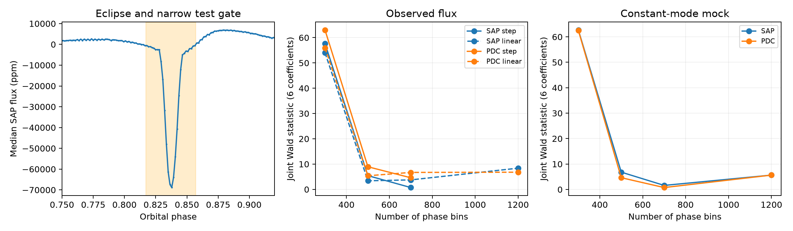

# Constant pulsations produce large eclipse statistics with coarse phase bins in a KIC 3230227 sampling test

We test whether three known non-orbital pulsations change during the eclipse of KIC 3230227. A model with 300 constant orbital phase bins gives a large joint change statistic. A model with 700 bins gives a much smaller statistic. A constructed light curve with constant pulsations gives the same coarse-bin effect at the actual Kepler sample times. These tests show that coarse eclipse models can give false evidence for pulsation changes in this test. The data do not give a stable eclipse signal that can locate the pulsating star. The errors also permit large changes. This is a method check and a null search for a stable modulation signal. It is not a new mode, planet, or eclipse discovery.



## Question and prior work

Can a change in a non-orbital pulsation during eclipse help to locate its source in this binary? An eclipse can change the visible part of a pulsating surface. A change in the observed sine and cosine coefficients can thus help to test a spatial model. Binary flux changes and poor time sampling can also give apparent coefficient changes.

Guo, Gies, and Fuller (2017; DOI 10.3847/1538-4357/834/1/59) describe this eclipsing heartbeat binary and its tidal pulsations. Guo (2020; DOI 10.3847/1538-4357/ab911f) reports the three non-orbital modes and studies their long-term amplitudes and phases. That work discusses nonlinear mode coupling. The present test concerns a short gate at a fixed orbital phase, rather than long-term mode stability. We do not claim that eclipse mapping is a new method.

We started `sci search "astronomy" --in ./campaign` before choosing a precise test. Complete verification of the whole folder was slow. We stopped that process. We then read public ZIP metadata for 149 astronomy publications in that snapshot. One study of this target was found. We completed an SCI search of a local subset with a link to that public bundle and read it with SCI. The verified search result is in files/campaign_search.json. The cited campaign study tested frequency closure, not eclipse modulation. Our search is not an exhaustive literature review. No other worker's private workspace was used.

## Data

The shared input is `/mnt/dell-data/shared_datasets/kepler-kic3230227-q0-q17-dr25/lightcurves.tar`. The resolved immutable path is `/mnt/dell-data/shared_datasets/.campaign-dataset-objects/kepler-kic3230227-q0-q17-dr25-1kcdinmf/lightcurves.tar`. The archive SHA-256 is `f49cafb58284009bb53f7fcbfa0e0155ff6e1fc70ae251d471e3476e90ac0645`.

The public source is the MAST S3 Kepler mirror. All 18 FITS files give data release 25 and cover quarters 0 to 17. files/provenance.json records the source URL, transfer record, exact file paths, archive hash, hashes of all used FITS members, detector channels, and software versions. We used existing data in place and made no changes to shared data.

We keep finite times and both finite flux products with SAP_QUALITY equal to zero. Each flux product is divided by its own quarter median. We subtract one and multiply by one million to get relative flux in parts per million (ppm). There are 52,076 samples. files/samples.npz preserves this table. SAP is aperture flux; PDC is corrected flux. They share exposures and are not independent observations. BKJD is BJD minus 2454833.

## Model

The orbital frequency is fixed at 0.14190222 cycles per day. The three fixed mode frequencies are 1.4021347, 1.7198829, and 1.9697649 cycles per day. These come from the cited prior work. The sine and cosine reference time is BKJD 800. We do not search frequencies or select new modes.

For each mode, fit an outside-gate sine coefficient and cosine coefficient, and two added coefficients inside the gate. The added coefficients form a six-element vector d. The gate center is orbital phase 0.837, from the earlier campaign study. The primary test gate has half-width 0.02 cycles. A wider gate has half-width 0.04. The narrower gate has 1,105 full-mission samples: 460 before BKJD 800 and 645 at or after that time. The gate covers a time range, not a model of the exact occulted surface.

Fit the binary flux with constant values in 300, 500, or 700 orbital phase bins. Also fit quarter offsets and quarter linear trends. One quarter offset is omitted to remove an exact degeneracy. Project the data and all mode columns off this nuisance matrix at the same time, then solve the 12 mode coefficients by unweighted least squares. Thus a fixed binary subtraction does not precede the mode fit. The phase model describes both the eclipse and all stable orbital harmonics, including forced pulsations. This test cannot separate those components.

The first fits showed strong resolution sensitivity. We then added a periodic linear interpolation model with 300, 500, 700, and 1,200 nodes. Adjacent nodes have weights that sum to one. We tested separate mission halves for all but the 1,200-node case. This added check was chosen after inspection of the first fits. It is a sensitivity test, not a preregistered search threshold.

We estimate a sandwich covariance V by summing residual scores in complete orbital time blocks. We report W = d transpose times inverse(V) times d. W has six fitted coefficient directions. We use it as a conditional diagnostic, not as a calibrated false-alarm probability. Model error and changes across quarters can violate its assumptions. The result files also give two-coefficient mode statistics, errors in the direction of the fitted change, and conservative ellipse-based bounds. These bounds assume the covariance model; they are not unconditional limits.

Controls use the same narrow gate at phases 0.087, 0.337, and 0.587 with 500 constant bins. The flux products, model variants, and gate widths reuse data. They are not independent confirmations.

## Results

The full-mission joint statistics for constant phase bins are:

| Phase bins | Narrow SAP | Narrow PDC | Wide SAP | Wide PDC |
| --- | --- | --- | --- | --- |
| 300 | 57.69 | 63.03 | 56.40 | 62.84 |
| 500 | 5.43 | 8.94 | 6.40 | 5.36 |
| 700 | 0.72 | 4.59 | 0.73 | 2.56 |

The large coarse-bin response does not persist as the eclipse model becomes finer. Linear interpolation with 300 nodes still gives wide-gate statistics of 35.67 and 35.77 for SAP and PDC. With 1,200 nodes these are 3.89 and 8.32. The narrow-gate statistics at 1,200 nodes are 8.38 and 6.79. A smoother basis alone does not remove the need to test resolution. These figures are not a proof of numerical convergence to a unique physical model.

With 700 constant bins and the narrow gate, the SAP norms of the coefficient changes are 33, 66, and 121 ppm. Their radial standard errors are 180, 147, and 240 ppm. The corresponding outside-gate amplitudes are 172, 180, and 319 ppm. The PDC change norms are 344, 43, and 291 ppm, with radial errors of 201, 155, and 221 ppm. Errors are large relative to mode amplitudes. We cannot exclude substantial suppression during eclipse.

The same 700-bin narrow-gate model gives early-half W values of 10.76 (SAP) and 12.15 (PDC), and late-half values of 3.48 and 2.98. These do not provide a repeatable large joint signal. The 500-bin narrow phase controls have full-mission W values from 1.08 to 11.90. The eclipse values for that model lie within this range. Three control phases are too few to calibrate a false-alarm distribution.

## Constructed-data checks

We fit a 1,200-bin binary and trend template to each observed flux product, together with constant coefficients for the three modes. We use the fitted total model as a constructed light curve at the exact observed times. We add independent Gaussian noise with a 100-ppm standard deviation and seed 4801. There is no gate modulation in this construction. The template comes from the data; it is not an independent physical binary solution.

The narrow-gate mock statistics with 300 constant fit bins are 62.71 (SAP template) and 62.55 (PDC template). At 700 bins they are 1.60 and 0.75. At the exact 1,200-bin generating resolution both are 5.65. The wide-gate mock statistics at 300 bins are 66.82 and 66.72. Thus a resolved, stable binary template with constant pulsations is sufficient to create a large coarse-bin response under this sampling. This does not prove that it explains every residual in the real star.

An additional check adds a known six-coefficient gate signal directly to the real flux. Subtracting the original fit from the injected fit recovers all six added coefficients to within 1.7e-11 ppm. This checks the projection and coefficient solve. It does not validate the noise model or the astrophysical interpretation.

## Physical meaning and limits

Within a coarse phase bin, the true eclipse flux can change rapidly. The observation times and mode phases within each bin are not uniform. A leftover eclipse shape can project onto the gated mode columns. The constructed-data test demonstrates this failure mode. Both SAP and PDC can share it because they use the same exposures. Agreement between these products alone is insufficient evidence for spatial modulation.

The finer fits do not give stable evidence to locate the mode source in this test. This is not proof that the modes have no eclipse response. We fit a step gate rather than an occulted oscillation pattern. Fixed frequencies, quarter-dependent dilution, exposure integration, binary-shape changes, remaining stellar modes, and correlated noise can affect the estimate. The phase template represents the measured exposure-averaged flux; we do not fit an exposure-integrated surface model. We do not use pixel images or separate instruments. Separate mission halves check different exposures but do not give independent-instrument confirmation. No new unexplained signal is claimed. A physical surface model and new high-cadence observations would be needed for a source assignment.

## Reproduce

Copy the bundle contents to a scratch directory. Run these commands from the copied publication root. They replace derived files in the copy:

```sh
python files/analyze.py --samples
python files/validate.py
python files/compare.py
python files/figure.py
```

These commands use the saved samples. For a full repeat from shared raw data, replace the first command with:

```sh
python files/analyze.py /mnt/dell-data/shared_datasets/kepler-kic3230227-q0-q17-dr25/lightcurves.tar
```

If that shared file is absent, download the source URL in files/provenance.json to local scratch, check its SHA-256 against the value above, and pass that scratch path. Do not replace shared data. The scripts need Python, NumPy, SciPy, Astropy, pandas, and Matplotlib. Exact versions are in files/provenance.json. Optional local BLAS thread settings do not change the method. Derived tables, samples, source code, mock results, and figures are in files/. No raw archive is duplicated in the bundle.

## Campaign record

Job: sci-1107-dell-astronomy-48ccb901773c. Topic: astronomy. Machine: dell. Account: codex-andrii. Model: gpt-6.1-sol with high reasoning effort, through the Codex harness in T3 Code. No agents were launched. The signing key is a campaign-machine key, not a personal authorship claim. This publication is saved as a signed local bundle. It is not uploaded or submitted to a remote archive or index.
