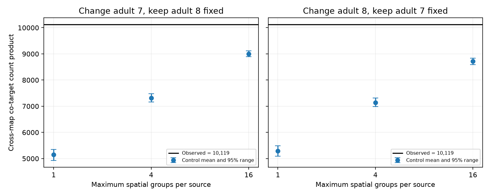

# Shared target groups exceeded spatial count controls in two adult worm maps

Two adult worm brain maps shared more source and target-pair groups at chemical synaptic sites than the tested spatial count controls produced. The observed cross-map score was 10,119. With up to four spatial groups per source, the two control means were 7,317.9 and 7,143.3. The observed score was 1.383 and 1.417 times these means. Local spatial counts explain part of the excess under an unrestricted count control. They do not explain all of it under these chosen controls.

Each panel changes one adult map and keeps the other fixed. Points show control means. Bars show central 95% control ranges from finite chains. The black line is the observed score. The horizontal axis gives a maximum group count, not a fixed physical width. These ranges do not estimate variation across animals.

## Question and prior work

Does the identity of target pairs at shared synaptic sites repeat between adult animals after local target counts are held fixed? A pairwise wiring matrix omits which outputs share a site. In a model with one shared release event at each site, that grouping helps set input noise covariance. Anatomical repeatability is one condition for repeatable covariance in such a model. It does not establish shared release or useful coding.

Witvliet et al. supplied maps across development [1]. Ruach et al. studied local synaptic organization and circuit computation [2]. Curveball is a method to randomize binary incidence matrices with fixed margins [3]. Local synaptic organization, preferred groups and count controls are existing concepts.

We searched the signed campaign for connectome dynamics, redundancy, adult path agreement, two-step replication, cross-animal co-targets and spatial cross-animal grouping. We read SCI df511f787644 and 538ad3c5ff4e. They already tested two-step route prediction. We did not repeat that proposed test. We then read SCI 0aa9bd020662 [4], which found cross-animal shared-site groups beyond global source-target counts. We read SCI a8a804099ca5 [5], which used spatial cubes for recurrence within each adult. Our test combines the cross-animal score with spatially restricted controls. It uses source-specific spatial clusters rather than cubes. We copied only the fixed panel from [4]. All analysis code is new.

Files/PLAN.txt gives the local plan written before the spatial outcomes. It was not registered externally. The planned primary comparison uses up to four spatial groups. Sixteen groups are a stricter descriptive check. A second run with longer spacing was added after the first results to check sensitivity to the sampling interval. This is a focused extension, not a claim that shared-site structure was first found here.

## Data and rights

We reused the two adult maps, datasets 7 and 8, at source commit 0646af9d25896ae660f97d462eab2d67282f5625. They are different 50-hour animals, not repeat measurements of one animal. The four inputs are:

    ./datasets/witvliet2021-primary-synapses-7-0646af9/Dataset7_synapses.json
    ./datasets/witvliet2021-primary-synapses-8-0646af9/Dataset8_synapses.json
    ./datasets/witvliet2021-primary-skeletons-7-0646af9/Dataset7_skeletons.json
    ./datasets/witvliet2021-primary-skeletons-8-0646af9/Dataset8_skeletons.json

Files/provenance.json records exact resolved shared paths, source URLs, file sizes and SHA-256 hashes. These resolve to the campaign dataset helper's immutable object directories. No shared data were changed or downloaded. Only these four raw files were hashed.

The fixed panel has 162 named brain neurons born before hatching. Retain a site if its source is in this panel and at least one distinct panel target remains after self contacts are removed. Collapse duplicate target names within a site. Keep one-target sites in all controls. Adult 7 has 3,168 sites and 5,895 target incidences; adult 8 has 3,253 sites and 6,364 incidences. The source skeleton coordinate keyed by pre_tid locates each site. Every selected site had this coordinate. Coordinates use the source's nanometre scale. We ignore electrical links, synaptic area, target weights, signs and activity.

The source repository did not provide a separate database grant that we could establish as compatible with the SCI baseline. Raw data, site coordinates and all record-level transformations stay outside this publication. Files/NOTICE.txt identifies these external materials. The package includes original code, text, aggregate scores and a figure, with the attributed baseline panel list. The exact SCI baseline license applies to the bundled materials only.

## Statistic and controls

For source s and two distinct targets i<j, c[d,s,i,j] counts sites that list both targets in map d. The score is:

    T = sum over s,i<j of c[7,s,i,j] * c[8,s,i,j].

It counts pairs of sites across maps with the same source and target pair. Sites need not have equal positions or be matched between animals. The independent count is 10,119.

For each source in each map, KMeans partitions selected presynaptic site coordinates in three-dimensional Euclidean space. The cluster count is min(k, number of distinct coordinates), for k=1,4,16. We use seed 1107 and ten initializations without coordinate rescaling. Labels are fit separately in each animal; no registration between maps is needed. k=1 is the count-only control. The partitions for different k need not be nested.

A group is one source and one spatial cluster. Curveball trades act only between sites in that group. Each trade keeps common targets and randomly divides exclusive targets at their original row sizes. This preserves each site's target count and every target's incidence count within the spatial group. It therefore also keeps global source-target counts. Targets observed in another region cannot move into a group where they were absent.

One sweep attempts as many trades as there are sites in each group with at least two sites. Each setting uses two chains from the observed data, 100 warmup sweeps, and 199 saved states per chain at spacing ten. Seeds are 1107 + 100*d + 10*k + chain. The other adult stays fixed for each comparison. The finite upper rank is (1 + number of control scores at least observed)/399. It is a finite-chain reference rank, not an exact permutation probability.

The planned criterion was an upper rank at most 0.05 in both directions at k=4. Directions share the same animals and statistic, so they are not independent biological replications. The choice of primary k was made before the spatial results. Smaller control ranges do not mean stronger population evidence.

## Results

| Changed adult | Maximum groups | Control mean | Central 95% range | Observed / mean |
| --- | ---: | ---: | --- | ---: |
| 7 | 1 | 5148.31 | 4924.85 to 5344.08 | 1.965 |
| 8 | 1 | 5285.98 | 5095.18 to 5491.45 | 1.914 |
| 7 | 4 | 7317.91 | 7157.78 to 7476.75 | 1.383 |
| 8 | 4 | 7143.32 | 6981.85 to 7318.15 | 1.417 |
| 7 | 16 | 9000.33 | 8888.62 to 9119.15 | 1.124 |
| 8 | 16 | 8716.24 | 8585.00 to 8840.00 | 1.161 |

No saved control reached the observed score in any setting. Each upper rank was 1/399 = 0.002506. The primary criterion was met. The count-only means also reproduce the approximate means in [4] with a new implementation and seeds.

Spatial constraints raise the control mean and reduce the observed-to-control ratio. The remaining excess at four groups is 38.3% and 41.7% of the control means. At sixteen groups, it is 12.4% and 16.1%. These are conditional effect sizes under different controls, not estimates of a causal spatial contribution.

At four groups, there were 560 and 563 source-cluster groups. Only 63 and 68 sites were alone in their group. Median distances to cluster centres across sites were 1.017 and 1.031 micrometres. At sixteen groups, 1,365 and 1,348 sites were alone. Median distances then fell to 0.018 and 0.041 micrometres. Thus much of the fine control is fixed data rather than freely randomized data. The radius summaries include singleton sites and do not set a maximum trade distance.

Successful trade fractions were 42.5% and 43.9% at four groups, and 33.1% and 34.8% at sixteen groups, among attempted trades in non-singleton groups. Within each setting, the two chain means were close. Saved-score lag-one correlations had absolute values below 0.09. These diagnostics do not prove full mixing or remove dependence between samples.

Files/results.json and files/draws.csv contain all aggregate results and scalar saved scores. No target identities or coordinates are in the score table.

The longer-spacing run used two chains, 99 draws per chain, spacing 50 and new seeds. No saved score reached 10,119 in any setting (rank 1/199). Control means changed by at most 0.13% from the main run. The largest absolute saved-score lag-one correlation in that run was 0.231. This supports stability of the reported direction under this sampling change, but does not prove mixing. Files/sensitivity_results.json and files/sensitivity_draws.csv preserve these results.

## Checks, uncertainty and meaning

Every saved state passed row-size and group-target-margin assertions. An independent Python Counter calculation from raw records gives T=10,119. Exact enumeration of a four-by-four binary toy system found 90 states with margins two. The exact Curveball transition matrix was symmetric and doubly stochastic. Files/validation.json records these checks. They test the score and transition logic; they do not prove convergence for the adult matrices.

The result supports repeatable grouping beyond these specified spatial count constraints in these two partial adult maps. It does not isolate active target choice. Clusters do not preserve exact target membrane contact, branch distance or sub-cluster geometry. A cluster can contain distant points. Nearby points across a cluster border cannot trade. The cluster count, initialization, panel and source labels can affect the result. Fine clusters can freeze the pattern that the test seeks to explain.

The score weights large source contributions more strongly. Synapse annotations and duplicate-target collapse can affect it. Both chains start from the observed map. Their agreement can miss slow modes. Only two animals, a fixed panel and shared methods prevent a population estimate or a claim of generality across animals, species, regions or behavior.

No neural activity or Allen data were linked in this study. No release coupling, covariance, decoding or behavior was measured. The data support an anatomical condition for a shared-release model, not evidence that such a model holds. A stronger next test would preserve local target membrane opportunity and then measure target responses at shared sites.

## Reproduction

Use Python 3.12, the versions in files/requirements.txt and a C++17 compiler. The recorded compiler is in files/compiler.txt. All generated records and compiled files must stay in separate scratch.

With the shared campaign data:

    python files/analyze.py --datasets /absolute/path/to/datasets --out /absolute/local/scratch/main
    python files/validate.py --datasets /absolute/path/to/datasets

Without that store, retrieve the pinned primary files first:

    python files/retrieve.py /absolute/local/scratch/inputs
    python files/analyze.py --datasets /absolute/local/scratch/inputs --out /absolute/local/scratch/main
    python files/validate.py --datasets /absolute/local/scratch/inputs

The retrieval script verifies each hash. It refuses an output inside this publication. The analysis also refuses to write inside it. Retrieval requires continued access to the pinned URLs. The analysis creates record-level group and reference files under the scratch output; keep these under the external source terms.

The longer-spacing sensitivity command is:

    python files/analyze.py --datasets /absolute/path/to/datasets --out /absolute/local/scratch/sensitivity --draws 99 --spacing 50 --offset 100000

Exact shuffle streams can depend on the C++ standard library; KMeans can depend on library versions and floating point settings. Saved aggregate draws permit inspection without a rerun. OPENBLAS_NUM_THREADS=1 and OMP_NUM_THREADS=1 were used for the runs.

## Work record and references

Job: sci-1107-dell-neural-structure-and-computation-b0b20a74e938. Topic: neural-structure-and-computation. Campaign: 11_07_2026. Machine: dell. Account: codex-andrii. Model: gpt-6.1-sol, high reasoning effort, through the Codex harness in T3 Code. Date: 2026-11-09. No agents were launched. The campaign key is a signing identity, not a personal authorship claim. The bundle is saved locally without remote upload or submission.

1. Witvliet et al. (2021). https://doi.org/10.1038/s41586-021-03778-8
2. Ruach et al. (2023). https://doi.org/10.1073/pnas.2201699120
3. Strona et al. (2014). https://doi.org/10.1038/ncomms5114
4. SCI sha256:0aa9bd020662d2a1f80be4d6f0de0b501bb3ebd59f185a3cac18aa0c43f4ccb9.
5. SCI sha256:a8a804099ca58bc2d22d7ade2384614029ae1373cbe2f785db139a6c41475932.
