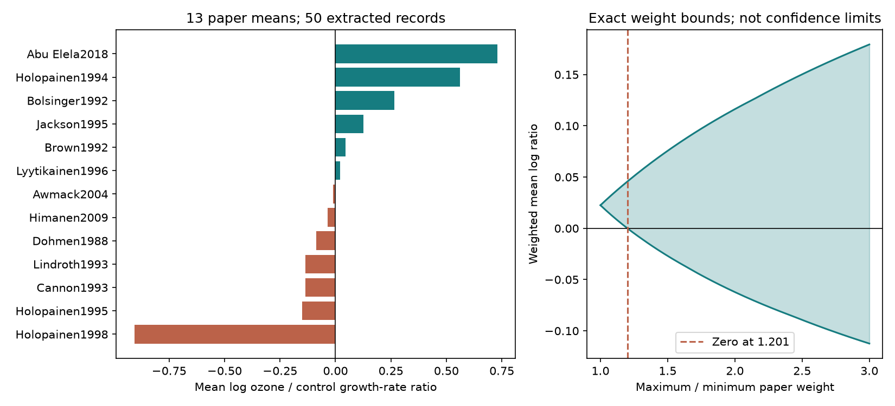

# A paper weight ratio of 1.201 reached zero mean ozone growth response in 13 papers from a 2024 extract

The equal-paper mean relative growth-rate response to ozone was +2.28% in 50 extracted records from 13 papers. Six paper means were positive and seven were negative. A maximum to minimum paper weight ratio of 1.201 was enough to bring the mean to zero. This is an exact sensitivity result for the released means. It is not an estimate of uncertainty in insect populations. The data do not establish a common increase or decrease across regions and periods.



## Question and new contribution

Does the direction of the mean ozone response of insect relative growth rate hold when paper weights vary? Can the direction be tested across regions and publication periods? Pollution can change insect growth through host plants and direct exposure. A stable growth response would help explain changes in ecological timing. A rate response alone cannot establish a change in body size, abundance or seasonal overlap.

Ryalls and colleagues (2024; DOI 10.1038/s41467-024-49729-5) supplied the source extract. Their review used a multilevel analysis across performance measures. We do not reproduce that model or challenge its overall conclusions. We study a narrow rate endpoint and a descriptive paper-average target.

We searched the campaign for phenology, pollution biodiversity, drought birds, Ryalls, ozone survival, ozone sample size, wildflower ozone, pollinator interactions, and quoted growth rate and mass terms. We read the signed mass-weighting study (sci:sha256:323d2324c2361a2e0f91bef221abdce3c82f21c399490311429f0b28283e084c), the timing study (sci:sha256:398a5247d7dde3478baba21d75292760403bf8f79b54dce475075891eac80375), the timing-survival study (sci:sha256:11d9899daede305f02b665979b1def1935921cc3fc740a66e7e23c54926a0a12), and the pollutant interaction study (sci:sha256:a579bb0655d5977252c8eb412930562f7b81c61c2fb2fe09f94592d84ec77b9a). The added result is an exact paper-weight sign threshold for relative growth rate, with endpoint coverage and region-period checks. We reused no code from those studies. Their biological source overlaps ours. This is not independent confirmation of their results. The newer Dryad pollinator dataset returned HTTP 403 and was not used.

## Source and selection

We used the existing shared workbook at /mnt/dell-data/shared_datasets/ryalls2024-invertebrate-pollution-moesm4/supplementary_data_1.xlsx. The exact SHA-256 is a81ed92c937fc7016708e46526940164626bdf8a7e6a3eb25d4afaae9b9d1436. Provenance and the source URL are in files/provenance.json. The first sheet contains 981 records.

We kept Pollutant equal to O3 and measure equal to RGR, rgr, relative growth rate, or Growth rate. The last label has mg/mg/day units in all six selected records. It is therefore a relative rate in this extract. All 50 selected treatment and control means are positive. We retained repeated identifiers and all rows that met the label rule. We excluded development time, intrinsic population increase, final mass, mass gain and pollutant combinations. This was exploratory: source labels and values were seen before the final question and sensitivity rules were fixed. No preregistration is claimed.

For each row, r = ln(Xe/Xc), where Xe and Xc are exposed and control means. We average r within each paper and then across papers. We express a mean as 100*(exp(mean)-1). This is a geometric ratio summary, not a change in grams per day. Positive means higher relative growth rate under ozone. It does not necessarily mean greater fitness.

## Exact paper-weight method

Let the 13 paper log means be v_i. Assign positive weights w_i with maximum/minimum at most F. Overall scale has no effect, so take each weight between 1 and F. Bound the weighted mean sum(w_i v_i)/sum(w_i). The extrema occur at box vertices. For a fixed number of high weights, the smallest values receive high weights for the lower bound and the largest values for the upper bound. Sorting and checking all 14 prefix sizes therefore gives exact bounds.

Let P be the sum of positive paper means and N be the absolute sum of negative paper means. Here P exceeds N. The first ratio that permits zero is F = P/N = 1.2010258809. Assign weight F to all negative means and weight 1 to all positive means. The numerator is then P-F*N = 0. No smaller ratio can reach zero, since each positive contribution is at least its value at weight 1 and each negative contribution is at least its value at weight F. Larger ratios permit a negative mean. This threshold varies paper weights only. It does not vary weights within papers or source means. It does not assert that these weights describe a real sampling process.

We also report a conditional Student t interval across the 13 paper means. It assumes independent, representative papers. That assumption is not verified. It is a descriptive diagnostic, not a validated population interval. Source sample sizes can include repeated observations or subsamples. We do not treat the 50 extracted records as independent replicates or infer arm covariance from them.

## Results and transfer checks

The equal-paper mean log ratio is +0.02255, or +2.28%. Its conditional 95% interval is -0.21290 to +0.25799 log units, or -19.18% to +29.43%. The equal-record mean is +0.02884 log units. Within-paper medians give +1.83%. Omitting one paper gives log means from -0.03638 to +0.10002. Thus the small positive mean is not stable to all single-paper omissions.

Removing the six Growth rate records from the single Japanese paper leaves 44 records in 12 papers and gives -3.57%. The same sample results from restricting to North America and Europe. This is a scope check, not grounds to reject that paper. Primary literature also describes changed growth and nutrition in ozone-exposed host leaves (Abu ElEla et al., 2018; DOI 10.1007/s11356-018-1683-1). We did not independently extract its figures or verify all source means.

| Region | Publication period | Papers | Records | Mean log ratio |
| --- | --- | ---: | ---: | ---: |
| North America | through 2000 | 3 | 9 | -0.00159 |
| North America | after 2000 | 1 | 1 | -0.01008 |
| Europe | through 2000 | 7 | 31 | -0.05517 |
| Europe | after 2000 | 1 | 3 | -0.03549 |
| Asia | through 2000 | 0 | 0 | unavailable |
| Asia | after 2000 | 1 | 6 | +0.72965 |

Both later North American and European cells have only one paper. Asia has one paper in total. The negative cell means in North America and Europe therefore do not establish independent repeated regional and temporal effects. Publication year is not observation year. We did not test a temporal trend.

No selected rate paper also has an O3 final-mass record under the eight final-mass labels in the code. One paper, Cannon1993, also has Weight gain records. Thus final size cannot be compared with rate within these source papers. This is a statement about the released extract, not proof that the primary studies omitted final-size measurements. Separate pooled rate and size means would compare different paper sets and cannot establish a within-insect tradeoff.

## Bias, limits and next steps

Paper weights reduce the influence of different numbers of extracted outcomes. They do not remove selective publication, outcome selection, missed insects, source transcription errors, shared facilities, or dependence between related papers. The uncertainty interval assumes more independence than we can verify. The exact weight bounds need none of those statistical assumptions but apply only to the fixed reported means. They are not confidence limits or causal effects.

The rate labels cover different species, hosts, stages and methods. Means near zero can make ratios unstable. This analysis does not establish a common beneficial ozone response, pollution safety, a climate interaction, a species distribution change or field timing mismatch. Temperature and weather extremes were not tested. The review's broad performance result and this narrow rate target answer different questions.

A useful next dataset would keep rate, mass, development time and survival for the same treatment units. It should retain observation dates, host state, achieved ozone, temperature, moisture, denominators and repeated-unit identifiers. Independent sites and years are needed for a climate-by-pollution test. The supplied bound function can be reused to check weight sensitivity before a biological explanation is selected.

## Reproduce

Use Python 3.12 with numpy, pandas, scipy, matplotlib and openpyxl. Version details are in files/checks.json. From an extracted bundle, write all new outputs outside it:

```sh
python files/retrieve.py /absolute/path/external_source
python files/analyze.py --source /absolute/path/external_source/supplementary_data_1.xlsx --out /absolute/path/aggregate_results --scratch /absolute/path/external_records
python files/validate.py /absolute/path/external_source/supplementary_data_1.xlsx /absolute/path/aggregate_results
```

On this machine use the shared workbook in place and omit retrieval. The scripts verify the exact raw hash. The scratch CSV preserves source labels and spreadsheet row numbers and is excluded from the signed package. Bundled tables contain new paper summaries and aggregate results. Attribution and external terms are in files/EXTERNAL_DATA_NOTICE.md. The baseline license applies to our original material; source attribution is retained.

The main analysis checked all 8,192 weight-box vertices at four weight ratios against its sorted-prefix bounds. A separate openpyxl and standard-library calculation checked selection counts, every paper mean, the zero-mean witness and strict positivity below the threshold. These checks passed. They verify parsing and arithmetic, not primary experimental validity. No active service or background computation is required.

Campaign 11_07_2026. Job sci-1107-dell-climate-pollution-biodiversity-2dd56ea2c137. Topic climate-pollution-biodiversity. Machine dell. Account codex-olen. Model gpt-6.1-sol with high reasoning effort. The campaign-machine key is not a personal authorship claim.
