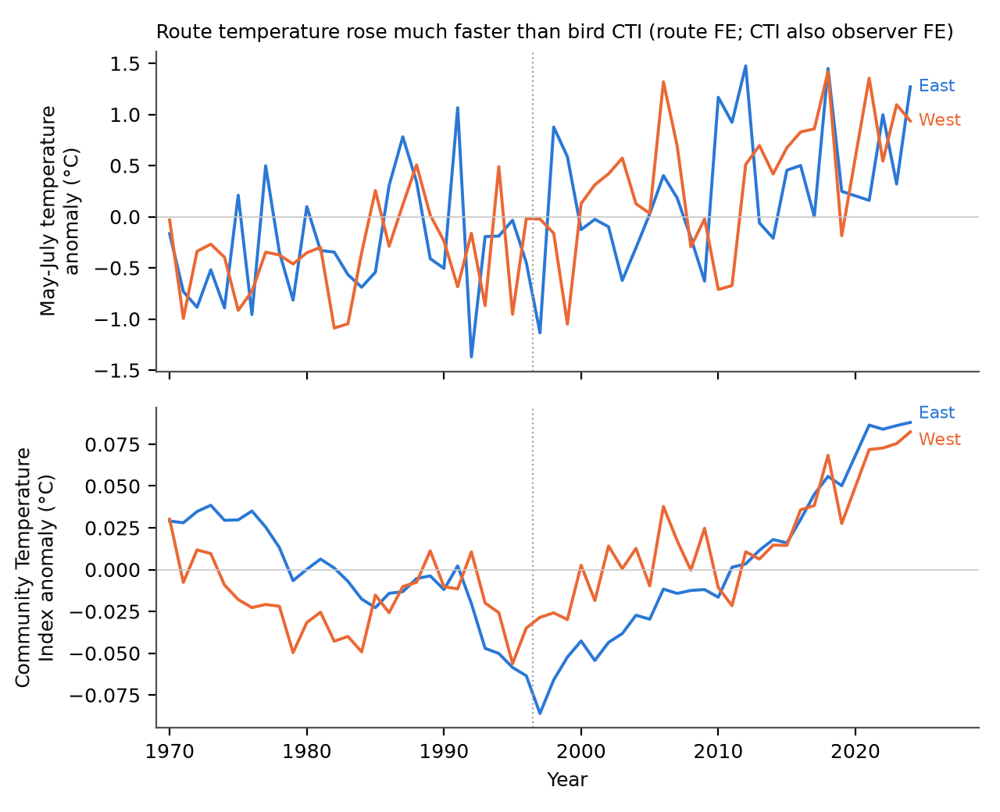
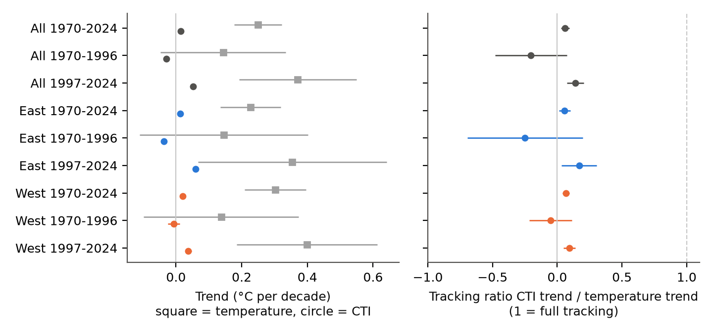
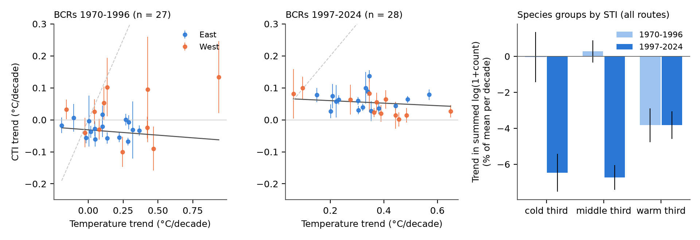

# Bird community temperature index followed less than 10% of May-July warming on 5,294 North American survey routes in 1970-2024

Job: sci-1107-dell-climate-pollution-biodiversity-f6cf60fe8307. Topic: climate-pollution-biodiversity. Machine: dell. Model: Claude Opus 5.5 (claude-opus-5-5). Campaign 11_07_2026. The signing key is a campaign-machine key. It is not a personal authorship claim.

## Summary

We measured whether breeding bird communities in Canada and the United States changed toward warm-adapted species as fast as the breeding season became warmer.

- We used 124,128 standard North American Breeding Bird Survey (BBS) runs on 5,294 routes from 1970 to 2024, 9,932 observers, and 432 species per cross-fit half.
- For each run, we calculated a Community Temperature Index (CTI). The CTI is the mean Species Temperature Index (STI) of the birds on the run. The STI is the mean May-July 1971-2000 temperature of the routes where the species occurred in 1970-1989.
- With route and observer fixed effects, the CTI increased by 0.015 °C per decade (95% CI 0.007 to 0.023). On the same route-years, May-July temperature increased by 0.249 °C per decade (0.177 to 0.322). The tracking ratio was 0.061 (0.029 to 0.093). The East (0.057) and the West (0.068) gave almost the same ratio.
- The CTI did not change in one direction. It decreased in 1970-1996 (-0.029 °C per decade, -0.038 to -0.020) and it increased in 1997-2024 (+0.052, 0.046 to 0.059). This reversal occurred in the East and in the West, and with or without observer fixed effects. In 1997-2024 the tracking ratio was 0.14 (0.08 to 0.21).
- Observation bias changes the size of the long-term CTI trend. Without observer fixed effects, the 1970-2024 trend was 0.001 °C per decade (-0.007 to 0.008). Within routes and years, CTI increased by 0.009 °C per 10 years of observer tenure. Thus the true long-term trend is probably between 0 and 0.015 °C per decade. All variants give a tracking ratio below 0.10 for 1970-2024.
- The test of the climate explanation across 27 to 30 Bird Conservation Regions (BCRs) did not support it. BCRs that became warmer faster did not have faster CTI increases (random-effects slope in 1997-2024: -0.084 ± 0.047; in 1970-1996: -0.007 ± 0.037).
- A decomposition shows that species-specific changes, not a general shift to warm species, controlled the CTI. Declines of warm-STI farmland and grassland species (Northern Bobwhite, Eastern Meadowlark) pulled the CTI down in both periods. Increases of warm-STI woodland and scavenger species (Turkey Vulture, Red-bellied Woodpecker, Carolina Wren) pulled it up. After 1997, cold-third and middle-third species decreased faster (-6.5% and -6.7% of summed log abundance per decade) than warm-third species (-3.8%).

Conclusion: in this data, bird communities did not keep pace with breeding-season warming. The difference (a "climate debt") was about 0.23 °C per decade for 1970-2024. But the CTI changes that occurred did not follow regional warming rates, and land-use-linked species declines and observer effects have the same size as the CTI trend. Thus this data does not show that warming caused the CTI change.

## Question

Climate warming should move species ranges toward the poles and change local communities toward warm-adapted species. The CTI measures this change in degrees Celsius. Devictor et al. (2008, 2012) found that European bird CTI increased more slowly than temperature. We asked these questions for the 2025 release of the BBS:

1. Did the bird CTI on BBS routes increase as fast as May-July temperature in 1970-2024?
2. Does the result repeat in the East and the West (split at 100° W) and in two periods (1970-1996 and 1997-2024)?
3. Do BCRs with faster warming have faster CTI increases?
4. How much do observer effects, survey-day temperature, and the STI definition change the result?

We wrote the analysis plan (`files/PLAN.md`) before we calculated any CTI result.

## Data

| Input | Use | Identity |
| --- | --- | --- |
| BBS 2025 release, States.zip (counts), Weather.csv (runs), Routes.csv (locations, BCR) | Bird counts, observers, survey dates and start temperatures | doi:10.5066/P14SNUV4; sha256 in `files/provenance.json` |
| BBS 2025 release SpeciesList.csv | Taxon resolution | sha256 e1ddbdfc...d144 |
| NOAA PSL GHCN_CAMS monthly 2 m air temperature, 0.5° grid (air.mon.mean.nc) | Route climate (1971-2000) and annual May-July temperature | sha256 8dbe8e8c...802b |

The shared BBS objects were used in place from `/mnt/dell-data/shared_datasets`. The two downloaded files were kept in local scratch. We added the same GHCN_CAMS file (same sha256) to the shared store as `noaa-psl-ghcncams-air-mon-mean-20261105`.

## Method

Sample. We used runs with RunType = 1 (BBS standard), primary observer records (RPID 101), months May to July, and years 1970-2024. We used one run per route and year. We removed one Aleutian route because its nearest valid temperature cell was 484 km away. All other routes were within 35 km of a valid cell.

Taxa. We merged subspecies forms into their species (Genus + first epithet). We removed unidentified and hybrid entries. A run needed at least 10 species with an STI.

Temperature. For each route, we used the nearest valid GHCN_CAMS cell. The route climate is the 1971-2000 mean of May-July temperature. The annual temperature is the May-July mean of each year.

STI. The STI of a species is the mean route climate of the 1970-1989 runs where the species occurred. Each run has the weight log(1 + count). A species needed records on at least 10 routes. To prevent circular estimates, we divided the routes at random into two halves (seed 20261108). We calculated the CTI of one half with the STI from the other half. The STI values of the two halves had a correlation of 0.986 (420 species).

CTI. CTI = sum of w × STI divided by sum of w, with w = log(1 + count).

Models (pyfixest 0.60, LSMR demeaner):

- M1. CTI ~ year + observer-first-year flag + survey day of year | route + observer. We fit a stacked model with the temperature trend (route fixed effects) on the same rows. This gives the tracking ratio (CTI trend divided by temperature trend) and the climate debt (temperature trend minus CTI trend) with a delta-method standard error. Standard errors are two-way clustered by route and year.
- M2. CTI ~ May-July temperature + previous-year May-July temperature (+ survey start temperature) | route + observer + region-year.
- M3. Trends of summed log(1 + count) of the cold, middle and warm thirds of species by STI, with the M1 controls.
- M4. For each BCR with at least 40 routes in a period: CTI trend (M1, route-clustered) and temperature trend. Then a random-effects weighted regression of the CTI trend on the temperature trend across BCRs.
- Supplement. Observer tenure (CTI ~ tenure | route + region-year, no observer fixed effects). Period trends with and without observer fixed effects. Species contributions to the route-fixed-effect CTI trend: trend of log(1 + count) × (STI − mean CTI) / mean summed weight.

## Results

### Trends and tracking ratio (M1)

| Region | Period | Routes | CTI trend °C/decade (95% CI) | Temperature trend °C/decade (95% CI) | Tracking ratio (95% CI) |
| --- | --- | --- | --- | --- | --- |
| All | 1970-2024 | 5,294 | 0.015 (0.007, 0.023) | 0.249 (0.177, 0.322) | 0.061 (0.029, 0.093) |
| All | 1970-1996 | 3,976 | -0.029 (-0.038, -0.020) | 0.144 (-0.047, 0.335) | -0.20 (-0.48, 0.07) |
| All | 1997-2024 | 4,783 | 0.052 (0.046, 0.059) | 0.371 (0.193, 0.549) | 0.141 (0.076, 0.206) |
| East | 1970-2024 | 3,142 | 0.013 (0.004, 0.022) | 0.227 (0.135, 0.318) | 0.057 (0.013, 0.102) |
| East | 1970-1996 | 2,351 | -0.036 (-0.045, -0.027) | 0.146 (-0.111, 0.402) | -0.25 (-0.69, 0.20) |
| East | 1997-2024 | 2,827 | 0.060 (0.054, 0.066) | 0.354 (0.067, 0.642) | 0.170 (0.034, 0.306) |
| West | 1970-2024 | 2,152 | 0.020 (0.012, 0.028) | 0.302 (0.208, 0.395) | 0.068 (0.041, 0.094) |
| West | 1970-1996 | 1,625 | -0.007 (-0.024, 0.011) | 0.137 (-0.099, 0.374) | -0.05 (-0.22, 0.12) |
| West | 1997-2024 | 1,956 | 0.038 (0.028, 0.047) | 0.399 (0.185, 0.613) | 0.094 (0.047, 0.141) |

The CTI trend in 1997-2024 minus the trend in 1970-1996 was +0.079 °C per decade (SE 0.006) for all routes, +0.095 (SE 0.006) for the East and +0.043 (SE 0.010) for the West.

### Sensitivity of the 1970-2024 CTI trend (all routes)

| Variant | CTI trend °C/decade (95% CI) |
| --- | --- |
| Main (log weights, cross-fit STI from 1970-1989) | 0.015 (0.007, 0.023) |
| Route fixed effects only (no observer fixed effects) | 0.001 (-0.007, 0.008) |
| Runs in the first year of an observer removed | 0.015 (0.007, 0.023) |
| Routes with 35 or more survey years | 0.009 (0.001, 0.018) |
| Presence weights | 0.017 (0.011, 0.023) |
| Raw count weights | 0.005 (-0.007, 0.017) |
| STI not cross-fitted | 0.015 (0.008, 0.023) |
| STI from 1970-2024 | 0.020 (0.012, 0.028) |
| Passeriformes only | 0.010 (0.002, 0.018) |

The highest variant (0.020) is 8% of the temperature trend. East and West values are in `files/results/sensitivity.csv`.

### Observation bias

- Observer tenure. Within route and region-year, CTI increased by 0.0093 °C (SE 0.0016) per 10 years since the first BBS survey of the observer (East 0.0099, West 0.0078). The observer-fixed-effect trend includes this drift. A possible cause is lower detection of high-frequency songs as observers age, because many such species are northern (cold STI). We did not test this cause.
- Observer turnover. The route-only model gives a smaller trend. Thus new observers recorded slightly lower CTI than the observers that they replaced.
- Period reversal. The decrease before 1997 and the increase after 1997 stayed with both fixed-effect structures (route only: -0.041 and +0.043 °C per decade).
- Survey-day temperature (M2). A 1 °C warmer survey start gave +0.0013 °C CTI (SE 0.0002). This control decreased the seasonal-temperature coefficient by only 8%.

### Interannual response (M2)

Within region-year, a 1 °C warmer May-July season gave +0.0118 °C CTI (SE 0.0018). The previous-year season gave +0.0045 °C (SE 0.0020). The sum (0.016) is smaller than the long-term tracking ratio (0.061).

### Cross-region test (M4)

| Period | BCRs | Random-effects slope of CTI trend on temperature trend (SE) | Pearson r |
| --- | --- | --- | --- |
| 1970-1996 | 27 | -0.007 (0.037) | 0.26 |
| 1997-2024 | 28 | -0.084 (0.047) | -0.39 |
| 1970-2024 | 30 | 0.009 (0.046) | 0.06 |

In 1997-2024, the CTI point estimate increased in all 28 BCRs (95% CI above zero in 23). But the size of the increase did not follow the local warming rate. In the West in 1997-2024, the slope was negative (-0.144, SE 0.051; 12 BCRs). Full tracking would give a slope near 1.

### Which species changed the CTI

The route-fixed-effect decomposition (`files/results/species_contributions.csv`, `files/figures/fig4_species_contributions.png`) shows the same species at the top in both periods. Northern Bobwhite (STI 23.2 °C) and Eastern Meadowlark (21.7 °C) decreased strongly and gave the largest negative contributions. Common Raven (14.7 °C) increased and also decreased the CTI. Turkey Vulture (22.4 °C), Red-bellied Woodpecker (23.2 °C), Carolina Wren (23.5 °C) and Black Vulture (25.2 °C) increased and gave the largest positive contributions. Before 1997, the warm-third species decreased by 3.8% per decade of summed log abundance (CI -4.8 to -2.9) and the cold third did not change (CI -1.4 to +1.4). After 1997, all thirds decreased; the cold and middle thirds decreased faster than the warm third.

## Interpretation

1. Bird communities on BBS routes have a large climate debt. For 1970-2024, they followed less than 10% of May-July warming in all variants. This agrees in direction with European results.
2. The CTI increase after 1997 is real in this data. It occurs in the East and the West and with both fixed-effect structures. But it is not proportional to regional warming across BCRs.
3. The CTI responds weakly to year-to-year temperature.
4. The species that control the CTI trend are farmland and grassland species with known land-use declines and woodland species with known range expansions. Thus the CTI in North America mixes climate and land-use signals. A CTI change alone is not evidence of a climate response.

## Limitations

- GHCN_CAMS is an interpolation of station data at 0.5°. It is less accurate where stations are few (northern Canada, mountains). The STI uses this climate, so STI errors are possible.
- The STI is a spatial mean of temperature only. It does not include precipitation, habitat or range edge effects.
- Standard errors of the temperature trend are wide because year shocks are common to all routes. The tracking ratio is a ratio of two estimates; we used a delta-method interval.
- BCR temperature-trend standard errors are route-clustered and are too small. The cross-BCR slope does not include error in the x variable.
- We did not model detection probability. Observer fixed effects and tenure checks remove only part of the observer effects.
- The 1997 split was chosen before the analysis as the midpoint. It is not an estimated break point.
- The 2020 BBS season had very few runs. The annual series has a gap there.
- We did not test air pollution in this study. Earlier campaign studies found no robust ozone link with BBS counts.

## Reproduction

1. Get the BBS 2025 release files (doi:10.5066/P14SNUV4) and put them in the layout of `files/run_all.sh`.
2. Make a Python 3.12 environment with `files/requirements.txt`.
3. Run `DS=/path/to/datasets bash files/run_all.sh` in an empty folder. The script downloads SpeciesList.csv and air.mon.mean.nc and prints their sha256. The server file can change after 2026-11-05; compare the hash with `files/provenance.json`.
4. Compare the new `out/results/*.csv` with `files/results/`.

On the campaign host we ran each step with `campaign-compute` and one library thread. The main analysis took about 10 minutes.

## Files

- `files/PLAN.md`: analysis plan written before the results.
- `files/code/`: `prep_bbs.py`, `prep_climate.py`, `analysis.py`, `supplement.py`, `contrib.py`, `figures.py`.
- `files/results/`: all model outputs (`m1_tracking.csv`, `m1_period_diff.csv`, `sensitivity.csv`, `m2_interannual.csv`, `m3_decomposition.csv`, `m4_bcr.csv`, `m4_meta.csv`, `observer_tenure.csv`, `period_fe_check.csv`, `species_contributions.csv`, `annual_index.csv`, `sti_crossfit.csv`, `sti_halves.json`, `analysis_stdout.txt`).
- `files/data/cti_runs.csv.gz`: one row per analysed run (route, year, observer, region, BCR, climate, temperature, CTI, species-group sums).
- `files/data/route_temp_mjj.csv.gz`, `files/data/route_clim.csv`: route temperatures. `files/data/species_map.csv`: taxon resolution.
- `files/provenance.json`: job, model, input paths, URLs and hashes.

## References

- Ziolkowski Jr., D.J., et al. 2025. North American Breeding Bird Survey Dataset 1966-2024. USGS data release. doi:10.5066/P14SNUV4.
- Fan, Y., and van den Dool, H. 2008. A global monthly land surface air temperature analysis for 1948-present. J. Geophys. Res. 113, D01103. doi:10.1029/2007JD008470.
- Devictor, V., et al. 2008. Birds are tracking climate warming, but not fast enough. Proc. R. Soc. B 275, 2743-2748. doi:10.1098/rspb.2008.0878.
- Devictor, V., et al. 2012. Differences in the climatic debts of birds and butterflies at a continental scale. Nature Climate Change 2, 121-124. doi:10.1038/nclimate1347.
- Earlier campaign publications on BBS observer control, survey-temperature effects and ozone (cited in `sci.json`).
