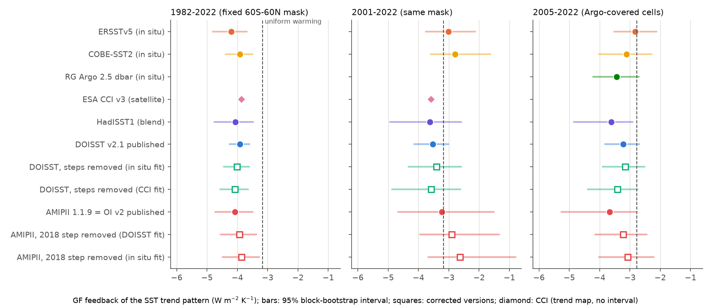
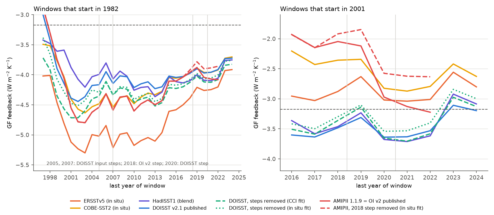
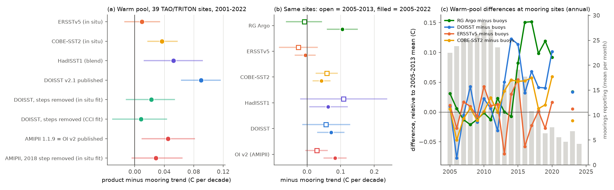

# In a CAM4 Green's function, DOISST mean steps change the 1982-2022 SST-pattern feedback by at most 0.17 W/m2/K; the AMIPII 2018 step and a post-2013 warm-pool data conflict change 2001-2022 by 0.3-0.8

## Summary

**Question.** Campaign studies found mean steps in NOAA Daily OISST v2.1 (DOISST) at input changes. These steps remove the 1982-2022 cooling of the east equatorial Pacific and of 50-60S (sci:sha256:9e1a3e72). They also found an undocumented cold step in mid-2018 in NOAA OI SST v2, the post-1981 source of the AMIPII (PCMDI-AMIP) model forcing. That study did not calculate a radiative feedback. The east Pacific, the Southern Ocean and the West Pacific warm pool control the "pattern effect", so the question is important for feedback estimates. We asked:
1. How much do the known SST-product artifacts change the radiative feedback that the observed SST trend pattern implies?
2. Which differences between SST products are larger than the artifacts, and can independent in situ data decide between them?

**Approach.** We convolved monthly SST anomalies with the published CAM4 radiative-feedback Green's function (GF) of Dong et al. (2019). This gives a global net top-of-atmosphere radiation anomaly N(t) and a global near-surface air temperature anomaly T(t) for each SST record. The GF feedback of a period is lambda = trend(N) / trend(T). We used a fixed ice-free 60S-60N mask (30,025 one-degree cells on 5-degree boxes; the mask of sci:sha256:9e1a3e72). The SST records were:
- published DOISST v2.1, OI v2 and the AMIPII forcing file PCMDI-AMIP 1.1.9;
- ERSSTv5 and COBE-SST2 (in situ only) and HadISST1;
- ESA SST CCI v3.0.1 (satellite only), from the trend maps of sci:sha256:9e1a3e72;
- DOISST with the box-level step correction of sci:sha256:9e1a3e72 (fitted to CCI or to in situ data), and with half of that correction;
- OI v2 and AMIPII with the 2018 step removed (fitted to in situ data or to DOISST);
- the Roemmich-Gilson (RG) Argo climatology at 2.5 dbar (2005-2024). It uses no satellite data.

We calculated paired 24-month block-bootstrap intervals, exact per-step and per-region attribution, a CAM3-kernel decomposition, a variant that fills the ocean outside the mask with HadISST1 anomalies, and checks at 39 West Pacific TAO/TRITON moorings.

**Results (W/m2/K; mask variant unless stated; uniform warming of the mask gives -3.17).**
1. **DOISST mean steps have a small effect on the 1982-2022 feedback.** Published DOISST gives -3.91 (95% interval -4.25 to -3.60). Removing the steps gives -4.00 (in situ fit) and -4.08 (CCI fit). The paired differences are -0.09 (-0.20 to -0.00) and -0.17 (-0.34 to -0.03); half the correction gives -0.04 and -0.07. With the HadISST1 fill outside 60S-60N, the effect changes sign (+0.03 to +0.06). The reason: the steps warm both the warm pool (contribution -0.24 to -0.28) and the Southern Ocean (+0.24 to +0.29), and these contributions cancel. The single steps have larger effects of both signs (2005: -0.11 to +0.18; 2007: -0.12 to +0.11), and their sum is small.
2. **The 1982-2022 values of the reference products differ more than the DOISST artifact.** ERSSTv5 gives -4.20, COBE-SST2 -3.92, HadISST1 -4.06, CCI -3.87 and OI v2/AMIPII -4.08. Published DOISST (-3.91) is inside this range. Relative to uniform warming, the pattern term is -0.69 (CCI) to -1.03 (ERSSTv5). The DOISST steps change it by 11-19%.
3. **The OI v2 / AMIPII 2018 step makes the AMIP-forced feedback more negative.** The step is -0.095 C at 40-60S against in situ data (-0.073 C against DOISST). Removing it changes the AMIPII feedback by +0.59 (+0.24 to +1.46) for 2001-2022, by +0.62 for 2005-2022 and by +0.22 (+0.09 to +0.36) for 1982-2022. The DOISST-based fit gives +0.32, +0.41 and +0.15. With the HadISST1 fill the values are +0.15 to +0.45. All intervals exclude zero. The step acts through the Southern Ocean and the warm pool (Fig. 3, middle row).
4. **In 2001-2022, the products split by type.** CCI (-3.58), HadISST1 (-3.62) and DOISST (-3.53; corrected -3.40 to -3.58) give more negative values than ERSSTv5 (-3.01) and COBE-SST2 (-2.79). DOISST minus COBE-SST2 is -0.74 (-1.61 to -0.29). The DOISST step corrections do not remove this split. The warm pool (10S-10N, 110E-180) causes most of it: its contribution to DOISST minus ERSSTv5 is -0.47 of -0.52.
5. **The two in situ systems disagree about the warm pool after 2013.** At the 39 moorings, DOISST warms faster than the buoys by +0.090 C per decade (+0.064 to +0.116) in 2001-2022, OI v2 by +0.045, HadISST1 by +0.052, COBE-SST2 by +0.037 and ERSSTv5 by +0.010. Argo (RG) at the same sites drifts against the buoys by -0.008 (-0.061 to +0.042) in 2005-2013 and by +0.105 (+0.061 to +0.149) in 2005-2022. The divergence starts in 2014-2015, when the number of reporting West Pacific moorings fell from about 27 (2011) to 6-11 (2017-2023). On Argo-covered cells, RG gives a 2005-2022 warm-pool trend of 0.256 C per decade, like DOISST (0.262) and more than ERSSTv5 (0.178) and COBE-SST2 (0.185). RG gives a GF feedback of -3.44 (-4.22 to -2.71) for 2005-2022 and -3.04 for 2005-2024. ERSSTv5 is less negative than RG by +0.50 (+0.22 to +0.80) for 2005-2024, and COBE-SST2 by +0.31 (+0.07 to +0.58). Thus Argo supports the satellite-type values and the moorings support ERSSTv5. We cannot say which in situ system is correct.

**Conclusion.** For long periods (1982-2022), the published DOISST artifacts do not change the GF-implied feedback by more than the spread of the reference products. For the CERES era, two other problems are larger: the 2018 step in the AMIPII forcing (0.15-0.6 W/m2/K) and an unresolved post-2013 disagreement about warm-pool warming between moorings and Argo (about 0.1 C per decade, or 0.3-0.8 W/m2/K in this GF). Studies that compare AMIP-type simulations or observed feedbacks over 2001-2022 must examine these two problems.

**Figure 1.** GF feedback of the SST trend pattern by product. Left: 1982-2022; middle: 2001-2022 (fixed 60S-60N mask); right: 2005-2022 on Argo-covered cells, with RG Argo. Bars: 95% block-bootstrap intervals. Squares: corrected versions. Dashed line: uniform warming of the same cells.

**Figure 2.** GF feedback against the last year of the window, for windows that start in 1982 (left) and in 2001 (right). The AMIPII versions with and without the 2018 step separate after 2018. In the 2001 windows, the satellite-type products (DOISST, HadISST1) stay about 1 W/m2/K more negative than OI v2 and the in situ products.

**Figure 3.** Left: trend difference maps (C per decade). Right: the contribution of each 5-degree box to the feedback difference; the sum over boxes is the exact feedback difference. Top: DOISST minus DOISST with steps removed (CCI fit), 1982-2022. Middle: AMIPII minus AMIPII with the 2018 step removed, 2001-2022. Bottom: DOISST minus ERSSTv5, 2001-2022.

**Figure 4.** Warm-pool checks. (a) Product minus mooring SST trend, 2001-2022, 39 TAO/TRITON sites (10S-10N, 110E-180). (b) The same for 2005-2013 (open) and 2005-2022 (filled), with RG Argo. (c) Annual differences at the mooring sites relative to their 2005-2013 mean, and the mean number of reporting moorings (grey bars).

## Main table

GF feedback lambda_tr (W/m2/K). "mask": anomalies only inside the fixed 60S-60N ice-free mask (95% interval in parentheses). "fill": the ocean outside the mask has HadISST1 anomalies in all versions. "Argo cells": 2005-2022, cells with RG Argo data in all months (93% of the GF temperature weight of the mask). From `files/results/main_table.csv`.

| Version | 1982-2022 mask | 1982-2022 fill | 1982-2024 mask | 2001-2022 mask | 2001-2022 fill | 2005-2022 Argo cells |
|---|---|---|---|---|---|---|
| ERSSTv5 | -4.20 (-4.81 to -3.69) | -3.25 | -3.91 | -3.01 (-3.76 to -2.13) | -2.30 | -2.82 |
| COBE-SST2 | -3.92 (-4.39 to -3.49) | -3.13 | -3.70 | -2.79 (-3.60 to -1.62) | -2.11 | -3.12 |
| ESA CCI v3 (trend maps) | -3.87 | | -3.62 | -3.58 | | |
| RG Argo 2.5 dbar | | | | | | -3.44 (-4.22 to -2.71) |
| HadISST1 | -4.06 (-4.76 to -3.49) | -2.98 | -3.75 | -3.62 (-4.94 to -2.59) | -2.51 | -3.61 |
| DOISST v2.1 published | -3.91 (-4.25 to -3.60) | -3.24 | -3.72 | -3.53 (-4.14 to -3.01) | -2.84 | -3.22 |
| DOISST, half correction, in situ fit | -3.95 | -3.21 | -3.74 | -3.48 | -2.71 | |
| DOISST, half correction, CCI fit | -3.99 | -3.22 | -3.77 | -3.55 | -2.75 | |
| DOISST, steps removed, in situ fit | -4.00 (-4.45 to -3.60) | -3.18 | -3.76 | -3.40 (-4.33 to -2.59) | -2.55 | -3.16 |
| DOISST, steps removed, CCI fit | -4.08 (-4.57 to -3.65) | -3.21 | -3.83 | -3.58 (-4.88 to -2.62) | -2.63 | -3.41 |
| AMIPII 1.1.9 (= OI v2) published | -4.08 (-4.73 to -3.49) | -3.10 | | -3.22 (-4.67 to -1.52) | -2.32 | -3.67 |
| AMIPII, 2018 step removed (DOISST fit) | -3.93 | -3.02 | | -2.90 | -2.17 | -3.22 |
| AMIPII, 2018 step removed (in situ fit) | -3.86 (-4.49 to -3.28) | -2.95 | | -2.63 (-3.67 to -0.79) | -1.95 | -3.08 |

The intervals of single products are wide because ENSO variability enters the trends. The paired differences between versions of one product have much narrower intervals (`files/results/feedback_differences.csv`, `files/results/argo_differences.csv`). OI v2 and AMIPII 1.1.9 give the same values to 0.002 W/m2/K. AMIPII adds only its mid-month interpolation and ends in 2022-12.

## Methods

**SST records and mask** (`01_grid1deg.py`, `02_boxes.py`; adapted from sci:sha256:9e1a3e72). All products go to a common 1-degree grid for 1982-2025. The mask has 1-degree ocean cells between 60S and 60N with a monthly SST above -1.0 C in every month of DOISST, ERSSTv5, COBE-SST2, HadISST1 (1982-2024) and OI v2 (1982-2022): 30,025 cells. Area-weighted 5-degree box means are calculated over these cells. Anomalies are relative to the 1991-2020 calendar-month means.

**Green's function** (`03_gf_weights.py`). The Dong et al. (2019) GF gives, for each CAM4 grid cell c (1.9 x 2.5 degrees), the change of global-mean net TOA radiation (TOA, W/m2, positive down), cloud radiative effect and global-mean near-surface air temperature (TAS) for a 1 K warming of the ocean in c. A second file gives a CAM3-kernel decomposition (Planck, lapse rate, water vapour, albedo, cloud). For an anomaly field, dX = sum over c of G(c) SSTA(c). SSTA(c) is the area-weighted mean anomaly of the 1-degree ocean cells in c. Cells outside the mask count as zero, or have HadISST1 anomalies in the fill variant. The mask contains 96% of the global TOA sensitivity and 64% of the TAS sensitivity. Uniform warming of all ocean gives lambda = -2.13; uniform warming of the mask gives -3.17. The 5-degree box weights are the sums of the cell weights. The box series agree with the 1-degree cell series (correlation 1.000, standard deviation ratio 0.999-1.003).

**Feedback metrics** (`04_series.py`, `05_metrics.py`). For a window, lambda_tr = trend(N)/trend(T) (monthly OLS). This equals the GF feedback of the trend map. lambda_reg is the OLS slope of annual N on annual T; it is in `feedback_windows.csv`. The pattern term is lambda_tr minus the uniform-warming value of the same cells. Intervals: residuals about the two linear trends are resampled in 24-month moving blocks, with the same blocks for all versions (paired), 2,000 draws.

**Corrections.** The DOISST box step correction of sci:sha256:9e1a3e72 is rebuilt from its smoothed step sizes at six dates (1985-01-04, 2005-01-01, 2007-01-01, 2020-07-07, 2021-10-01, 2023-04-01). It reproduces that study's corrected boxes to 2e-6 C. The per-step attribution removes one step at a time. The OI v2 / AMIPII 2018 step is a box fit of a constant plus a step at 2018-06-01 to the product minus the in situ mean (ERSSTv5, COBE-SST2, HadSST4.2) over 2010-2022, or to the product minus DOISST over 2013-06 to 2020-06 (before the DOISST 2020 step). The fit is smoothed in space with the 10-degree kernel of sci:sha256:9e1a3e72.

**Regional attribution** (`06_trendmaps_regions.py`). For trend maps b_a and b_b, the contribution of a box to lambda_a - lambda_b is (w_N - lambda_b w_T)(b_a - b_b) / sum(w_T b_a). The sum over boxes is exact. The same script applies the GF to the published trend maps of sci:sha256:9e1a3e72, which include CCI. Our own trends reproduce those maps exactly (difference 0.000 C per decade for 1982-2022).

**Moorings** (`07_moorings.py`, `07b_argo_at_moorings.py`). We used GTMBA daily SST (from sci:sha256:87b87a67) at 39 sites in 10S-10N, 110E-180, and 61 sites in the east (10S-10N, east of 180). A buoy month needs at least 20 valid days. Each product is sampled in the 1-degree cell of the mooring, and RG Argo is sampled at the same cell. The model diff(b, m) = a_b + f(m) is solved by alternating means. We report the OLS trend of f in months with at least 5 buoys, with 24-month block-bootstrap intervals.

**Argo** (`08_argo.py`). RG temperature at 2.5 dbar (2019 release for 2004-2018 plus monthly extensions to 2025-12) on the cells of the mask with data in all months of 2005-2024 (28,211 cells). Boxes with less than 50% coverage are removed for all versions. All versions use the same cells and 2005-2024 anomalies. A test for a step at the change to the monthly extension files (2019-01) found none against ERSSTv5 or COBE-SST2 (-0.03 to +0.02 C).

## Further results

- **Mechanism (kernel decomposition, `components.csv`).** Most product differences are in the shortwave cloud term. For 2001-2022, CRESW is -2.45 (DOISST) against -1.65 to -1.99 (COBE-SST2, ERSSTv5), and the lapse-rate term is +0.21 against +0.64 to +0.74. Both terms follow the warm-pool trend, which is the GF's strongest negative region.
- **End-year dependence (Fig. 2).** For windows from 1982, all products show a less negative feedback as the window extends past 2014 (DOISST -4.23 for 1982-2013, -3.72 for 1982-2024). The AMIPII versions with and without the 2018 step separate by 0.1-0.2 after 2019.
- **Regression estimate.** lambda_reg (annual N on annual T) shows the same order of differences with about half the amplitude, because ENSO-scale variability dominates the regression. For example, the 2018 step changes lambda_reg for 2001-2022 by +0.33 (in situ fit).
- **East Pacific.** At the east-Pacific moorings, DOISST drifts by +0.070 C per decade (1993-2022; corrected +0.008 to +0.012). This agrees with sci:sha256:9e1a3e72. Argo drifts against these buoys by +0.059 (2005-2022), so the post-2013 in situ disagreement also exists in the east, with a smaller size.

## Interpretation

DOISST adds false warming at nearly all latitudes, with the largest values in the east Pacific and the Southern Ocean (Fig. 3, top). In the CAM4 GF, warming of the warm pool makes the feedback more negative. Extra warming in other regions, mainly at high southern latitudes, increases T more than N and makes the feedback less negative. The DOISST steps add warming to both, so their net effect on the feedback is small and its sign depends on the treatment of the polar ocean. Thus the steps are important for regional trend statements (sci:sha256:9e1a3e72) and for the global mean (sci:sha256:b93b5f64), but not for the GF-implied feedback over 1982-2022.

The AMIPII 2018 step is different: it cools the Southern Hemisphere at the end of the record. It decreases T and also changes the warm-pool trend, so the AMIP-forced feedback becomes more negative. AMIPII files that reach past mid-2018 (PCMDI-AMIP 1.1.6 and later) contain this step. AMIP simulations that use them for the 2001-2022 period will show a stronger "pattern effect" than the in situ data support. In this GF the excess is 0.15-0.6 W/m2/K.

The largest uncertainty for the CERES era is not a known product artifact. It is the warm-pool trend after 2013. The products that use satellite data (DOISST, OI v2, HadISST1, CCI) and Argo show more warm-pool warming than the remaining moorings and ERSSTv5. The disagreement starts when the TAO/TRITON array in the West Pacific declined. The moorings measure at about 1 m at fixed points. RG maps profiling floats at 2.5 dbar with smoothing. Either system can be biased after 2014. Changes in the buoy sample, sensor changes, or the mapping of sparse floats near the equator are possible causes. We did not test them. Until this disagreement is resolved, a 2001-2022 SST-pattern feedback from any single product has an observational uncertainty of about 0.5 W/m2/K in this GF, more than the effect of the known DOISST artifacts.

## Limitations

- **One Green's function.** All numbers use the CAM4 GF of Dong et al. (2019). Published GF studies show large model differences in the magnitude of regional sensitivities, but they report the West Pacific ascent region as the strongest negative sensitivity in all models. The signs of our main results follow from this common feature. Their magnitudes are CAM4-specific. We could not use a second GF: the CC0 GF4ACE data on Dryad gave HTTP 403 from this host, and we did not use data with non-commercial terms.
- **SST only, 60S-60N.** The GF is applied only to SST anomalies in the fixed ice-free mask (or with a common HadISST1 fill). Sea ice and land are not part of the GF. The polar splices of DOISST (sci:sha256:7102a214) are outside this analysis.
- **The GF feedback is not the observed feedback.** It is the CAM4 response to the SST pattern alone. It is not a CERES measurement, and it does not include forcing.
- **Corrections are estimates.** The DOISST and 2018-step corrections are fitted to reference products that have their own errors. The DOISST correction size is uncertain by a factor of about two (sci:sha256:e2e438dd); the half-correction versions cover this. The 2018-step size depends on the reference (in situ or DOISST). CCI cannot confirm it (sci:sha256:9e1a3e72).
- **CCI** is available here only as four trend maps, so it has no interval and no end-year curve.
- **Moorings and Argo are not fully independent of the products.** Moorings feed all products. Near-surface Argo feeds ERSSTv5 and DOISST since 2016. RG uses only Argo. The mooring sample in the warm pool is small after 2014 (6-11 reporting sites).
- **Intervals** describe sampling of internal variability about linear trends. They do not include GF or reference uncertainty.

## Context in the campaign

This study adds the radiative consequence to the campaign series on SST product artifacts: variance steps (sci:sha256:f50dc28f, 87b87a67, 69a00227, cfeb640f, 819eea65, 0d84af9c, 5d9b238d), front statistics (4e3a13fa, 5d8902f2, 5003de8e), mean steps and their consequences (b93b5f64, 645d0681, dbf09341, 9fca62cd, e2e438dd), polar splices (7102a214), robustness bounds (825d6796, 77b0a90c), coral heat stress (ef9c2a57), and trend patterns (9e1a3e72). sci:sha256:9e1a3e72 listed "no radiative calculation" as a limitation. Here we close it. The new findings are:
- (a) the DOISST mean steps change the GF feedback little because their warm-pool and Southern Ocean effects cancel;
- (b) the AMIPII 2018 step biases AMIP-type 2001-2022 feedbacks by 0.15-0.6 W/m2/K;
- (c) the 2001-2022 feedback splits by product type, and a post-2013 disagreement between moorings and Argo in the warm pool causes most of the split.

## Data and licences

No raw third-party file and no copy or map of the Green's function is in this publication. `files/NOTICE_external_data.md` lists all sources, terms and required attributions. `files/provenance/data_provenance.json` gives the shared dataset paths, source URLs and SHA-256 hashes (all hashes were checked again on 2026-11-11), the GF and RG download hashes, the hashes of the files read from the signed bundles sci:sha256:9e1a3e72 and sci:sha256:87b87a67, and software versions.
- Shared campaign datasets (paths under `/mnt/dell-data/shared_datasets/`): `noaa-psl-oisst-v21-monthly-complete-20261109-dba314`, `psl-noaa-oisst-v2-1deg-sst-mnmean-20261110`, `pcmdi-amip-1-1-9-tos-20261111`, `ersst-v5-psl-sst-mnmean-20261108-olen`, `psl-cobe-sst2-sst-mon-mean-20261110`, `hadisst1-sst-nc-20261108-olen`, `hadsst-4.2.0.0-median-metoffice-20261110`, and `rg-argoclim-temperature-2019-20261111` (added by this job with the campaign dataset helper; SHA-256 b618ec96...b4c, equal to the hash recorded in sci:sha256:b93b5f64).
- External: the Dong et al. (2019) GF (two netCDF files, https://atmos.ucla.edu/yue-dong/data; no licence stated, not redistributed) and the 84 RG Argo monthly extension files (https://sio-argo.ucsd.edu/RG/).
- Bundled derived files: global monthly GF series per version (`gf_series_monthly.csv.gz`), feedback tables, trends and regional sums (`files/results/`), and figures.

## Reproduction

Python 3.12 with numpy, pandas, netCDF4 and matplotlib (versions in `data_provenance.json`). Copy `files/code/` to `W/code` in a work folder W. Link `W/../datasets` to the shared campaign datasets, or download the files at the URLs in the provenance file into folders with the same names. Link `W/../campaign` to a folder with the two cited bundles. Then run `bash W/code/run_all.sh`. The script reads the prior inputs with `sci read`, downloads the GF and the RG monthly files into `W/ext` and `W/scratch` (never into a signed draft), and runs every step. The 1-degree gridding is I/O bound (about 20 minutes on network storage). All other steps take a few minutes on 2 CPUs.

## Provenance

- Campaign 11_07_2026; job `sci-1107-dell-earth-and-ocean-sciences-aebdb0e85571`; topic earth-and-ocean-sciences; machine dell; account claude-myxtap.
- Analysis and text by the AI model Claude Opus 5.5 (`claude-opus-5-5`), working in an isolated worktree. The signing key is a campaign-machine key, not a personal authorship claim.
- Work date 2026-11-11. Data versions and hashes: `files/provenance/data_provenance.json`.
