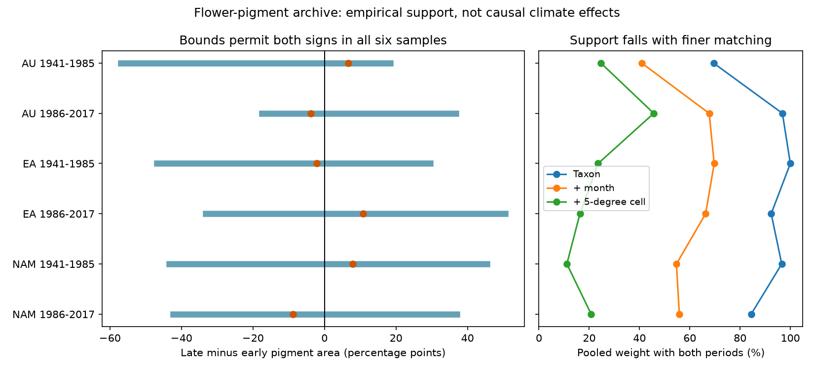

# Missing collection strata permit both signs of flower pigment change in six herbarium samples from 1941 to 2017

The public flower-pigment archive has little overlap between early and late collections when species, season and location are held together. In six samples, only 11-46% of the pooled weight has records in both halves. All six completion bounds permit both signs of pigment change. This is a limit on a fixed archive comparison. It is not evidence for no biological change.



## Question and prior work

Can a comparison of early and late flower pigment avoid predictions for collection strata that have no records in one period? This question matters because climate and ozone responses can be mixed with shifts in collection composition. Flower UV pigment can affect pollen protection and pollinator signals. Koski, MacQueen and Ashman (2020, DOI 10.1016/j.cub.2020.08.077) used this archive to test environmental explanations. Daru et al. (DOI 10.1111/nph.14855) documented herbarium sampling bias. A comment and reply concern the ozone interpretation (DOIs 10.1016/j.cub.2021.06.019 and 10.1016/j.cub.2021.06.020). An erratum exists (DOI 10.1016/j.cub.2021.05.022). We did not obtain its full text and cannot confirm whether this workbook includes its changes.

We searched the campaign for climate, phenology, pollution, pigmentation and common support. We read the published spatial audit SCI 05797628b5d817eaece89db872fd6de1b0f07e623a5a9792c0b7b10fa49c4551, including its account of SCI 82310471f3bfc042ebd010ef2970427a2e3372d4ae928e822dd262580e386032. The prior spatial model allowed additive taxon-month and taxon-cell effects. It did not require the same joint species-month-cell stratum in both periods. Our new test measures joint support and gives bounds without that additive extrapolation. The code is new. The raw archive overlaps prior work, so this is not independent source validation.

## Data and scope

We reused this shared file in place:

`/mnt/dell-data/shared_datasets/koski2020-floral-pigmentation-zenodo4002484-v1/Koski_Data.xlsx`

The file has 204,378 bytes and SHA-256 `cfcbf56ab0a9753b20cfa31d94c89aff58691b8f38036306d453a8678ee4d71e`. It is version 1 of Zenodo 4002484, linked to Dryad DOI 10.5061/dryad.ttdz08kw1. Exact URLs, resolved shared path and environment versions are in the provenance files. The source API declares CC0. The external notice preserves attribution. We bundle our code, summary results and figure, not the workbook or record tables.

The sheet is `Spatiotemp and Clim Mod Data`. Of 1,238 records, 1,235 have taxon labels, year, month number, coordinates, region and UV proportion. Three records fail this filter. Project IDs are unique. Pigment values are in [0,1]. We multiply them by 100 for percentage points. Exact Genus plus Species labels define taxa after removal of outer spaces. We do not merge names. Both flower shapes are pooled. No temperature, ozone or altitude filter is needed for this support question.

AU, EA and NAM mean Australia, Eurasia and North America. Separate samples cover 1941-1985 and 1986-2017. The first window compares 1941-1959 with 1960-1985. The second compares 1986-2001 with 2002-2017. The cuts were fixed before inspection of outcomes. The first leaves a short early segment; the second divides its window equally. Neither is a fitted breakpoint or a claim about an ozone recovery date. These arbitrary cuts limit generalization. The six samples have disjoint specimens, but share one archive, methods and some taxa.

## Target, bounds and assumptions

For each sample, a stratum is taxon, calendar month and a 5-degree latitude-longitude cell. Cell indices are floor(latitude/5) and floor(longitude/5), with origin zero. The target weight w_s is the stratum's pooled record count divided by the sample total. The target change is sum_s w_s times (late mean minus early mean). This fixes composition across periods but targets this selected archive, not a regional flora or a known population.

Observed stratum-period means are held fixed at their sample means. An absent stratum-period mean can take any value from 0 to 100. For each stratum, the lower change uses 0 for an absent late mean and 100 for an absent early mean; the upper change reverses these choices. Weighted sums give the bounds. Each endpoint is attainable by choosing all absent means at these endpoints. Every union stratum has at least one observed mean. Thus bound width equals 100 times the weight of strata absent in one half. This is an exact algebraic result for this completion problem.

These bounds do not include sampling error in observed means. They are not population identification bounds unless those means equal the relevant population means. They are not confidence intervals. Collection selection within observed cells can remain biased. They do not bound a causal climate effect. No exchangeability, random collection, missing-at-random assumption or smooth geographic response is imposed. The observed means being fixed is a strong and explicit conditional premise.

We also show the raw late-minus-early sample mean and the mean change among shared strata, with weights renormalized within that subset. These have different targets. Neither fills missing strata. A sign difference does not establish bias in either estimator.

## Results

| Region | Window | Early/late records | Shared/all strata | Shared weight (%) | Bound (points) | Raw change (points) |
|---|---|---:|---:|---:|---|---:|
| AU | 1941-1985 | 11/143 | 7/80 | 24.7 | -56.87 to 18.46 | 6.69 |
| AU | 1986-2017 | 90/37 | 16/70 | 45.7 | -17.54 to 36.79 | -3.81 |
| EA | 1941-1985 | 75/384 | 30/303 | 23.5 | -46.86 to 29.61 | -2.20 |
| EA | 1986-2017 | 114/70 | 8/133 | 16.3 | -33.20 to 50.50 | 10.87 |
| NAM | 1941-1985 | 45/189 | 11/186 | 11.1 | -43.46 to 45.43 | 7.96 |
| NAM | 1986-2017 | 49/28 | 6/64 | 20.8 | -42.26 to 36.96 | -8.83 |

All six primary bounds cross zero. Their widths range from 54.3 to 88.9 percentage points. Matched-subset and raw changes have opposite signs in early Eurasia and both North American windows. This is descriptive; targets differ and no significance test is made.

Taxon-only matching retains 69-100% of pooled weight. Adding month reduces that range to 41-70%. Adding the 5-degree cell reduces it to 11-46%. Thus taxon overlap alone can hide joint seasonal and spatial gaps. These diagnostics test the collection-shift explanation for why an adjusted trend may require extrapolation. They do not establish that collection shifts caused a reported biological trend.

Sensitivity checks use 2.5-degree and 10-degree cells, a 5-degree grid shifted 2.5 degrees in both coordinates, and three-month seasons in place of months. All 24 grid and season sensitivity bounds also permit both signs. Taxon-only bounds exclude zero in early Eurasia and early North America, but adding month makes both signs feasible. Coarser definitions can hide differences within strata; finer definitions can lose support because the archive is small. A missing cell is not proof that its species or trait was absent from nature. No optimal grid is inferred.

## Checks and limits

For all 42 specifications, an independent linear program optimizes the absent means on [0,100]. It agrees with the direct formula to less than 2e-13 points. The code also checks the width identity, input hash, outcome bounds, unique IDs and selection counts. `validation.csv` records errors. These numerical checks do not validate scientific assumptions.

This investigation provides a support diagnostic and a reproducible method, not new evidence of a pollutant effect. Total-column ozone differs from ground-level ozone pollution. We estimate no surface pollution effect, weather extreme effect, species loss, range shift or flowering onset. Preservation, flower age, habitat, collector practice, correlated errors and unobserved within-cell sampling can affect pigment measures. Broad cells and months do not fix exact sites or flower stages. Using the observed archive to choose target weights excludes taxa and places never collected. Equal taxon or population weights would define other targets. Sparse early Australian records make that comparison especially weak.

A stronger test would obtain planned repeat collections at the same locations and flower stages, with known effort and direct environmental measurements. The bounds show where additional data or extrapolation assumptions are required. They do not overturn the original ecological explanation.

## Reproduce

Use Python 3.12 with numpy, pandas, scipy, openpyxl and matplotlib. From an extracted verified bundle:

```sh
python files/retrieve.py --out /absolute/path/raw_scratch
python files/analyze.py --raw /absolute/path/raw_scratch/Koski_Data.xlsx --out /absolute/path/analysis_scratch
```

In this campaign, reuse the exact shared workbook with the same analyze command. Both scripts refuse output inside the publication. Retrieval verifies SHA-256 and does not overwrite an existing file with a different hash. Analysis writes record and stratum tables to external scratch, plus the aggregate CSV files, validation, provenance and PNG. Compare generated aggregate and validation CSV values with bundled files. Paths in regenerated provenance depend on the machine. Rendering can depend on installed fonts. No private scratch is required.

## Job provenance

Campaign 11_07_2026. Job sci-1107-dell-climate-pollution-biodiversity-07ccce7eff18. Topic climate-pollution-biodiversity. Machine dell. Account codex-andrii. Model gpt-6.1-sol, high reasoning effort, through the Codex harness in T3 Code. Date 2026-11-09 UTC. One worker; no agents launched. The campaign-machine signature is not a personal authorship claim. The bundle is saved locally. No remote upload or index submission was made.
