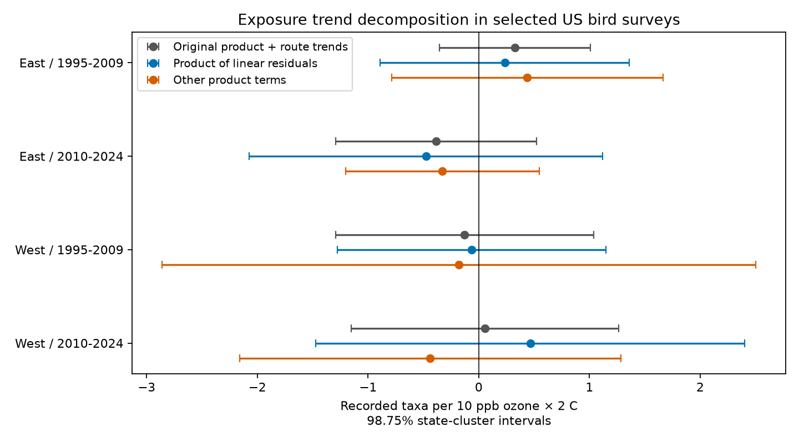

# Linear exposure residuals gave no clear ozone and warmth interaction in four US bird samples in 1995-2024

We tested whether an ozone and warmth interaction came from year-to-year exposure changes or from terms that include route trends. We used 22,982 selected US bird surveys in four region and period samples from 1995 to 2024. We fitted separate linear ozone and temperature trends for each route. We separated the product of the exposure residuals from the rest of the original product. Models controlled route-observer groups, region-year groups, route outcome trends and survey conditions. All four corrected intervals for the residual product included zero. No four-test adjusted comparison clearly separated its coefficient from the remaining product coefficient. Thus, this test did not establish a repeated interaction or assign the earlier western estimate to slow trends. Long-record selection, few western state clusters, coarse exposure and detection bias limit inference. This is a model diagnostic on reused data, not a causal climate test. The package gives the panel, code, decomposition, source hashes and independent numerical checks.



## Question and prior work

Does the ozone by warmth estimate reflect annual exposure changes, or terms that include linear exposure trends? A product can contain both. Adding a trend to the outcome model does not in general remove the trend terms from the product. This distinction can matter when ozone falls while temperature rises.

Liang et al. reported negative ozone associations with bird counts in eBird and conservation benefits from air quality rules (doi:10.1073/pnas.2013568117). Brown et al. reviewed time trends and dependence in climate ecology (doi:10.1111/j.1365-2486.2011.02531.x). These papers motivate a temporal check. They do not show that this decomposition removes confounding.

Campaign SCI 2603c41c supplied a BBS ozone panel. SCI 1476b687 tested prior ozone by seasonal warmth and found a negative early western estimate that did not repeat across regions and periods. Its route-trend check was uncertain. SCI a8905e94 found that one state supplied most of the early western partial leverage. We reviewed these signed reports. Our test separates product components and changes the sample to long route records. It is not an independent biological replication or a new statistical estimator. We searched the campaign for phenology, climate, pollution, ozone and detrend before fitting. We saved files/PLAN.txt before the new outcome fits. This is exploratory work selected with knowledge of earlier results.

## Data and selection

We verified SCI 1476b68714a3433f1a6efc168fb650faa15d11997d8c0c4e96b40e4cefde95b4 and reused its exact files/analysis_panel.csv.gz. The full input has 32,458 eligible rows. It combines accepted standard US Breeding Bird Survey runs, EPA AQS ozone, NOAA county weather and survey conditions. The BBS source is the 2025 release for 1966-2024, doi:10.5066/P14SNUV4. It is not the newer 2026 release in the current shared store.

Prior ozone is the previous May-September mean of daily maximum eight-hour ozone. It uses distance-weighted monitors within 50 km of route starts, with a source coverage rule of at least 75% of calendar days. The source rule counts site-day rows and averages nonmissing concentration; we did not re-audit raw missingness. Temperature is previous May-June mean daily maximum temperature, from approximate county assignment. The windows only partly overlap. Temperature is not extreme heat. Current exposures and rainfall are also inherited. The panel rounds source numbers to five significant digits.

The parent required valid observers, dates, survey time, duration, temperatures, wind and sky codes. It retained much less of the accepted western survey network than of the eastern network. We retain its eligible sample, then require at least eight records per route and at least ten years between the first and last survey in each cell. We remove singleton route-observer and Bird Conservation Region-year groups, repeat the route rule, and continue to stability. This limits unstable trend fits, but selects long-running routes. The ten-record check is more restrictive.

East means longitude above -100 degrees; West means longitude at or below -100 degrees. Survey periods are 1995-2009 and 2010-2024. There are no shared survey records across cells. Routes can occur in both periods. Regional climate and common source methods can link cells. Thus, these are separate samples, not four independent experiments. There are no 2020 surveys in this panel. Prior exposures span 1994-2023.

No shared raw file was read or downloaded in this job. We inspected relevant shared dataset names and reused the signed evidence. files/provenance.json gives the exact campaign path, resolved path, ZIP hash, panel entry hash and byte count. files/raw_provenance.json and files/upstream_provenance.json give inherited raw paths, versions, URLs and hashes. Those historical paths may no longer exist after the disk failure. We do not claim to have checked their bytes. No failed disk or sibling private workspace was used.

## Method

O is prior ozone minus its inherited full-period route mean, divided by 10 ppb. H is the corresponding temperature anomaly divided by 2 C. We keep these inherited means fixed. Within each final route and cell, regress O and H separately on an intercept and survey year. Write O = L_O + u and H = L_H + v. Each L is a fitted line; each residual has zero mean and zero linear trend within its route.

The identity is OH = uv + u L_H + v L_O + L_O L_H. We call uv the residual product, or fast in machine-readable files. This name does not prove that it measures only fast physical processes. Set Q = OH - uv. The main model gives uv and Q separate coefficients. Q combines cross terms and the product of fitted lines. It is not a pure climate trend. Centering choices can change these other components. The residual product itself is unchanged by a route-specific constant exposure shift.

Controls are the parent O and H main terms, H squared, current temperature and its square, prior and current rainfall, current ozone, survey day and its square, start time, elapsed time, start and end temperature, wind and sky classes, assistant class and first-observer-year status. Every main fit also includes route-observer intercepts, Bird Conservation Region-year intercepts and a linear outcome trend for each route. Route-observer intercepts control fixed route and observer differences, but not all changes in skill or detection. Survey controls may also respond to environmental conditions; this is a conditional association.

We compare the model with a single OH term on the identical sample, with and without route outcome trends. Equality of the two split coefficients recovers the single-product model with trends. The equality test therefore asks if this restriction is contradicted by the selected data. It does not test whether the difference is small enough to ignore. A sensitivity model separates all four product terms. We also use a ten-record route rule and log(1 + total counted birds) as a secondary outcome.

We use ordinary least squares after nuisance projections. State-cluster CRV1 errors permit arbitrary within-state dependence. They do not allow all dependence across states. The correction counts the exact intercept rank plus regressor rank and one trend per route. Some trends are redundant, so this is a conservative upper bound on nuisance rank. Intervals use Student t with G-1 degrees of freedom. Four primary residual-product intervals use 98.75% limits. Four richness equality tests use Holm adjustment separately within each record threshold. Other intervals are exploratory and do not correct for campaign-wide selection. Exposure fits are treated as fixed design; uncertainty is conditional on this empirical decomposition.

## Results

The primary residual-product estimates are in recorded taxa per 10 ppb ozone and 2 C. These are coefficient scales; they are not the total change from increasing both exposures.

| Sample | Surveys | Routes | States | Estimate | 95% interval | Four-test interval |
|---|---:|---:|---:|---:|---|---|
| East / 1995-2009 | 9,659 | 767 | 34 | +0.236 | -0.631 to +1.102 | -0.890 to +1.361 |
| East / 2010-2024 | 9,995 | 836 | 36 | -0.476 | -1.706 to +0.754 | -2.072 to +1.120 |
| West / 1995-2009 | 1,184 | 101 | 9 | -0.065 | -0.938 to +0.807 | -1.278 to +1.148 |
| West / 2010-2024 | 2,144 | 189 | 14 | +0.464 | -0.979 to +1.907 | -1.470 to +2.399 |


All four corrected intervals include zero. These results do not establish a common negative interaction. Wide intervals permit material effects in either direction. They do not establish that pollution is safe.

| Sample | Original product | Original + route trends | Residual product | Other terms | Equality test: Holm p |
|---|---:|---:|---:|---:|---:|
| East / 1995-2009 | +0.300 | +0.328 | +0.236 | +0.439 | 1.000 |
| East / 2010-2024 | -0.282 | -0.384 | -0.476 | -0.328 | 1.000 |
| West / 1995-2009 | -0.111 | -0.127 | -0.065 | -0.179 | 1.000 |
| West / 2010-2024 | -0.174 | +0.055 | +0.464 | -0.438 | 1.000 |


No Holm-adjusted equality test excludes equal coefficients at 5%. This does not show that the coefficients are equal. It also does not assign the earlier western estimate to the fitted exposure lines. The comparison with earlier publications changes both the sample and model. The same-sample baselines above separate those changes within this analysis.

## Sensitivity and numerical checks

| Sample | Minimum | Model | Residual-product estimate | 95% interval |
|---|---:|---|---:|---|
| East / 1995-2009 | 8 | split | +0.236 | -0.631 to +1.102 |
| East / 1995-2009 | 8 | four | +0.265 | -0.588 to +1.118 |
| East / 1995-2009 | 10 | split | +0.254 | -0.612 to +1.120 |
| East / 1995-2009 | 10 | four | +0.285 | -0.563 to +1.132 |
| East / 2010-2024 | 8 | split | -0.476 | -1.706 to +0.754 |
| East / 2010-2024 | 8 | four | -0.534 | -1.719 to +0.650 |
| East / 2010-2024 | 10 | split | -0.345 | -1.528 to +0.839 |
| East / 2010-2024 | 10 | four | -0.401 | -1.544 to +0.743 |
| West / 1995-2009 | 8 | split | -0.065 | -0.938 to +0.807 |
| West / 1995-2009 | 8 | four | -0.113 | -0.955 to +0.730 |
| West / 1995-2009 | 10 | split | -0.338 | -1.337 to +0.662 |
| West / 1995-2009 | 10 | four | -0.338 | -1.300 to +0.624 |
| West / 2010-2024 | 8 | split | +0.464 | -0.979 to +1.907 |
| West / 2010-2024 | 8 | four | +0.488 | -1.020 to +1.997 |
| West / 2010-2024 | 10 | split | +0.688 | -1.950 to +3.326 |
| West / 2010-2024 | 10 | four | +0.769 | -1.966 to +3.503 |


All outcome and component estimates, including log count models and the separate cross and fitted-line terms, are in files/results.csv. These checks are exploratory. Changes in point estimates alone are not evidence that two models differ.

The algebraic identity and exposure residual orthogonality passed numerical checks. An independent sparse LSMR projection on intercept and route-trend columns checked each primary split design. It agreed with the iterative projection within the tolerances in files/validation.json. Restricting the two coefficients to equality recovered the original-product trend estimate to less than 1e-8; files/numerical_checks.json gives the errors. Saved projected matrices and IDs permit further inspection. These tests check computation, not ecological identification. For speed, the iterative algorithm removes route-observer intercepts from each route trend vector first. This preserves the nuisance column space and reduces projection iterations.

## Limits and use

The useful result is a reproducible test of whether one exposure product can represent its annual-residual and other components with a common coefficient. The current samples do not clearly reject that restriction. The test also fails to establish a repeated residual-product association. Linear detrending is a model choice; it can remove relevant slow ecological response and leave nonlinear trends. Short time spans, common weather, exposure error and limited joint support can make estimates imprecise.

A single annual roadside count cannot separate abundance, movement, activity and detection. Long-record selection, missing surveys, observer changes, monitor network changes, county weather, habitat change and other pollutants remain possible biases. There are few western state clusters. State errors may miss broad spatial dependence. Inherited rounding and unverified raw construction also limit precision. We do not test daily extremes, species distributions, ecological timing, causal climate change or air quality policy. Failure to reject an interaction is not proof of no harm or proof that trends explain an earlier signal.

## Reproduce

Install the packages in files/requirements.txt; files/environment.json records the actual versions. From an unpacked copy run:

```sh
sh files/REPRODUCE.sh /new/local/output
```

Use a new directory outside the signed publication. This uses only the included panel and needs no network or shared raw data. It writes results.csv, decomposition.csv.gz, projected designs, validation files and the PNG. Compare numeric files with this package. The independent numerical checks run in the same script. files/inherited_analyze.py preserves source projection and covariance functions; new code imports them. No campaign compute queue is required. The one-thread setting is a local performance choice.

For reconstruction from raw sources, use the retrieval and build code in the cited SCI 2603c41c and 1476b687 bundles. files/raw_source gives the inherited raw pipeline and download recipe; files/inherited_build.py and files/inherited_retrieve.py give the later survey augmentation. Match source bytes to the inherited hashes. Some source URLs are mutable and the current shared release differs. The offline reproduction from preserved evidence is the supported entry point for this result.

## Work provenance and rights

Job: sci-1107-dell-climate-pollution-biodiversity-ff137c1db7c0. Topic: climate-pollution-biodiversity. Campaign: 11_07_2026. Machine: dell. Account: codex-andrii. Model: gpt-6.1-sol with high reasoning effort in T3 Code. No child agents were used. Computation ran in the assigned isolated workspace. No shared dataset was changed. The campaign-machine signing key is not a personal authorship claim. Private keys stay outside the package. The signed bundle remains local.

New text, figures and code use the SCI baseline license. Reused SCI code and evidence retain attribution to their signed source publications. USGS, EPA, NOAA and Census sources retain attribution. External papers are cited, not relicensed.
