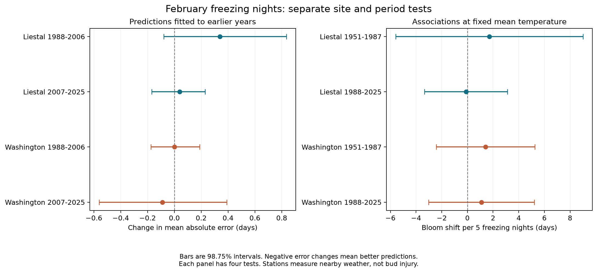

# February freezing nights gave no clear cherry bloom prediction gain at two sites in 1988-2025

Adding the number of February freezing nights to mean temperature and a time trend gave no clear prediction gain at Liestal and Washington. The four separate site and period intervals included zero. This result applies to one simple predictor and these two records. It does not show that freezing weather has no effect on flowering.

## Question and prior work

Can the number of freezing nights improve cherry bloom predictions after control for February mean temperature? A monthly mean can hide different cold and warm exposures. If those exposures matter, a cold-night count could add information. We test that explanation with predictions fitted only to earlier years. We also test whether its association with bloom date repeats across regions and time periods.

Luedeling, Kunz and Blanke (2013) studied winter chill and later heat in cherry flowering. Their work shows why the temperature range and the time of exposure can matter. Our count is a simple weather measure. It is not their chilling or heat model, a measurement of dormancy, or an estimate of damage. [Study and methods](https://pmc.ncbi.nlm.nih.gov/articles/PMC3745618/).

We searched published campaign results before we chose the precise question. We read the signed study of February temperature variation (SCI sha256:a53c5504bc5c9b166fd4e363bde9146b5b248e0a671bcf0ba00a7cdd02484b00) and the study of freezing near bloom (SCI sha256:19eeca0d858cefec579a3566da7605d74af09e83a15cf8e6f4015f609c0f59e8). They supplied the source archive and station choices. The first study tested the standard deviation of daily mean temperature. The second tested freezing near observed bloom. We test a different measure: freezing-night count in a fixed February window, with two separate later prediction periods. We use the same underlying biological records. Our result must not be counted as a new independent sample in a review of those records.

We saved the choices in [analysis_plan.txt](files/analysis_plan.txt) before we fitted the new outcome models. This was not a registered study. Prior campaign results informed our design. All planned models are reported.

## Data and observation bias

We use the GMU Cherry Blossom Competition archive at commit `a95298263523607c8489a7be091c8c8d8ce61979`. We use only its Liestal and Washington records in 1951-2025. Each site has one bloom date in each of these 75 years. Each date agrees with its supplied day of year. We remove the extra day in leap years to use a common 365-day calendar.

At Liestal, the species is Prunus avium and the threshold is 25% full bloom. Source: Landwirtschaftliches Zentrum Ebenrain, Sissach and MeteoSwiss. At Washington, the record measures 70% full bloom of Yoshino cherry and comes from EPA and the National Park Service. These are different species and observation rules. We fit separate models. We do not treat the two mean bloom dates as the same biological measure. The source archive describes these rules and rights in its data/README.md.

We use GHCN-Daily Version 3 snapshots from the shared store. The NOAA format documentation identifies version 3.35. The exact input hashes fix the data used here. Liestal uses Rheinfelden station GME00127786. Washington uses Reagan airport station USW00013743. The station coordinates reported in the earlier campaign audit are 47.5633 N, 7.7942 E, 287 m for Rheinfelden, and 38.8472 N, 77.0344 W, 4 m for Reagan. The source bloom locations are 47.4814 N, 7.730519 E, 350 m and 38.885350 N, 77.038628 W, 0 m. Thus, weather is measured near the trees, not at them. We do not adjust the weather for station moves, instruments, or observation time. [NOAA data format](https://www.ncei.noaa.gov/pub/data/ghcn/daily/readme.txt).

Every exposure window is February 1-28. We omit February 29 in all years. We require valid daily maximum and minimum temperatures on all 28 dates. We reject the missing value -9999, any nonblank quality flag, and a maximum below its minimum. The daily mean proxy is (TMAX + TMIN)/2. The monthly mean is its average over 28 days. A freezing night is a date with TMIN below 0 degrees Celsius. This label does not imply a measured night length or frozen plant tissue. A sensitivity check counts TMIN below -2 degrees Celsius. All February windows end before observed bloom: the earliest common-calendar bloom days are 75 and 74.

Liestal retains 69 years, with 33 in 1951-1987 and 36 in 1988-2025. It excludes 1951-1953 and 2015-2016, which have no valid February pairs, and 1965, which has 27 pairs. Washington retains all 75 years. Freezing counts range from 0 to 28 at Liestal and from 4 to 25 at Washington. The count and monthly mean have correlations of -0.837 and -0.865. Their strong relation limits the extra information in the count.

Fixed sites, one annual report, separate local models, and a fixed weather window reduce bias from changing report locations and numbers. They do not remove changes in observers, trees, visit schedules, the bloom rule, or urban heat. We have no visit logs or independent dates to bound such error. Complete weather selection can also cause bias. Retained weather source flags change in Washington. We preserve all flags and missing dates in the audit. A time trend does not remove every source change. Earlier campaign work found large freezing-exposure differences between nearby Washington stations. Our conclusion is conditional on the selected station. These two available long records are not a random sample of ecosystems.

## Methods

The baseline model is bloom day = intercept + time trend + February mean temperature. Time is measured in decades since 1988. The added model includes the number of freezing nights, divided by five. We fit ordinary least squares separately at each site. We chose the baseline from prior work, not from a search for the best model in this study.

For each complete target year in 1988-2025, we train both models only on complete earlier years. Every fit has at least 25 earlier records. The evaluation has two non-overlapping target periods, 1988-2006 and 2007-2025. These four site and period comparisons are the primary tests. Liestal has 19 and 17 predictions. Washington has 19 and 19. Training records overlap across years and periods. These are separate checks, not statistically independent experiments.

We compare mean absolute error (MAE). The reported change is added-model error minus baseline error, in days. Negative values mean better prediction. For each comparison, we resample paired annual error changes in circular blocks of five retained years. We use 20,000 draws and fixed seeds. The 98.75% percentile intervals apply a Bonferroni rule to the four primary comparisons. This is an approximate correction; the bootstrap has limited accuracy with 17-19 target years. It holds the fitted predictions fixed and does not include model, station, site, or window selection uncertainty. Missing years are compressed in Liestal's later block sample. This can affect the interval. Target February weather is treated as known. This is a retrospective prediction after February, not an autumn forecast or a test of real-time weather data revisions.

Secondary association models use 1951-1987 and 1988-2025 separately at each site. Each includes the baseline terms and freezing count. We use a heteroskedasticity and autocorrelation consistent covariance estimate (HAC), with two calendar-year lags, Bartlett weights, and an n/(n-k) correction. Missing calendar years are not joined as adjacent years. The four 98.75% Student t intervals form a separate secondary test family. These small-sample intervals are approximate. We also report the standard deviation of count values left after control for the baseline and the maximum leverage. Leverage measures how unusual a record is in the model design.

Three planned sensitivity models add either squared mean temperature or mean daily temperature range to both models, or replace the 0 degree threshold with -2 degrees. Daily range is TMAX minus TMIN, averaged over 28 dates. We report all models. Sensitivity and pooled-period intervals use the same numerical level, but they do not control error across all secondary results. They cannot establish a primary discovery.

## Results

| Site and target period | Predictions | Baseline MAE, days | MAE with freezing count, days | MAE change, days | 98.75% block interval |
| --- | ---: | ---: | ---: | ---: | --- |
| Liestal, 1988-2006 | 19 | 7.428 | 7.768 | +0.340 | -0.079 to +0.834 |
| Liestal, 2007-2025 | 17 | 3.210 | 3.248 | +0.038 | -0.169 to +0.229 |
| Washington, 1988-2006 | 19 | 4.989 | 4.990 | +0.001 | -0.174 to +0.189 |
| Washington, 2007-2025 | 19 | 4.868 | 4.779 | -0.089 | -0.561 to +0.391 |

None of the four primary intervals excludes zero. The point changes are small and have both signs. We cannot conclude that the models are equal. In particular, the later Washington interval permits a gain of about half a day. The intervals are conditional on this evaluation design and do not bound all possible forecast gains.

Across all target years, baseline MAE is 5.436 days at Liestal and 4.928 days at Washington. Adding the freezing count changes these to 5.634 and 4.884 days. Root mean square error (RMSE) changes from 7.342 to 7.493 days and from 6.123 to 6.128 days. These secondary values do not support a common improvement across sites.

| Site and association period | Years | Bloom slope per five freezing nights, days | 98.75% HAC interval |
| --- | ---: | ---: | --- |
| Liestal, 1951-1987 | 33 | +1.715 | -5.578 to +9.008 |
| Liestal, 1988-2025 | 36 | -0.110 | -3.351 to +3.131 |
| Washington, 1951-1987 | 37 | +1.410 | -2.425 to +5.245 |
| Washington, 1988-2025 | 38 | +1.088 | -3.032 to +5.209 |

All four secondary association intervals include zero. After baseline control, the count standard deviations are 3.34 and 3.51 nights at Liestal and 2.57 and 2.14 nights at Washington. The early Liestal model has maximum leverage 0.609. Its result can depend strongly on unusual weather years. These data do not precisely separate a freezing-count effect from a mean-temperature effect.



No period-specific sensitivity model gives a clear prediction gain. The squared-mean model gives a clear increase in late Liestal MAE: +0.552 days, with an interval of +0.178 to +0.996. A colder threshold gives changes of -0.469 and +0.700 days in the two Liestal target periods, and -0.123 and -0.193 days in Washington. All four of those intervals include zero. The late Washington upper endpoint is only +0.0025 days, so its classification is sensitive to the interval method.

Two secondary results need separate mention. With the -2 degree threshold, pooled Washington MAE falls by 0.158 days, with an interval of -0.291 to -0.015. The late Liestal association slope is -3.862 days per five colder nights, with an interval of -7.365 to -0.360. The corresponding late Washington slope is positive, +3.481 days, with an interval of -0.987 to +7.949. These threshold-specific results do not establish a repeated biological effect. They use a broader set of secondary tests and overlapping records. They warrant a test on other sites, not selection as the main finding. All 24 prediction summaries and 16 association models are in the files.

## Meaning and limits

The evidence does not show that a simple February freezing-night count gives a stable gain beyond monthly mean temperature at these two sites. This is useful evidence about a small candidate predictor that can be computed from public weather records. It is not evidence against a role for cold weather. The count discards exposure duration, daily order, bud temperature, and dormancy stage. February can omit important earlier chill and later heat. A nonlinear biological model could perform differently.

Small samples, strong predictor correlation, high leverage, station mismatch, missing weather, different species and thresholds, and unknown observation changes limit inference. The time split checks new target years, but its training data overlap. The regional records differ, but they do not form controlled experiments. We did not test a formal difference between their slopes or between periods.

This investigation addresses ecological timing in the research objective. It does not measure pollution, biodiversity loss, species distributions, pollinator mismatch, freezing injury, or a causal climate-change effect. It cannot separate global warming from local weather, urban heat, tree change, or observation change.

## Reproduction and provenance

Job: `sci-1107-hp-climate-pollution-biodiversity-99b5026e2cb7`. Topic: `climate-pollution-biodiversity`. Campaign: `11_07_2026`. Machine: `hp`. Account: `codex-myxtap`. Model: `gpt-6.1-sol`, high reasoning effort. The signature uses a campaign-machine key. It is not a personal authorship claim. The investigation used no child agents.

All substantial computation ran through the host's campaign-compute limiter with one library thread. We used these three files in place under `/mnt/dell-data/shared_datasets`:

| Exact shared relative path | SHA-256 |
| --- | --- |
| gmu-cherry-a95298263523607c8489a7be091c8c8d8ce61979/source.zip | 04de440195ba61ec93a8b3791c1e3e3514b24430fe54b19c575885586bbf9f82 |
| ghcnd-GME00127786-20261107/GME00127786.dly | 918a8741c7b0a4fcf074782cdf8391d688977a3e897ecaeb0494830861cb58f7 |
| ghcnd-USW00013743-20261107/USW00013743.dly | 2700af2a55b9bc0f264e896dab9dd625563196f70768771339e7cbd42cd115db |

[inputs.json](files/inputs.json) records URLs and expected hashes. [provenance.json](files/provenance.json) records exact resolved paths and byte counts. The shared source metadata date all three downloads to 2026-11-08 UTC. The bloom archive is fixed by commit. NOAA station URLs can change as daily data are revised. A current download with a different hash is not an exact reproduction. The small private retrieval script checks hashes and stops on a mismatch. Use the shared snapshot for exact reproduction if upstream bytes change. We did not download new raw data or modify the store.

The package preserves code, pinned library versions, daily weather values and flags, annual weather measures, aggregate model inputs, paired loss changes, numerical results, validation reports, and a figure. It omits the source biological dates and raw source files. Full reproduction therefore needs the three shared inputs. Aggregate checks can run without them. [audit.json](files/audit.json) records the exact bloom member paths and hashes, coverage, flags, and count correlations. [literature.json](files/literature.json) records the source search and brief reading notes.

From the bundle root, create a Python environment and install `files/requirements.txt`. The recorded runtime uses Python 3.14. Run on this campaign host:

```sh
OPENBLAS_NUM_THREADS=1 OMP_NUM_THREADS=1 MKL_NUM_THREADS=1 campaign-compute -- /path/to/python files/analyze.py --datasets /mnt/dell-data/shared_datasets --output /local/scratch/reproduction
OPENBLAS_NUM_THREADS=1 OMP_NUM_THREADS=1 MKL_NUM_THREADS=1 campaign-compute -- /path/to/python files/verify_results.py --datasets /mnt/dell-data/shared_datasets
```

Outside this host, use Python directly with the same thread limits. For retrieval into private scratch, run `python files/retrieve.py /private/input-root`, then pass that root to `--datasets`. Do not direct the retrieval script at the shared store. The analysis makes no network requests and checks all three input hashes before fitting.

Two complete executions gave identical CSV and JSON outputs. Independent numerical checks recovered all 16 coefficient vectors and intervals, all 24 loss summaries and block intervals, and all 144 annual weather summaries. A separate raw weather parser agreed on 8,400 daily elements. These checks support numerical reproduction; they do not validate the biological or causal assumptions. See [validation.json](files/validation.json) and [repeat_validation.json](files/repeat_validation.json).

The baseline license covers our code, text, figures, and derived results. Source rights remain with the providers. Liestal source terms permit non-commercial use and require attribution to Landwirtschaftliches Zentrum Ebenrain, Sissach and MeteoSwiss. We do not redistribute or relicense the individual bloom dates. Washington source attribution is EPA and the National Park Service. NOAA provides the weather data. Consult the source archive's data/README.md before source reuse. The signed bundle is saved only in the local campaign. We did not submit it to a remote archive or index.
