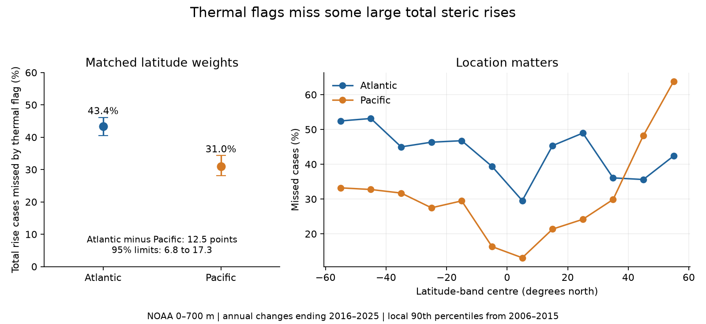

# Local thermal flags missed more large total steric rises in the Atlantic than the Pacific in NOAA upper-700-m fields at 60 S-60 N in 2016-2025

A local temperature-based flag missed 43.4% of large total steric rises in the Atlantic and 31.0% in the Pacific. Both basins had the same latitude-band weights. The Atlantic-minus-Pacific difference was 12.5 percentage points. Its conditional 95% three-year block interval was 6.8 to 17.3 points. Each flag used a local 90th-percentile threshold from annual changes in 2006-2015. The test used changes in 2016-2025.

This result describes an indicator for the same time in one NOAA mapped product. It does not measure forecast skill or coastal flood risk. It shows that an earlier finding of smaller total than thermal variation during large thermal changes does not make a thermal threshold a complete indicator of large total steric rises.



Figure 1. The left panel shows missed-case fractions with conditional 95% three-year block intervals. The right panel shows fractions in each 10-degree latitude band. The bands have equal weight in the left panel. These are local annual changes, not changes in basin-mean sea level. A case is one cell and one ending season. Large total rises exceed a separate local total threshold.

## Question and prior evidence

Can a local upper-tail thermal flag mark large total steric rises equally well in the Atlantic and Pacific after latitude weights are matched? Steric sea level is the part of sea level that changes with water density. Temperature and salinity both affect density. A temperature-only indicator may therefore omit some large total steric changes.

The campaign [thermal-extreme study](sci:sha256:49633e7010c645a6e1d5f558511826cb51ce9feca9959af9436ec5a3311cdcad) found smaller absolute total than thermal changes in 76% of large local Atlantic thermal changes. That result selects cases by thermal change. It does not give the fraction of total-selected cases that a thermal flag misses. Our test reverses the selection question, separates calibration from scoring, and tests one formal basin contrast. We use the same source snapshots, but new code. This is not an independent product check.

The [lag study](sci:sha256:ddb2f8af08b27617e541af4eb17ba2e1e3edfd8e1fa7d98165f866b4d8f2c53c) and [latitude-weight study](sci:sha256:ad26e4d68ab3fb815c546ebfd2f395df64eb0887e52e33f11fe10cfb05b73351) show why time scale and geographic weights need explicit treatment. We read these results. files/search_record.json records the searches and selected prior results. Search does not prove novelty. files/plan.txt records the local plan before new scores. It was not registered.

[Wang et al. (2017)](https://doi.org/10.3390/w9070484) used several products to show important regional salinity effects during the Argo era. [Levitus et al. (2012)](https://doi.org/10.1029/2012GL051106) describe the method used by NOAA for heat content and thermal sea level. Our contribution is a reproducible test of local upper-tail overlap and its basin difference. Regional salinity effects are established prior knowledge.

## Data, scope and rights

We reused two shared NOAA NCEI files in place. Their creation date is 2026-09-30. Their folder labels say 20261006. We use the one-degree fields a_mm_ts (thermal) and s_mm_fs (total), in mm, integrated from the surface to 700 m.

- Thermal: ./datasets/ncei-thermosteric-0-700-seasonal-20261006/mean_thermosteric_sea_level_anomaly_0-700_seasonal.nc. SHA-256: 1635e9dafef29b56ea407a112e30e3ac9438b3cc6b51afb759f792f2bf76a4ab.
- Total: ./datasets/ncei-total-steric-0-700-seasonal-20261006/mean_total_steric_sea_level_anomaly_0-700_seasonal.nc. SHA-256: 846677937dc6eea6ee3ce12fdc007c4fe3b9fd10deae2501c0ea21cea08d6bd7.

files/provenance.json gives exact source URLs, absolute shared paths, resolved paths, sizes, dates, hashes and source license attributes. The /mnt/dell-data paths are compatibility paths to the shared store on HP SSD. No failed disk path was used. There were no downloads for this study.

The [NCEI product](https://www.ncei.noaa.gov/products/ocean-heat-salt-sea-level) uses in situ profiles and reference fields. We select 600 <= time < 852 months since 1955-01-01: 84 seasons in 2005-2025. Partial 2026 is excluded. Coordinates and basin masks agree. NOAA mask codes 1 and 2 define the Atlantic and Pacific. Cell centres must be at least 60 S and below 60 N. There are 7,823 Atlantic and 15,758 Pacific cells. All selected cells have complete paired fields. No values are filled.

Data citation: Levitus, S., Antonov, J. I., Boyer, T. P., Baranova, O. K., Garcia, H. E., Locarnini, R. A., Mishonov, A. V., Reagan, J. R., Seidov, D., Yarosh, E., and Zweng, M. M. (2017), NCEI Accession 0164586, [doi:10.7289/V53F4MVP](https://doi.org/10.7289/V53F4MVP). Subset: upper-700-m seasonal thermal and total steric fields, 2005-2025, Atlantic and Pacific, 60 S-60 N, file versions defined above. Accessed from the shared store on 2026-11-09. Credit: NOAA NCEI, its Ocean Climate Laboratory, NOAA GOMO, and the profile data providers.

Raw grids, source cell records, source papers and source figures are not included. The package contains our code, text, figures and aggregate analysis results under the exact SCI baseline license. NOAA information is not claimed as our property. files/EXTERNAL_DATA.md gives external-data attribution and terms. It does not change the license of our bundled work.

## Method

Let T(t,c) and S(t,c) be thermal and total steric level at season t and cell c. Annual changes are x=T(t,c)-T(t-4,c) and y=S(t,c)-S(t-4,c). The pairs compare the same quarter in consecutive years. There are 80 changes with ending seasons in 2006-2025. No seasonal mean or trend is fitted. The thresholds can therefore reflect local annual-change trends as well as variation.

At each cell, use the 40 changes ending in 2006-2015 to estimate separate 90th percentiles for signed x and y. Use NumPy's linear quantile interpolation. Set each threshold to at least zero. A thermal flag F has x above the thermal threshold plus 1e-8 mm. A total flag G has y above its total threshold plus 1e-8 mm. The tolerance avoids numerical flags at flat values. A miss has G=1 and F=0. A hit has G=F=1. Only positive total rises can be flagged. These definitions concern upper tails of annual change, not extreme level, SST, ocean heat content, or a return period.

Score the 40 changes ending in 2016-2025. The thresholds use no test changes. However, the first test pairs and last calibration pairs share 2015 observations. All source data are a revised 2026 product. The temporal split does not make this a real-time or independent-observation experiment.

Divide the common latitude domain into twelve 10-degree bands. Within each basin and band, normalize cosine-latitude cell weights to sum to one. These weights approximate spherical cell areas. They do not correct partial coastal cells. For band j and basin b, sum weighted case indicators over all test seasons:

    M(b,j) = sum(w * G * (1-F)) / sum(w * G)
    M(b)   = mean over the 12 bands of M(b,j)
    D      = M(Atlantic) - M(Pacific)

The primary score is D. It is a difference between mean band-conditional miss fractions. It is not the fraction from pooling every basin case with its natural area. Matching band weights controls the contribution of broad latitude bands, not exact latitude within each band, longitude, thermal amplitude, water depth, salinity variance or observation coverage.

Recall is the band mean of hits/total flags. Precision is the band mean of hits/thermal flags. Total and thermal flag rates are the corresponding band means over all cases. Ratios are formed after summing within a band over years; the bands are then averaged. Annual band sufficient statistics are preserved in files/annual_bands.csv.

For uncertainty, draw circular blocks of three test years with replacement, take enough blocks to cover ten years, and truncate to ten. Use 10,000 draws and seed 110703. Apply the same year indices to every basin, band and statistic. Each year's four season-pair summaries remain intact. We do not form artificial changes across bootstrap joins. Two- and four-year blocks use seeds 110702 and 110704. Intervals are the 2.5 and 97.5 percentiles. All main draws are stored.

These are conditional intervals. Thresholds, masks and mapped fields stay fixed. The bootstrap does not include threshold estimation error, measurement error, mapping error or product revisions. Ten test years allow few independent blocks. Slow ocean memory can make these intervals too narrow. No spatial independence is assumed and no cell count is used as an inferential sample size.

## Results and explanation checks

| Main score | Atlantic | Pacific |
| --- | ---: | ---: |
| Missed-case fraction, 95% limits | 43.4% [40.4, 46.1] | 31.0% [28.1, 34.3] |
| Recall | 56.6% | 69.0% |
| Precision | 53.0% | 69.6% |
| Total flag rate | 10.4% | 12.0% |
| Thermal flag rate | 11.2% | 11.7% |

The primary difference is 12.45 percentage points [6.83, 17.31]. The point rates show why miss fractions must be reported with marginal flag rates. A threshold fitted to ten earlier years does not force exactly 10% of later cases to be flagged. Neither basin uses an optimized classifier. Lowering the thermal threshold alone could reduce misses at the cost of more flags. That tradeoff was not tested here.

| Planned check | Atlantic minus Pacific, percentage points | Conditional 95% limits |
| --- | ---: | --- |
| Main, two-year blocks | 12.45 | 7.67 to 17.02 |
| Main, four-year blocks | 12.45 | 7.24 to 17.33 |
| Both thresholds at 80th percentile | 10.12 | 7.22 to 12.92 |
| Both thresholds at 95th percentile | 14.34 | 7.56 to 20.47 |
| Natural basin area weights | 15.46 | 8.81 to 21.06 |
| Reverse calibration and test decades | 10.03 | 6.44 to 14.48 |

Except where stated, the table uses three-year blocks. Natural weights pool band numerators and denominators with the band areas. Equal band weights reduce the point difference from 15.46 to 12.45 points but do not remove it. Thus, different broad latitude coverage is not a complete explanation for this product's basin contrast.

Reversing the decades uses thresholds from 2016-2025 to score 2006-2015. It is a descriptive stability check, not a second future test. Its positive difference shows that the sign is not limited to the forward split. Removing one calibration year and refitting the thresholds gives point differences of 11.77 to 13.29 points. Removing one test year from scoring gives 10.75 to 13.72 points. These checks do not give a full threshold-error interval. Test-year omissions also leave the omitted year in other pairs' endpoints.

The pattern is not uniform. Ten of twelve latitude-band point differences are positive. The Pacific has larger miss fractions in 40-50 N and 50-60 N. These band values are descriptive and have no separate multiplicity-adjusted tests. They do not identify specific physical regions or independent events.

An additional component summary is preserved for inspection. Define H=y-x. In each band, take sum(H) over missed cases divided by sum(y) over those cases, then average the twelve ratios. This score is 0.457 in the Atlantic and 0.346 in the Pacific. It is a descriptive identity-based diagnostic, not a share for all ocean rises and not a cause test. H includes salinity effects, nonlinear density terms and analysis effects. It is not an independent salinity measurement. Selection on total change can itself favour positive H. These numbers cannot show that freshwater flux or circulation caused the misses.

## Limits and useful scope

The result supports a narrow tool choice: an upper-tail thermal flag should not be treated as a complete indicator of local upper-tail total steric rise in this product. It remains informative: it marks over half the Atlantic total flags and about two-thirds in the Pacific. The result does not establish that every temperature-based method must have these miss rates.

Only one mapped product, one depth layer, two basins and two ten-year periods were tested. Shared mapping and profile errors can alter the tail overlap. The fixed 90th percentiles come from only 40 overlapping calibration changes per cell; the 95th-percentile check uses very few upper-order observations. A large number of grid cases does not supply many independent years. The equal-band average is a chosen geographic target, not a global ocean probability.

The test estimates neither a physical feedback nor a trend in extreme frequency. It does not resolve recovery times. Total steric change omits added ocean mass, deeper steric change, tides, storms and land motion. It cannot establish observed coastal sea-level or flood effects. Independent temperature-salinity products and explicit error propagation are needed for physical attribution.

## Reproduction and audits

Use Python 3.12 and the package versions in files/environment.json. From an extracted publication, run:

```sh
python files/audit.py
python files/analyze.py files/annual_bands.csv /absolute/path/to/new-score-output
python files/extract.py /absolute/path/to/shared_datasets /absolute/path/to/new-extract-output
python files/audit_source.py /absolute/path/to/shared_datasets files/annual_bands.csv /absolute/path/to/new-source-audit
```

Each output directory must be new and outside the publication. The first two commands work offline with the included aggregates. Full extraction and the source audit verify both raw-file hashes before use. Shared datasets need not be copied into the publication. If the inputs are absent, run `python files/retrieve.py /absolute/path/to/new-external-data-root`, then use that root for extraction. Live URLs may change. A hash mismatch stops reproduction. In that case, obtain the exact historical files with the listed hashes from the shared store or an external archive; do not substitute revised fields silently. The retrieval script is not a shared-store ingestion tool. New shared data must use campaign-dataset as required by the campaign.

The independent source audit uses netCDF4, explicit interpolation of sorted calibration values, and direct sums. It checked all 1,920 primary band/year terms. Its maximum absolute difference from extraction was 4.84e-13. The offline aggregate audit passed count identities, flag bounds, 44 independently reconstructed miss-fraction point checks and 18 stored-draw interval bounds. The package contains 3,360 band/year rows, 325 score rows and 30,000 main paired draws. Audit reports are included. These audits check calculations, not NOAA observations. During development the audit exposed small 32-bit weight discrepancies. Both paths now use 64-bit weights, and all published results use the corrected extraction.

## Campaign record

Campaign: 11_07_2026. Job: sci-1107-hp-earth-and-ocean-sciences-db7d72c6f568. Topic: earth-and-ocean-sciences. Machine: hp. Account: codex-andrii. Model: gpt-6.1-sol, high reasoning effort. No child agents were used. The campaign-machine signing key is not a personal authorship claim. This investigation saves a signed bundle locally. It performs no remote archive upload or index submission.
