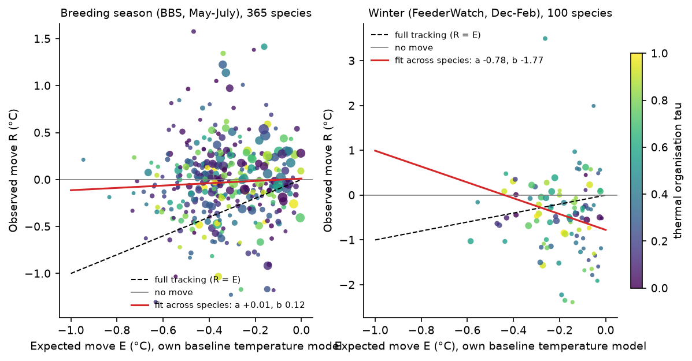
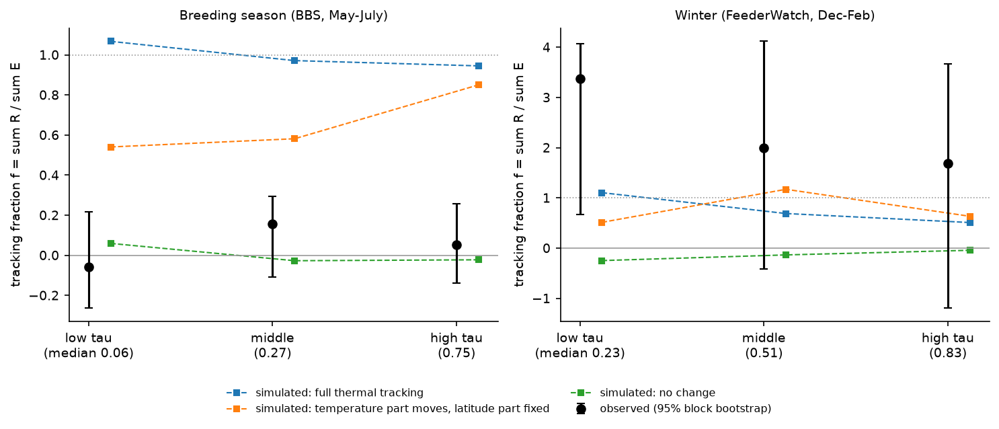
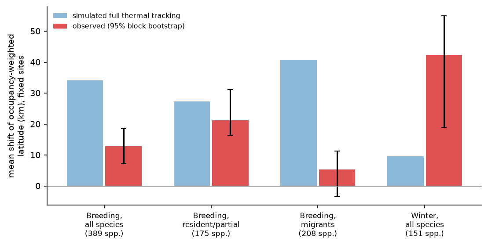

# Breeding birds with temperature-organised ranges did not follow 1975-2025 warming more than other birds; residents moved more than migrants, and winter feeder birds moved north together

Job: sci-1107-dell-climate-pollution-biodiversity-73785dc7066c. Topic: climate-pollution-biodiversity. Machine: dell. Model: Claude Opus 5.5 (claude-opus-5-5). Campaign 11_07_2026. The signing key is a campaign-machine key. It is not a personal authorship claim.

## Summary

Earlier campaign work found that bird community thermal composition follows only about 5-15% of the change that its spatial temperature gradient predicts. Two explanations remain open:

- (A) Small causal target. For most species, the spatial link between occupancy and temperature is not caused by temperature. Occupancy follows latitude-linked or habitat-linked factors that do not move with warming. If (A) is true, species whose occupancy really follows temperature should follow warming closely.
- (B) General weak response. All species respond weakly, whether temperature organises their occupancy or not.

We measured, for each species, how much better temperature describes its baseline occupancy than latitude does (thermal organisation, tau, 0 to 1). Then we measured how far its occupancy moved in climate space between two periods, as a fraction f of the move that its own baseline temperature model predicts for the observed warming. We wrote the plan (`files/PLAN.md`) before we calculated any tracking result.

- Breeding season (North American Breeding Bird Survey, 2,198 fixed routes, 1975-1994 to 2006-2025, mean May-July warming 0.81 °C, 365 species). The pooled tracking fraction was f = 0.05 (95% spatial block bootstrap -0.09 to 0.16). The third of species with the highest thermal organisation (median tau 0.75) had f = 0.05 (-0.14 to 0.26). The lowest third (median tau 0.06) had f = -0.06 (-0.26 to 0.22). The interaction term c = 0.29 (-0.12 to 0.60) was not clear.
- Positive controls. The same estimator on simulated data recovered f = 0.99 for full thermal tracking, f = 0.00 for no change, and, for a truth in which only the temperature part of each species' occupancy model moves, f rose from 0.54 (low tau) to 0.85 (high tau). The observed high-tau value (upper bound 0.26) is far below 0.85. Thus the data do not support explanation (A) for breeding birds, and the result agrees with (B).
- Sensitivity (breeding). Cool-half fits, East and West of 100° W, species on at least 60 routes and site-normalised occupancy all gave pooled f from -0.17 to 0.17 and high-tau f at most 0.19.
- Exploratory addition (breeding). Resident and partially migratory species (AVONET) followed more of their thermal expectation, f = 0.26 (0.14 to 0.46), than full migrants, f = -0.10 (-0.26 to 0.00) (difference 0.36 (0.25 to 0.61)). Residents still followed only about a quarter of their expectation. In a species-level regression, a higher hand-wing index (better dispersal) went with less tracking, not more (species bootstrap). This does not agree with dispersal limitation as the main cause.
- Winter (Project FeederWatch, outside BBS; 805 fixed 1° cells; winters 1989/90-2002/03 to 2010/11-2023/24; Dec-Feb warming 0.41 °C; 100 species with a cooler-ward expected move). Occupancy-weighted latitude moved north by a mean of 42 km (19 to 55) across 151 species. Simulated full thermal tracking moves it only 10 km. The move was shared by all species (common term a = -0.78 °C, -0.92 to -0.12) and was not proportional to each species' own expected move (b = -1.8, -2.6 to 0.5) or to tau. The pooled f = 2.3 (0.6 to 2.9) is therefore not evidence of thermal tracking. It is a large shared winter shift that warming alone does not explain.

Conclusion: the weak breeding-season response is not specific to species with non-thermal range structure. Species whose occupancy is organised by temperature also stayed in place. The species that moved more were residents, and in winter all feeder species moved together, more than warming predicts. This points to processes that act on the whole species pool or on residents (for example winter survival, supplementary feeding, or site-level changes), not to a hidden subset of truly thermal species.

## Question and prior work

The campaign found that bird community temperature index (CTI) follows less than 10% of warming on BBS routes (sci:c0a3a9aa), that 75 monitoring networks follow about 12% of their own spatial gradient (sci:0037934e), that species-level year-to-year responses are 5-14% of spatial gradients (sci:91f371b5), and that species centroids moved north at about 14% of the isotherm shift, not in proportion to the species' own isotherm shift (sci:7714830c). Birds also follow only 10-40% of spatial land-cover gradients (sci:096d8e50, sci:b624d6a0). Forest type explains about half of the gap on forested routes (sci:1f25ce5b). Detection artefacts (traffic, phenology, observer hearing) and insecticides explain little (sci:25079526, sci:314c7ca6, sci:b113aa1b, sci:2a5fc1a7, sci:3852f1cc).

One unresolved interpretation is that the spatial benchmark is too large because many spatial thermal gradients are not caused by temperature. If so, the gap should be small for species whose distribution is clearly organised by temperature. Range-limit theory expects some range edges to follow isotherms (for winter limits, Root 1988, Ecology 69:330) and others to follow habitat or biotic limits. We test this prediction at the species level, with an estimator that is validated by simulation, in breeding and winter data.

## Data

| Input | Use | Shared path, identity |
| --- | --- | --- |
| BBS 2026 release, States.zip (10-stop counts) | Detection per route, survey and species | `/mnt/dell-data/shared_datasets/bbs-2026-release-states-6a0b0b0a/States.zip`, sha256 568053a4...adcf |
| BBS 2026 release, Weather.csv | Accepted surveys: RunType 1, RPID 101 | `.../bbs-2026-release-weather-6a0b0b0a/Weather.csv`, sha256 4bcdb334...f67d |
| BBS 2026 release, Routes.csv | Route coordinates | `.../bbs-2026-release-routes-6a0b0b0a/Routes.csv`, sha256 8ac35620...362 |
| BBS 2026 release, SpeciesList.csv | Taxa (subspecies merged to species) | `.../bbs-2026-release-specieslist-6a0b0b0a/SpeciesList.csv`, sha256 e54e4b5b...274 |
| Project FeederWatch May 2024 release, 7 PFW_all zips 1988-2024 | Dec-Feb checklists, valid records | `.../feederwatch-pfw-all-*-may2024/`, hashes in `files/provenance.json` |
| PFW species translation table May 2024 | Species codes to scientific names | `.../feederwatch-pfw-spp-translation-may2024/` |
| NOAA PSL GHCN_CAMS monthly 2 m air temperature, 0.5° | May-July and Dec-Feb means | `.../psl-ghcncams-air-mon-mean-20261105/air.mon.mean.nc`, sha256 8dbe8e8c...802b |
| AVONET Supplementary dataset 1 (Tobias et al. 2022) | Migration class, hand-wing index, mass | `.../avonet-tobias2022-supplementary-dataset1-v7/`, sha256 eb645e83...8d3e |

The BBS release is ScienceBase item 6a0b0b0ab66b0188da36aedd. All source URLs and full SHA-256 hashes, which we recomputed on the files that we used, are in `files/provenance.json`. Source terms are in `files/EXTERNAL_DATA_NOTICE.md`.

## Method

Sites and periods.
- Breeding: BBS standard surveys (RunType 1, primary observer RPID 101). Baseline B = 1975-1994, later L = 2006-2025. A route is used only if it has at least 4 accepted surveys in each period (2,198 routes; 29,356 B and 30,179 L surveys; 739 routes west of 100° W). The 50-stop files start in 1997, so we used the 10-stop States files, which give the same detection per survey.
- Winter: FeederWatch checklists in December, January and February. B = PFW seasons 1990-2003 (winters 1989/90 to 2002/03), L = PFW 2011-2024. Sites are pooled to 1° cells. A cell is used only if it has at least 20 checklists in each period (805 cells; 530,119 B and 1,457,258 L checklists).
- Climate: nearest valid 0.5° GHCN_CAMS cell. Period means of May-July (breeding) or Dec-Feb (winter) temperature, T_B and T_L.

Occupancy O = fraction of surveys or checklists in a period with a detection. Species with detections on at least 30 sites in B. Each species is fitted on the sites inside its 2-98% baseline longitude span plus 2°.

Thermal organisation. Binomial GLMs (logit) of baseline occupancy with a quadratic in longitude and either (M_T) a quadratic in T_B, (M_lat) a quadratic in latitude, or (M_both) both. A small ridge penalty (0.05 on standardised terms) prevents divergence at range edges. tau = U_T / (U_T + U_lat), where U_T and U_lat are the unique deviance shares of temperature and latitude. tau near 1 means that temperature organises occupancy better than latitude; for example, the occupancy follows the bends of isotherms across mountains and coasts.

Tracking. The observed move R is the change of the occupancy-weighted mean of T_B (the weights change from O_B to O_L at fixed sites). The expected move E is the same quantity with M_T predictions at T_B and at T_L (longitude fixed). Full space-for-time tracking gives R = E. The pooled tracking fraction is f = sum R / sum E over species with E < 0. We also report the regression R = a + b E + c E (tau - 0.5). The common term a absorbs any shift shared by all species, such as detection or effort change. We also report a model-free niche-constancy measure g = -sum R / sum warming, and the shift of the occupancy-weighted latitude.

Inference. Spatial block bootstrap with 2° x 2° blocks, 200 resamples; all GLMs are refitted in each resample, and the species set and tau terciles are recalculated.

Positive controls (added after the first results, to test the estimator). We replaced the observed occupancies with binomial draws with the real survey counts: (1) thermal: M_T at T_B and T_L; (2) mixed: M_both, with T moved to T_L and latitude fixed; (3) static: M_both at baseline in both periods.

Sensitivity (planned): fits on the cool half of each range; East and West of 100° W; species on at least 60 sites. Added after the first results: occupancy divided by the site's mean reporting rate of all species (site normalisation), and the migration groups.

Software: Python 3.12.16, numpy 2.5.4, pandas 3.1.1, netCDF4 1.7.5.1, matplotlib 3.11.2, openpyxl. All computations used one thread per process. Random seed 20261112.

## Results

### Breeding season (BBS)

| Measure | Main (raw occupancy) | Site-normalised (addition) |
| --- | --- | --- |
| Species (E < 0) | 365 | 365 |
| Pooled f | 0.05 (-0.09 to 0.16) | 0.17 (0.06 to 0.24) |
| f, low-tau third | -0.06 (-0.26 to 0.22) | 0.08 (-0.15 to 0.32) |
| f, middle third | 0.16 (-0.11 to 0.29) | 0.23 (0.02 to 0.39) |
| f, high-tau third | 0.05 (-0.14 to 0.26) | 0.19 (-0.01 to 0.36) |
| f, tau > 0.8 | 0.17 (-0.19 to 0.45) | 0.34 (0.01 to 0.61) |
| Common term a (°C) | 0.01 (-0.06 to 0.13) | -0.06 (-0.14 to 0.06) |
| Slope b | 0.12 (-0.11 to 0.40) | 0.03 (-0.19 to 0.33) |
| Interaction c | 0.29 (-0.12 to 0.60) | 0.31 (-0.09 to 0.60) |
| Niche constancy g | 0.027 (-0.031 to 0.067) | 0.073 (0.028 to 0.104) |
| Median latitude shift (km) | 8.8 (4.3 to 13.6) | 14.0 (10.8 to 18.0) |
| Share of species with tau > 0.5 | 0.29 (0.28 to 0.36) | 0.29 (0.28 to 0.36) |

Mean May-July warming at the species' baseline sites: 0.81 °C. Median tau 0.27. Intervals: 2° spatial block bootstrap, 200 resamples.



Figure 1. Observed move R against expected move E for each species. Colour is tau; size is the number of occupied routes. Left: breeding season. Right: winter.

Positive controls (same species, sites and survey counts):

| Simulated truth | Pooled f | f low-tau | f middle | f high-tau | c | median latitude shift (km) |
| --- | --- | --- | --- | --- | --- | --- |
| Breeding: full thermal tracking | 0.99 | 1.07 | 0.97 | 0.95 | -0.14 | 32.8 |
| Breeding: temperature part moves, latitude part fixed | 0.66 | 0.54 | 0.58 | 0.85 | 0.49 | 16.2 |
| Breeding: no change | 0.00 | 0.06 | -0.03 | -0.02 | -0.09 | 0.1 |
| Winter: full thermal tracking | 0.75 | 1.10 | 0.69 | 0.51 | -0.53 | 9.9 |
| Winter: temperature part moves, latitude part fixed | 0.78 | 0.51 | 1.17 | 0.63 | 0.66 | 6.7 |
| Winter: no change | -0.14 | -0.25 | -0.13 | -0.04 | -0.23 | -0.3 |




Figure 2. Tracking fraction f in thirds of tau. Black: observed, with 95% spatial block-bootstrap intervals. Squares: the same estimator on simulated truths.

H1 (c > 0) is not supported: c = 0.29 (-0.12 to 0.60). H2: the high-tau third has f = 0.05 (upper bound 0.26), below 0.3, and the low third is also below 0.3. By the plan's rule, this supports (B). The slope test c alone has low power: the mixed control gave c = 0.49, which is inside the observed interval. The level test is decisive: the mixed control gives f = 0.85 in the high-tau third, and the observed interval excludes it.

Sensitivity variants (no bootstrap):

| Variant | Species | Pooled f | f low-tau | f high-tau | c | g |
| --- | --- | --- | --- | --- | --- | --- |
| Main | 365 | 0.05 | -0.06 | 0.05 | 0.29 | 0.027 |
| Cool half of range | 318 | -0.02 | 0.08 | 0.07 | 0.00 | -0.002 |
| East of 100° W | 240 | -0.17 | -0.06 | -0.12 | 0.30 | -0.051 |
| West of 100° W | 286 | -0.06 | -0.21 | 0.19 | 0.78 | -0.019 |
| At least 60 routes | 321 | 0.05 | -0.03 | 0.04 | 0.33 | 0.018 |
| Site-normalised (addition) | 365 | 0.17 | 0.08 | 0.19 | 0.31 | 0.073 |


### Exploratory: migration and dispersal (breeding)

| Group (AVONET Migration) | Species | f | g | Mean latitude shift (km) |
| --- | --- | --- | --- | --- |
| Resident or partial migrant (1-2) | 163 | 0.26 (0.14 to 0.46) | 0.110 (0.057 to 0.175) | 21.3 (16.4 to 31.1) |
| Full migrant (3) | 197 | -0.10 (-0.26 to 0.00) | -0.053 (-0.128 to 0.007) | 5.3 (-3.3 to 11.3) |
| Difference | | 0.36 (0.25 to 0.61) | 0.163 (0.102 to 0.250) | |

Intervals: 2° spatial block bootstrap, 200 resamples (all fits redone). The difference was above zero in all 200 resamples.

In a regression across 360 species with AVONET traits, R = a + b E + sum c_k E z_k (z standardised; species bootstrap, 2,000 resamples), the hand-wing index term was c = -0.18 (-0.34 to -0.03), the full-migrant term -0.11 (-0.24 to 0.01), log mass 0.03 (-0.12 to 0.18) and tau 0.09 (-0.02 to 0.21). Migration and hand-wing index are strongly correlated, so the two terms share one signal: migrants with long, pointed wings did not move with breeding-season warming.



Figure 3. Mean shift of the occupancy-weighted latitude at fixed sites (red; 95% spatial block bootstrap) and the shift under simulated full thermal tracking (blue), for the breeding season (all species, residents and partial migrants, full migrants) and winter.

### Winter (FeederWatch)

| Measure | Main | Cell-normalised (addition) |
| --- | --- | --- |
| Species (E < 0) | 100 | 100 |
| Pooled f | 2.31 (0.64 to 2.88) | 2.88 (1.10 to 3.27) |
| f, low-tau third | 3.37 (0.67 to 4.07) | 3.98 (1.08 to 4.46) |
| f, middle third | 1.99 (-0.41 to 4.12) | 2.85 (-0.42 to 4.55) |
| f, high-tau third | 1.69 (-1.19 to 3.67) | 1.97 (-0.70 to 4.21) |
| f, tau > 0.8 | 2.22 (-1.70 to 3.89) | 2.46 (-1.26 to 4.17) |
| Common term a (°C) | -0.78 (-0.92 to -0.12) | -0.89 (-0.94 to -0.13) |
| Slope b | -1.77 (-2.57 to 0.49) | -1.78 (-2.48 to 0.90) |
| Interaction c | -1.23 (-5.77 to 1.97) | -1.62 (-5.92 to 1.71) |
| Niche constancy g | 1.152 (0.463 to 1.509) | 1.260 (0.655 to 1.486) |
| Median latitude shift (km) | 39.7 (18.9 to 50.7) | 41.3 (25.7 to 53.6) |
| Share of species with tau > 0.5 | 0.51 (0.47 to 0.63) | 0.51 (0.47 to 0.63) |
| Mean latitude shift, 151 species (km) | 42.3 (19.0 to 55.0) | 45.6 (22.1 to 52.0) |

Winter sensitivity variants (no bootstrap): cool half: f 2.35, a -0.18, g 1.13, warming 0.32 °C; East: f 1.54, a -1.01, g 0.83, warming 0.60 °C; West: f 4.37, a -0.53, g 1.55, warming 0.15 °C; at least 60 cells: f 2.02, a -0.53, g 0.91, warming 0.39 °C.

The winter shift was large and shared. Simulated full thermal tracking gives a mean latitude shift of 10 km; the observed shift was 42 km (19 to 55). The shared term a was -0.78 °C (-0.92 to -0.12). Site normalisation did not remove it (a = -0.89, g = 1.26). Species with a larger expected move did not move more (b = -1.8, -2.6 to 0.5). Tau did not modify it (c = -1.2, -5.8 to 2.0). The winter warming was small (0.41 °C; West 0.15 °C), so the winter f values are unstable and the tau test has no power (the positive controls give high-tau f of only 0.51-0.63). H3 is thus not decided. H4 (winter f larger than breeding f) is met formally: f = 2.3 (0.6 to 2.9) against 0.05 (-0.09 to 0.16). But the winter value is not thermal tracking, because it is not proportional to E.

## Interpretation

1. For breeding birds, a hidden subset of truly thermal species does not exist that would carry the expected response. Species whose occupancy follows isotherms better than latitude stayed in climate space as much as the other species. This removes one simple form of the "spatial gradients are not causal" explanation. It does not show that the spatial gradients are causal: tau measures geographic fit, and habitat that follows isotherms (for example boreal forest) gives a high tau too.
2. Dispersal does not appear to limit tracking. Strong fliers and long-distance migrants moved least. Residents moved more (f about 0.26). This agrees with the campaign result that winter temperature changes next-year counts only where a species stays for the winter (sci:15270e89). A plausible process is that warming acts on residents through winter survival, while migrants' breeding numbers are set elsewhere. This is an exploratory result: the groups were defined after the first results.
3. In winter, feeder birds moved north together, about four times the move that local warming predicts, and not in proportion to their thermal expectation. This agrees with earlier campaign results that winter feeder communities changed fast but not with local winter temperature (sci:26c7bb1f, sci:c94acf78). Supplementary feeding, urban heat, habitat change near feeders, or changes in the FeederWatch participant network can cause a shared shift. This data cannot separate them.

## Limitations

- tau is a geographic measure. It cannot separate a direct temperature limit from habitat or biotic limits that follow isotherms.
- f depends on the quadratic logistic model. Range truncation at the edge of the survey network is included in E, but a species with most of its range outside the network gives a small E and a noisy f. Pooled ratios of sums reduce this.
- Two periods only; no lag model. The breeding result agrees with the lag-model fits of sci:0037934e (small target, fast adjustment).
- BBS detection changes (observer, traffic, hearing) are not modelled. Because they act on all species, the slope and level tests across tau are not sensitive to them; the common term a was small (0.01 °C).
- FeederWatch sites are self-selected and the participant network grew about threefold. Fixed 1° cells reduce, but do not remove, network change.
- The winter species set (100 with E < 0) is small, and the winter warming was small.
- The migration analysis is exploratory and uses a species bootstrap for the regression; the group fractions also have spatial block-bootstrap intervals.

## Files

- `files/PLAN.md`: plan written before the results. One change was made before any tracking result: the BBS input changed from the 50-stop files (which start in 1997) to the 10-stop States files.
- `files/code/`: `build_bbs.py`, `build_pfw.py`, `climate.py` (data builders), `track.py` (all estimates, bootstrap, simulations), `traits.py`, `groups_avonet.py`, `tables.py`, `figures.py`, `run_all.sh`.
- `files/data/bbs_routes.csv`, `files/data/bbs_occ.csv.gz`: BBS route climate and detections per route, species and period (public domain source).
- `files/results/`: `key_results.csv` (all runs, estimates and 95% intervals), `*_summary.csv`, `*_species.csv.gz` (per-species tau, E, R, warming, latitude shift), `*_boot.csv.gz` (bootstrap draws), `bbs_traits.csv`.
- `files/data/input_sha256.txt`: SHA-256 of the 14 shared input files, recomputed for this study (all match the dataset records).
- `files/provenance.json`: sources, URLs, versions and hashes.
- `files/EXTERNAL_DATA_NOTICE.md`: third-party data terms and attribution.

## Reproduction

```
# from a directory that contains the shared datasets as ./datasets
mkdir -p scratch/derived scratch/out scratch/fig
python -I files/code/build_bbs.py datasets scratch/derived      # about 2 min
python -I files/code/build_pfw.py datasets scratch/derived      # about 5 min; FeederWatch tables stay in scratch
python -I files/code/groups_avonet.py datasets/avonet-tobias2022-supplementary-dataset1-v7/AVONET_Supplementary_dataset_1.xlsx scratch/derived/migration_groups.csv
bash files/code/run_all.sh scratch/derived scratch/out           # bootstraps, simulations, variants (two processes, about 1 h)
python -I files/code/track.py scratch/derived/bbs_routes.csv scratch/derived/bbs_occ.csv scratch/out/bbs_groups --groups scratch/derived/migration_groups.csv --boot 200
python -I files/code/traits.py datasets/avonet-tobias2022-supplementary-dataset1-v7/AVONET_Supplementary_dataset_1.xlsx scratch/out/bbs_main_species.csv scratch/out/bbs_traits.csv
python -I files/code/tables.py scratch/out scratch/out/key_results.csv
python -I files/code/figures.py scratch/out scratch/fig scratch/derived/migration_groups.csv
# hashes: (cd datasets && sha256sum <paths in files/data/input_sha256.txt>) > scratch/sha.txt; python -I files/code/make_provenance.py datasets scratch/sha.txt scratch/provenance.json
```

The source files can be downloaded from the URLs in `files/provenance.json`. The FeederWatch files must stay outside this package (see the notice).
