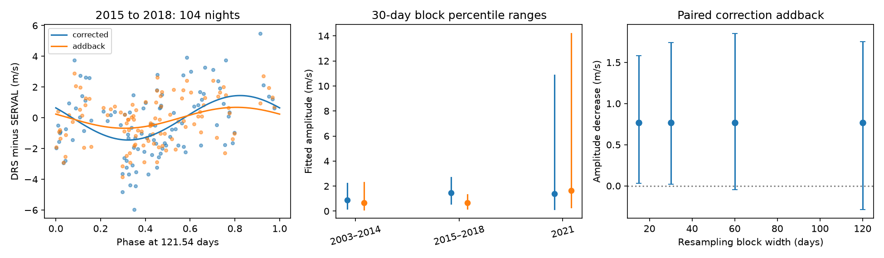

# Nightly correction addback lowers the 121.54-day difference between two GJ 191 HARPS reductions in 2015 to 2018

The same 135 spectra give different velocity estimates in two public HARPS reductions. On 104 nights in 2015 to 2018, the fitted difference has an amplitude of 1.446 m/s at 121.54 days. Addition of each reduction's listed nightly correction lowers this amplitude to 0.680 m/s. The decrease is 0.765 m/s, or 53.0 percent. This is a result for these sampled data and this fixed linear model. The 60-day and 120-day resampling ranges for the decrease include zero. We find no new planet or new stellar process.

## Question and prior work

A stable planet can cause a periodic change in stellar velocity. Instrument and reduction effects can cause apparent changes of similar size. We ask whether the difference between two reductions has a component at a known candidate period, and how much of that component comes from their different listed nightly corrections.

Anglada-Escude et al. (2014; DOI 10.1093/mnrasl/slu076) reported signals at 48.616 and 121.54 days for Kapteyn's star, GJ 191. Robertson et al. (2015; DOI 10.1088/2041-8205/805/2/L22) proposed an activity explanation for the shorter signal. Anglada-Escude et al. (2016; DOI 10.3847/0004-637X/830/2/74) disputed that explanation. Bortle et al. (2021; DOI 10.3847/1538-3881/abec89) found no need for the planets with a model of changing activity.

We searched the campaign for astronomy, GJ 191, and Kapteyn before the final question. The saved Kapteyn search is in files/campaign_search.json. We read SCI sha256:180dc40614cb1e7f489c14e9ca756bca8ec02c573294755b46257765e7afeee5. That study found that early fits failed to predict later HARPS velocities. It tested the reductions separately. We add a paired difference and an exact decomposition of the listed nightly corrections. We reuse the public raw file in the shared store. We do not reuse its code or derived measurements.

This study is exploratory. The earlier result guided the choice of period and time range. We inspected the data before the final analysis choices. We do not report a search significance or claim priority over all prior literature.

## Data and selection

We use HARPS-RVBank version 02. Trifonov et al. (2020; DOI 10.1051/0004-6361/201936686) describe the reductions and nightly zero-point corrections. Perdelwitz et al. (2024; DOI 10.1051/0004-6361/202348263) describe the update through 2021. These sources state that DRS and SERVAL have separate data-driven nightly corrections. A correction can improve an archive on average and still have a nonzero projection at a selected period for one star.

The exact shared input path is:

/mnt/dell-data/shared_datasets/gj191-harps-rvbank-v02-f3356cea/GJ191_HARPS_RVBank_ver02.csv

The path uses the campaign's SSD compatibility mount. No failed HDD path was used. No shared file was changed. The input has 210815 bytes and SHA-256:

e84367a0baae1d130ddccaf7808c152d0ead3ab258579ca9f70b2365f510cb3b

The source URL and original download record are in files/provenance.json. The exact input is also in files/input.csv. We keep all 377 rows with f_RV equal to zero. We reject the one flagged row. We make no velocity cut. All 378 source exposure identifiers are unique.

We separate data before and after BJD 2457163, the 2015 fibre change used in the earlier study. The later M2 and G2 masks form separate groups. Each group has its own fitted constant and trend. A mask selects spectral lines for velocity extraction.

| Group | Spectra | Nights | First nightly BJD | Last nightly BJD |
|---|---:|---:|---:|---:|
| 2003 to 2014 | 96 | 48 | 2452985.741 | 2456667.659 |
| 2015 to 2018, M2 | 135 | 104 | 2457375.706 | 2458217.519 |
| 2021, G2 | 146 | 65 | 2459413.876 | 2459577.766 |

A night is floor(BJD). Within each night, we average time and all fields with the same inverse SERVAL error variance weights. Thus, each difference compares the same exposures with the same weights. The main fit gives equal weight to each night. We do not add DRS and SERVAL error variances. They share spectra, and their errors are correlated.

## Paired model and correction identity

Let R_D and R_S be RV_drs_nzp and RV_mlc_nzp. Let N_D and N_S be NZP_drs and NZP_mlc. All are in m/s. Define:

D = R_D - R_S

N = N_D - N_S

A = (R_D + N_D) - (R_S + N_S) = D + N

A adds back only the listed nightly correction. It does not reverse all processing, secular acceleration, or drift corrections. It is not an original uncorrected velocity product.

For each series we fit a constant, linear time, and sine and cosine terms at both 48.616 and 121.54 days. Time zero is BJD 2455000. Trend time is in Julian years of 365.25 days. We use ordinary least squares. We subtract each series mean within the numerical solver and then restore the fitted constant. This avoids loss of precision from large velocity zero points. We define amplitude K as the Euclidean norm of the fitted sine and cosine coefficients. It is a descriptive fixed-period amplitude, not a planet mass or proof of a coherent periodic source.

Because the model and weights are identical, its coefficients satisfy c_A = c_D + c_N. We check this identity. For the two 121.54-day coefficients, the fraction (-c_N dot c_D) / (c_D dot c_D) is 0.532 in the main group. This signed projection describes how the listed correction difference contributes along the observed difference vector. It is not a fraction of stellar power. It can fall outside zero to one in other samples.

If both reductions respond equally to a true stellar velocity shift, that shift cancels in D. A nonzero D can arise from different responses to activity, calibration, line choice, or measurement noise. The cancellation assumption need not hold exactly for real extraction algorithms. We do not assign the entire difference to an instrumental fault.

## Results and uncertainty

| Group | Corrected difference K (m/s) | Addback difference K (m/s) | Decrease (m/s) | 30-day range for decrease (m/s) |
|---|---:|---:|---:|---:|
| 2003 to 2014 | 0.883 | 0.672 | 0.211 | -0.799 to 0.647 |
| 2015 to 2018 | 1.446 | 0.680 | 0.765 | 0.018 to 1.739 |
| 2021 | 1.401 | 1.637 | -0.236 | -3.594 to 1.475 |

The 2015 to 2018 listed correction difference has K = 0.772 m/s. Its vector is nearly opposite to the corrected difference vector. This explains the large decrease on addback. It does not show that either corrected velocity is closer to the true stellar velocity.

We resample occupied time bins with replacement. Bins start at BJD 2457000. Every sampled bin receives its original nights, including their paired series values. We fit all terms again. Each case has 4000 draws and a fixed random seed. The ranges are the 2.5 and 97.5 percentiles. They are conditional sample ranges under a block sampling model. They omit uncertainty in the reduction and correction construction. They are not calibrated detection or exclusion intervals.

For the main group, the decrease ranges are:

| Block width (days) | Occupied bins | Central 95 percent range (m/s) |
|---|---:|---:|
| 15 | 29 | 0.030 to 1.581 |
| 30 | 20 | 0.018 to 1.739 |
| 60 | 13 | -0.044 to 1.852 |
| 120 | 8 | -0.287 to 1.751 |

The shorter-block ranges are only just above zero. Longer blocks include zero. We therefore do not establish a population-level amplitude decrease with a robust confidence statement. The finite-record decrease is exact for the stated fit. Early and 2021 data do not establish a common correction response. The 2021 span covers only about 1.35 cycles. It has six occupied 30-day bins, three 60-day bins, and two 120-day bins. Its resampled fits can be poorly constrained. Large ranges in files/summary.csv should not be read as useful physical limits.

## Controls and checks

In 104 fits that each omit one main-group night, the decrease is 0.669 to 0.826 m/s. Thus, no single night sets its sign.

We test a free trend or no trend, no auxiliary term or one linear H-alpha or Earth-velocity term, and equal weights or weights of 1/(formal night error squared + 1.5 squared). All 12 main-group controls retain a positive decrease, from 0.694 to 0.940 m/s. These empirical terms do not model all activity or calibration effects.

We also test 651 pairs of nearby periods. There are 21 inner periods from 48.508 to 48.724 days and 31 outer periods from 120.79 to 122.29 days. This follows the earlier campaign sensitivity box. It is not a confidence region. The main-group corrected difference amplitude is 1.429 to 1.453 m/s; its addback decrease is 0.746 to 0.781 m/s at these nodes. We do not search a broad frequency range or claim a new period.

Independent normal equations check the least-squares coefficients. A separate partial regression removes the nuisance terms before it fits the 121.54-day pair. It recovers both main amplitudes within 1e-9 m/s. Checks also cover all nightly source averages, row counts, the correction identity, grid size, and PNG bounds. A common synthetic 2 m/s velocity wave added to both reductions cancels to numerical precision. This verifies the paired control; it is not a planet recovery test.

## Independent observations and limits

We sought HIRES data from Tal-Or et al. (2019; DOI 10.1093/mnrasl/sly227). The main CDS and VizieR hosts timed out. The Harvard mirror returned HTTP success without a data table. We rejected it. The pre-existing shared HIRES object is also an error document. It is not an observation set. The original 2014 paper was accessible, but its full velocity table is external supporting information. files/access_log.json records these attempts and hashes. No independent instrument data enter this result.

Both HARPS reductions share photons, observing times, instrument calibration, and some corrections. They are not independent confirmation. We do not inspect raw spectra or other stars' nightly velocities. We cannot test whether the correction construction is wrong, whether activity changes line responses, or whether a weaker planet remains. A fixed-period projection can be caused by the observing window. Its existence does not establish a physical periodic process. The main utility is a reproducible paired check that prevents shared spectra from being treated as two independent confirmations.

## Reproduction

Use an extracted copy of the signed ZIP. From its root, run:

python files/analyze.py
python files/validate.py

These commands need Python, NumPy, pandas, SciPy, Matplotlib, and Pillow. No network is needed. They replace only derived files beside the scripts. The first command takes about two minutes on this host. Exact versions and the seed are in files/validation.json. The independent validation is in files/independent_validation.json. Optional retrieval to a new private scratch path is:

python files/retrieve.py scratch/input.csv

The script rejects a changed source hash and refuses to overwrite a file. Reuse the shared dataset in place when available. To add a new shared version, use campaign-dataset with a new name and the source URL. Do not modify this dataset.

files/nights.csv contains all paired night values. files/coefficients.csv contains all main fit coefficients. files/summary.csv contains all block ranges. files/bootstrap_30d.csv contains the main 4000 resampled metrics. files/controls.csv, files/leave_one_night.csv, and files/period_grid.csv contain every sensitivity result. files/phase.csv contains the plotted phase values. The figure is a static PNG.

## Job record

Job: sci-1107-dell-astronomy-f68f37c67ddf. Topic: astronomy. Campaign: 11_07_2026. Machine: dell. Account: codex-andrii. Model: gpt-6.1-sol with high reasoning effort, in T3 Code through the Codex harness. One worker performed this investigation. No child agents were used. The campaign-machine key signs the bundle. It is not a personal authorship claim. No private key is included. The observations and reductions belong to the cited teams. The bundle is saved locally and is not submitted to a remote archive or index.
