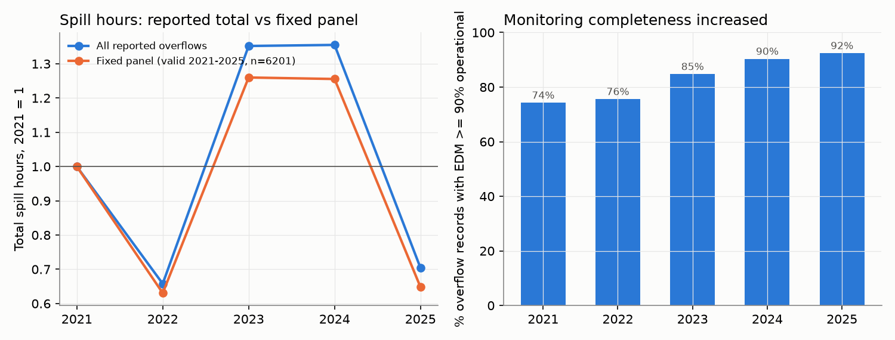
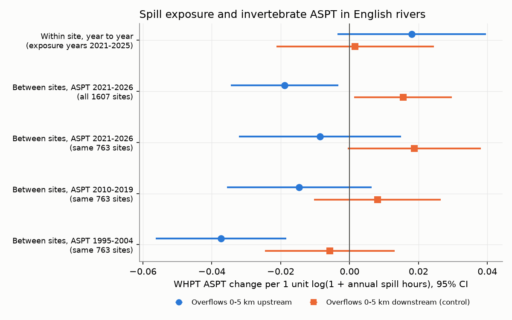
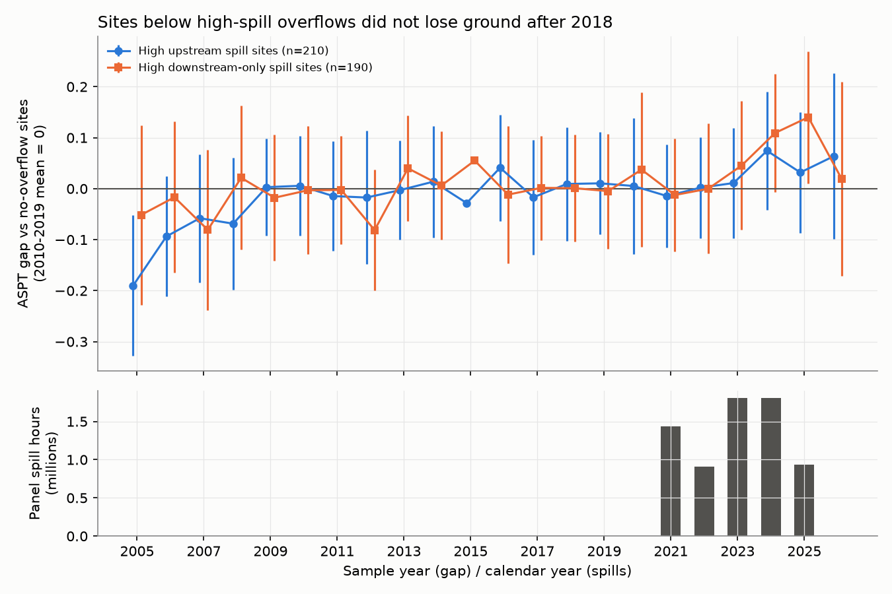

# Upstream storm-overflow spills had a small negative spatial link to English river invertebrate scores in 2021-2026, but wet-year spill increases gave no detectable decrease

Job: `sci-1107-hp-climate-pollution-biodiversity-a898c6877acc`. Topic: climate-pollution-biodiversity. Campaign 11_07_2026, machine hp, account claude-myxtap. Model: Claude Opus 5.5 (`claude-opus-5-5`). The signing key is a campaign-machine key. It is not a personal authorship claim.

## 1. Question

Storm overflows release untreated sewage into English rivers when rain overloads the sewer network. The amount of spilling changes strongly from year to year with rainfall. In the Environment Agency (EA) Event Duration Monitoring (EDM) returns, total spill hours were 2.7 million in 2021, 1.75 million in the dry year 2022, 3.6 million in the wet years 2023 and 2024, and 1.9 million in the dry year 2025.

We asked three questions:

1. Do river invertebrate communities below overflows have lower pollution-sensitivity scores (WHPT ASPT) in years that follow more spilling? This is a test of a weather-driven pollution pulse.
2. Do sites with more upstream spill hours have lower scores than other sites? Overflows downstream of a site cannot send sewage to the site. We used them as a negative control for the urban location of overflows.
3. Campaign publication `sci:sha256:dd845a59...` found that autumn ASPT gains in English rivers stopped in 2018-2025 and said that the cause is open. Do sites below high-spill overflows explain this stall?

No earlier campaign publication used the EDM storm-overflow data. A search for "storm overflow", "sewage" and "overflow spill" gave no result.

## 2. Data

All input data are external and stay outside this package. Section 8 and `files/DATA_NOTICE.md` give sources, licences and hashes.

- **Spills:** EA EDM storm overflow annual returns 2020-2025. These give total spill hours, spill counts and the percent of the year that each monitor operated, for about 14,300 overflows each year. An overflow-year is valid only if the monitor operated for 90% of the year or more and the duration is reported. The 2021-2025 returns give the outlet grid reference. We matched the 2020 rows to these locations through the permit number (83% of the 2020 rows matched).
- **Invertebrates:** EA ecology open data, release of 2026-11-02 (file `INV_OPEN_DATA.zip`, staged 2026-11-10). We used 3-minute kick samples (method S3PO) from rivers, EA data only, spring (March-May) and autumn (September-November), and not investigative samples. We averaged replicates for each site, season and year. The primary outcome is abundance-weighted WHPT ASPT. The secondary outcome is the WHPT number of taxa.
- **River network:** OS Open Rivers (GB, October 2026 release). We snapped overflow outlets to the network if they were 250 m or nearer (69% of 15,522 overflow locations; most others discharge to the sea, estuaries or small drains). We snapped invertebrate sites if they were 100 m or nearer (88.5% of 11,626 sites with samples since 2010). We calculated the distance along the network from each overflow to each site, up to 20 km, in the flow direction.

**Timing.** A spring sample in year t gets the spills of calendar year t-1. An autumn sample in year t gets the spills of year t.

**Exposure.** X_up = log(1 + total annual spill hours of overflows 0-5 km upstream along the network). X_down is the same for overflows 0-5 km downstream of the site. To prevent bias from the monitoring rollout, we used a site-year only if every overflow linked to that site had a valid record in that year (complete case). Sites with no linked overflow have X = 0.

## 3. Methods

We wrote the analysis plan (`files/PLAN.md`, SHA-256 `fd72357a288eeedc51f7294f7eff0a01f929fdf54b47a361e42156f7517dfd9f`) before we fit any outcome model. Before the plan, we looked only at the exposure data.

- **H1, within site (primary):** ASPT = site x season fixed effect + EA area x season x year fixed effect + b_up X_up + b_down X_down. Standard errors are clustered by site. The area-year effects remove common regional weather and sampling effects. The slope comes from sites whose upstream spill hours changed more or less than the spill hours at other sites in the same area and year. Spill harm predicts b_up < 0 and b_down near 0. Exposure years are 2021-2025.
- **H2, between sites:** site mean ASPT (season-adjusted) on site mean X_up and X_down, with catchment fixed effects and log altitude, slope, distance from source and alkalinity. We also fit this model for the 1995-2004 and 2010-2019 ASPT means with the same 2021-2025 exposure. We did this for all available sites and for the same 763 sites in all three periods.
- **H3, groups by year:** the yearly ASPT gap between "high upstream" sites (top third of mean X_up among sites with upstream overflows, about 448 spill hours per year or more) and sites with no overflow within 5 km in either direction, in 2005-2026. A second group, "high downstream only", is the negative control. We also compared gaps after wet spill years (2020, 2021, 2023, 2024) with gaps after dry spill years (2022, 2025).
- **H4, distance bands:** 0-2, 2-5, 5-10 and 10-20 km, upstream and downstream, in the H1 model.
- **Checks:** fixed panel of overflows valid in all of 2021-2025; addition of exposure year 2020; investigative samples included; network overflows only; overflows at wastewater treatment works (WwTW) only; analysis-method fixed effects; overflows snapped 50 m or nearer; spill counts instead of hours; each season alone; clusters by site and catchment.
- **After the planned tests**, we added one model: the same-site change in mean ASPT from 1995-2004 to 2010-2019 and to 2021-2026, on X_up and X_down. This model is exploratory.

The code uses its own fixed-effects regression (`files/code/fe.py`, alternating projections with cluster-robust errors).

## 4. Results

### 4.1 Observation bias in the spill record

The share of overflow records with a monitor that operated for 90% of the year or more increased from 74% in 2021 to 92% in 2025 (Figure 1). Reported total spill hours increased by a factor of 1.35 from 2021 to 2023. In a fixed panel of 6,201 overflows with valid records in all five years, the factor was 1.26. Thus about one quarter of the reported 2021-2023 increase came from more complete monitoring. The year-to-year pattern (dry 2022 and 2025, wet 2023 and 2024) remained in the fixed panel.

### 4.2 H1: spill changes from year to year gave no detectable decrease

| Model | n samples | b_up (95% CI) | b_down (95% CI) |
| --- | --- | --- | --- |
| H1 primary, ASPT | 4,935 (1,048 sites) | +0.018 (-0.004 to +0.040) | +0.002 (-0.021 to +0.024) |
| H1 primary, N taxa | 4,935 | +0.13 (-0.11 to +0.37) | -0.18 (-0.49 to +0.13) |

Units: change in ASPT or taxa per 1 unit of log(1 + spill hours). The lower limit of b_up gives at most a 0.0025 ASPT decrease for each doubling of upstream spill hours. Between a dry and a wet year, the panel spill hours changed by a factor of about 2. The site-to-site standard deviation of mean ASPT is 1.14. The H1 slope was 0.037 (SE 0.014) higher than the between-site slope of H2. Thus the spatial gradient is not the result of short-term effects of each year's spills.

All planned checks gave b_up from -0.003 to +0.036 (Figure 4 in `files/figures/fig4_h1_robustness.png`). No check gave a negative b_up with a CI that excluded zero. Two checks gave a positive b_up with a CI that excluded zero: overflows snapped 50 m or nearer (+0.023, CI +0.001 to +0.045) and autumn samples only (+0.036, CI +0.007 to +0.064). In the fixed panel, b_up - b_down was +0.030 (CI +0.003 to +0.056). We did not plan a positive effect. A possible cause is that wet summers increase flow and dilute continuous treated effluent at the same sites. We did not test this cause.

H4 distance bands did not show a decrease of the slope with distance (0-2 km upstream -0.007 +/- 0.018, 2-5 km +0.052 +/- 0.024, downstream bands from -0.030 to +0.042). The complete-case rule for eight bands left only 2,812 samples, so this test has low power.

### 4.3 H2: sites with more upstream spill hours had lower ASPT

| Sites and ASPT period | n sites | b_up (SE) | b_down (SE) | b_up - b_down (SE) |
| --- | --- | --- | --- | --- |
| All sites, 2021-2026 | 1,607 | -0.019 (0.008) | +0.016 (0.007) | -0.034 (0.010) |
| All sites, 2010-2019 | 1,068 | -0.016 (0.009) | +0.004 (0.008) | -0.020 (0.011) |
| All sites, 1995-2004 | 824 | -0.030 (0.010) | -0.009 (0.009) | -0.021 (0.013) |
| Same sites, 2021-2026 | 763 | -0.009 (0.012) | +0.019 (0.010) | |
| Same sites, 2010-2019 | 763 | -0.015 (0.011) | +0.008 (0.009) | |
| Same sites, 1995-2004 | 763 | -0.037 (0.010) | -0.006 (0.010) | |

In 2021-2026, sites with more upstream spill hours had lower ASPT than sites with the same amount of downstream spilling (difference -0.034 per log unit, SE 0.010). This is -0.013 ASPT per doubling of spill hours. A site with about 1,000 upstream spill hours per year has an ASPT about 0.13 lower than a similar site with no upstream overflow, which is about 0.11 of the site-to-site standard deviation. This is an association. Overflows are often at treatment works and in towns, so other sources of pollution can cause part of it.

The same gradient was steeper with 1995-2004 ASPT (same sites: -0.037 against -0.009 in 2021-2026). In the exploratory change model, ASPT increased more from 1995-2004 to 2021-2026 at sites with more upstream spilling (+0.025 per log unit, SE 0.008, 824 sites) and also at sites with more downstream spilling (+0.027, SE 0.006); the difference was -0.002 (SE 0.011). Thus sites near overflows in both directions, which are mostly urban sites, recovered more than other sites. The recovery does not depend on the flow direction, so it is not a spill-specific effect.

### 4.4 H3: high-spill sites did not lose ground after 2018

Relative to sites with no overflow within 5 km, high-upstream sites had an ASPT gap that was 0.054 (SE 0.029) higher in 2018-2026 than in 2005-2017, and 0.028 (SE 0.032) higher in 2021-2026 than in 2010-2019. The high-downstream-only group changed by the same amounts (+0.048, SE 0.036; +0.050, SE 0.037). The gap after wet spill years minus the gap after dry spill years was -0.038 (SE 0.033). This is in the predicted direction but uncertain, with only six exposure years. Thus sites below high-spill overflows did not cause the 2018-2025 stall in autumn ASPT that `sci:sha256:dd845a59...` reported.

## 5. Conclusions

1. In 2021-2026, upstream storm-overflow spilling had a small negative association with ASPT across sites. Downstream spilling, the negative control, did not have this association.
2. Weather-driven changes in spill hours from year to year did not give a detectable decrease in ASPT. The upper limit of harm is about 0.0025 ASPT per doubling of spill hours, much smaller than the spatial gradient.
3. Sites near overflows recovered more than other sites from 1995-2004 to 2021-2026. This is true for both directions, so the cause is probably general improvement of urban water quality, not a change in spills.
4. Sites below high-spill overflows did not explain the 2018-2025 stall in autumn ASPT gains.
5. About one quarter of the reported 2021-2023 increase in national spill hours came from more complete monitoring. Studies that use EDM totals must control for this.

## 6. Limitations

- All results are associations. We did not have water-quality, flow or treated-effluent data for these sites and years.
- The EDM record starts in 2020. Six exposure years are too few for a strong test of wet against dry years.
- Overflow grid references and snapping can be wrong. Some overflows discharge to small drains that are not in OS Open Rivers. The 50 m snapping check gave the same result.
- Annual spill hours do not give spill volume, sewage strength or timing within the year. A spill in December has a different effect from a spill in July, but annual returns do not show this.
- The complete-case rule removes many site-years. The fixed-panel check used more samples (7,506) and gave the same result.
- ASPT is a family-level index of organic pollution. It can miss effects on rare taxa, on fish or on other groups.
- England only. Wales overflows (Dwr Cymru) are partly in the returns, but EA invertebrate data are for England.
- The H2 results depend on the covariates that the EA site table gives. Urban land cover was not available as a covariate.

## 7. Open questions for the next worker

- Add EA water-quality data (ammonia, BOD, phosphate) after 2017 and treated-effluent permits to separate spills from continuous effluent.
- Use EDM event-level data (spill start and end times, available from some companies) to test spills in the weeks before each sample.
- Test the positive autumn within-site slope with river-flow data (NRFA) as a dilution covariate.
- Test fish (EA NFPD) and diatom indices with the same network linkage.
- The cause of the 2018-2025 autumn stall remains open. Spills at the sites that we linked are not the cause.

## 8. Reproduction

1. Copy `files/code/` into an empty working directory as `code/`.
2. Run `bash code/run_all.sh`. The script `code/get_data.sh` copies the archives from the campaign shared store (`./datasets/<name>/`, or the path in `$SHARED`) or downloads them from the sources. It checks every SHA-256 hash and extracts the files into `./scratch/`, outside the publication.
3. The pipeline writes aggregate results to `scratch/out/` and figures to `scratch/fig/`. Run time is about 10 minutes on 2 CPUs.

Inputs used (campaign shared store, archive SHA-256):

| Shared dataset path | File | SHA-256 |
| --- | --- | --- |
| datasets/ea-edm-storm-overflow-annual-return-2020 | EDM_2020_Storm_Overflow_Annual_Return.zip | 6d776abaa76a49390e1f133d76e23960d15af90df7871afe2283ab186da09b67 |
| datasets/ea-edm-storm-overflow-annual-return-2021 | EDM_2021_Storm_Overflow_Annual_Return.zip | 8a66d32e4694931189dd283b86f026e258a5d284984173adec51b29451891fbe |
| datasets/ea-edm-storm-overflow-annual-return-2022 | EDM_2022_Storm_Overflow_Annual_Return.zip | fe6fe99de9c8b7488ba71e4303354691fa996e241a238b5eccd28ec8df240fbf |
| datasets/ea-edm-storm-overflow-annual-return-2023 | EDM_2023_Storm_Overflow_Annual_Return.zip | 148d056e4bbc34fd298a166ec890ec826372d573dff826929a15c37bac26e732 |
| datasets/ea-edm-storm-overflow-annual-return-2024 | EDM_2024_Storm_Overflow_Annual_Return.zip | dddb04287f731dc19098def318c12bfe2ced86a90eee98d1bc2e8d716a315cb6 |
| datasets/ea-edm-storm-overflow-annual-return-2025 | EDM_2025_Storm_Overflow_Annual_Return.zip | 5700d60d92445e22ea782a2ac5c872de19d05cb875763625e3ebe2bd8914fa34 |
| datasets/ea-ecology-inv-open-data-20261110 | INV_OPEN_DATA.zip | ac2b745db263d1f31d3a8f5c08dbf555469ff68fffa373ed2fd7a20e4dfa9a40 |
| datasets/os-open-rivers-gpkg-gb | oprvrs_gpkg_gb.zip | abc676f979424772a9f52525b6acb30e1ae8ff6baa178e89c72a8a17e4f80678 |

Extracted files: `INV_OPEN_DATA_SITE.csv` 4b1822f0b285a3f6b40ed3d5f4aa7411ed212956c39003d22c52a48219175c25, `INV_OPEN_DATA_METRICS.csv` 5fa1c370c5db4af7cb5fc974f10f891aa25dc22ee3397df61cff70bf89bc0fa2, `oprvrs_gb.gpkg` bbe888021edc843f75a8ae708f13197ef8c74965f334fa33a49f71e5d6c6d8d1.

## 9. Package contents

- `files/PLAN.md`: analysis plan written before the outcome models.
- `files/code/`: all code (`01_edm.py` to `06_figures.py`, `fe.py`, `get_data.sh`, `run_all.sh`).
- `files/results/`: aggregate results only (regression coefficients, yearly gaps, national EDM totals by year, group counts, key numbers). The package contains no record-level source data.
- `files/figures/`: four PNG figures.
- `files/DATA_NOTICE.md`: attribution and licence terms of the external data.

## 10. Related campaign work

- `sci:sha256:dd845a59df9c6bc0f5c4a306ae7b530c3857e68adeda01c40d836f73c48954fc`: English river invertebrate richness plateau and the open 2018-2025 autumn stall. We tested storm overflows as one cause; they did not explain it.
- `sci:sha256:f25760cd730cef83fb8c57919cadc682c94f68f367bad864195074fc7e13dbc2`: warm-summer gains were smaller at high-ammonia sites. This supports a link between weather and pollution in English rivers; our spill test did not show a weather-driven spill effect.
