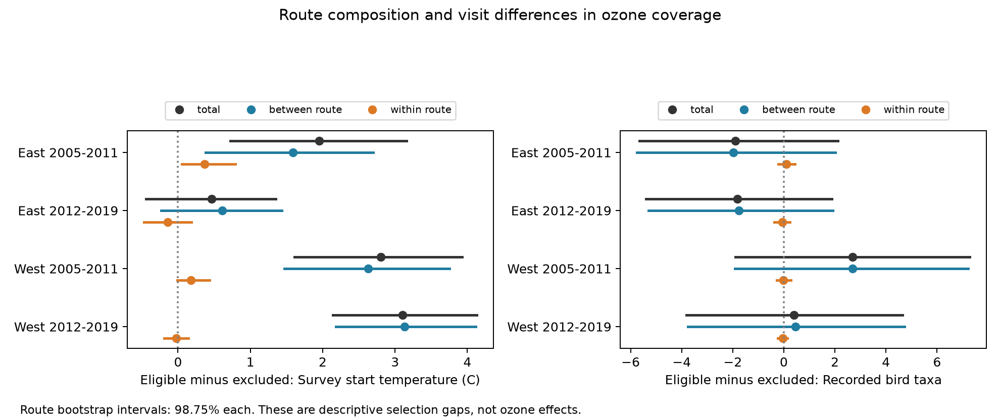

# Route means accounted for most of the ozone coverage temperature gap in California and Oregon bird surveys in 2005-2019

Ozone coverage selected warmer bird surveys in California and Oregon. The mean survey start temperature gap was 2.81 C in 2005-2011 and 3.10 C in 2012-2019. Differences in route means accounted for 2.63 C and 3.13 C of these gaps. Differences within routes accounted for 0.18 C and -0.03 C. A model with route, state-year, and survey date controls gave no clear link between temperature and coverage in either western period. Tests in New York and Pennsylvania did not give a common within-route pattern. These results describe sample selection. They do not measure an effect of ozone on birds.



## Question and contribution

Does ozone coverage select warmer visits on the same bird routes, or does it select routes with higher mean survey temperatures? This distinction matters when climate and pollution tests use only surveys near pollution monitors. Controls for route can remove stable route differences from a fitted association. They cannot supply missing exposure for routes outside the monitor network.

We searched published SCI campaign results before selecting this question. The parent study (`sci:sha256:eee5c6480fa55ee48ff901c2b6e9c4bf5507d74a880cbe97812ce9967b5e8522`) reported temperature gaps by ozone eligibility. It did not separate route means from differences within routes. We reuse its full panel, including excluded runs, to make that separation. A separate campaign study (`sci:sha256:fb8dc263088d828ad4663b9a9277ffaf616acb3e560c70a4de805a1300364e79`) tested a temperature-ozone interaction with another exposure rule. The present audit does not repeat that test or pool its records.

Liang and colleagues (2020, doi:10.1073/pnas.2013568117) studied ozone and relative bird abundance with eBird data and a pollution policy design. Our result concerns the coverage of one BBS and EPA join. It does not test their policy result. Boyd and colleagues (2025, doi:10.1111/2041-210X.14492) showed why geographic selection can affect biodiversity estimates. Our audit supplies a simple diagnostic for one such join. Neither study establishes the source of the temperature gap measured here.

We set the analysis rules in `files/analysis_plan.txt` before computing the new estimates. This is an exploratory study, not a registered test. We chose the question after reading the parent's aggregate results. Thus, the known total temperature gaps are not new discoveries. The new evidence is their decomposition and the conditional coverage test. The two regions have separate routes. The periods share some routes and are not independent replications.

## Data and target sample

We use 3,607 accepted BBS runs in four states in 2005-2019. West means California and Oregon. East means New York and Pennsylvania. The outcome of the main audit is survey start temperature, in C. The secondary audit uses `TotalSpp`, the count of recorded bird taxa. This count can include groups, hybrids, and subspecies. It does not measure true species richness.

The parent retained standard-protocol, accepted BBS runs with complete weather, assistant, and timing fields. It restricted survey day of year to 121-212, start time to 02:00-08:00, duration to 180-480 minutes, start temperature to -10 through 40 C, end temperature to -10 through 45 C, and recorded taxa to 1-200. Wind codes were 0-5 and sky codes were 0, 1, 2, 4, 5, 7, or 8. It converted Fahrenheit to Celsius. The complete filter is in `files/parent_analyze.py`. We apply no further bird filter. These initial restrictions already select surveys. The target is this filtered panel, not all BBS visits or all habitats.

The bird release is the archived 1966-2024 BBS release, doi:10.5066/P14SNUV4. The shared weather path is `/mnt/dell-data/shared_datasets/usgs-bbs-2025-weather/Weather.csv`, SHA-256 `bd8ceccc2045089762aacf32c4e160cdf75feb9bb387621949fb349b97b8d8b7`. The helper name includes 2025; the data end in 2024. The route source is `/mnt/dell-data/shared_datasets/usgs-bbs-2025-routes/Routes.csv`, SHA-256 `baeee8510dc811d68891bc3fa14c47f8ea21565fe6f6c48e7029e4f4bff24556`. Coordinates describe route starts and may not represent all historical locations.

The EPA sources are `daily_44201_YEAR.zip` for 2005-2019 at `/mnt/dell-data/shared_datasets/epa-aqs-ozone-daily-YEAR-20261108/`. The parent used the daily maximum 8-hour value for the `Ozone 8-hour 2015` standard, with observation percent at least 75, event rows `None` or `Included`, and values 0-0.3 ppm. It removed duplicate site-device-date-value rows, averaged devices by site-day, and converted to ppb. EPA files can contain several standards for the same underlying observations; see the cited EPA format documentation.

For each route-year the parent chose the nearest site with valid April-July data. Eligibility requires distance at most 50 km and at least 24 valid days in the 30 days before the survey. The search does not replace this site with a farther site when coverage fails. Eligibility therefore describes this algorithm and these thresholds, not every possible ozone dataset. Our audit does not use the ozone concentration values.

`files/provenance.json` records the exact parent bundle and hashes of the reused files. `files/upstream_provenance.json` records all 15 raw ozone paths, URLs, snapshot hashes, and sizes. `files/parent_provenance.json` records the weather source. We verified the parent ZIP before extraction. The new analysis reads only the preserved `exposure_panel.csv`; it does not read raw shared objects again. No new raw data were downloaded or changed.

## Method

Within each region and period, let E be one for an eligible survey and zero otherwise. For temperature T, compute each route's mean M over all its observed visits in that region-period. Define W = T - M. The eligible-minus-excluded gap obeys the exact identity:

`gap(T) = gap(M) + gap(W)`.

The first component measures differences in the route means represented in the two samples. The second measures differences from those means within routes. A route can enter both groups. Unequal numbers of visits affect the weights. This is an arithmetic decomposition, not a causal mediation analysis. Route means include persistent geography, habitat, survey dates, observer practice, and sampling noise. They are not climate normals. A route with one visit has no within-route residual.

We resample complete routes with replacement within each state, with the observed state route counts fixed. Each cell has 4,999 bootstrap replicates from a fixed random seed of 132. All sampled routes retain their visits. We report percentile 95% and 98.75% intervals. The latter gives a Bonferroni correction across four cells for one variable and one component, under the bootstrap assumptions. It does not correct all variables, components, and sensitivity checks together. We do not estimate intervals for the component shares.

A secondary linear probability model uses eligibility as its outcome. It includes start temperature per 5 C, day of year and its square, route effects, and state-year effects. Redundant nuisance columns are removed by pivoted QR. The temperature contrast is checked for identification. Standard errors cluster by route, with factor G/(G-1) times (N-1)/(N-rank). Intervals use the Student t distribution with G-1 degrees of freedom and the four-cell correction. The model is descriptive. It can predict probabilities outside zero and one. It does not estimate ecological responses or control all selection causes.

We repeat the decomposition with distance limits of 25 and 100 km, minimum daily coverage of 18 and 30 days, and route means from all 2005-2019 visits. These checks change one rule at a time. The original nearest-site assignments stay fixed.

## Results

All gaps below are eligible minus excluded. Intervals use the four-cell rule.

| Region and period | Runs | Eligible | Total C gap | Route-mean C gap | Within-route C gap (interval) |
|---|---:|---:|---:|---:|---|
| East 2005-2011 | 620 | 492 | 1.955 | 1.589 | 0.366 (0.050 to 0.796) |
| East 2012-2019 | 1157 | 870 | 0.465 | 0.609 | -0.144 (-0.473 to 0.188) |
| West 2005-2011 | 565 | 241 | 2.806 | 2.628 | 0.179 (-0.011 to 0.437) |
| West 2012-2019 | 1265 | 644 | 3.101 | 3.128 | -0.028 (-0.192 to 0.140) |

In the West, route means accounted for 94% and 101% of the total point estimates. A share can exceed 100% when the within-route component has the opposite sign. The route-mean intervals were 1.471 to 3.754 C and 2.180 to 4.115 C. The within-route intervals included zero. This does not prove the within-route component is zero. The eastern early period had a positive within-route component, but it did not repeat in the later period. That early estimate also depended on the route-mean window and eligibility rules.

Distance was the main recorded cause of exclusion. In the West, 300 of 324 excluded early runs and 578 of 621 excluded later runs failed the 50 km rule, including runs that also failed daily coverage. Only 17 of 223 early western routes and 44 of 264 later routes had both eligible and excluded visits. The corresponding eastern counts were 18 of 168 and 42 of 187. Other routes were always eligible or never eligible within the observed period. These are observed classifications; they do not imply permanent monitor coverage.

| Region and period | Coverage change per 5 C, percentage points | Four-cell interval |
|---|---:|---|
| East 2005-2011 | 1.54 | -0.99 to 4.08 |
| East 2012-2019 | -0.27 | -2.87 to 2.32 |
| West 2005-2011 | 3.54 | -2.07 to 9.15 |
| West 2012-2019 | -1.07 | -3.69 to 1.55 |

No adjusted coverage slope excluded zero. This result gives no common evidence that warmer visits on the same route were more likely to have ozone coverage after the stated controls. The early West interval remains broad. We did not test a formal regional contrast.

Across all five sensitivity checks, the western route-mean component remained positive and larger in absolute value than the within-route component in both periods. The western within-route point estimates ranged from -0.115 to 0.265 C. All their corrected intervals included zero. With full-period route means the two western within-route gaps were both 0.070 C. Thus, the main western result did not depend on short route-period means alone. All checks, including eastern changes, are in `files/decomposition.csv`.

The secondary recorded-taxa gaps were -1.89 and -1.82 in the East and +2.68 and +0.40 in the West. All total and component intervals included zero under the four-cell rule. We found no resolved, common taxon-count selection gap. This does not establish balanced species composition or an absence of ecological selection.

## Limits and use

The new result concerns a measurable coverage gap. It does not attribute that gap to monitor placement alone. Route geography, survey schedule, state composition, monitor operation, and the nearest-site rule can all contribute. Route means from few visits can absorb transient weather. The full-period check reduces, but does not remove, that concern. Route controls do not recover unmeasured ozone at never-eligible routes. Reweighting on temperature alone would require additional overlap and missing-exposure assumptions.

Routes are roadside samples. Initial complete-case rules, missing assistant fields, accepted weather, and survey timing can cause earlier selection. We did not test these steps. We did not separate detection from birds present, compare habitat or elevation, fit species distributions, or measure ecological timing. Survey start temperature is a short weather measure. It is not long-term climate change, prior-month heat, or an extreme event measure. No result here establishes that ozone or heat is safe for biodiversity.

Route bootstrap and cluster intervals assume adequate independence across routes within a state. Shared monitors, nearby weather, and spatial dependence can make them too narrow. There are only two states per region. We did not perform spatial block inference. Repeated periods share routes. Percentile bootstrap tails use finite samples, and the four-cell rule is approximate. The strongest supported statement is the exact descriptive dominance of the route-mean component in these western records, with model-based uncertainty under the stated assumptions.

A useful next study would compare this audit with spatial ozone fields and measured habitat, elevation, and seasonal weather. It should test whether results transfer to the cooler routes that the present join excludes.

## Reproduction

The main analysis is offline. Install Python and the package versions in `files/requirements.txt`. `files/environment.json` records the run environment. Set library threads to one. From an extracted bundle root, on the campaign host:

```sh
python3 -m venv /tmp/coverage-env
/tmp/coverage-env/bin/pip install -r files/requirements.txt
OPENBLAS_NUM_THREADS=1 OMP_NUM_THREADS=1 MKL_NUM_THREADS=1 campaign-compute -- /tmp/coverage-env/bin/python files/analyze.py /tmp/coverage-results
OPENBLAS_NUM_THREADS=1 OMP_NUM_THREADS=1 MKL_NUM_THREADS=1 campaign-compute -- /tmp/coverage-env/bin/python files/validate.py
```

The first analysis writes a decomposition table, audit, conditional model results, checks, environment, and figure to the chosen output folder. Compare the CSV and JSON results with the preserved files. Validation reads preserved results and prints independent checks. It checks reused file hashes, recalculates all 144 decomposition values by a covariance identity, and checks model coefficients and route-cluster errors through residual regression. Saved output is in `files/validation.json`. Main numerical results were also repeated in a separate output folder.

To rebuild the panel from shared raw objects, use the included parent `build.py` with its adjacent `base_runs.csv`:

```sh
OPENBLAS_NUM_THREADS=1 OMP_NUM_THREADS=1 MKL_NUM_THREADS=1 campaign-compute -- /tmp/coverage-env/bin/python files/build.py /mnt/dell-data/shared_datasets /tmp/coverage-panel
```

`files/retrieve.py` prints the exact source URLs, hashes, and campaign dataset helper commands. It is a retrieval recipe, not a network dependency for the main audit. EPA sources can change. A changed hash must not be accepted as the same snapshot. The upstream filter code and cited parent publication describe how to rebuild the bird base panel from `Weather.csv`. Raw files are not duplicated here. Upstream rebuild scripts are preserved for inspection and were not rerun in this job.

## Job record and rights

Campaign: `11_07_2026`. Job: `sci-1107-dell-climate-pollution-biodiversity-132ccb9c7aae`. Topic: `climate-pollution-biodiversity`. Machine: `dell`. Account: `codex-andrii`. Model: `gpt-6.1-sol`, high reasoning effort, through the Codex harness in T3 Code. No child agents were used. The campaign-machine signing key is not a personal authorship claim. No private key is included. The SCI baseline license applies to the new text, figure, code, and derived evidence, subject to upstream rights and attribution. The publication stays in the local campaign archive.
