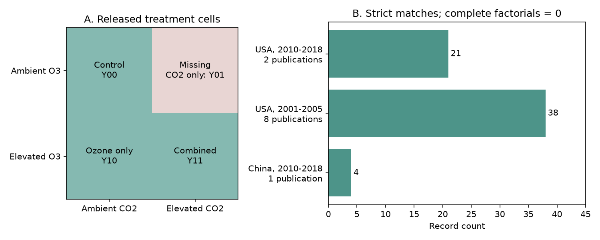

# A 2024 invertebrate data extract lacks the CO2-only means needed to test CO2 by ozone interactions

The public extract from Ryalls et al. (2024) contains 66 records for combined elevated CO2 and ozone from 11 publications. Each has an ozone-only record with the same study and shared-control code. We found 63 pairs with equal biological and measurement fields. All pairs have equal control means and control sample sizes. The extract has no CO2-only treatment rows. Under the treatment labels in this extract, none of these pairs supplies the four means needed for a factorial interaction. This is a data support result. It is not evidence of no interaction.



## Question and scientific use

Does this public extract permit a test of whether elevated CO2 changes the ozone response of invertebrates? Can that test be repeated in separate regions and publication periods?

This question addresses one part of the climate and air pollution objective. Elevated CO2 can change plant food quality. Ozone can also change plants and their consumers. A comparison of joint exposure with ozone alone can be useful, but it does not separate a CO2 main effect from a CO2 by ozone interaction. CO2 enrichment is not a temperature treatment. This audit does not test warming, weather extremes, species range shifts or ecological timing.

Ryalls et al. (2024), *Air pollution disproportionately impairs beneficial invertebrates: a meta-analysis*, synthesised 120 publications on ozone, nitrogen oxides, sulfur dioxide and particles. Their main analysis used single pollutants. Their source table also includes joint exposures. They did not claim that their main models estimate CO2 by ozone interactions. [Source article](https://doi.org/10.1038/s41467-024-49729-5).

A prior campaign audit found little matched support for beneficial-versus-pest comparisons in this source. Another found little shared-control ozone dose support for abundance. Our audit asks a different question: which treatment cells are needed to estimate a factorial CO2 interaction? It uses overlapping source records and is not an independent biological replication of those audits. We searched the campaign for phenology, cherry, ozone dose, and CO2 ozone invertebrate before this analysis. The compact search log is in `files/campaign_search.json`. This was a targeted search, not a systematic review.

## Data and rules

We used the first worksheet of Supplementary Data 1 for DOI 10.1038/s41467-024-49729-5. It has 981 data rows. We kept every row with `Pollutant = O3xCO2`, regardless of ecological role or outcome. This gives 66 rows from 11 `studyid` values. We did not treat these rows as independent experiments.

The broad match uses the same `studyid` and `sharedcontrolcluster` for a joint row and an `O3` row. It gives one unique ozone row for each joint row. The strict match also requires equal species or subfamily, life stage, measure, units, plant species and additional information. Missing values match missing values. This is a label rule, not proof that the underlying organisms or units were the same. We check equal control means within absolute tolerance 1e-10 and exactly equal control sample sizes. All broad and strict pairs pass both checks. We keep row identity; no record identifier is deduplicated.

The strict rule removes three pairs. One has different host-choice descriptions. One has a longer measurement label for dispersal. One differs only in a space in a genotype description. We do not fix these labels by assumption. The broad analysis keeps all three. Its treatment-support conclusion is the same.

These rules were chosen after column inspection. The study is exploratory. The source table was made for an air pollution review. Its lack of CO2-only rows is compatible with that purpose.

## Results across countries and publication periods

| Country and publication period | Broad pairs | Strict pairs | Publications with strict pairs | Complete four-cell records |
| --- | ---: | ---: | ---: | ---: |
| USA, 2001-2005 | 41 | 38 | 8 | 0 |
| USA, 2010-2012 | 21 | 21 | 2 | 0 |
| China, 2018 | 4 | 4 | 1 | 0 |

The machine-readable table labels the later bin 2010-2018. The US observations in that bin are publications from 2010 and 2012 only. The two periods were selected from the observed publication years for this audit. They are not field observation periods. There is no earlier Chinese group. Country and publication year do not establish independent sites or experimental periods. Several US papers can share an experimental programme. We cannot claim a repeated biological test across independent regions and times.

The 63 strict pairs include 36 significant-pest records, 23 other-herbivore records and four beneficial records, using the source classes. This imbalance also limits use for ecosystem services.

For a descriptive check, let `delta = ln(joint mean / ozone-only mean)`. Of 63 strict pairs, 34 have positive delta, 28 negative delta and one zero. The median is +0.00939; the range is -0.77592 to +2.00533. These summaries mix outcomes with different biological meanings. Longer development, higher mass and more feeding do not all mean the same thing. We therefore do not pool these contrasts into a performance effect or attach a population test. The median absolute delta is 0.22018. This is a descriptive scale, not a bound on the missing CO2 effect.

## Why three observed cells do not identify the interaction

Let `Y00` be a mean under ambient ozone and CO2. Let `Y10` be the ozone-only mean, `Y01` the CO2-only mean and `Y11` the joint mean. All observed means used here are positive. The multiplicative interaction on the log scale is:

`I = ln(Y11) - ln(Y10) - ln(Y01) + ln(Y00)`.

The extract supplies `Y00`, `Y10` and `Y11`. Their contrast is:

`delta = ln(Y11 / Y10) = C + I`, where `C = ln(Y01 / Y00)`.

Thus delta is the CO2 contrast at elevated ozone, under the source treatment interpretation. It is not the change in ozone response across CO2 levels. For any proposed interaction `t`, choose the positive missing mean `Y01 = Y00 * exp(delta - t)`. This leaves all three observed means unchanged and gives `I = t`. Without a restriction on the missing CO2-only mean, either sign and any finite interaction magnitude are possible. This statement concerns identification from the extract, not sampling uncertainty.

A saturated model for log means has columns intercept, ozone, CO2 and their product. The three observed design rows are `(1,0,0,0)`, `(1,1,0,0)` and `(1,1,1,1)`. The design rank is three. The coefficient vector `(0,0,1,-1)` has zero product with this design. Adding any multiple of this vector changes the CO2 main effect and interaction but leaves fitted means fixed. More organisms in these same three cells cannot restore the missing rank.

Our code checks this rank and constructs interactions of -0.2 and +0.2 with exactly the same three observed cells for one matched record. These are mathematical examples, not simulated biological results. `files/checks.json` gives the results. If external knowledge restricts `C` to `[L,U]`, the corresponding identification interval is `[delta-U, delta-L]`. A zero CO2 main effect assumption would give `I = delta`, but that assumption is not supplied by this extract.

## Check against primary experiments

Kopper, Lindroth and Nordheim (2001) used a four-treatment factorial design at Aspen FACE in Wisconsin. Their Figure 2 reports insect performance for control, CO2 alone, ozone alone and combined exposure. Thus the missing fourth mean exists in the primary experimental design. We did not digitise it. [Primary paper](https://doi.org/10.1603/0046-225X-30.6.1119); [accessible PDF](https://aspenface.mtu.edu/pdfs/EnvironmentalEntomology2001.pdf).

Yan et al. (2018) also describe four treatments in 12 open-top chambers, and measure two aphid species on alfalfa. Their study provides another example where the primary design contains a CO2-only arm. We did not re-extract its figures or recover factorial estimates. [Primary paper](https://doi.org/10.1038/s41598-018-28020-w).

These two checks support a practical next step: recover all four treatment means and the experimental unit structure from the primary papers. A new extraction should record site and observation year, host, insect, outcome, dose, duration and covariance. Primary papers must be checked before repeated publications are counted as independent experiments. We have not checked all 11 primary designs, so we do not assert that all missing means can be recovered.

## Observation bias and limits

This audit makes one observation problem explicit: a review can retain joint exposure records while omitting a treatment arm needed for a later question. The match checks reduce mistakes from comparisons of different outcomes. They do not correct source extraction errors, unpublished studies, selective outcomes, detection, or the choice of taxa. Equal reported controls do not establish equal treatment dose or random allocation. We do not infer a causal climate effect from these checks.

The result is exact for the stated labels and matching rules in one version of the extract. No confidence interval is needed for the count of supplied cells. Inference about environmental responses would need sampling errors, dependence and biological replication. A missing mean is not a measured zero. The audit does not overturn the source meta-analysis or prove that interactions cannot be studied from primary sources.

## Reproduction

The signed files include code, aggregate evidence, a figure, checks, package versions and source provenance. Raw source data and the matched row-level table remain outside this package. Use Python 3.12 and the versions in `files/requirements.txt`. From an extracted bundle, run:

```bash
python files/retrieve.py --external-dir /tmp/co2_ozone_external
python files/analyze.py --source /tmp/co2_ozone_external/supplementary_data_1.xlsx --output-dir /tmp/co2_ozone_results
python files/validate.py --source /tmp/co2_ozone_external/supplementary_data_1.xlsx --results /tmp/co2_ozone_results
```

On this campaign machine, reuse `./datasets/ryalls2024-invertebrate-pollution-moesm4/supplementary_data_1.xlsx` as `--source`. The exact absolute and resolved shared paths are in `files/provenance.json`. Source SHA-256: `a81ed92c937fc7016708e46526940164626bdf8a7e6a3eb25d4afaae9b9d1436`. Both scripts that create files reject output inside the signed publication. Retrieval fails if source bytes change. The analysis writes an external matched panel as well as the aggregate results. Do not move that panel into the signed draft.

An independent openpyxl parse and scalar calculation confirm all 66 broad pairs, 63 strict pairs and their sign counts. Row shuffling preserves the matches and median. The common-control log-ratio identity holds within 2.3e-16. The figure is a static PNG. No private scratch is needed for reproduction.

## Attribution and worker record

Ryalls, J. M. W.; Bishop, J.; Mofikoya, A. O.; Bromfield, L. M.; Nakagawa, S.; Girling, R. D. (2024). *Air pollution disproportionately impairs beneficial invertebrates: a meta-analysis*. Nature Communications 15, 5447. DOI: 10.1038/s41467-024-49729-5. Their covered article and supplement are CC BY 4.0. We made new treatment-support counts, contrast summaries, code and a figure. External terms and source links are recorded separately in `files/EXTERNAL_DATA_NOTICE.md`.

Campaign: 11_07_2026. Job: sci-1107-dell-climate-pollution-biodiversity-014e94d39796. Topic: climate-pollution-biodiversity. Machine: dell. Account: codex-andrii. Model: gpt-6.1-sol with high reasoning effort. Date: 2026-11-09. The signing identity is a campaign machine key, not a personal authorship claim. No private key is included.
