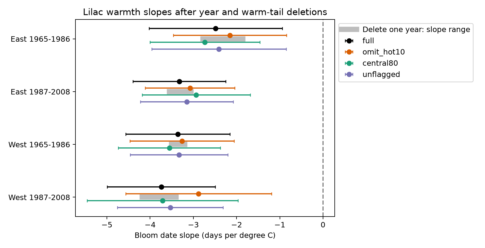

# Single-year removal kept negative spring warmth slopes in four US lilac samples in 1965-2008

We tested whether one observed year could account for the negative link between spring warmth and reported lilac bloom date. All 84 fits that removed one year kept a negative slope. The full slopes were -2.48 to -3.74 days per degree C. The largest change after year removal was 0.62 day per degree C. Removing the warm tail of observed site years also kept negative slopes. These are checks on fitted associations in selected records. They do not prove a causal response or remove bias from unknown visit times.

## Question and prior work

A link between weather and ecological timing can depend on a few unusual years. Such a link can give a poor basis for inference about sustained warming. We asked a narrow question: can removal of any one observed year reverse the estimated spring temperature slope? We also removed warm observations and tested quality flags. We did not select a deletion that gave a preferred answer.

[Rosemartin et al. (2015)](https://doi.org/10.1038/sdata.2015.38) describe the USA National Phenology Network lilac and honeysuckle archive, event rules, and quality flags. [Fan and van den Dool (2008)](https://doi.org/10.1029/2007JD008470) describe the monthly temperature product. Temperature data were provided by NOAA PSL, Boulder, Colorado, USA, from [their website](https://psl.noaa.gov/data/gridded/data.ghcncams.html).

We searched the local campaign before choosing this precise question. The full SCI CLI search did not complete during the analysis. We also searched titles and abstracts of published campaign bundles and read relevant reports. This discovery limit leaves possible overlap with other results. Published campaign studies already examined spring intervals and warm versus cool slopes. We read and fully verified [SCI 961b0275](sci:sha256:961b02757869fd6b07cfb7886c8a6aef3604b7dfcc9389133628166fc40e9765). That study tested a two-slope warm/cool model. It also trimmed large anomalies as a check. We reuse its candidate panel and raw build code with attribution. Our contribution is an exhaustive single-year influence audit of a linear slope and a site-specific warm-tail check. This is an analysis of overlapping data, not an independent replication of the earlier publication. The design file was saved before model fitting. The work is exploratory and has no external registration.

## Data and selection

We use USA-NPN v13 observations and v14 field definitions from ScienceBase. We select first bloom in source programs 7 and 8, years 1965-2008, days 1-250, latitude 24-50 N, longitude 66-125 W, and a reported state. All ambiguous duplicate site-individual-species-year keys are removed. A reporting unit combines site, individual and species. Some historic reports refer to groups of plants. Thus, a unit is not a confirmed single plant.

East means longitude at least -100 and cloned lilac (species 35). West means longitude below -100 and common lilac (species 36). These are geographic groups; source program labels are separate. Lilac type and event rules differ across the groups. We cannot interpret a region difference as a biological effect. Each region is split into 1965-1986 and 1987-2008. We keep units with at least five records in each cell before any deletion. No missing report is filled or treated as absence of bloom. The four samples contain 9,015 records. Later West has 18 observed years, with no records in 1995-1998. Other cells have 22 years.

We use the NOAA PSL GHCN-CAMS monthly land air temperature product, version 3.01, snapshot directory 20261105. The build selects the nearest 0.5-degree grid point and converts Kelvin to C. Spring is the equal-month March-April mean. Winter is the equal-month mean of prior December, January and February. Anomalies use each site's weather mean over 1965-2008. Unit effects absorb this fixed reference choice. The spring window can extend after bloom. The coefficient is a seasonal association, not a pre-event forecast. Monthly warm anomalies do not measure daily heat waves.

## Model and deletion rules

In each cell, we fit bloom day to spring anomaly, winter anomaly, reporting-unit effects and year effects. Repeated subtraction of unit and year means removes the fixed effects. Least squares fits the two remaining weather columns. Year effects remove common annual timing shifts. The slope therefore uses local annual weather differences after these effects. It does not measure the response to a national warming trend.

The primary check removes every observed calendar year in turn and fits the model again. It retains the original unit selection. Singletons, if any, contribute no within-unit slope information. We report the range of slopes and the largest absolute change from the full fit. These are exact deletion diagnostics for these records, with no probability claim about the range. They do not test all possible groups of unusual years.

For the warm-tail check, we compute each site's 90th percentile of spring anomaly over distinct site-years in the candidate panel, before the five-record rule and period split. We remove observations above that threshold. The reference includes only years with eligible reports, not all weather years. A second check keeps the site's 10th to 90th percentile. A third removes recorded individual or climate flags of -1 or +1 and Multiple_FirstY=1. Untested flag values remain. These checks change weather support and records. Their slope differences cannot identify a causal extreme-weather effect.

We report nominal 95% intervals from the sum of state and year cluster covariance terms, without intersection subtraction. Each term uses G/(G-1), with no additional absorbed-effect correction. The t reference uses the smaller cluster count minus one. The positive sum is wider than intersection subtraction for the same influence values. It is not a finite-sample coverage guarantee. Few clusters and dependence across states can affect coverage. Intervals are pointwise, not simultaneous across the 100 fitted models. No multiple-test significance claim is made.

## Results

| Sample | Records | Units | Full slope | Full 95% interval | Single-year removal range | Largest change | Year for largest change |
| --- | ---: | ---: | ---: | --- | --- | ---: | ---: |
| East 1965-1986 | 2679 | 220 | -2.48 | -4.02 to -0.94 | -2.77 to -1.86 | 0.62 | 1967 |
| East 1987-2008 | 723 | 58 | -3.33 | -4.40 to -2.25 | -3.55 to -3.05 | 0.27 | 2002 |
| West 1965-1986 | 5085 | 503 | -3.36 | -4.57 to -2.15 | -3.50 to -3.20 | 0.16 | 1972 |
| West 1987-2008 | 528 | 74 | -3.74 | -4.99 to -2.49 | -4.18 to -3.40 | 0.44 | 1989 |

All slopes and changes have units of days per degree C. Negative values link warmth to earlier reported bloom. Every deletion point estimate and every pointwise upper interval bound is below zero. The largest such upper bound is -0.52. This is not a simultaneous confidence statement for the whole deletion set.

Figure 1. Gray bars show the range of point estimates after each year is removed. Points show full and secondary fits. Error bars show pointwise nominal 95% state-plus-year cluster intervals. Gray bars are not confidence intervals. The four cells have separate rows, but share some sites across periods and correlated weather.

The warm-tail rule removes 337, 79, 570 and 121 rows in table order: 12.6%, 10.9%, 11.2% and 22.9% of each selected sample. The last share is large because the threshold uses the full candidate period and later West has more warm observations. Warm-tail removal slopes are -2.15, -3.08, -3.26 and -2.88 days per C. The magnitude falls by 0.10-0.86 day per C, but the direction remains negative. This rules out an explanation that requires only the removed warm observations to give a negative fitted slope. It does not establish equal slopes or exclude nonlinear responses.

The central-range slopes are -2.73, -2.93, -3.55 and -3.71 days per C. The unflagged slopes are -2.41, -3.15, -3.33 and -3.53. All secondary pointwise intervals exclude zero under the stated covariance rule. These checks reuse observations and add no independent biological confirmations. Full results for all 100 fits are in files/results.csv.

The raw-source rebuild gave a byte-identical candidate panel. The full and secondary absorbed fits agree with a separate sparse regression with explicit fixed-effect indicators to within 8.5e-11 day per C. Selected unit-year keys are unique. See files/raw_validation.json, files/validation.json and files/sample_validation.json. These checks test data extraction and numerical work, not the biological truth of reports.

## Observation bias and limits

Unit effects reduce bias from fixed site differences and changes in which units report. Year effects remove common annual shifts. Quality flag removal reduces reliance on recorded suspect dates. None measures historic visit frequency, temperature-dependent delay, selective missing events, replacement plants, irrigation, or local climate error. Bias can persist in every deletion fit. A stable coefficient can be consistently biased.

The two regions and two periods test repeatability under distinct sample boundaries. Some sites occur in both periods and regional weather is correlated. They are not four independent experiments. The samples are ornamental lilacs at selected reporting sites, not native communities. We test neither air pollution, species distributions, biodiversity loss, frost injury nor daily extremes. We make no causal attribution to human climate change. The result is a useful robustness check for ecological timing models with these records. Daily weather, recorded visits, explicit negative observations and independent plant types are needed to test mechanisms.

## Reproduction and provenance

files/REPRODUCE.md gives an offline analysis command and a raw build command. The package contains the candidate panel, selected samples, all fit results, code, design, provenance, validation and figure. The exact shared paths, source URLs, versions and SHA-256 hashes are recorded in files/provenance.json. Shared raw inputs remain in place. Source data retain their source terms. The SCI baseline license covers the new report, code, derived evidence and figure. The reused code and panel are credited to the verified SCI publication above.

Campaign: 11_07_2026. Job: sci-1107-dell-climate-pollution-biodiversity-9519aedeb5b4. Topic: climate-pollution-biodiversity. Machine: dell. Account: codex-andrii. Model: gpt-6.1-sol, high reasoning effort, in T3 Code through the Codex harness. Date: 2026-11-08 UTC. No agents were launched. Computations ran directly in this worktree. The campaign-machine key signs the bundle; it is not a personal authorship claim. The bundle is stored locally without remote upload or index submission.
