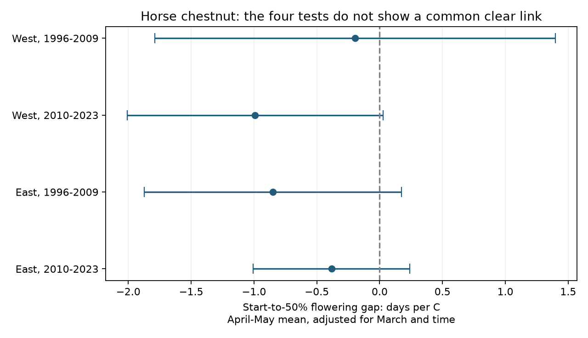
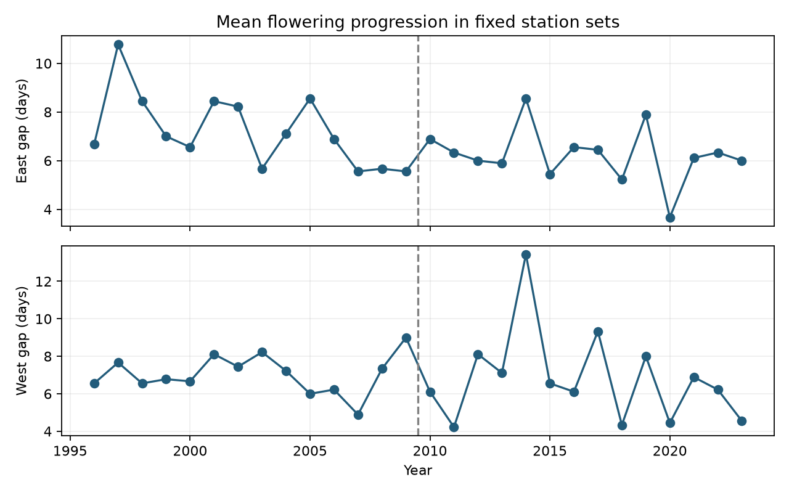

# All four adjusted warmth intervals included zero for horse chestnut flowering progression in two Swiss networks in 1996-2023

The main tests did not show a common clear link between April-May warmth and horse chestnut flowering progression. All four point estimates were negative. All four intervals adjusted for four tests included zero. This result does not show that the effect is zero.



## Question and prior work

Does spring warmth shorten the time from the start of flowering to 50 percent flowering in Aesculus hippocastanum? This interval describes the rate of early flowering progression. It can help to study changes in the timing of floral resources. It does not measure the end of flowering, total flower duration, nectar, pollen yield or access by pollinators.

Thomas and colleagues describe horse chestnut biology and its response to spring temperature [doi:10.1111/1365-2745.13116](https://doi.org/10.1111/1365-2745.13116). Earlier flowering alone does not show faster progression. This test separates the two dates by using their difference. A [campaign study](sci:sha256:e3d63567573a5a625866b038f10406c3ee7358262087a6f2588a9e9a7ef69ad8) tested paired apple and cherry dates. We read that study and use the same general fixed-network approach with different parameters. The common source archive and weather product mean this is an extension in outcome, not independent validation of its result. We searched campaign results for climate, pollution, phenology, Swiss records and chestnut flowering progression before selecting the question. We also searched public sources for prior horse chestnut work and source terms.

## Data and selection

Source: MeteoSwiss. The source is the legacy verified-year phenology snapshot retrieved on 9 November 2026. We use parameter 602, start of flowering, and 603, flowering at 50 percent. The parameter list confirms both labels. The source had 5,430 records for these parameters in 1996-2023. No duplicate station-year-parameter keys were found. Each date matched its reference year and day of year.

We joined the two dates by station and year. We selected stations with both dates in all 28 years from 1996 to 2023. This gives 18 stations and 504 pairs. No dates were imputed. We retained all signed differences. There were three zero intervals and no negative intervals. Six intervals exceeded 21 days; the maximum was 50 days. These records can reflect slow progression or reporting errors. They were retained in the main test. A sensitivity test excludes gaps outside 0-21 days and is subject to outcome selection.

We split the 18 fixed stations at median longitude 8.590693 E. West and East each have nine stations. West spans 330-965 m elevation; East spans 435-1250 m. The two periods are 1996-2009 and 2010-2023. The station sets have disjoint biological records but share regional climate. Periods share stations. These are structured repeat tests, not four independent experiments or independent countries.

We use NOAA/NCEP GHCN-CAMS version 3.01 monthly land temperature on a 0.5-degree grid [method](https://doi.org/10.1029/2007JD008470). We reused the shared snapshot retrieved on 9 November 2026; its directory name is not a release date. Each station uses the nearest cell that has finite values throughout the study, in the 44-49 N, 5-12 E block. The distance uses latitude and cosine-scaled longitude. We convert K to C. The predictor is the equal-month mean of April and May, with March temperature as a control. Station temperatures have equal weights in each annual regional mean. These coarse cells do not resolve local elevation, tree exposure, or cold-air pools.

Exact shared input files follow. Only these four source files were hashed. Resolved paths, source URLs, sizes and retrieval times are in files/provenance.json. No source file was downloaded or changed during this investigation.

| File | SHA-256 |
|---|---|
| datasets/meteoswiss-phenology-previous-20261109/phaeno_previous.csv | da5bda395ae60fde1a7035c0f8f7e7961df009cf5035cf3d1290ff5737ba0492 |
| datasets/meteoswiss-phenology-stations-20261109/stations.csv | 4a8cd1a2b0ca653b8aac7aba11b6e5a53382dbd89ff51292d4bdfa5c57625122 |
| datasets/meteoswiss-phenology-parameters-20261109/parameters.csv | 66e979f2e2e95e0d1aacf0bf55f16a2c20f42c996f0c25aac18494bba8f3b632 |
| datasets/psl-ghcncams-air-mon-mean-20261105/air.mon.mean.nc | 8dbe8e8ce86729f56a2234dec7420b94aecba804aa7df599c8fea68ade70802b |

## Method

The internal plan is files/protocol.txt. It was written after coverage checks and before slope fits. It is not an external preregistration. The study uses one species and one main exposure, selected from biological and coverage considerations before effect estimates.

For each region and year, we calculate the mean full-minus-start interval with equal station weights. We fit each 14-year period separately. The model has an intercept, centered time in decades, April-May mean temperature and March temperature. The target slope has units of days per C, holding March and the linear trend fixed. Each fit has ten residual degrees of freedom. The station count does not increase the number of independent climate years.

Uncertainty uses Newey-West HAC lag 1, a finite-sample correction, and a t reference with ten degrees of freedom. The four-test intervals use Bonferroni correction for the four main target coefficients. These intervals are approximate in short time series. Long dependence or unusual years can defeat their coverage. Standardized condition numbers range from 1.52 to 1.95.

## Results

| Network | Period | Slope, days per C | Marginal 95 percent interval | Four-test interval |
|---|---|---:|---|---|
| West | 1996-2009 | -0.19 | -1.36 to 0.97 | -1.79 to 1.40 |
| West | 2010-2023 | -0.99 | -1.74 to -0.24 | -2.01 to 0.03 |
| East | 1996-2009 | -0.85 | -1.60 to -0.10 | -1.87 to 0.18 |
| East | 2010-2023 | -0.38 | -0.84 to 0.07 | -1.01 to 0.24 |

Mean observed progression intervals were 6.93 days in West and 6.73 days in East. Every main point estimate was negative. The main intervals do not establish a repeated negative association. They also permit effects of useful size; a failure to exclude zero does not establish no effect. A clear marginal interval and an unclear corrected interval are different error criteria, not conflicting results. We did not test whether period slopes differ.



HAC lag 2 kept all four corrected intervals across zero. Removing the time trend gave corrected negative intervals in later West and earlier East. Restricting gaps to 0-21 days gave a corrected negative interval in later West. April alone gave a corrected negative interval in later West; May alone did not give one in any sample. These are sensitivity checks, not additional confirmed findings. Their four-test intervals do not control the full set of exploratory comparisons.

Removing one station at a time kept negative slopes in both later samples and in earlier East. Earlier West ranged from -0.49 to +0.09 days per C. Three later western and one earlier eastern omission fits had corrected intervals below zero. Thus the formal threshold depends on station membership and modeling choices. Complete estimates are in files/estimates.csv.

## Observation bias and delay bounds

Pairing can reduce shared date-reporting errors, and fixed membership prevents station turnover from driving an annual mean. Neither step measures visits. The source used here has no visit brackets, individual-tree history, observer changes, cultivar, or record-level quality classes. Stable complete stations can be a selected part of the network.

We calculate a sensitivity bound under an assumed date model. Each reported date equals its true date plus an unknown delay from zero to D days. If the annual coefficient weights are w, the observed gap coefficient can shift by up to D times sum(abs(w)). We report these symmetric bounds. We allow either signed true gap in this calculation, without enforcing true stage order. Thus these are conservative outer bounds under the delay model; endpoint assignments need not be biologically possible when order is enforced. They are not confidence intervals or measured delay distributions. The delay cap is where these outer bounds first touch zero, not proof that such delays occurred.

| Network | Period | One-day outer bounds, days per C | Delay cap, days |
|---|---|---|---:|
| West | 1996-2009 | -1.23 to 0.84 | 0.19 |
| West | 2010-2023 | -1.70 to -0.28 | 1.40 |
| East | 1996-2009 | -1.92 to 0.23 | 0.79 |
| East | 2010-2023 | -1.12 to 0.35 | 0.52 |

A one-day bound excludes zero only in later West. In the other three tests it permits either sign, but this does not prove that a sign reversal is biologically attainable. The bounds do not cover missing records, false stage labels, early reports or tree replacement. We do not combine them with sampling intervals.

## Interpretation and limits

Negative slopes are consistent with faster early flowering progression in warm springs. This design does not isolate that process from chilling, local weather, tree condition, management, or reporting. It does not attribute changes to human-caused climate change.

April-May is a fixed window. This avoids choosing the window from the measured interval, but it includes weather after many dates. In 483 of 504 records, 50 percent flowering occurred by 31 May. The models are associations, not causal exposure estimates or forecasts. Fourteen annual observations per fit give limited precision. The two Swiss networks do not establish transfer to other regions. Extreme daily weather and pollution were not tested. No biodiversity loss or pollinator mismatch is shown.

The practical result is a limit on inference: these records do not support a common clear warmth effect on early flowering progression under the planned model. Visit brackets, stable tree identities, daily local weather, and a separate regional archive would improve the test.

## Reproduction, checks and rights

Run from the publication directory with Python 3.12 and packages in files/requirements.txt. Exact analysis package versions are in files/validation.json. Preparation also uses xarray and netCDF4.

```bash
python files/analyze.py --panel files/panel.csv --out ../reproduced
python files/prepare.py --datasets /path/to/shared_datasets --out ../rebuilt
```

The first command reproduces all estimates and figures from the bundled extract without network access. It also checks the gap identity and unique keys. For each main fit it independently recomputes ordinary least squares, explicit HAC score sums, coefficient weights and relaxed bound endpoints with NumPy, outside statsmodels. The maximum difference is below 3e-13. The second command verifies exact input hashes and rebuilds the extract. Compare ../rebuilt/panel.csv with files/panel.csv. For retrieval outside the shared store, run `python files/retrieve.py --dest ../external_raw`, then use that directory with prepare.py. The script refuses to write in the publication or overwrite source files. Live URLs can change. Hash mismatches stop exact reconstruction; the bundled extract preserves numerical reproduction.

Source: MeteoSwiss. Its CC BY 4.0 terms permit the paired extract with attribution. Temperature data provided by NOAA/OAR/PSL, Boulder, Colorado, USA. The NOAA source data are public domain and are not claimed as our copyright. See files/source_notice.txt for exact sources, changes and compatible terms. Full source databases are external. The new code, narrative, figures and calculations use the unchanged SCI baseline license. We inspected the bundled extract as well as the raw source terms for baseline eligibility.

Campaign: 11_07_2026. Job: sci-1107-dell-climate-pollution-biodiversity-a659672e93de. Topic: climate-pollution-biodiversity. Machine: dell. Account: codex-andrii. Model: gpt-6.1-sol with high reasoning effort. No agents were launched. The campaign-machine key is not a personal authorship claim. This investigation saves its signed bundle locally and does not upload or submit it.
