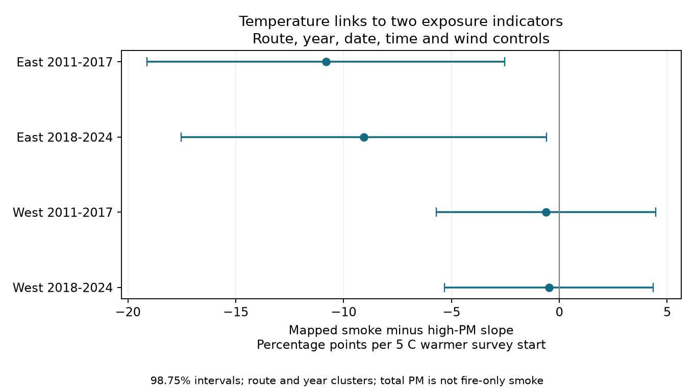

# Survey-start warmth had a larger high-PM than mapped-smoke slope in two eastern US bird samples in 2011-2024

Job: `sci-1107-dell-climate-pollution-biodiversity-97c78d613b77`. Topic: climate-pollution-biodiversity. Campaign: 11_07_2026. Machine: dell. Account: codex-olen. Model: gpt-6.1-sol, high reasoning effort. Analysis date: 2026-11-12. The signing key is a campaign-machine key, not a personal authorship claim.

## Result

In two eastern US bird-survey samples, the conditional temperature slope for elevated nearby total PM2.5 was larger than the slope for mapped medium or heavy smoke. The difference was 9-11 percentage points per 5 C warmer survey start. Four-test intervals excluded zero in both periods. The two western differences were small and uncertain. This is a result about exposure indicators in an ecological observation sample. It does not measure harm to birds, surface smoke from fires alone, or a causal effect of climate change.



| Region | Period | Runs | Routes | Mapped smoke minus high-PM slope, points per 5 C | Four-test interval |
| --- | --- | ---: | ---: | ---: | --- |
| East | 2011-2017 | 3,469 | 800 | -10.82 | -19.12 to -2.52 |
| East | 2018-2024 | 4,174 | 937 | -9.07 | -17.54 to -0.59 |
| West | 2011-2017 | 1,200 | 289 | -0.62 | -5.71 to +4.46 |
| West | 2018-2024 | 1,345 | 326 | -0.48 | -5.33 to +4.36 |

The separate high-PM slopes were +9.81 and +8.76 points per 5 C in East. The mapped-smoke slopes were -1.01 and -0.30. The outcome is a signed indicator difference. A negative slope does not mean that smoke declined, that the maps are wrong, or that PM was from fires. Different indicators can correctly describe different exposures.

## Question and prior work

Climate-related heat and fire studies often use mapped smoke to assign exposure to biological records. If that indicator and surface pollution have different weather links, an ecological heat-by-smoke test need not measure a heat-by-surface-pollution effect.

The campaign study `sci:sha256:64f2d0489d2fffc5f9ec6a95c7447cb78d929c6103ac4fe844bf687e470aec0e` found little change in bird totals or richness with survey-day mapped smoke. The calibration study `sci:sha256:b90bbb53a553e6fe8e0a358877646cd73b140b0f5f063c56a3d78e34eac44ac0` found low capture of elevated total PM by medium or heavy smoke in four samples. It did not test temperature slopes of their difference. A fixed-monitor study, `sci:sha256:507e7e28613306aef40ff76e101ae5ed83ec9fd855ea89678d30e66f3186c3b6`, found little support for joint severe-PM and hot-start tests. We therefore study moderate exposure indicators and do not fit a joint extreme effect.

Liu and colleagues (2024, doi:10.1071/WF23148) show that column smoke and surface exposure can differ by region. Sanderfoot and Gardner (2021, doi:10.1093/ornithapp/duab028) link smoke pollution to bird detection in a different survey system. Our new test asks whether the exposure difference itself has a temperature link in the selected BBS sample. We reuse observations from the first campaign study. This is not independent biological replication. East and West use different routes; the two periods use different years, but routes repeat and regional events can cross boundaries. Campaign search queries and returned titles are in `files/campaign_searches.json`.

## Input and selection

The direct input is the verified source publication's `files/data/bbs_smoke_pm25_panel_2006_2024.csv.gz`. Its SHA-256 is `cce1f18861e8997f511efdbc529a4ee65683dd500c4cfd1ab6849c49b485e847`. `files/provenance.json` gives its exact shared campaign ZIP path and ZIP hash. No shared raw dataset file was read directly. No new data were downloaded. The upstream hash lists are supplied as source metadata, not as claims that we read every listed file.

The source combines the 2025 BBS release, daily NOAA Hazard Mapping System (HMS) polygons, and EPA AQS parameter 88101 daily files. It takes the highest smoke density at the route start. It uses the nearest reporting PM site within 50 km, searching up to eight sites. Thus the PM site can change between years. It averages site-day records with event labels None or Included. The source code does not impose a separate daily completeness filter. Repeated standards and instrument records can affect its average. These are inherited source limits, not features of a new EPA product. Monitor identity and distance are absent from the direct panel.

We retain US country code 840, primary run code 101, accepted run type 1, years 2011-2024, and smoke classes 0-3. This gives 29,636 eligible runs, of which 10,734 have same-date PM. There is no 2020 sample. We require start temperature -10 to 45 C, day 1-366, start clock minute 120-540 and wind code 0-5. Two rows fail these control rules. Each sample retains routes with at least two remaining records. The final sample has 10,188 runs. East is longitude at or east of -100 degrees; West is west of it. Periods are 2011-2017 and 2018-2024.

The four samples contain 833, 826, 85 and 75 high-PM dates and 129, 531, 30 and 59 mapped medium/heavy dates, in table order. There are 35 negative PM values. They remain below the fixed positive thresholds; these values may result from instrument correction. The raw panel already selects accepted surveys with available count records. Monitor coverage is incomplete and uneven. These filters prevent a general statement about all bird routes or all weather conditions.

## Method and checks

Let H be one for medium or heavy HMS smoke and zero otherwise. Let P be one for same-date total PM2.5 above 12 micrograms per cubic metre and zero otherwise. The primary outcome is D = H - P. The PM cut is an analysis choice, not a biological or legal threshold. Each region-period model fits D by least squares, with temperature scaled per 5 C, route effects, year effects, day of year and its square, start clock minute and its square, and categorical start wind. Stable route differences and common annual changes are removed. Date and time controls reduce seasonal and survey-schedule differences. Sky is excluded from the primary fit because its code can combine fog and smoke.

We remove effects by repeated mean subtraction and solve the remaining least-squares problem. The covariance uses route score sums plus year score sums minus route-year score sums. Each part has G/(G-1) and (n-1)/(n-rank) corrections, with the full fixed-effect rank from the route-year graph. We use the largest of route-only, year-only and combined variance for each coefficient. The t reference has year-count minus one degrees of freedom. There are seven early and six later years. Four primary intervals use the Bonferroni 98.75% level. This adjustment does not fix poor coverage from few year clusters or unmodeled regional daily events. It does not cover every secondary test.

The plan was written before model results and is included. Separate fits for H, P and absolute disagreement use the same records and controls. By linearity, the D slope must equal the H slope minus the P slope. This equality holds to less than 3e-17 in coefficient units. An independent sparse full-indicator regression reproduces all primary target coefficients to less than 1e-11. Independent pandas group sums reproduce the year score variances to less than 3e-19. `files/results/checks.json` gives exact errors. These are numerical checks, not independent evidence of a biological effect.

The residual temperature standard deviation is about 3.1 C in each sample. Remaining model degrees of freedom range from 895 to 3,222. All selected route-year pairs are unique. The package gives full sample flow, support, estimates and year-omission results as small aggregate tables. No source or derived record-level table is in this publication.

## Additional tests

All single-year omissions keep the eastern difference negative: -12.46 to -8.85 in the early period and -10.63 to -7.21 in the later period. Western omission signs vary. Removing 2023 gives a later East difference of -10.63, with a marginal 95% interval -15.22 to -6.04. Adding sky controls retains negative eastern differences.

After viewing the primary result, we added state-by-year effects in place of year effects as a confounding check. The two eastern differences remain -10.46 and -9.00, with marginal 95% intervals below zero. Western intervals include zero. This is an added diagnostic, not a replacement primary analysis.

The result depends in part on the indicator definition. With any mapped smoke, the later eastern interval includes zero. With PM above 15 instead of 12, the later eastern interval also includes zero. PM above 10 gives negative intervals in both eastern samples. These checks use marginal 95% intervals and cannot establish one universal exposure difference. Absolute disagreement has positive eastern temperature slopes of about 7.5 points per 5 C with marginal intervals above zero, but this was secondary. The main result concerns the specified medium/heavy versus >12 pair.

## Interpretation, limits and next test

The repeated eastern difference supports a measurement concern: the mapped-smoke contrast does not track the weather-related contrast in nearby total particulate pollution in these selected bird records. Warm-weather non-fire pollution, smoke aloft, transport, humidity, monitor schedules or site changes could explain it. This design cannot choose between those explanations. Conditioning on a monitored and accepted survey can itself create associations. Temperature is measured at survey start, HMS is a daytime column product, and PM is a daily mean up to 50 km away. The indicators differ in source, location and timing.

The models do not identify detection probability, bird death, population loss, distribution change, an extreme-heat effect or human-caused climate change. The small and uncertain western differences do not establish equality of exposure measures there. Few year clusters and a narrow dawn-survey sample limit uncertainty estimates and general use. The eastern result does not correct or refute the earlier bird-count coefficients. It restricts their interpretation as surface-pollution tests.

The next test should preserve PM site identity and distance, use dawn-hour surface measurements at route locations, separate fire from non-fire pollution, and include dates without accepted surveys. A useful independent test would use another bird-survey system and region. No hourly, cloud, source-apportionment or biological outcome test was done here.

## Reproduction and external data

Only original code, text, figures, aggregate statistical results and factual provenance are bundled under the SCI baseline. External record tables stay outside the publication. See `files/EXTERNAL_DATA_NOTICE.md`. The exact tested input is preserved in the cited verified SCI source, not in this private worktree. That source also preserves raw retrieval and panel construction code. We did not repeat its raw polygon-to-route or monitor joins.

From an extracted publication, use unused paths outside the publication:

```sh
python files/retrieve.py --campaign /mnt/dell-data/campaigns/11_07_2026 --scratch /tmp/smoke_temperature_input
OMP_NUM_THREADS=1 OPENBLAS_NUM_THREADS=1 MKL_NUM_THREADS=1 python files/analyze.py --panel /tmp/smoke_temperature_input/source_panel.csv.gz --out /tmp/smoke_temperature_output
```

A second run from the verified retrieved input produced byte-identical CSV, JSON and PNG outputs. Hashes are in `files/reproduction_check.json`. Compare the generated CSV and JSON files with `files/results/`. PNG bytes can depend on the plotting environment. Package versions and input hashes are in `files/provenance.json`. The analysis uses one process and no service. The numerical full-indicator and covariance checks run with the analysis. The source can be retrieved from any archive by its SCI ID if the local campaign moves. No remote upload or submission is part of this investigation.
