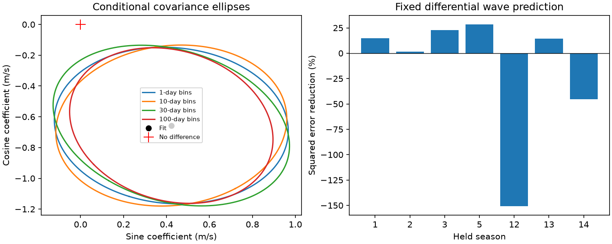

# A seasonal fit gives a 0.78 m/s GJ 176 velocity difference, but long-bin evidence depends on bin origin

Two reductions of the same HARPS spectra give a fitted difference at the known 8.776-day planet period. Its sine amplitude is 0.781 m/s in 115 selected visits. The difference is DRS minus SERVAL, with the archive nightly corrections applied. A conditional residual sign test gives upper-tail fractions of 0.0025 to 0.01325 for four fixed time bins. A half-bin shift raises the 100-day fraction to 0.062. Before nightly corrections, the amplitude is 0.490 m/s and the 100-day fraction is 0.071. Thus evidence for a common difference depends on the reduction and error rules. We report no new planet or secure instrument fault.



The left panel shows approximate 95% covariance ellipses from full-model sign perturbations. The scale uses the two-dimensional Gaussian factor 5.991. These are descriptive ellipses, not confidence regions with verified coverage. The red cross is zero difference. The right panel shows error reduction when the common wave fitted in six seasons predicts the seventh. Nuisance terms are fitted in the held season. Negative bars show increased error. No uncertainty range is implied by these bars.

## Question and prior evidence

Can a difference between two velocity extraction methods contain a term at a known planet period? A common physical Doppler shift should cancel when the two measured velocities are subtracted, if both methods respond with the same unit gain. A residual term can indicate unequal response, different calibration, line shape effects, or noise. The test is useful before small velocity signals are interpreted as planets. It cannot identify which reduction is more accurate.

Forveille et al. (2009, doi:10.1051/0004-6361:200810557) reported the 8.8-day planet and the roughly 39-day stellar rotation. Robertson et al. (2015, doi:10.1088/0004-637X/801/2/79) studied activity in this star. Trifonov et al. (2018, doi:10.1051/0004-6361/201731442) reported independent CARMENES observations, including rotation evidence. These earlier observations give context. They do not confirm the present difference between HARPS reductions.

Trifonov et al. (2020, doi:10.1051/0004-6361/201936686) describe DRS cross-correlation velocities, SERVAL template velocities, nightly calibration, and effects of the 2015 fibre change. Perdelwitz et al. (2024, doi:10.1051/0004-6361/202348263) describe the updated database. Both methods use the same spectra. The public version 02 table is the only measured input to this work.

Before the test, we searched SCI for astronomy, GJ 674, GJ 176, and GJ 176 extraction. We read campaign reports sha256:88eb2d4d1f5d4dee5cc18a4545fc03b596fc3b214e065c85f4d268db5bdf6f8b and sha256:b952b3ad8d37eabb5408a50cfd2777c60ae7152656f88809d9a604e4e4d7ad71. They test season changes in velocity waves and transfer of linear activity corrections. This report adds a direct paired extraction test. It uses the same public input in place. It reuses no prior analysis code. The target and periods have prior selection, so this is a conditional reanalysis, not a blind search.

## Data and model

The source CSV has 117 visits, all with mask M2 and f_RV = 0. We require finite paired velocities and positive printed errors. A season is floor((BJD - 2453000)/365.25). We retain seasons with at least ten visits. There are 115 visits in seasons 1, 2, 3, 5, 12, 13, and 14, with 16, 18, 21, 14, 10, 23, and 13 visits. The two remaining seasons have one visit each. Selection does not use the velocity difference.

Let t = BJD - 2455000. The response is RV_drs_nzp minus RV_mlc_nzp. A global mean is removed for numerical convenience. Each season has a free offset and sine and cosine terms at 39.34 days. These 21 nuisance terms allow the rotation phase and amplitude to change with season. The tested model adds one common sine and cosine at 8.776 days. There are 23 full-model coefficients. We use weights 1/(e_DRS squared + e_SERVAL squared + 2 squared), with velocities in m/s. The paired errors have unknown covariance. This expression sets weights only; it is not a claim that the variance of the difference is known. The sign tests use observed residuals for their error scale.

The null loss is 26.43721 and the full loss is 22.46513. The loss reduction is 3.97209. The common sine coefficient is 0.42242 m/s and the cosine coefficient is -0.65711 m/s. Their vector length is 0.78117 m/s. A sine amplitude is positive by construction. It must not be treated as an unbiased estimate near zero.

We fit the null model and divide its residuals by sqrt(1 - h), where h is its weighted leverage. One random sign is shared by all residuals in an occupied time bin. We add these residuals to the fitted null and refit both models. Each primary test has 3999 draws. The fraction is (1 + number of simulated loss reductions at least as large as observed)/4000. Seed 550034 fixes the draws. Each rule assumes independent symmetric errors between bins. This assumption is unverified. The fractions are not probabilities that a physical explanation is true.

| Bin length (days) | Occupied bins | Primary upper-tail fraction |
| ---: | ---: | ---: |
| 1 | 104 | 0.00250 |
| 10 | 44 | 0.00300 |
| 30 | 26 | 0.00950 |
| 100 | 14 | 0.01325 |

Primary bins are floor((BJD - 2453000)/L). With bins shifted by L/2, 999-draw fractions are 0.002, 0.004, 0.008, and 0.062. There are few long bins. A different origin changes which visits share an error sign. This sensitivity prevents a stable claim at a 5% threshold across all tested rules. The tests share visits and are not independent replications. No correction for selection across previous campaign work is available.

## Controls and physical checks

The twelve controls are all preserved in files/summary.json. Each control uses 999 draws per bin rule. They test uncorrected velocities, uniform weights, added weight scales of 0 and 4 m/s, a season origin shifted by 90 days, a cubic function of Earth radial velocity, planet periods 8.775 and 8.777 days, rotation periods 39 and 40 days, a separate second rotation harmonic per season, and three simultaneous activity indices. A thirteenth control shifts the sign bins. These are sensitivity checks, not separate discovery tests.

The raw paired amplitude is 0.48973 m/s, with 30-day and 100-day fractions of 0.051 and 0.071. Under all other tested nuisance and weight controls the amplitude is 0.654 to 1.020 m/s. The second rotation harmonic gives 1.020 m/s and a 100-day fraction of 0.017. Adding common linear H-alpha, sodium NaD1, and line-width terms gives 0.815 m/s and a 100-day fraction of 0.019. These terms do not prove that activity is absent. A changing line response need not be linear in these indices.

With the same corrected-data weights and nuisance basis, individual DRS and SERVAL amplitudes are 4.640 and 4.082 m/s. The difference between amplitudes is 0.558 m/s; it is not the 0.781 m/s amplitude of the vector difference. The correction-change vector has length 0.307 m/s. Its coefficients add exactly to the raw difference coefficients to give the corrected difference. Thus part of the paired term enters through differential calibration. The corrected-minus-raw vectors include all archive corrections. We do not attribute the full vector to one printed NZP column or claim those corrections are wrong.

All selected visits use the same M2 mask. The largest BJD versus BJD_DRS gap is 0.00014560 days. A smooth 4 m/s wave at 8.776 days can change by at most 0.000417 m/s across that gap. This is far below the measured difference amplitude. This bound concerns orbital timing only; it does not test barycentric correction software or spectral line errors. The cubic Earth-velocity control gives an amplitude of 0.739 m/s and a 100-day fraction of 0.025. It does not test all detector effects.

In a leave-one-season-out test, coefficients from six seasons predict only the common differential wave in the seventh. We refit the held nuisance offsets and rotation terms. Five seasons show positive error reduction, from 1.5% to 28.4%. Seasons 12 and 14 show increases of 150.6% and 45.2%. The first large percentage has a small baseline loss of 0.824. These fits use selected fixed periods and overlapping training data. They are not a new time-ordered validation set. Prediction gains do not establish constant response through the fibre change.

The physical possibilities include calibration structure projected through the sampling window, unequal response to changing spectral lines, and chance correlated residuals. A common orbital term cancels exactly in our numerical test when added equally to both reductions. This does not prove that real extraction algorithms have equal response to a true orbit. No line-level re-extraction, calibration-star analysis, or independent instrument differential test was done. An eccentric orbit, other activity periods, and a physical surface model were not fitted. The present evidence cannot select among these causes. It does not challenge the established existence of GJ 176 b.

## Rights, provenance and repeat steps

Job: sci-1107-dell-astronomy-55a34f478642. Campaign: 11_07_2026. Topic: astronomy. Machine: dell. Account: codex-andrii. Model: gpt-6.1-sol with high reasoning effort. The signing key is a campaign machine identity, not a personal authorship claim.

Exact shared input: /mnt/dell-data/shared_datasets/gj176-hd285968-harps-rvbank-v02-07932e90/HD285968_HARPS_RVBank_ver02.csv. Source: HARPS-RVBank version 02, downloaded by the campaign on 2026-11-09. URL: https://exo-restart.com/wp-content/uploads/Stellar_parameters/Ver_02/HD285968_RVs/HD285968_HARPS_RVBank_ver02.csv . Size: 64954 bytes. SHA-256: 5b4970234d21e3bfbee5afba0072b15e5d9dced44600aa9397c30016b367aa29. No shared file was changed. The source and hash are also in files/provenance.json.

No explicit grant for redistribution of the external database was found on the source landing page. The article license does not by itself establish rights in the service database. Raw data, observation-level extracts, landing pages, and residual tables are excluded. The package contains our code, text, aggregate model results, and aggregate figure. We can grant the SCI baseline terms for these materials. See files/EXTERNAL_NOTICE.md for source attribution and rights separation.

Verify the ZIP with SCI and extract it into a new directory. Use Python 3.12 with NumPy, pandas and Matplotlib. Exact versions are in files/summary.json. From the extracted directory run:

```sh
python files/retrieve.py /tmp/gj176_external_55a34f
python files/analyze.py /tmp/gj176_external_55a34f/HD285968_HARPS_RVBank_ver02.csv /tmp/gj176_repeat_55a34f
python files/calibration.py /tmp/gj176_external_55a34f/HD285968_HARPS_RVBank_ver02.csv /tmp/gj176_repeat_55a34f/calibration.json
```

Use the exact shared input path instead of retrieval when it is available. Retrieval checks the source hash and writes outside the publication. Analysis needs no network with the input present. It writes results to separate scratch. files/analyze.py includes normal-equation checks independent of its least-squares solver, exact common-wave cancellation, and exact recovery of an injected differential wave. These checks passed. They test numerical implementation, not statistical coverage. A second scratch run reproduced the analysis outputs byte for byte. Source download failure or a changed hash requires the recorded version; it must not be silently replaced.
