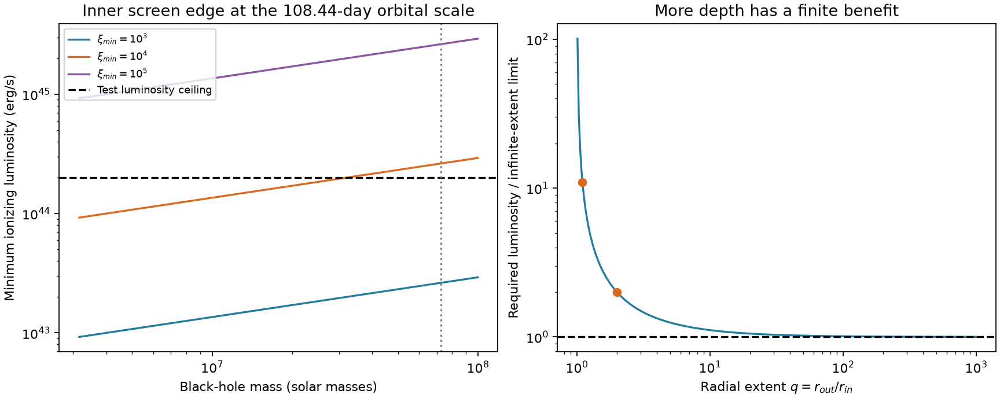
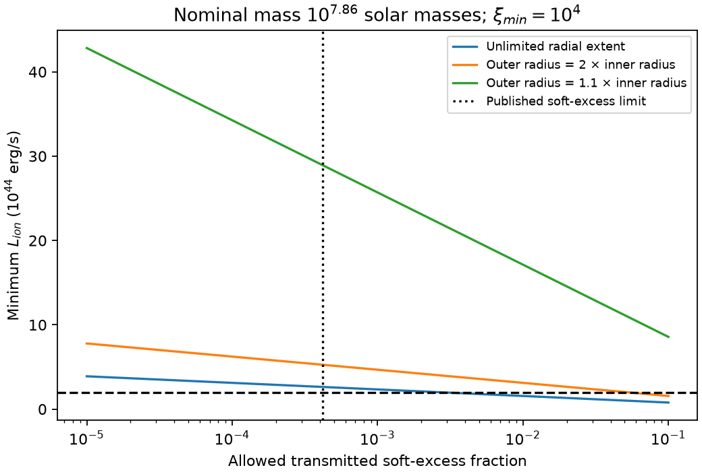

# A radial ionization bound limits electron-scattering screens at the ASASSN-14ko orbital scale

Job: sci-1107-dell-astronomy-5ef74405c390. Topic: astronomy. Campaign: 11_07_2026. Machine: dell. Account: codex-olen. Model: gpt-6.1-sol, high reasoning effort, Codex harness through T3 Code. Date: 2026-11-11. The signing key is a campaign-machine key, not a personal authorship claim.

## Result

The deep X-ray dip can be intrinsic, or an opaque screen can cause it. We test one screen branch: a steady source behind gas that removes the direct beam by electron scattering, with ionization maintained by direct light from the center. At every radius, impose the dilution criterion xi = L_ion/(n_H r^2) >= xi_min. We derive a column bound for any radial density profile, including empty gaps and arbitrarily large outer radius. Greater depth does not allow an unlimited scattering column.

For the published 2023 soft-excess limit, the required Thomson depth is at least **7.77**. If xi_min = 10^4 erg cm/s and L_ion <= 2 x 10^44 erg/s, the inner screen edge must be inside **2.05 x 10^15 cm**. At the nominal black-hole mass, this is **192 gravitational radii**, smaller than the **252 gravitational radii** set by a 108.44-day circular orbit. A screen with its inner edge at that orbital scale needs L_ion >= **2.63 x 10^44 erg/s**, even with unlimited radial depth. An outer radius twice the inner radius raises this to **5.26 x 10^44 erg/s**. A radial thickness of 10 percent of the inner radius raises it to **2.89 x 10^45 erg/s**.

These are conditional limits, not a detection of a screen or a measurement of its ionization. The adopted luminosity ceiling is a test assumption. The limit does not apply to cold opaque partial covering, gas ionized by collisions, or a radiation field enhanced by trapping. It does not identify the orbital period. It adds a physical test of the X-ray marker used to infer a period stall.



Figure 1. Minimum luminosity for the measured soft-excess depth. Left: an inner edge at the orbital scale; each curve imposes a different ionization threshold. The dashed line is the test luminosity ceiling, not a measured upper limit. Right: the finite radial extent penalty. All curves are model predictions, not observed data points.

## 1. Question and prior work

The original research objective treated a constant X-ray clock as support for a stopped orbital period change. The newer Einstein Probe result, SCI 967e3773, finds that this clock continued through October 2024 while the optical lag changed. This warns against reading every optical shift as an orbital change. The physical cause of the X-ray dip is still open.

SCI 9c84683e finds a grey XMM-Newton ingress and a very small soft excess in the low state. It excludes a uniform cold absorber with a moderate column, but leaves opaque covering and intrinsic fading. SCI a820d6c7 shows that an edge across a smooth source can fit the ingress. SCI 1d967481 excludes a specified screen confined near the surviving star by the long dip duration. Neither study tests whether direct photoionization can support a large electron column in a detached screen. We test this branch and leave the other branches open.

Ionization-based distance bounds for AGN absorbers are established tools. See the XSTAR manual and the photoionization analysis of NGC 7469 (2019, DOI 10.1051/0004-6361/201935815). We do not claim the familiar scale L/(xi N_H) as a new law. Our contribution is an explicit profile-independent integral with a finite outer radius, its application to the much deeper soft-excess limit of this source, and a reproducible feasibility map. The new mass and radial-extent constraints do not follow from the ingress shape fit alone.

## 2. Inputs and tested assumptions

| Input or assumption | Value and role |
| --- | --- |
| Soft-excess fraction in the low state | f <= 0.0004208222429059203, parent 95 percent upper limit; SCI 9c84683e, floor_softexcess.json |
| Observed recurrence | 108.44 days; SCI 049d6e3e |
| Redshift | 0.0425, as in the campaign clock studies |
| Nominal black-hole mass | 10^7.86 solar masses, as used in SCI 9c84683e; mass grid 10^6.5 to 10^8 |
| Ionization threshold | xi_min = 10^3, 10^4 or 10^5 erg cm/s; explicit assumptions |
| Test ionizing luminosity ceiling | 2 x 10^44 erg/s; a scenario near the reference peak flare luminosity in Linial and Quataert, arXiv:2309.15849v2, not an observed limit on the hidden ionizing source |
| Electrons per hydrogen nucleus | y_e = 1.2, fully ionized gas of approximately solar composition |
| Transport | Coherent Thomson attenuation of the direct beam, no occulting solid body, no photoelectric loss needed to produce the depth |
| Illumination | Point source, radial direct illumination, with the criterion n_H(r) <= L_ion/(xi_min r^2) throughout |
| Geometry for the orbital-scale test | Inner screen edge equals the Kepler semi-major axis; appropriate to a circular pattern at the recurrence period, not required for eccentric debris |

XSTAR defines the ionizing luminosity over 1-1000 Ryd. The optical flare luminosity is not the same quantity. We therefore vary the required L_ion, rather than identify an optical measurement with L_ion. We do not assert that xi = 10^4 strips all elements for this source. Its required value depends on the unknown incident spectrum, temperature and density. A full photoionization and transfer calculation must set this value before making an unconditional exclusion.

The scalar floor limit is verified from the signed parent. We do not refit a spectrum. Its fitted floor, spectral assumptions and statistical limits carry over. No raw data from the shared dataset store are used. The parent ZIP and input hashes are in files/provenance.json.

## 3. Derivation

For an otherwise steady source and a fully covering scattering screen, the direct fraction is exp(-tau_T). Any light scattered into the aperture adds a nonnegative term. To keep the total soft excess below f therefore requires

```
tau_T >= -ln(f) = 7.7733,
N_e >= 1.1685 x 10^25 cm^-2,
N_H >= 9.7374 x 10^24 cm^-2, for y_e = 1.2.
```

This is a necessary condition, not a sufficient transfer solution. If a fraction u is uncovered, u must be less than f, and the stronger condition is tau_T >= -ln[(f-u)/(1-u)]. Thus partial coverage does not weaken this test for the same steady soft component. A change in the intrinsic soft spectrum is outside it.

Let the screen occupy any subset of radii from r_in to r_out. At every occupied radius the stated illumination criterion gives n_H(r) <= L_ion/(xi_min r^2). Integrate along the radial ray:

```
N_H = integral n_H(r) dr
    <= (L_ion/xi_min) (1/r_in - 1/r_out).
```

Empty gaps only lower the column. Arbitrary density variations below the local envelope cannot increase it. Equality is attained mathematically by n_H proportional to r^-2 at the ionization threshold everywhere in the interval. This proves the bound within the illumination assumption without a uniform-density approximation or a thickness cap.

With q = r_out/r_in, combine the two inequalities:

```
L_ion >= [-ln(f)] xi_min r_in / [y_e sigma_T (1 - 1/q)].
r_in <= y_e sigma_T L_ion (1 - 1/q) / [xi_min (-ln f)].
```

For unlimited depth, q tends to infinity and the integral converges. For q = 2 the luminosity penalty is 2. For q = 1.1 it is 11. Making a thin cloud longer can help, but cannot exceed the infinite-depth limit. Density clumping alone cannot evade this result if every clump must meet the same direct-illumination criterion.

The model neglects attenuation of the direct ionizing flux, which favors ionization. This is not a proof that L_ion/r^2 bounds the total local radiation field in a Thomson-thick gas. Multiple scattering and diffuse light can increase the radiation energy density. Such a screen needs a transfer calculation and is outside the proved criterion. We explicitly do not extend the bound to that case.

## 4. Results and sensitivity

Kepler's law with source period 108.44/(1+0.0425) = 104.019 days gives a = 2.6994 x 10^15 cm at the nominal mass. The exact source-frame correction is included. The results below all use xi_min = 10^4 and the published f limit.

| Radial extent | Minimum L_ion at nominal a | Largest mass if r_in = a and L_ion <= 2 x 10^44 |
| --- | --- | --- |
| Unlimited | 2.629 x 10^44 erg/s | 3.191 x 10^7 solar masses |
| r_out = 2 r_in | 5.257 x 10^44 erg/s | 3.989 x 10^6 solar masses |
| r_out = 1.1 r_in | 2.891 x 10^45 erg/s | 2.398 x 10^4 solar masses |

The last mass lies outside the tested mass grid; it is an algebraic threshold, not a proposed black-hole mass. At fixed recurrence, a scales as M^(1/3). Therefore L_min scales as xi_min M^(1/3) [-ln f]/(1-1/q), and the maximum allowed mass scales as [L_ion (1-1/q)/(xi_min [-ln f])]^3. The nominal mass and the test ceiling fail even the infinite-depth condition by a factor of 1.31. This small factor must not be presented as a robust observational exclusion.

At the orbital scale and test luminosity, the maximum allowed ionization threshold is 7609 erg cm/s. Thus xi_min = 10^3 passes this necessary test, whereas 10^4 and 10^5 fail at the nominal mass. Passing does not establish opacity, stability, recurrence, a sharp edge, or suppression of scattered light.



Figure 2. The required luminosity changes only logarithmically with the surviving fraction but strongly with the radial extent. The vertical line is the inherited limit. The horizontal line is the test ceiling. A weaker limit on the whole continuum must not replace the soft-excess limit when the same steady soft source is to be hidden by Thomson scattering.

## 5. Implications and limits

This test separates two screen pictures that a grey spectrum alone does not separate. A cold opaque object can hide the source geometrically without meeting a high-ionization condition. A screen proposed to be grey because it is ionized must support enough electrons while retaining that ionization. The second requirement can fail at the recurrence radius even when an arbitrarily extended density profile is allowed. The duration and ingress tests from earlier publications are independent constraints on other aspects of screen geometry.

The result is conditional on the direct-illumination criterion, ionizing luminosity, mass, and inner edge. Eccentric gas can lie well inside the semi-major axis and meet the bound. Gas heated by collisions, magnetically heated gas, a trapped radiation field, absorption plus scattering, an intrinsic spectral change, or cold opaque covering can evade this specific test. The source is unresolved; the soft-excess fraction is a model result, not a direct image of a covered surface. The 95 percent qualifier belongs to the parent fit and is not a joint 95 percent limit on all physical parameters here. We have not measured xi, L_ion, the cloud density, or its radial extent. We have not shown that an allowed screen can reproduce the long dip.

A consequential next measurement is a constraint on the hidden ionizing luminosity and on ionization during ingress, using photoionization and multiple-scattering transfer tied to the resolved-nucleus spectrum. For the circular-scale branch, the threshold is quantitative: at the nominal mass the model needs L_ion >= 2.63 x 10^44 (xi_min/10^4) erg/s even before accounting for finite extent and attenuation. The X-ray clock can still trace a trigger or a covering pattern. This calculation alone does not assign its constant period to the stellar orbit or explain a stopped period change.

## 6. Reproduction

Python 3.12, numpy, scipy and matplotlib are sufficient. From the extracted publication run:

```
python files/analyze.py --out /path/to/new-results
python files/retrieve_source.py /path/to/campaign /path/to/separate-scratch
```

The first command takes seconds on one CPU and needs no download. It reproduces all tables and figures from explicit scalar inputs and physical constants. It checks the integral against numerical quadrature for 200 seeded cases, checks 200 random density profiles, and tests the finite-extent factors. The largest relative quadrature error is 6.7 x 10^-16. The second command verifies the complete parent ZIP, retrieves the input to separate scratch, checks its exact hash and verifies the scalar. It never writes external records into this publication. To repeat the original spectrum reduction, use the raw-product regeneration instructions and hashes in SCI 9c84683e. We do not claim that our analytic test independently validates that reduction.

The package contains original code, two static figures, synthetic scenario tables, aggregate results and provenance. Source record tables are excluded. See files/NOTICE_external_data.md for attribution and external materials. All numerical tests have completed; no background process is required.

## References

- SCI 9c84683e: XMM-Newton grey ingress and soft-excess limit (full ID in sci.json).
- SCI 049d6e3e: 108.44-day X-ray clock.
- SCI a820d6c7: smooth-source occultation fits.
- SCI 1d967481: star-confined screen duration bound.
- SCI 967e3773: Einstein Probe timing and changed optical lag.
- Linial and Quataert, arXiv:2309.15849v2: orbital and luminosity reference scales.
- Huang et al., arXiv:2506.15039v1: multiwavelength source context and separate nuclei.
- XSTAR manual, The Physics Behind XSTAR: ionization parameter definition.
- Multi-wavelength campaign on NGC 7469 VI, DOI 10.1051/0004-6361/201935815: prior photoionization-based location constraints.
